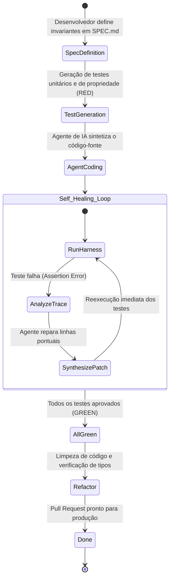

Bem-vindo à quarta parte da nossa análise técnica da série **CS146S: The Modern Software Developer da Universidade de Stanford**.

Nas aulas anteriores, exploramos a mentalidade de maestro de IA, o funcionamento interno dos modelos de linguagem e o Model Context Protocol (MCP). Na **Aula 4 (Semana 3)**, o curso enfrenta o desafio de engenharia mais urgente das equipes de tecnologia: **Como construir sistemas de software corporativos de milhares de linhas com confiabilidade, quando os LLMs inevitavelmente alucinam, introduzem regressões silenciosas e se desviam dos requisitos de produto?**

A abordagem ingênua — popularmente chamada nas redes sociais de "Vibe Coding" ou prompt conversacional desestruturado — falha de forma catastrófica em ambientes de missão crítica. Com base em experimentos de laboratório de Stanford, esta aula formaliza o **Spec-Driven Development (SDD)** e ensina a implementar um **Test Harness** automatizado com **loops de feedback autocicatrizantes (Self-Healing Loops)** usando ferramentas modernas como Claude Code e Cursor.

{/* truncate */}

---

### 1. A Falácia do "Vibe Coding": Por Que o Prompting Sem Especificação Entra em Colapso

Quando desenvolvedores confiam em interações puramente conversacionais com agentes de IA, a entropia do sistema cresce a cada interação:

```mermaid
flowchart TD
    subgraph Vibe_Coding_Entropy ["O Antipadrão: Conversational Vibe Coding"]
        V1["Prompt Vago: 'Adicione um checkout de pagamento'"] --> V2["LLM gera 300 linhas de código"]
        V2 --> V3["Desenvolvedor bate o olho rapidamente (Parece correto)"]
        V3 --> V4["Merge direto na branch principal"]
        V4 --> V5["Próximo Prompt: 'Adicione cupons de desconto'"]
        V5 --> V6["LLM sobrescreve silenciosamente a lógica de status de pagamento"]
        V6 --> V7["Regressão catastrófica em produção"]
    end

    subgraph Spec_Driven_Determinism ["Stanford CS146S: Spec-Driven Development (SDD)"]
        S1["Especificação Formal (PRD & Contrato de Interfaces)"] --> S2["Suíte de Testes Determinística (Harness)"]
        S2 --> S3["Geração de Código por IA (Claude Code / Cursor)"]
        S3 --> S4["Execução Automatizada de Testes (pytest / vitest)"]
        S4 -->|Testes Falham (Vermelho)| S5["Loop de Autocorreção com Stacktraces Reais"]
        S5 --> S3
        S4 -->|Todos os Testes Aprovados (Verde)| S6["Merge Verificado sem Regressões"]
    end
```

O "Vibe Coding" fracassa porque o modelo de linguagem esquece restrições anteriores ao longo da conversa (*Attention Dilution*) e não existe nenhuma autoridade determinística que valide o comportamento do código.

---

### 2. O Test Harness Fechado: O Ciclo Red-Green-Refactor para Agentes de IA

No Spec-Driven Development, o Test Harness funciona como uma barreira matemática inegociável:



#### As Três Regras de Ouro do Harness Engineering:
1. **Escreva os Testes Primeiro**: Os critérios de aceitação devem estar formalizados antes que o agente gere a primeira linha de implementação.
2. **Arquivos de Teste Imutáveis**: O agente tem permissão para alterar apenas arquivos de implementação — nunca a suíte de testes (*Prevenção de Adulteração de Testes*).
3. **Feedback Determinístico**: O agente consome códigos de saída padronizados da CLI (0 = Sucesso; diferente de 0 = Falha detalhada com números de linha).

---

### 3. Fluxos de Trabalho Práticos com Claude Code & Cursor

Nas sessões práticas de Stanford, os estudantes implementaram microserviços com Claude Code sob estrita governança SDD:
- **Arquivo de Regras `CLAUDE.md`**: Define comandos de build, execução de testes e diretrizes arquiteturais.
- **Execução em Subprocesso**: O Claude Code executa `pytest tests/test_payment.py` localmente no terminal.
- **Reparação Iterativa**: Se houver falha, o agente lê a mensagem de erro, diagnostica a raiz do problema e ajusta os arquivos necessários.

---

### 📌 Resumo Executivo para Gestão (3–5 Linhas)
1. **Fim do Vibe Coding**: Prompts conversacionais soltos geram entropia acelerada e regressões silenciosas no código.
2. **Spec-Driven Development (SDD)**: Especificações formais e suítes de testes determinísticas são os alicerces indispensáveis da IA confiável.
3. **Loops Autocicatrizantes**: Ciclos fechados (teste $
ightarrow$ diagnóstico $
ightarrow$ patch atômico) permitem que agentes corrijam bugs de forma autônoma.
4. **Imutabilidade dos Testes**: O agente jamais deve ter permissão para modificar os testes a fim de forçar aprovação artificial.

### Referências
- **Playlist Oficial do Curso**: [Stanford CS146S: The Modern Software Development (YouTube Playlist)](https://www.youtube.com/playlist?list=PLxpwjSdVZQ95OWe3QvkVEcU1f1X-6NDj9)