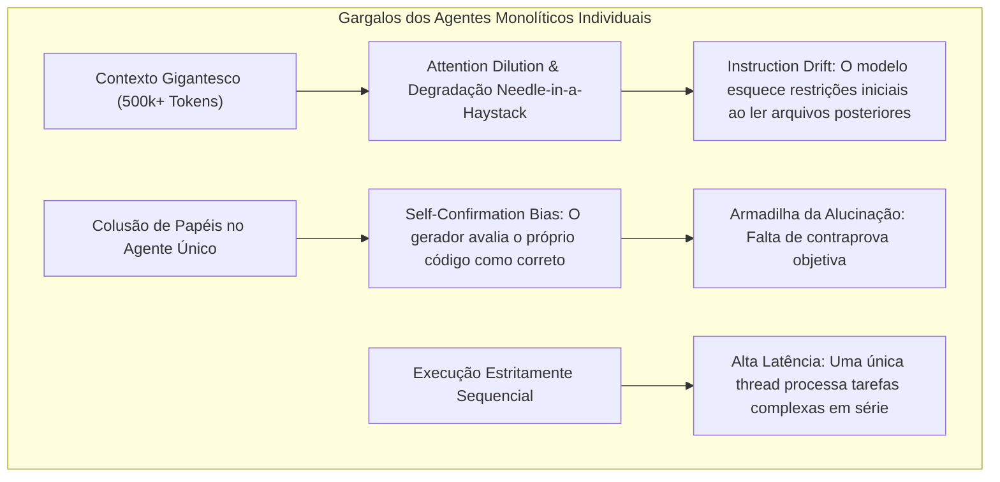
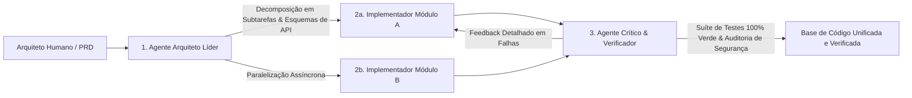

Bem-vindo à Aula 5 da nossa análise técnica da série **CS146S: The Modern Software Developer da Universidade de Stanford**.

Nas aulas anteriores, exploramos engenharia de prompt, mecanismos de transformadores, o protocolo MCP e test harnesses autocicatrizantes. Todos esses modelos compartilhavam uma premissa básica: **uma única sessão primária de LLM** interagindo com um desenvolvedor ou repositório.

Contudo, quando um projeto de software ultrapassa milhares de linhas de código e dezenas de microserviços, essa abordagem monolítica desmorona. Agentes individuais sofrem de **saturação de contexto, dispersão de atenção (*Attention Dilution*) e bloqueio cognitivo**.

Nesta aula, os professores de Stanford apresentam a fronteira da engenharia nativa de IA: **Sistemas Multiagente (MAS) e Orquestração de Enxames (Swarm Orchestration)**. Verificamos como a divisão funcional entre **Arquitetos, Implementadores e Críticos**, operando sobre grafos acíclicos dirigidos (DAGs) e barramentos de mensagens estruturados, multiplica a precisão e a escalabilidade dos projetos.

{/* truncate */}

---

### 1. Os Limites de Escala de Agentes Monolíticos

Por que não podemos simplesmente despejar um repositório corporativo de 500.000 linhas em uma janela de contexto de 1 milhão de tokens e pedir para a IA *"refatorar todo o pipeline de pagamentos"*?

Pesquisadores de Stanford identificam três gargalos fundamentais:

---

### 2. O Padrão Arquiteto-Implementador-Crítico (AIC)

A solução apresentada no Stanford CS146S é a separação funcional em três papéis complementares de agentes:

1. **Lead Architect Agent**: Analisa o PRD, decompõe o problema em um Grafo Acíclico Dirigido (DAG) de tarefas e define contratos de interface estritos.
2. **Implementer Agents**: Múltiplas instâncias autônomas que implementam módulos individuais concorrentemente.
3. **Critic & Verifier Agent**: Executa auditorias determinísticas de segurança, linters e testes de integração. Como o crítico não escreveu o código, ele está 100% livre do *Viés de Autoconfirmação*.

---

### 3. Orquestração Assíncrona via DAG & Memória Compartilhada

Para que dezenas de agentes colaborem sem bloqueios concorrentes, o sistema adota payloads estruturados em JSON e um quadro-negro centralizado de contexto compartilhado (Shared Blackboard Memory).

---

### 📌 Resumo Executivo para Gestão (3–5 Linhas)
1. **Limites Monolíticos**: Agentes de contexto único sofrem de dispersão de atenção e viés de autoconfirmação em grandes bases de código.
2. **Padrão Arquiteto-Implementador-Crítico**: A divisão de papéis permite desenvolvimento paralelo com auditoria independente de qualidade.
3. **Fluxos em DAG**: Grafos assíncronos evitam bloqueios mútuos e escalam radicalmente a velocidade de entrega.
4. **Contratos Estruturados**: Esquemas estritos em JSON entre agentes garantem determinismo e integridade sistêmica.

### Referências
- **Playlist Oficial do Curso**: [Stanford CS146S: The Modern Software Development (YouTube Playlist)](https://www.youtube.com/playlist?list=PLxpwjSdVZQ95OWe3QvkVEcU1f1X-6NDj9)
