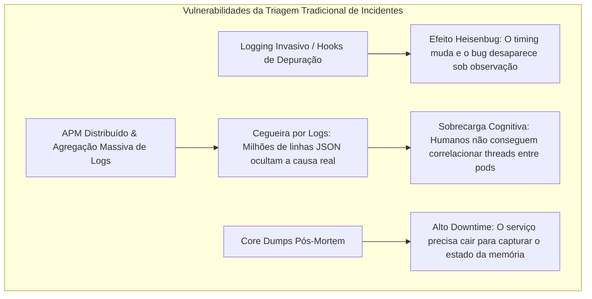
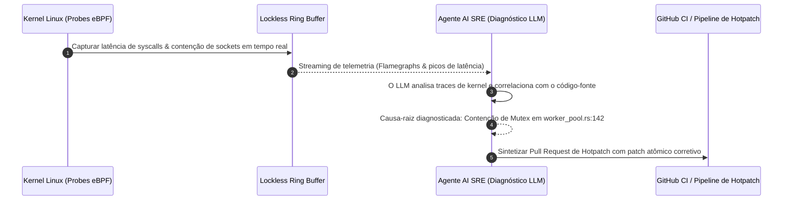

Bem-vindo à Aula 6 da nossa análise técnica da série **CS146S: The Modern Software Developer da Universidade de Stanford**.

Na aula anterior, estudamos a orquestração de enxames multiagente para construção de bases de código modulares. Porém, mesmo o software mais rigorosamente testado em laboratório encontra a realidade implacável dos ambientes de produção.

Às 3 da manhã, quando um deadlock obscuro de concorrência congela um cluster distribuído de processamento ou uma consulta sem índice faz a latência disparar para 12 segundos, as abordagens convencionais de depuração fracassam. Análises estáticas não capturam condições dinâmicas de corrida, injeções invasivas de logs alteram a cronologia dos eventos (*Efeito Heisenbug*), e plataformas de APM afogam os engenheiros de confiabilidade (SREs) em gigabytes de ruído.

Nesta aula, os professores de Stanford apresentam o estado da arte da resiliência operacional: **Depuração Guiada por IA & Perfilamento em Tempo de Execução**. Conectando programas **eBPF (extended Berkeley Packet Filters)** a **agentes de diagnóstico SRE baseados em LLMs**, engenheiros capturam telemetria de kernel com custo próximo a zero, identificam a causa-raiz em segundos e geram hotpatches verificados de forma autônoma.

{/* truncate */}

---

### 1. O Dilema da Depuração Tradicional em Produção

Ao enfrentar interrupções em microserviços de alto rendimento, os engenheiros lidam com três paradoxos:

---

### 2. A Solução: Observabilidade de Kernel via eBPF + Diagnóstico por IA

O eBPF permite executar programas seguros de bytecode diretamente no espaço de kernel do Linux sem recompilar o kernel nem carregar módulos perigosos. Dessa forma, chamadas de sistema (syscalls), sockets de rede e kprobes são monitorados com overhead imperceptível.

---

### 📌 Resumo Executivo para Gestão (3–5 Linhas)
1. **Limites do Debugging Convencional**: Logs invasivos alteram o tempo das condições de corrida (Heisenbugs) e ferramentas de APM inundam equipes com ruído.
2. **Precisão com eBPF**: Rastreamento em nível de kernel intercepta chamadas de sistema com overhead próximo a zero e sem alterar o código da aplicação.
3. **Diagnóstico Automatizado**: Agentes LLM SRE analisam buffers de telemetria e localizam o ponto exato da falha na base de código.
4. **Resolução em Minutos**: Da análise de traces à síntese de um hotpatch validado por testes, o tempo de restauração (MTTR) cai drasticamente.

### Referências
- **Playlist Oficial do Curso**: [Stanford CS146S: The Modern Software Development (YouTube Playlist)](https://www.youtube.com/playlist?list=PLxpwjSdVZQ95OWe3QvkVEcU1f1X-6NDj9)
