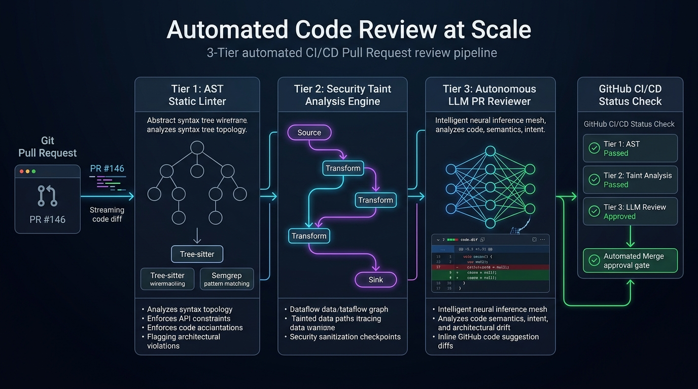
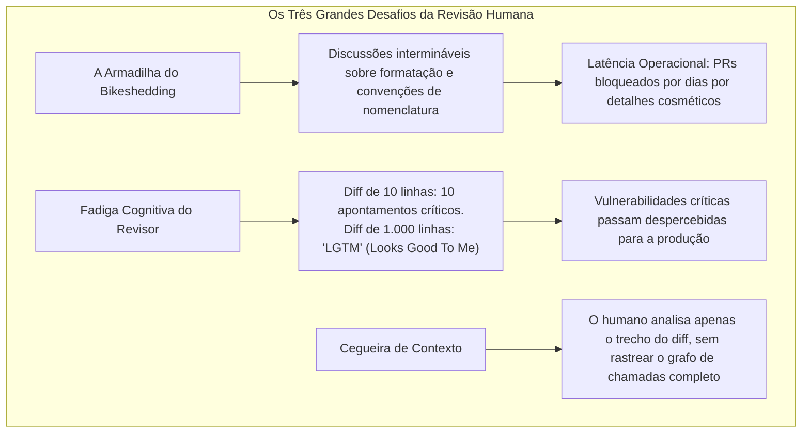
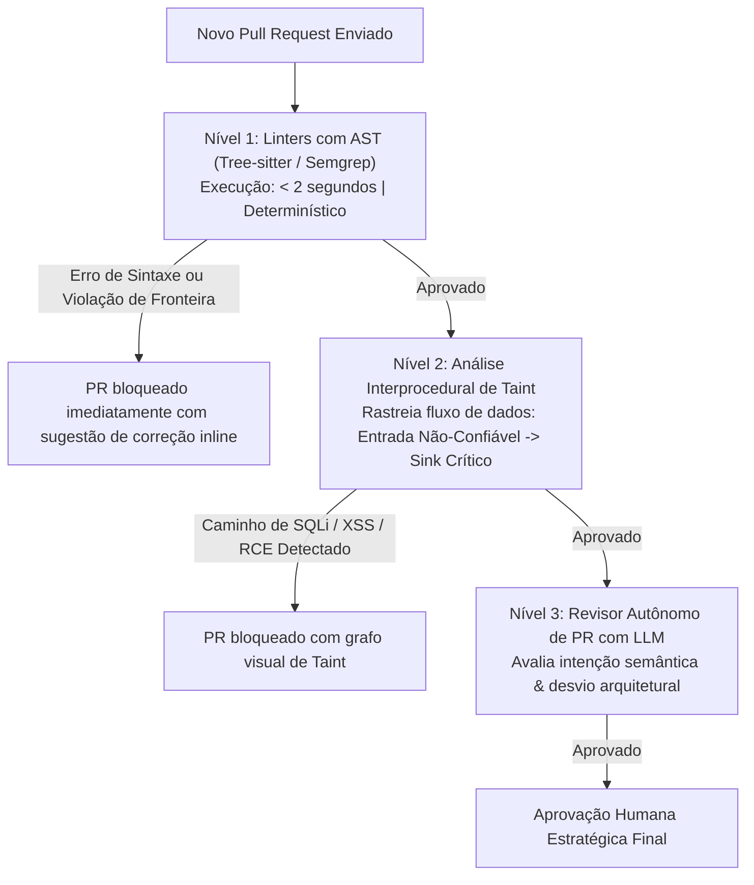

Bem-vindo à Aula 7 da nossa análise técnica da série **CS146S: The Modern Software Developer da Universidade de Stanford**.

Na aula anterior, analisamos a resolução de incidentes em produção com eBPF e agentes de IA. Contudo, qualquer líder técnico sênior sabe: o bug mais barato e seguro é **aquele que nunca chega a ser mesclado na branch principal**.

Em organizações de tecnologia modernas, a revisão de código em Pull Requests (PR Review) é o guardião central da qualidade, integridade arquitetural e segurança. Porém, à medida que os times crescem, a revisão humana converte-se em um gargalo operacional massivo. Engenheiros seniores perdem de 15 a 20 horas semanais analisando diffs, debatem detalhes cosméticos irrelevantes (*Bikeshedding*) e, exaustos diante de PRs com mais de mil linhas (*Review Fatigue*), deixam passar condições de corrida sutis ou injeções SQL.

Nesta aula, os professores de Stanford apresentam a arquitetura de **Revisão Automatizada de Código em Escala**. Através de uma hierarquia em três níveis composta por **Linters com AST (Tree-sitter, Semgrep)**, **Análise Estática de Taint** e **Revisores Autônomos de PR com LLMs**, as equipes eliminam 90% do trabalho mecânico de revisão e bloqueiam vulnerabilidades com determinismo absoluto.

{/* truncate */}

---

### 1. A Crise da Revisão de Código Manual

Por que o modelo tradicional de revisão humana falha ao escalar?

---

### 2. A Hierarquia Automatizada de Revisão em Três Camadas

Stanford propõe uma linha de defesa estruturada:

1. **Nível 1 (Linters com AST)**: Inspeciona a árvore sintática abstrata em milissegundos, bloqueando APIs inseguras e violações de fronteiras modulares.
2. **Nível 2 (Análise de Taint)**: Rastreia se entradas de usuários não validadas alcançam pontos sensíveis de execução (como comandos SQL ou funções de shell).
3. **Nível 3 (Revisor com LLM)**: Avalia a coerência semântica do código, conformidade com os contratos de interface e surgimento de débitos de arquitetura.

---

### 📌 Resumo Executivo para Gestão (3–5 Linhas)
1. **Automação Contra a Fadiga**: Revisões manuais colapsam diante de grandes diffs devido ao esgotamento cognitivo e debates cosméticos.
2. **Defesa em Três Níveis**: Linters com AST cuidam da sintaxe, análise de taint garante segurança de dados e LLMs avaliam integridade arquitetural.
3. **Queda Drástica de Latência**: 90% do trabalho repetitivo de revisão é resolvido instantaneamente no pipeline de CI.
4. **Foco no Que Importa**: Engenheiros seniores concentram-se exclusivamente em decisões estratégicas de design de sistemas.

### Referências
- **Playlist Oficial do Curso**: [Stanford CS146S: The Modern Software Development (YouTube Playlist)](https://www.youtube.com/playlist?list=PLxpwjSdVZQ95OWe3QvkVEcU1f1X-6NDj9)