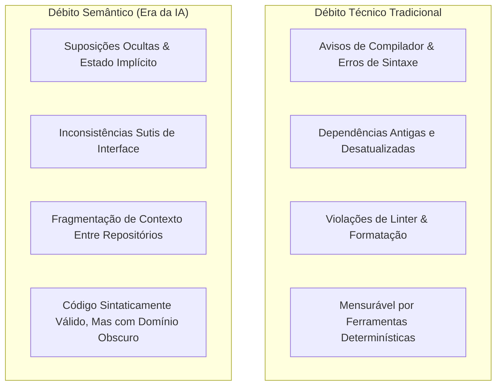
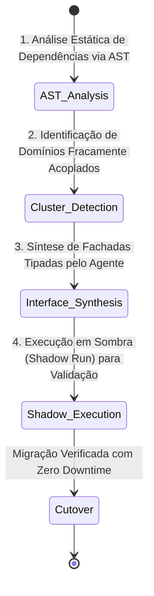

Bem-vindo à oitava parte da nossa análise técnica da série **CS146S: The Modern Software Developer da Universidade de Stanford**.

Nas sessões anteriores, exploramos engenharia de prompt (Aula 2), ferramentas MCP (Aula 3), test harnesses autocicatrizantes (Aula 4), enxames multiagente (Aula 5), tracing de kernel com eBPF (Aula 6) e revisão automatizada de PRs (Aula 7).

Na **Aula 8**, o currículo foca nas implicações sistêmicas de longo prazo do uso de agentes de IA: **Como projetar arquiteturas de software que agentes de IA consigam navegar, compreender e modificar sem sucumbir à complexidade crescente? E como utilizar agentes para decompor com segurança grandes monólitos legados?**

As arquiteturas tradicionais de software — caracterizadas por estado mutável global, dependências cíclicas e monólitos com centenas de milhares de linhas — sobrecarregam a capacidade de raciocínio lógico dos modelos. Nesta aula, os professores de Stanford formalizam o conceito de **Débito Semântico (*Semantic Debt*)**, estabelecem os mandamentos da **Arquitetura Nativa de IA** e fornecem um guia prático para **Decomposição de Monólitos baseada em AST**.

{/* truncate */}

---

### 1. O Paradoxo da Velocidade: Débito Técnico vs. Débito Semântico

Métricas clássicas de engenharia medem o **débito técnico**: bibliotecas desatualizadas, queries lentas sem índice, cobertura de testes insuficiente. Compiladores e linters estáticos conseguem detectar esses problemas de forma determinística.

No entanto, quando agentes de IA geram código em ritmo acelerado, surge uma ameaça muito mais insidiosa: o **Débito Semântico (*Semantic Debt*)**.

O débito semântico ocorre quando o código compila perfeitamente sem erros e passa em todos os testes unitários, mas a intenção conceitual do sistema tornou-se tão fragmentada que nenhum modelo de IA consegue mais assimilar a visão global da arquitetura.

---

### 2. Princípios da Arquitetura de Software Nativa de IA

Para manter bases de código gerenciáveis por agentes autônomos, Stanford propõe quatro diretrizes:

1. **Arquitetura Hexagonal Rígida (Ports & Adapters)**: A lógica de negócio deve ser 100% isolada de frameworks, bancos de dados e APIs externas. Um agente precisa ser capaz de testar a regra de negócio central sem precisar subir um banco real.
2. **Orçamento Explícito de Contexto**: Módulos e pacotes devem ter tamanho contido para que suas interfaces e definições de tipos caibam em 25% da janela de contexto do LLM.
3. **Contratos Determinísticos de Interface**: Proibido usar dicionários genéricos ou JSON solto como parâmetros de funções. Cada interface deve ser formalizada com esquemas estáticos (Pydantic, Zod, Protobuf).
4. **Grafos de Dependência Sem Ciclos**: Dependências circulares geram loops infinitos de refatoração para os agentes.

---

### 3. Decomposição de Monólitos Baseada em AST

A migração segura de monólitos para serviços modulares ocorre em quatro fases:

---

### 📌 Resumo Executivo para Gestão (3–5 Linhas)
1. **Identificação do Débito Semântico**: O risco central na era da IA não é código com erros de sintaxe, mas código sintaticamente perfeito cuja lógica conceitual está fragmentada.
2. **Arquitetura Nativa de IA**: Modularidade estrita, esquemas tipados inegociáveis e ausência de dependências cíclicas são requisitos indispensáveis.
3. **Decomposição com AST**: Grafos de sintaxe abstrata permitem aos agentes delimitar fronteiras de domínio e sintetizar fachadas com precisão.
4. **Execução em Sombra**: A validação em sombra (Shadow Run) garante equivalência comportamental exata antes da virada definitiva em produção.

### Referências
- **Playlist Oficial do Curso**: [Stanford CS146S: The Modern Software Development (YouTube Playlist)](https://www.youtube.com/playlist?list=PLxpwjSdVZQ95OWe3QvkVEcU1f1X-6NDj9)
