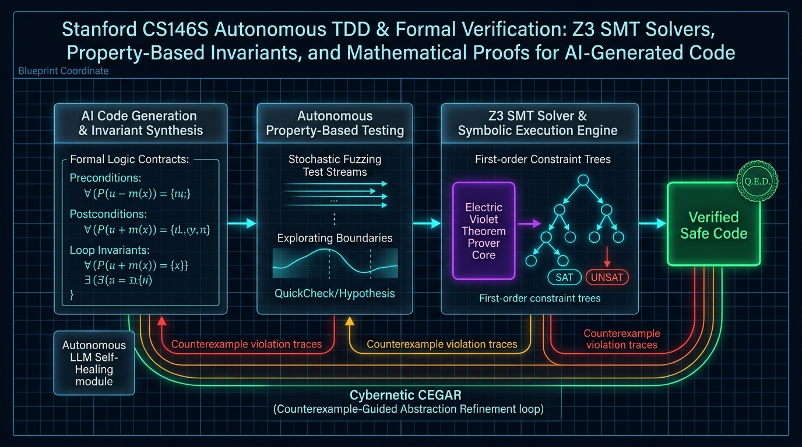

Bem-vindo à nona parte da nossa análise técnica da série **CS146S: The Modern Software Developer da Universidade de Stanford**.

Nas aulas anteriores, estudamos engenharia de prompt, MCP, enxames multiagente, eBPF e arquiteturas nativas de IA. Na **Aula 9**, o currículo de Stanford enfrenta o maior dilema da computação contemporânea: **Como equipes de engenharia podem confiar em modelos de linguagem probabilísticos e não-determinísticos ao construir códigos de missão crítica para finanças, aeroespacial, criptografia e infraestrutura distribuída?**

Como Edsger Dijkstra afirmou há mais de meio século: *“Testes de programas podem demonstrar a presença de erros, mas nunca sua ausência!”* Nesta aula, pesquisadores de Stanford demonstram a transição indispensável de testes pontuais para o **Property-Based Testing (PBT) Autônomo**, a **Execução Simbólica** e a **Verificação Formal com o Solver Z3 SMT**.

{/* truncate */}

---

### 1. Os Limites dos Testes Unitários Baseados em Exemplos

Em testes unitários tradicionais, o desenvolvedor valida apenas alguns valores arbitrários:

```python
def test_calculate_fee():
    assert calculate_fee(100) == 5
    assert calculate_fee(0) == 0
```

Quando um agente de IA gera código para passar nesses testes, frequentemente ocorre o **Overfitting de Testes**:
- O agente sintetiza uma lógica que satisfaz especificamente essas 2 entradas, mas falha catastróficamente com números negativos, overflow de inteiros ou valores extremos.

---

### 2. Property-Based Testing (PBT) com Hypothesis

Em vez de testar números estáticos, o engenheiro formaliza **invariantes matemáticos universais**:

```text
Para toda entrada x pertencente ao Domínio de Entradas:
    Propriedade(f(x)) == Verdadeiro
```

```python
from hypothesis import given, strategies as st

@given(st.integers(min_value=0, max_value=1_000_000))
def test_fee_always_less_than_amount(amount):
    fee = calculate_fee(amount)
    assert 0 <= fee <= amount
```

O framework gera milhares de casos estocásticos de borda, localiza o menor contraexemplo possível (*Shrinking*) e força o agente de IA a implementar a lógica matemática correta e robusta.

---

### 3. Verificação Formal com o Solver Z3 SMT

O patamar máximo de garantia é a prova matemática formal através de solvers SMT (Satisfiability Modulo Theories):

```python
from z3 import Int, Solver, sat, unsat

# Verificação formal de invariantes de saldo
balance = Int('balance')
withdrawal = Int('withdrawal')
s = Solver()

# Pós-condição: Saldo nunca pode se tornar negativo
new_balance = balance - withdrawal
s.add(balance >= 0)
s.add(withdrawal > 0)
s.add(new_balance < 0) # Busca ativamente por um contraexemplo

if s.check() == unsat:
    print("Matematicamente Provado: Invariante válida para todas as entradas possíveis!")
else:
    print("Contraexemplo encontrado:", s.model())
```

Se o solver Z3 retornar `unsat` (insatisfatível), está matematicamente provado que, sob as pré-condições estabelecidas, **nenhum estado inválido de sistema jamais poderá ocorrer** — não importa se o sistema processar bilhões de transações.

---

### 📌 Resumo Executivo para Gestão (3–5 Linhas)
1. **Limites de Testes Simples**: Testes baseados em exemplos pontuais geram overfitting em agentes de IA e ignoram casos críticos de borda.
2. **Invariantes por PBT**: O teste baseado em propriedades valida leis fundamentais do sistema sob milhares de cenários estocásticos extremos.
3. **Provas Matemáticas com Z3**: Solvers SMT oferecem garantia matemática absoluta da correção algorítmica.
4. **Loop CEGAR de Autocura**: Contraexemplos gerados pelos solvers são devolvidos ao agente como especificações determinísticas para correção imediata do código.

### Referências
- **Playlist Oficial do Curso**: [Stanford CS146S: The Modern Software Development (YouTube Playlist)](https://www.youtube.com/playlist?list=PLxpwjSdVZQ95OWe3QvkVEcU1f1X-6NDj9)