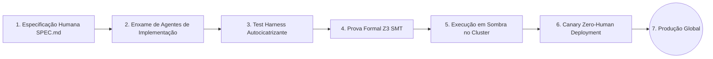

Bem-vindo à aula final e síntese da série **CS146S: The Modern Software Developer da Universidade de Stanford**.

Ao longo de dez semanas intensivas, este currículo desconstruiu cinco décadas de premissas sobre programação tradicional. Do surgimento da Engenharia Humano-Agente (Aula 1) e da física interna de Coding LLMs (Aula 2) ao protocolo MCP (Aula 3), harnesses autocicatrizantes (Aula 4), orquestração de enxames (Aula 5), observabilidade de kernel via eBPF (Aula 6), revisão automatizada de código em escala (Aula 7), arquiteturas nativas de IA (Aula 8) e verificação formal com solvers Z3 SMT (Aula 9).

Na **Aula 10**, os professores de Stanford unem todos esses fios conceituais em uma visão integrada do futuro da computação: **A Fábrica de Software Autônoma**. Analisamos a transição para pipelines de **Zero-Human Continuous Deployment**, a coordenação de **frotas globais de IA** e a consolidação do papel do engenheiro humano como **Maestro e Arquiteto de Sistemas**.

{/* truncate */}

---

### 1. A Fábrica de Software Autônoma: O Pipeline Zero-Human Deployment

No modelo maduro de engenharia de software nativo de IA, nenhuma linha de código em produção precisa ser digitada manualmente por humanos. O fluxo opera de forma contínua e autônoma:

1. **Especificação & Invariantes**: O arquiteto humano elabora a especificação de produto e define as restrições inegociáveis.
2. **Síntese Concorrente por Enxames**: Dezenas de agentes especializados escrevem código e testes em paralelo.
3. **Validação Determinística**: O test harness fecha o ciclo de autocura eliminando regressões.
4. **Verificação Matemática Formal**: Algoritmos de missão crítica são provados via lógica simbólica.
5. **Execução em Sombra & Canary Deployment**: O novo código roda em paralelo com tráfego real sem impacto aos usuários até atingir 100% de estabilidade.

---

### 2. Gestão e Governança de Frotas de IA em Escala

À medida que centenas de agentes de IA trabalham simultaneamente na mesma base de código, as organizações exigem ferramentas rigorosas de governança:

- **Controle Orçamentário de Tokens**: Monitoramento em tempo real do custo por feature desenvolvida.
- **Trilhas de Auditoria Determinísticas**: Registro imutável de todas as chamadas de ferramentas e decisões lógicas dos agentes.
- **Guardrails de Segurança Invioláveis**: Bloqueio criptográfico de acesso a chaves mestras e bancos de produção não autorizados.

---

### 📌 Resumo Executivo para Gestão (3–5 Linhas)
1. **A Fábrica Autônoma de Software**: A integração de SDD, enxames de agentes e verificação formal viabiliza pipelines contínuos de desenvolvimento sem toque manual.
2. **Pipelines Zero-Human**: A entrega contínua com validação em sombra e canários automatizados reduz o ciclo de entrega de semanas para minutos.
3. **Governança de Frotas de IA**: A liderança técnica foca na gestão de políticas, limites orçamentários de tokens e barreiras inegociáveis de segurança.
4. **O Engenheiro como Maestro**: O valor do profissional de tecnologia agora reside na formulação de problemas complexos, rigor arquitetural e supervisão estratégica de sistemas.

### Referências
- **Playlist Oficial do Curso**: [Stanford CS146S: The Modern Software Development (YouTube Playlist)](https://www.youtube.com/playlist?list=PLxpwjSdVZQ95OWe3QvkVEcU1f1X-6NDj9)
- **Departamento**: Universidade de Stanford, Departamento de Ciência da Computação