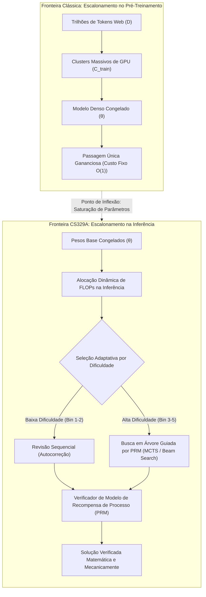
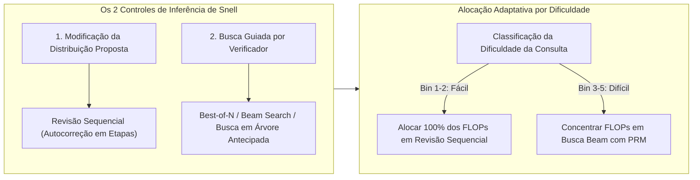

Boas-vindas ao segundo capítulo de nossa análise técnica sobre o curso de pós-graduação da **Universidade de Stanford, CS329A: Self-Improving AI Agents (Agentes de IA com Autoaperfeiçoamento, Outono de 2025)**.

Em nossa aula inaugural, mapeamos a transição macroeconômica dos preditores autorregressivos de próximo token para laços agênticos autônomos com retroalimentação do ambiente. Hoje, exploramos o alicerce computacional indispensável a essa autonomia: **o Escalonamento de Computação em Tempo de Inferência (Test-Time Compute Scaling / Inference-Time Scaling)**.

Por mais de meia década, a doutrina hegemônica da indústria foi ditada pelas leis de escalonamento do pré-treinamento (Kaplan et al., Chinchilla): *erguer clusters colossais de GPUs, expandir a contagem de parâmetros N e processar dezenas de trilhões de tokens web*. No entanto, com os pesos θ congelados, o que ocorre quando nos recusamos a aceitar uma resposta sôfrega (greedy) gerada em 50 milissegundos? E se um agente investir **10 segundos, 1 minuto ou 10 minutos para explorar deliberadamente árvores de raciocínio, verificar passos intermediários e revisar suas hipóteses**?

Com base nas evidências empíricas de *Large Language Monkeys* (Brown et al., 2024), no estudo *Compute-Optimal Scaling* de Snell et al. (Stanford/UC Berkeley, 2024) e no framework de arquitetura modular *Archon*, formalizamos como a alocação de FLOPs de inferência em substituição à mera escala de parâmetros redefine a inteligência artificial moderna.



{/* truncate */}

---

### 1. Escalonamento Clássico vs Computação na Inferência: A Mudança de Paradigma

O aprendizado profundo moderno foi edificado sobre a constatação empírica de que a perda de validação decai como uma lei de potência (power law) em relação ao custo computacional de treinamento:

```text
L(N, D) = E + A / N^α + B / D^β
```

onde N é a contagem de parâmetros sem embeddings e D é o volume do conjunto de treinamento em tokens. Todavia, essa formulação tradicional trata o custo de inferência como uma constante estática: exatamente 2 FLOPs por parâmetro para cada token decodificado autorregressivamente.

#### Os Limites Físicos da Expansão do Pré-Treinamento
Ao expandir os modelos além de 10^26 FLOPs (classe GPT-4), o pré-treinamento deparou-se com três barreiras severas:
1. **O Esgotamento dos Dados Web Naturais:** O volume de texto humano de alta qualidade na internet é finito (~10^14 tokens). A geração contínua de dados sintéticos sem verificadores confiáveis precipita o colapso do modelo (Model Collapse) e degradação entrópica.
2. **Custo Exponencialmente Ascendente:** Melhorar a acurácia de um benchmark em apenas 1% na cauda aplainada de uma curva de potência requer decuplicar os FLOPs de pré-treinamento, totalizando centenas de milhões de dólares em investimentos (CAPEX).
3. **A Falácia da Passagem Única Estática:** Quer o modelo possua 7B ou 1T de parâmetros, a decodificação autorregressiva tradicional emite cada token t_i por meio de um número fixo de multiplicações matriciais:

```text
t_i ~ Softmax( W_u · LayerNorm( h_L(t_{1:i-1}) ) )
```

Demonstrações matemáticas formais e correção de bugs complexos espalhados por dezenas de arquivos de código exigem retrocesso (backtracking), especulação de hipóteses e validação em etapas que uma passagem puramente linear é incapaz de fornecer.

---

### 2. O Retorno do Teorema do Macaco Infinito: Large Language Monkeys

Na teoria clássica das probabilidades, o *Teorema do Macaco Infinito* de Émile Borel postula que um macaco teclando aleatoriamente numa máquina de escrever por um tempo infinito certamente reproduzirá as obras completas de William Shakespeare.

No final de 2024, pesquisadores da UC Berkeley e do Google Research colocaram essa premissa à prova em LLMs de fronteira: **《Large Language Monkeys: Scaling Inference Compute with Repeated Sampling》** (Brown et al., 2024).

```
Cobertura (Pass@k %)
 ▲
100│                                     ┌────────────── Limite Superior de Cobertura Pass@k
 90│                                ┌────┘ (Atinge 99% em MATH e CodeContests)
 80│                           ┌────┘
 70│                      ┌────┘
 60│                 ┌────┘ ◄── SWE-bench Lite: DeepSeek-Coder-V2 (k=250 -> 56.0%)
 50│            ┌────┘
 40│       ┌────┘   ◄── Claude 3.5 Sonnet Execução Única (43.0%)
 30│  ┌────┘
 20│ ┌┘
 10│┌┘  ◄── Gemma-2B Pass@1 (0.02%)
  0└┴──────┬──────────┬──────────┬──────────┬──────────►
    k=1    k=10       k=100      k=1,000    k=10,000   (Número de Amostras k)
```

#### Formulação Matemática do Estimador Não Enviesado pass@k
Ao amostrar N soluções candidatas independentes, com exatamente C delas passando por um sistema de verificação automatizado (testes unitários), o estimador não enviesado de variância mínima (MVUE) para pass@k é definido por:

```text
Pass@k = (1 / P) · ∑_{i=1}^P [ 1 - C(N - C_i, k) / C(N, k) ]
```

onde P representa o conjunto total de problemas, C_i a quantidade de respostas corretas para o problema i, e C(n, r) o coeficiente binomial. Para evitar estouro numérico com N = 10.000, ambientes em produção empregam este laço multiplicativo numericamente estável:

```text
Pass@k = 1 - ∏_{j=0}^{k-1} ( 1 - C_i / (N - j) )
```

#### Rupturas Empíricas: Modelos Compactos Desbancam Gigantes
A amostragem repetida na inferência redefiniu a avaliação de modelos:
* **SWE-bench Lite (Resolução de Bugs Reais no GitHub):**
  * O modelo de código aberto `DeepSeek-Coder-V2-Instruct` obteve com k=1 uma taxa modesta de **15,9%**.
  * Ao estender a amostragem para k=250 amostras, o pass@250 saltou para **56,0%**.
  * Esse índice superou o ensemble de GPT-4o e Claude 3.5 Sonnet (43,0%) por **13 pontos percentuais**.
* **CodeContests (Programação Competitiva Extrema):**
  * O modelo ultraleve `Gemma-2B` tinha pass@1 de apenas **0,02%** (praticamente zero).
  * Ao ser escalado para k=10.000, seu pass@10.000 subiu para **7,1%**, um ganho de **355x** obtido puramente por amostragem na inferência.
* **Inversão Financeira:**
  * Atingir 29,62% no SWE-bench com o DeepSeek-Coder-V2 (k=5) custou **$10.80**.
  * Por outro lado, executar uma única vez o GPT-4o (24,0%) custou **$39.00 (3,6x mais caro)**, e o Claude 3.5 Sonnet (26,7%) custou **$51.00 (4,7x mais caro)**.

```text
┌───────────────────────────────┬──────────┬────────────┬─────────────┐
│ Modelo e Estratégia           │ SWE-bench│ Custo ($)  │ Multiplicador│
├───────────────────────────────┼──────────┼────────────┼─────────────┤
│ DeepSeek-Coder-V2 (k=5)       │ 29.62%   │ $10.80     │ 1.0x (Base) │
│ GPT-4o (k=1 Ganancioso Único) │ 24.00%   │ $39.00     │ 3.6x Custo  │
│ Claude 3.5 Sonnet (k=1)       │ 26.70%   │ $51.00     │ 4.7x Custo  │
│ DeepSeek-Coder-V2 (k=250)     │ 56.00%   │ $540.00    │ Estado Arte │
└───────────────────────────────┴──────────┴────────────┴─────────────┘
```

#### A Lacuna Cobertura-Precisão: O Obstáculo do Verificador
Contudo, o mero aumento indiscriminado de amostras colide na **Lacuna Cobertura-Precisão (Coverage-Precision Gap)**.

Em domínios formais fechados com oráculos determinísticos (compiladores e testes unitários), **Cobertura equivale a Sucesso**: se 1 entre 250 trajetórias passar em todos os testes, ela é mecanicamente selecionada.

Em domínios abertos ou informais desprovidos de oráculos externos:
* No benchmark MATH, o `Llama-3-8B-Instruct` alcançou cobertura de **98,44%** com k=10.000 (ou seja, 98% dos lotes continham a solução correta).
* Porém, com **Votação por Maioria (Majority Voting)**, o acerto foi de 40,5% para apenas **41,41%** (acréscimo modesto de 0,9%p).
* A seleção **Best-of-N** com Modelo de Recompensa de Resultado (ORM) estagnou próximo a k=100 devido a falsos positivos e à manipulação de recompensas (Reward Hacking).

> **Diretriz de Engenharia:** Expandir amostras sem um verificador preciso apenas aumenta o tamanho do palheiro. Mesmo que a probabilidade de a agulha (a resposta) estar lá atinja 99%, encontrá-la é impossível sem um ímã de alta precisão (verificador).

---

### 3. A Alocação Ótima de Snell: Trocando Parâmetros por FLOPs

Em vez de lançar os dados 10.000 vezes sem critério, como alocar com máxima eficiência um orçamento computacional de inferência?

No final de 2024, Charlie Snell et al. (Stanford e UC Berkeley) publicaram o memorável estudo: **《Scaling LLM Test-Time Compute Optimally can be More Effective than Scaling Model Parameters》**.



#### Os Dois Controles de Computação na Inferência
Snell et al. classificaram as abordagens de inferência em duas dimensões ortogonais:
1. **Modificação da Distribuição Proposta (Propositor):** Induzir o modelo a elaborar trajetórias mais robustas por meio de revisão sequencial:
   ```text
   y_{t+1} ~ P_θ( y | x, y_1, ..., y_t, Critique_t )
   ```
2. **Busca Guiada por Verificador (Verificador):** Explorar sistematicamente nós intermediários de raciocínio avaliados por Modelos de Recompensa de Processo (PRM):
   ```text
   Score(Node_t) = PRM_ψ( x, y_{1:t} )
   ```

#### O Princípio da Inversão Adaptativa por Dificuldade
A contribuição primordial da equipe de Snell demonstrou que **a estratégia ideal inverte-se por completo conforme a dificuldade da tarefa**:

```text
Dificuldade Bin 1-2 (Problemas Fáceis)   ───>  Revisão Sequencial domina
Dificuldade Bin 3-5 (Problemas Difíceis) ───>  Busca em Feixe com PRM domina
```

1. **Problemas Fáceis (Bins 1–2):** 
   * A primeira resposta do modelo base já se encontra muito próxima da solução correta.
   * Aplicar buscas arborescentes complexas insere ruído de avaliação, degradando o resultado por sobreotimização.
   * **Estratégia Ótima:** A revisão sequencial (orientar o modelo a revisar equívocos de digitação ou sinais) obtém acurácia máxima com custo mínimo.
2. **Problemas Difíceis (Bins 3–5):**
   * Em olimpíadas matemáticas, a autocorreção linear falha porque o raciocínio inicial envereda por armadilhas lógicas insolúveis.
   * **Estratégia Ótima:** O Beam Search conduzido por um PRM passo a passo poda ramificações falhas precocemente.
3. **O Ganho de Eficiência Computacional:**
   * Uma política dinâmica que destina Revisão a consultas fáceis e busca PRM a consultas difíceis obtém a mesma precisão do Best-of-N tradicional consumindo **4 vezes menos computação (4x)**.

#### A Equivalência de 14x Parâmetros
O resultado mais marcante do estudo foi o embate entre **expandir o número de parâmetros de pré-treinamento em 14x** versus **conceder 14x mais computação de inferência a um modelo pequeno**:

```text
Modelo com 14x Parâmetros (Decodificação Gananciosa)  vs  Modelo 1x + 14x Custo de Inferência
```

* Em problemas fáceis e moderados no MATH e GSM8K, o modelo compacto com computação de inferência otimizada igualou ou superou o gigante 14 vezes maior.
* Já em problemas de altíssima complexidade (Bin 5), o porte dos parâmetros pré-treinados permaneceu indispensável: se o modelo base não possui representações semânticas fundamentais para conceber uma hipótese, a busca na inferência degenera em alucinação contínua.

---

### 4. Engenharia de Sistemas: Arquitectura Agêntica Modular Archon

Como converter essas leis teóricas em software pronto para produção sem depender de prompts instáveis?

O framework **Archon** (arxiv:2409.15254) soluciona essa demanda modularizando as funções dos LLMs em **camadas de pipeline de software**:

```mermaid
flowchart TD
    Q[Especificação / Prompt do Usuário] --> G[Camada 1: Conjunto de Geradores]
    G -->|Soluções Candidatas| C[Camada 2: Crítico Multiperspectiva]
    C -->|Críticas & Vulnerabilidades| R[Camada 3: Classificador por Torneio (Ranker)]
    R -->|Candidatos de Alto Potencial| F[Camada 4: Sintetizador de Fusão (Fuser)]
    F -->|Solução Consolidada| V[Camada 5: Sandbox de Verificação e Testes Unitários]
    V -->|Feedback de Execução| Dec{Aprovado nos Testes?}
    Dec -- Sim --> Final[Livraria Verificada em Produção]
    Dec -- Não (Loop de Refinamento) --> G
```

#### As Cinco Camadas do Archon
1. **Camada Geradora (Generator):** Gera respostas candidatas diversificadas variando temperaturas (T=0,2 a 0,8) ou alternando modelos heterogêneos (Claude 3.5 Sonnet + DeepSeek-V2).
2. **Camada Crítica (Critic):** Avalia as trajetórias candidatas pontuando falhas lógicas, omissões matemáticas e inconsistências de tipos.
3. **Camada Classificadora (Ranker):** Realiza avaliações cruzadas 1 contra 1 entre as respostas, estabelecendo um ranking robusto.
4. **Camada de Fusão (Fuser):** Recombina os melhores insights lógicos dos candidatos de topo em uma síntese única superior (+8,9% de ganho).
5. **Camada Verificadora (Verifier):** Gera de 5 a 10 testes unitários com um LLM, executando-os em ambiente isolado (+56% de acurácia em tarefas de código).

Recorrendo à **Otimização Bayesiana (Bayesian Optimization)**, o Archon mapeia um espaço de projeto de **9.576 configurações estruturais**, identificando a pipeline com ótimo de Pareto para qualquer meta de latência e orçamento.

---

### 5. Estudo de Caso: Desmistificando o OpenAI o1 e Modelos de Raciocínio

Os conceitos da Aula 2 de Stanford CS329A esclarecem com clareza a mecânica interna de modelos avançados de raciocínio como OpenAI o1 e DeepSeek-R1:

```
┌────────────────────────────────────────────────────────────────────────┐
│                   Nos Bastidores do Raciocínio de o1                   │
├────────────────────────────────────────────────────────────────────────┤
│ 1. Deliberação Oculta (Tokens de Inferência):                          │
│    O modelo emite milhares de tokens internos de reflexão (CoT) antes  │
│    de gerar a primeira palavra visível na tela.                        │
│                                                                        │
│ 2. Avaliação de Processo e Retrocesso:                                 │
│    Treinado via aprendizado por reforço (RL) em etapas, o modelo sabe  │
│    identificar caminhos errados e voltar (backtrack) para bifurcações. │
│                                                                        │
│ 3. Autocorreção Sequencial (Snell Revision):                           │
│    Trechos como "Espere, isto não parece certo, vamos recalcular" são  │
│    políticas operacionais aprendidas de revisão sequencial.            │
└────────────────────────────────────────────────────────────────────────┘
```

A linha de raciocínio visível de modelos como o o1 não é uma caixa-preta mágica: trata-se da corporificação neural do **Escalonamento de Computação em Tempo de Inferência**, unindo revisão sequencial, verificação PRM e busca arborescente em um só fluxo autorregressivo.

---

### 6. Resumo e Diretrizes Técnicas Fundamentais

1. **Duas Vias de Inteligência:** A ampliação de capacidade dos modelos não depende unicamente do pré-treinamento. A computação na inferência constitui um eixo independente que viabiliza a superação de gigantes por modelos menores.
2. **O Princípio Cobertura-Precisão:** A amostragem repetida (pass@k) multiplica a cobertura de acertos (DeepSeek-Coder-V2 subindo de 15,9% para 56,0%), mas colher esse benefício requer verificadores PRM de extrema precisão.
3. **Lei de Snell de Alocação Ótima:** Alocar processamento de forma adaptativa é 4 vezes mais econômico: use Revisão Sequencial em consultas triviais e busca Beam com PRM em problemas complexos.
4. **Sistemas Agênticos Modulares:** Como o Archon comprova, a arquitetura de software (geradores, críticos, sintetizadores e sandboxes) é tão decisiva para o resultado quanto o volume bruto de parâmetros da rede.

---

### Na Próxima Aula de Stanford CS329A:
Na **Aula 3**, examinaremos o núcleo de sustentação dos agentes: **《Robust Verification: Modelos de Recompensa de Processo (PRM), Ensembles e Supervisão Escalável (Scalable Oversight)》**. Veremos como edificar verificadores imunes à exploração de recompensas que validem demonstrações complexas sem supervisão humana. Não perca!