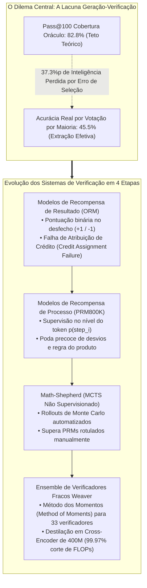
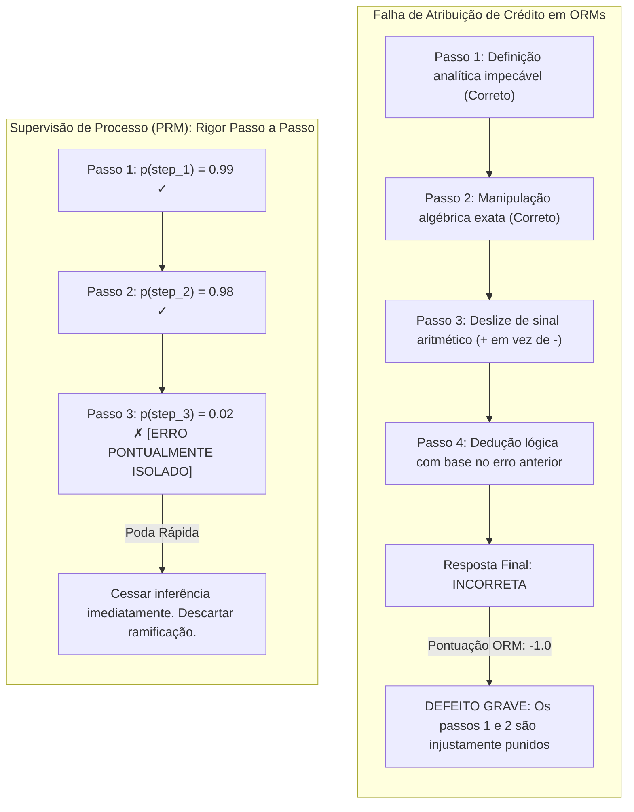
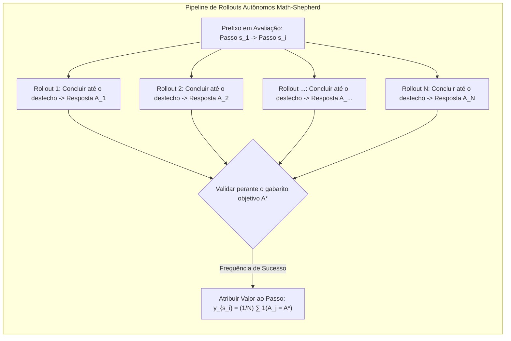
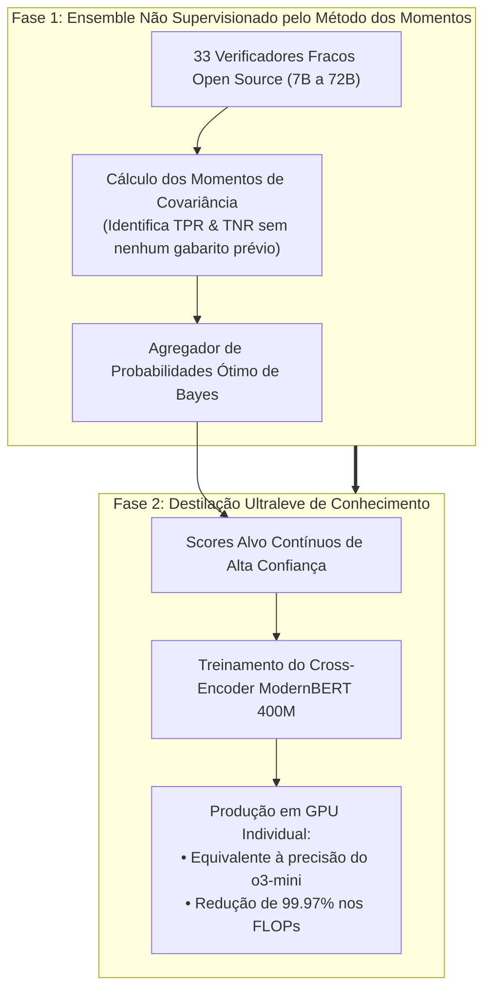

Boas-vindas ao terceiro capítulo de nossa imersão de engenharia sobre o curso de pós-graduação da **Universidade de Stanford, CS329A: Self-Improving AI Agents (Outono de 2025)**.

Na Aula 2, investigamos os mecanismos de escalonamento computacional na inferência e chegamos a uma constatação incontornável: embora a geração de milhares de trajetórias ($pass@k$) eleve a cobertura teórica de respostas para além de 99%, esse potencial latente permanece inatingível sem um verificador (Verifier) de alta precisão. Quando submetido à votação por maioria simplista, o desempenho estabiliza-se num platô restritivo.

Hoje, confrontamos a engrenagem arquitetural que rompe esse gargalo: **a Verificação Robusta (Robust Verification)**.

Matemáticos e engenheiros humanos raramente resolvem problemas intrincados num fluxo contínuo e sem pausas; eles rascunham uma etapa, checam a coerência algébrica, identificam deslizes de sinais e realizam retrocessos (backtracking) antes de avançar. Em contraste, os modelos de linguagem autorregressivos tradicionais operam estritamente para a frente. Havendo um desvio na dedução inicial, o modelo concebe alucinações progressivamente elaboradas para sustentar o erro primário.

Como podemos projetar verificadores desacoplados capazes de auditar passos intermediários, acusar falácias lógicas e guiar agentes em direção a respostas matematicamente comprovadas – sem gastar fortunas com anotação humana?

Apoiados nas contribuições de Cobbe et al. (GSM8K, OpenAI, 2021), na supervisão de processos de Lightman et al. (PRM800K, 2023), na anotação automatizada por Monte Carlo do *Math-Shepherd* (Yu et al., 2023) e no framework de ensemble *Weaver* (NeurIPS 2025), desvendaremos o estado da arte da **Engenharia de Verificadores**.



{/* truncate */}

---

### 1. A Lacuna Geração-Verificação: Formalização do Gargalo

Antes de detalharmos as arquiteturas de verificação, precisamos expressar matematicamente o abismo entre o que um modelo consegue gerar e o que o agente consegue de fato aproveitar:

```text
Gap(K) = Pass@K - Actual_Success_Rate
```

Em avaliações complexas como GPQA Diamond, modelos abertos como o `Llama-3.3-70B-Instruct` alcançam um $Pass@100$ de **82,8%**. Isso demonstra que, em mais de 8 em cada 10 problemas, ao menos uma demonstração exata repousa no grupo de 100 candidatos.

No entanto, ao aplicarmos a rotineira **Votação por Maioria (Majority Voting)** a esses mesmos 100 candidatos, a taxa de sucesso despenca para **45,5%**.

```
Acurácia (%)
 ▲
100│                                     ┌────────────── Pass@100 Fronteira Oráculo (82.8%)
 90│                                ┌────┘
 80│                           ┌────┘
 70│                      ┌────┘
 60│                 ┌────┘
 50│            ┌────┘ ◄── 37.3%p de Inteligência Dissipada
 40│  ──────────┴──────────────────────── Platô da Votação por Maioria (45.5%)
 30│
 20│
 10│
  0└┴────────────────────────────────────────────────► Orçamento de Amostras K
```

Perdem-se expressivos **37,3 pontos percentuais de cognição latente**, unicamente por incapacidade de selecionar a resposta correta. Quando trajetórias defeituosas confluem para uma mesma alternativa verossímil enganosa (Plausible Distractor), abordagens por frequência elegem falsos positivos.

#### A Gênese dos Verificadores Desacoplados: Cobbe et al. (GSM8K, 2021)
Para sanar essa divergência, Karl Cobbe e a equipe da OpenAI propuseram o benchmark **GSM8K** e consolidaram o conceito de **verificador independente**:

1. **Pesos Desacoplados:** Gerador e verificador não compartilham pesos na inferência. O gerador é ajustado em apenas 2 épocas para resguardar a entropia; o verificador é treinado a partir das resoluções emitidas.
2. **Cabeças de Valor por Token:** Em vez de avaliar apenas a última palavra da saída, acopla-se uma cabeça linear a cada token da rede Transformer:
   ```text
   V(t_i) = W_v · h_L(t_i) + b_v
   ```
   A função de perda agrega modelagem de linguagem e erro quadrático médio (MSE):
   ```text
   L_total = L_LM(θ) + λ · || V(t_end) - y_true ||^2
   ```
3. **O Ganho de 30x em Parâmetros:**
   * Utilizar um **verificador enxuto de 6B parâmetros** para escolher a melhor opção entre 100 tentativas igualou a eficácia de um **modelo denso de 175B**.
   * A dissociação entre geração e verificação viabilizou um multiplicador de **30x em aproveitamento de parâmetros**.

---

### 2. Supervisão de Resultado vs Processo: Lightman et al. (PRM800K)

Apesar de pioneiro, o verificador de Cobbe apoiava-se estritamente na **Supervisão de Resultados (Outcome Reward Models, ORMs)**.

Em maio de 2023, Hunter Lightman e pesquisadores da OpenAI publicaram o artigo referencial: **《Let's Verify Step by Step》** (Lightman et al., 2023).



#### O Problema de Atribuição de Crédito (Credit Assignment Problem)
Tomemos uma demonstração matemática com 10 etapas:
* **A Armadilha do Falso Negativo:** O modelo deduz brilhantemente dos passos 1 a 6. No passo 7, comete uma desatenção aritmética que descalibra a resposta final.
  * *Julgamento do ORM:* Aplica penalidade de $-1$. A sequência lógica irrepreensível dos passos 1 a 6 é descartada, corrompendo os gradientes de treino.
* **A Armadilha do Falso Positivo (Acerto Acidental):** No passo 3, o modelo envereda por um erro de lógica grave, mas no passo 8 incorre em outro lapso que anula o anterior, coincidindo por sorte com o gabarito.
  * *Julgamento do ORM:* Concede nota máxima $+1$. A rede é encorajada a cometer falhas metodológicas, acentuando o reward hacking.

Essa incapacidade de distribuição temporal de mérito inviabiliza o escalonamento dos verificadores de desfecho.

#### Estrutura Matemática dos PRMs
Lightman et al. produziram o **PRM800K**, composto por 800.000 avaliações humanas discriminando cada raciocínio (separado por quebras de linha) em positivo, negativo ou neutro.

Adotou-se a **Regra de Término no Primeiro Erro**: os especialistas encerravam a análise imediatamente após a primeira falácia lógica, uma vez que derivações subsequentes tornam-se nulas.

O PRM afere a probabilidade de o passo $s_i$ ser válido:

```text
p(s_i) = σ( W_p · h_L( Token_{\text{newline}, i} ) )
```

A nota conjunta atribuída à trajetória $S = (s_1, s_2, ..., s_M)$ segue a **Regra do Produto**:

```text
Score_PRM(S) = ∏_{i=1}^M p(s_i \text{ is correct})
```

#### Superioridade Experimental dos PRMs
No benchmark MATH sob protocolo Best-of-N até $N = 1.860$:

```text
┌───────────────────────────────┬──────────────┬──────────────┬─────────────┐
│ Estratégia de Seleção         │ Best-of-1    │ Best-of-100  │ Best-of-1860│
├───────────────────────────────┼──────────────┼──────────────┼─────────────┤
│ Votação por Maioria           │ 52.4%        │ 68.3%        │ 69.6%       │
│ Modelo de Resultado (ORM)     │ 52.4%        │ 70.1%        │ 72.4%       │
│ Modelo de Processo (PRM)      │ 52.4%        │ 74.8%        │ 78.2%       │
└───────────────────────────────┴──────────────┴──────────────┴─────────────┘
```

1. **Curvas de Escalonamento Ininterruptas:** Enquanto a votação e os ORMs estagnam por volta de $N = 100$, a precisão dos PRMs ascende continuamente por milhares de amostras.
2. **Taxa de Alinhamento Negativa:** Ao contrário do alinhamento usual (RLHF) que por vezes debilita a precisão matemática (a "taxa de alinhamento"), a supervisão de processo eleva a segurança e auditabilidade ao mesmo tempo que maximiza o rigor resolutivo.

---

### 3. Supervisão Autônoma de Processos: Math-Shepherd e Rollouts de Monte Carlo

Apesar da excelência do PRM800K, existia um impedimento corporativo: **rotular manualmente 800.000 passos é financeiramente proibitivo**.

No fim de 2023, Yu, Shen, Zhou et al. introduziram o **Math-Shepherd**, arquitetura de rotulagem autônoma inspirada na Busca em Árvore de Monte Carlo (MCTS).



#### Fundamento do Algoritmo
A máquina checa a máquina:
> Se um raciocínio intermediário $s_i$ for sólido, desdobrar a solução $N$ vezes a partir desse ponto levará frequentemente ao gabarito verídico $A^*$. Caso contenha falhas graves, as conclusões quase nunca atingirão $A^*$.

#### Estimativa Rígida vs Suave
Math-Shepherd formaliza duas funções de pontuação:

1. **Estimativa Rígida (Hard Estimation, HE):** Confere $+1$ caso ao menos um dos $N$ rollouts acerte a resposta, e $0$ se nenhum acertar:
   ```text
   y^{HE}_{s_i} = 1( ∃ j \in {1, ..., N} : A_j = A^* )
   ```
2. **Estimativa Suave (Soft Estimation, SE):** Mensura a fração empírica de acertos entre os $N$ rollouts como uma probabilidade contínua:
   ```text
   y^{SE}_{s_i} = (1 / N) · ∑_{j=1}^N 1( A_j = A^* )
   ```

#### O Salto: Rótulos Sintéticos Superam Avaliadores Humanos
O Math-Shepherd compilou **1,7 milhão de passos supervisionados** (mais que o dobro do PRM800K) sem envolver anotação manual paga.

* **Humanos vs Máquinas:** Em modelos LLaMA abertos, um PRM treinado com dados Math-Shepherd **superou o PRM800K humano no benchmark MATH**.
* **Motivo da Superação:** Os especialistas do PRM800K avaliaram somente produções do GPT-4, desconhecendo os padrões de erro de modelos abertos. O Math-Shepherd aprendeu diretamente das distribuições nativas da arquitetura alvo.
* **RL com Recompensas de Processo:** Executando PPO com os sinais do Math-Shepherd, o `Mistral-7B` avançou de 28,6% para **43,5% no MATH**.

---

### 4. Teoria de Ensembles: O Framework Weaver (NeurIPS 2025)

Mesmo com o Math-Shepherd, verificadores compactos de 7B ou 13B ainda manifestam inconsistências ocasionais. Rodar redes de 70B em produção, porém, sobrecarrega orçamentos e latências.

Pesquisadores de Stanford e da UW-Madison apresentaram uma solução matemática no NeurIPS 2025: **《Weaver: Shrinking the Generation-Verification Gap with Weak Verifiers》** (Zhang et al., 2025).



#### Agregação Não Supervisionada pelo Método dos Momentos
O Weaver congrega 33 verificadores imperfeitos (7B a 72B). Em ambiente operacional sem gabaritos, **qual verificador merece maior crédito?**

O Weaver aborda o desafio como um **Modelo Naive Bayes com Variável Latente**:
* A veracidade genuína `Y in {0, 1}` consiste numa variável latente inobservável.
* Cada verificador `k` exibe sensibilidade (``w_{k,1}``) e especificidade (``w_{k,0}``) desconhecidas:
  ```text
  `w_{k,1}` = P(S_k = 1 | Y = 1), \quad `w_{k,0}` = P(S_k = 0 | Y = 0)
  ```
* Assumindo independência condicional dado $Y$, a concordância paritária entre modelos desdobra-se em equações de covariância.

Empregando o **Método dos Momentos (Method of Moments)**, o Weaver inverte as matrizes e **deduz a exata confiabilidade ``(`w_{k,1}`, `w_{k,0}`)`` dos 33 modelos sem recorrer a rótulo algum**.

A agregação a posteriori bayesiana correspondente define-se por:

```text
P( Y=1 | S_1, ..., S_K ) = 1 / ( 1 + exp( - ( l_0 + ∑_{k=1}^K l_k(S_k) ) ) )
```

#### Resultados Sobranceiros
1. **Superando o OpenAI o3-mini:**
   * Associando o `Llama-3.3-70B-Instruct` ao ensemble Weaver em maratonas STEM, a acurácia atingiu **87,7%**.
   * O arranjo bateu modelos proprietários de ponta, inclusive **OpenAI o3-mini (86,7%) e GPT-4o (69,0%)**.
2. **Destilação em Cross-Encoder de 400M:**
   * A equipe transferiu o conhecimento do Weaver para uma arquitetura **`ModernBERT-Large` de apenas 400M parâmetros**.
   * Esse modelo reduzido conservou **98,7% da eficácia do ensemble de 33 redes**, encolhendo o processamento (FLOPs) em impressionantes **99,97%**.

---

### 5. Roteiro Prático: Diretrizes para Projetar Verificadores em Produção

Checklist corporativo sintetizado a partir da Aula 3:

```text
┌────────────────────────────────────────────────────────────────────────┐
│             Checklist de Arquitetura de Verificadores Corporativos     │
├────────────────────────────────────────────────────────────────────────┤
│ 1. Ambientes Determinísticos Fechados (Código, Provas Lógicas):        │
│    • Integrar compiladores e suítes de testes unitários como oráculos. │
│    • ORMs amparados por sandboxes isoladas (Docker / gVisor).          │
│                                                                        │
│ 2. Domínios Argumentativos Abertos (Análise Financeira, Contratos):    │
│    • PRMs sintetizados por rollouts autônomos (Math-Shepherd).         │
│    • Ponderação das saídas via Regra do Produto.                       │
│    • Poda precoce de nós intermediários com probabilidade p < 0.2.     │
│                                                                        │
│ 3. Contenção de Latência e Custos:                                     │
│    • Montagem offline do ensemble pelo Método dos Momentos (Weaver).   │
│    • Destilação em cross-encoder com menos de 1B de parâmetros.        │
│    • Inferência em menos de 10 ms em uma única GPU periférica.         │
└────────────────────────────────────────────────────────────────────────┘
```

---

### 6. Resumo e Axiomas de Engenharia

1. **A Seleção Dita o Limite:** A barreira dos sistemas cognitivos deslocou-se da geração para a triagem. Reduzir a defasagem de 30% exige verificadores independentes.
2. **Supremacia dos PRMs:** ORMs fracassam em raciocínios encadeados por equívocos de atribuição de crédito. PRMs etapa por etapa sustentam o escalonamento vigoroso em buscas Best-of-N.
3. **Vitória da Autossupervisão:** O escrutínio humano tornou-se dispensável; rollouts de Monte Carlo (Math-Shepherd) produzem dados aderentes às peculiaridades do modelo a custo zero.
4. **Aliança Ensemble-Destilação:** O Método dos Momentos (Weaver) derrota gigantes monolíticos, e a destilação em 400M suprime 99,97% dos custos de infraestrutura.

---

### O Que Vem a Seguir em Stanford CS329A:
Na **Aula 4**, migraremos das probabilidades de texto para o veredicto categórico do ambiente de execução: **《Tool Use & Code Feedback: Compiladores, Sandboxes e Ciclos Autônomos de Autocorreção》**. Exploraremos como agentes interagem com interpretadores Python e terminais Bash para retificar bugs sem auxílio externo. Até lá!