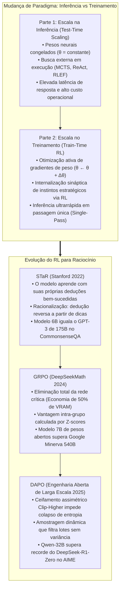
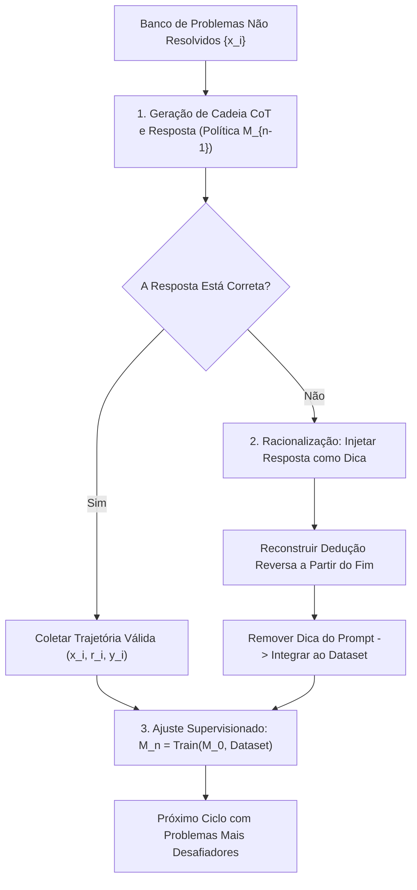
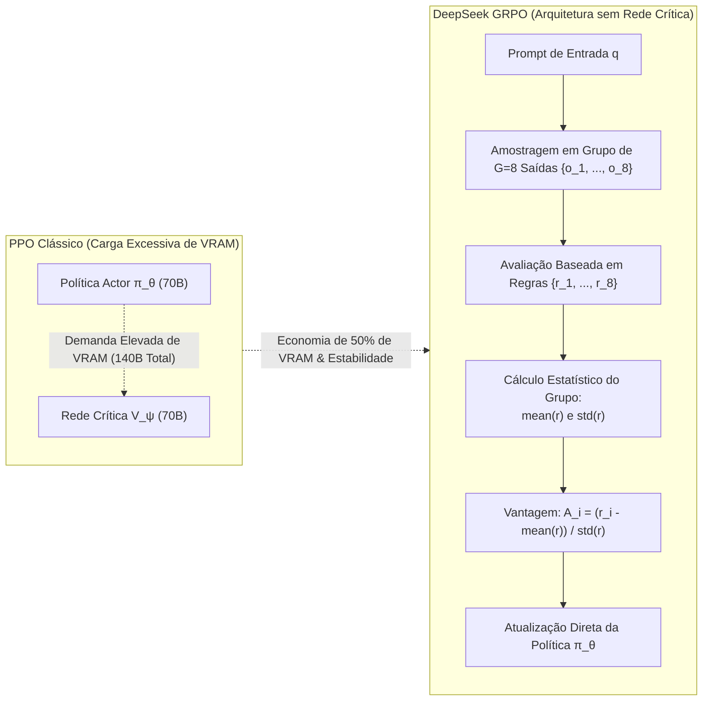

Boas-vindas ao sexto volume de nossa análise técnica detalhada do curso de pós-graduação da **Universidade de Stanford, CS329A: Self-Improving AI Agents (Agentes de IA que se Autoaperfeiçoam, Outono de 2025)**.

Ao longo das Aulas 1 a 5 (Parte 1: Fundamentos), exploramos como extrair o potencial máximo de modelos pré-treinados estáticos aplicando computação no momento da inferência (Test-time Compute): estruturando árvores de busca MCTS, integrando erros de compiladores e filtrando saídas por meio de comitês de verificadores.

Entretanto, precisamos encarar um limite matemático inescapável:
Conceder dez minutos adicionais a um estudante do ensino fundamental durante uma prova não o tornará capaz de demonstrar teoremas de cálculo diferencial e integral. Se as sinapses congeladas do modelo (parâmetros de peso, $\theta$) não codificam previamente esses conceitos dedutivos, gerar dez mil amostras ou recorrer a buscas exaustivas não produz inteligência genuína, mas mera casualidade estatística.

Hoje inauguramos a **Parte 2: Treinamento e Evolução (Aulas 6 a 9)**, voltando-nos à questão fulcral da autonomia:
> **“Em vez de gastar recursos massivos a cada inferência, como podemos investir computação durante o treinamento para reescrever de modo permanente os pesos neurais do modelo e transformá-lo em um raciocinador de elite?”**

Nesta **Aula 6**, dissecamos os três pilares que eliminaram a dependência de anotações humanas e inauguraram a era dos modelos de raciocínio profundo via **Aprendizado por Reforço Pós-Treinamento (Post-Training RL)**:
1. **Auto-inicialização do raciocínio analítico:** Self-Taught Reasoner (**STaR**, Zelikman et al., Stanford 2022).
2. **O fim da rede crítica (Critic):** Group Relative Policy Optimization (**GRPO**, DeepSeekMath 2024).
3. **Escala industrial em 1.000 GPUs:** Ceifamento desacoplado e amostragem dinâmica (**DAPO**, 2025).



{/* truncate */}

---

### 1. Escala no Treinamento vs Inferência: Redistribuindo a Fronteira de Custo

Para entender a razão pela qual os laboratórios de ponta migraram maciçamente para o aprendizado por reforço pós-treinamento, devemos examinar a equação fundamental do orçamento computacional (FLOPs):

```text
Compute_Total = Compute_Train + Compute_Inference
```

1. **Escala no Momento da Inferência (Inference-Time Scaling):** O vetor de parâmetros $\theta$ permanece inalterado. A computação é alocada em amostragens repetidas, busca em feixe e árvores MCTS. Embora produza ganhos em problemas pontuais, impõe uma latência severa e despesas recorrentes a cada interação de usuário em produção.
2. **Escala no Treinamento (Train-Time Scaling):** A computação é investida no ciclo prévio para ajustar permanentemente os parâmetros $\theta$ mediante aprendizado por reforço:

```text
θ* = argmax_θ E_{x ~ D, y ~ π_θ(·|x)} [ R(x, y) ]
```

Ao descobrir estratégias dedutivas superiores via RL, a retropropagação grava esses padrões diretamente nas matrizes de atenção e camadas densas. Na etapa de produção, o modelo passa a operar com **visão estratégica apurada em uma única passagem direta (Single Forward Pass), dispensando motores de busca externos**.

---

### 2. Auto-Inicialização do Raciocínio: STaR (Zelikman et al., Stanford 2022)

O ajuste fino supervisionado (SFT) tradicional exige dezenas de milhares de exemplos detalhados (Problema $\to$ Raciocínio $\to$ Resposta). Entretanto, remunerar matemáticos e arquitetos de software para redigir milhões de passos dedutivos torna-se economicamente inviável.

Em 2022, o time de Eric Zelikman na Universidade de Stanford levantou uma hipótese revolucionária:
> **“Se conseguimos aferir de forma automatizada e determinística a correção da resposta final, por que não permitir que o próprio modelo crie seus raciocínios, selecionar as cadeias que alcançaram a resposta exata e reajustar o modelo sobre seus próprios sucessos?”**

Dessa premissa nasceu o **Self-Taught Reasoner (STaR)**.



#### Validade Matemática: Aproximação do Gradiente de Política

O STaR não é um artifício heurístico isolado; constitui uma aproximação discreta exata do método de gradiente de política (Policy Gradient) sob uma recompensa indicadora $`1(y_hat = y*)`$:

```text
∇_θ J(θ) = ∑_i E_{r_hat, y_hat ~ π_θ(·|x_i)} [ 1(y_hat = y_i*) * ∇_θ log π_θ(r_hat, y_hat | x_i) ]
```

Em trajetórias incorretas, a função indicadora é $\mathbb{1} = 0$, zerando o gradiente e descartando o exemplo. Em amostras corretas ($\mathbb{1} = 1$), executa-se a subida de gradiente por máxima verossimilhança (MLE), convergindo a distribuição probabilística da política para cadeias dedutivas sólidas.

#### A Racionalização: Construindo Pontes Causais Inversas

Um gargalo do auto-filtro ingênuo decorre do fato de que o modelo não aprende com problemas que é incapaz de acertar. Ao falhar em 100% dos testes em um enunciado complexo, gera zero dados positivos de treino.

O STaR superou isso através da **Racionalização**:
1. Diante de uma resposta incorreta, a resposta verdadeira é injetada ao final do prompt: *“Dica: O resultado final é 42. Raciocine em sentido inverso para explicar por que 42 é matematicamente necessário.”*
2. Sabendo onde deve chegar, o modelo consegue construir a ponte causal reversa.
3. **O passo definitivo:** Antes de salvar o exemplo no conjunto de treino, **a dica é totalmente suprimida**:

```text
Registro no Dataset: Prompt [ x_i ] ──► Raciocínio Alvo [ r_reverso ] + Resposta [ y_i* ]
```

O modelo é ajustado como se tivesse deduzido o caminho sem auxílio, assimilando as intuições necessárias para vencer tarefas similares no futuro.

#### Impacto Empírico
* No benchmark **CommonsenseQA**, o STaR aplicado a um modelo **GPT-J de apenas 6B parâmetros** elevou a exatidão de 60,0% para **72,5%**.
* Esse modelo compacto de 6B atingiu desempenho pareado a uma versão especializada do **GPT-3 com 175B parâmetros (73,0%)**, cerca de 30 vezes maior.

---

### 3. A Extinção da Rede Crítica: DeepSeekMath e GRPO (2024)

Enquanto o STaR ancorava-se em um ciclo supervisionado, o avanço definitivo em aprendizado por reforço online para raciocínio emergiu com a equipe da DeepSeek no início de 2024: **DeepSeekMath e o algoritmo GRPO (Group Relative Policy Optimization)**.

#### A Inviabilidade do PPO Tradicional em Raciocínio Formal

O algoritmo clássico PPO (Proximal Policy Optimization) requer a alocação permanente de duas redes de grande porte na memória GPU:
1. **Rede de Política (Actor, $\pi_\theta$):** Responsável por gerar os tokens;
2. **Rede de Valor (Critic, $V_\psi$):** Responsável por prever o retorno financeiro/recompensa esperada de cada estado.

Manter um Actor de 70B exige carregar um Critic de 70B, duplicando o consumo de VRAM.
Além disso, em deduções matemáticas extensas onde a recompensa escalar ($+1$ ou $-1$) surge somente após milhares de tokens, **treinar um Critic preciso para pontuar cada token intermediário é instável e desequilibra os gradientes**.

#### A Ruptura de Paradigma do GRPO: Prescindir do Critic

A resposta da DeepSeek foi cirúrgica:
> **“Por que desperdiçar bilhões de parâmetros em uma rede de valor? Para uma solicitação `q`, faça a política atual amostrar um grupo de `G` respostas $`{o_1, ..., o_G}`$. Calcule a média e o desvio padrão de suas recompensas e normalize via Z-scores. Essa classificação relativa é a vantagem (Advantage) exata!”**



#### Formulação Matemática do GRPO

O GRPO otimiza a política $\pi_\theta$ sob regularização por divergência KL em relação a um modelo de referência $`pi_ref`$, sem auxílio de redes críticas:

```text
J_GRPO(θ) = E_{q, {o_i}_{i=1}^G} [ 
    (1 / G) * ∑_{i=1}^G (1 / |o_i|) * ∑_{t=1}^{|o_i|} {
        min(
            ( π_θ(o_{i,t}) / π_old(o_{i,t}) ) * A_hat_{i,t},
            clip( π_θ(o_{i,t}) / π_old(o_{i,t}), 1 - ε, 1 + ε ) * A_hat_{i,t}
        )
    } - β * D_KL( π_θ || π_ref )
]
```

A vantagem `A_hat_{i,t}` associada a cada solução `o_i` é computada estritamente com base nos dados do grupo:

```text
A_hat_{i,t} = r_tilde_i = ( r_i - mean({r_1, ..., r_G}) ) / ( std({r_1, ..., r_G}) + δ )
```

#### Atribuição de Crédito: Por Resultado vs Por Processo
1. **Supervisão por Resultado (Outcome):** Se a resposta final de $o_i$ estiver correta, $r_i = +1$; caso contrário, $-1$. A vantagem padronizada `r_tilde_i` é replicada igualmente por todos os tokens do texto.
2. **Supervisão por Processo (Process):** Atribuem-se recompensas parciais por etapa, acumulando a soma descontada de vantagens futuras para cada token.

#### Desempenho em Benchmarks: 7B Supera 540B
* O modelo `DeepSeekMath-Base 7B`, pré-treinado em 120 bilhões de tokens matemáticos, **superou o modelo Minerva de 540B do Google**.
* Com o GRPO, sua exatidão no benchmark MATH subiu de 46,8% para **51,7%**, tornando-se o primeiro modelo aberto de 7B a superar a barreira dos 50% sem apoio de calculadoras.
* Em conjunto com auto-consistência (Self-Consistency) de 64 amostras, atingiu impressionantes **60,9%**.

---

### 4. Da Teoria aos Clusters de 1.000 GPUs: DAPO (2025)

Contudo, ao replicar a equação de GRPO em testes de ponta como a **AIME 2024**, pesquisadores depararam-se com uma barreira prática:
* Enquanto o DeepSeek-R1-Zero alcançou 47 pontos na AIME, implementações convencionais de GRPO estagnavam em **aproximadamente 30 pontos**.

Em março de 2025, o projeto **DAPO (Decoupled Clip and Dynamic Sampling Policy Optimization)** revelou quatro soluções de engenharia para viabilizar o RL em larga escala:

```text
GRPO Básico (30 pts) 
  ──► + Filtro de Extensão (36 pts) 
  ──► + Clip-Higher (38 pts) 
  ──► + Perda por Token (42 pts) 
  ──► DAPO Completo (50 pts, Superando o DeepSeek-R1-Zero!)
```

#### Segredo 1: Ceifamento Assimétrico Clip-Higher ($`eps_low` = 0,20, `eps_high` = 0,28$)
* **O Problema:** O ceifamento simétrico ($\pm 0,2$) castiga a exploração. Quando o modelo gera um token raro e criativo com probabilidade inicial de 0,01, o teto de $1 + 0,2 = 1,2\times$ restringe-o a 0,012, enquanto tokens triviais (0,9) sobem sem barreiras.
* **O Efeito:** O modelo cessa a busca por caminhos novos e sofre **colapso de entropia (Entropy Collapse)**, emitindo respostas curtas e repetitivas.
* **A Resposta DAPO:** Conservar $`eps_low` = 0,20$ para punir desvios incorretos, mas estender o teto para **$`eps_high` = 0,28$** (+40%), dando margem para que tokens investigativos aumentem sua probabilidade.

#### Segredo 2: Amostragem Dinâmica (Filtro de Lotes Neutros)
* **O Problema:** Em exercícios triviais, todas as $G$ tentativas acertam ($r_i = 1$). Em questões intransponíveis, todas falham ($r_i = 0$).
* Nesses dois cenários, `formula`, a vantagem zera e **milhares de GPUs operam calculando gradientes nulos**.
* **A Resposta DAPO:** Excluir ativamente os lotes que não cumpram `0 < Correct Rollouts < G`, assegurando que 100% dos cálculos processem gradientes ricos em variância.

#### Segredo 3: Normalização de Perda em Nível de Token
Calcular médias por exemplo dilui falhas graves em textos longos. O DAPO normaliza o erro sobre o montante consolidado de tokens $\sum_i |o_i|$, impedindo que o modelo produza prolixidade desnecessária para burlar penalidades.

#### Segredo 4: Modelação Gradual para Textos Excessivos
Ao aprofundar raciocínios, o agente pode esbarrar no limite de contexto (ex.: 16.384 tokens). Descartar a saída com nota $-1$ elimina deduções com potencial. O DAPO introduz uma atenuação linear suave ao longo dos últimos 4.096 tokens, instruindo o modelo a encerrar as provas de forma controlada.

---

### 5. Arquitetura Corporativa: Infraestrutura Distribuída de RL para Raciocínio

A operação corporativa de modelos otimizados via GRPO/DAPO requer topologias segregadas de alta vazão:

```text
┌────────────────────────────────────────────────────────────────────────┐
│             Infraestrutura Empresarial Distribuída para GRPO/DAPO      │
├────────────────────────────────────────────────────────────────────────┤
│                                                                        │
│  [ Banco Curricular de Tarefas (Matemática / Compiladores / Testes) ]  │
│          │                                                             │
│          ▼                                                             │
│  ┌──────────────────────────────────────────────────────────────────┐  │
│  │                  Motor de Lotes e Amostragem Dinâmica            │  │
│  │  • Balanceador de Dificuldade: Filtro de lotes 100% acerto/erro  │  │
│  │  • Otimização de Bin-Packing conforme a janela de contexto       │  │
│  └───────────────────┬──────────────────────────────────────────────┘  │
│                      │ Lotes Selecionados                              │
│                      ▼                                                 │
│  ┌──────────────────────────────────────────────────────────────────┐  │
│  │                   Frota de Inferência vLLM / TensorRT-LLM        │  │
│  │  • Nós de Geração Concorrente Dedicados (Grupos G=8)             │  │
│  │  • Gerenciamento KV-Cache Distribuído via PagedAttention         │  │
│  └───────────────────┬──────────────────────────────▲───────────────┘  │
│                      │ Trajetórias Amostradas       │ Pesos            │
│                      ▼                              │ Sincronizados θ  │
│  ┌──────────────────────────────────────────────────┴───────────────┐  │
│  │                   Verificadores Baseados em Regras Formais       │  │
│  │  • Sandboxes Seguros Docker/gVisor (Python e SymPy)              │  │
│  │  • Auditoria de Sintaxe das Tags de Raciocínio `<think>`         │  │
│  │  • Estandardização de Vantagem no Grupo: A_i = (r - μ) / σ       │  │
│  └───────────────────┬──────────────────────────────────────────────┘  │
│                      │ Fluxo de Vantagens por Token                    │
│                      ▼                                                 │
│  ┌──────────────────────────────────────────────────────────────────┐  │
│  │                   Cluster de Treino Megatron / DeepSpeed         │  │
│  │  • Treinamento de Modelo Único de Política (Sem rede de valor)   │  │
│  │  • Motor de Gradiente Assimétrico Clip-Higher (ε_high = 0.28)    │  │
│  │  • Normalização de Perda por Token via FlashAttention-3          │  │
│  └──────────────────────────────────────────────────────────────────┘  │
│                                                                        │
└────────────────────────────────────────────────────────────────────────┘
```

#### Regras Práticas para Ambientes de Produção
1. **Remoção de Avaliações Humanas no Ciclo de RL:** Treinar o raciocínio estritamente sobre bases de conferência determinística (interpretadores, testes unitários, provadores simbólicos). Não injetar preferências subjetivas em RL dedutivo.
2. **Segregação de Hardware:** Separar fisicamente os servidores destinados à geração massiva (vLLM) daqueles dedicados ao cálculo de gradientes (Megatron-LM), interligando-os por redes RDMA de baixa latência.
3. **Imposição Estrutural de Tags:** Penalizar formalmente saídas que não utilizem as marcações `<think>`, impedindo o modelo de suprimir deduções para adivinhar o resultado.

---

### 6. Perguntas Técnicas Essenciais e Práticas de Engenharia

**P: Por que a penalização por divergência KL permanece necessária no GRPO e quando deve ser atenuada?**
**A:** O termo KL ($\beta `D_KL`(\pi_\theta \parallel `pi_ref`)$) age contra o **hackeamento de recompensa (Reward Hacking)** e o esquecimento catastrófico. Sem essa âncora, o modelo produz sequências repetitivas apenas para burlar o analisador. No entanto, para desencadear o raciocínio longo espontâneo (como no DeepSeek-R1-Zero), adota-se $\beta \to 0$ nas fases preliminares, reintroduzindo a restrição KL em estágios de ajuste fino.

**P: No STaR, a Racionalização não induz o modelo a criar dependência de dicas?**
**A:** Essa possibilidade é eliminada pela estrita **separação temporal entre a produção dos dados e o treinamento dos pesos**. A dica atua tão somente na montagem da cadeia causal reversa. Quando o exemplo é incorporado ao banco de treino, a dica é **completamente expurgada**. Para os gradientes, a resposta foi deduzida de forma autônoma.

---

### 7. Resumo e Conclusões Técnicas

1. **A Necessidade da Escala no Treinamento:** A busca na inferência é incapaz de criar conceitos ausentes dos pesos. A escala no treino fixa a aptidão estratégica de forma perene nas sinapses.
2. **Auto-Inicialização Efetiva:** O STaR comprova que modelos evoluem selecionando seus acertos e deduzindo reversamente via racionalização, igualando arquiteturas 30 vezes maiores.
3. **Superação da Rede Crítica:** O GRPO da DeepSeek extinguiu o modelo de valor, diminuiu o uso de VRAM em 50% e derivou vantagens analíticas sólidas de comparações internas ao grupo.
4. **Viabilidade Industrial em Escala:** O DAPO resolveu o colapso de entropia com Clip-Higher assimétrico ($\epsilon=0,28$), amostragem dinâmica e perdas em nível de token, batendo o DeepSeek-R1-Zero com a metade dos passos computacionais.

---

### O Que Vem a Seguir em Stanford CS329A:
Na **Aula 7**, deixaremos a resolução de provas predefinidas para explorar o horizonte da investigação científica autônoma:
**《Aula 7: Evolução Aberta: ADAS, The AI Scientist, AlphaEvolve e Agentes Autoevolutivos》**.
Analisaremos como agentes formulam teses científicas inéditas, concebem arquiteturas de aprendizado de máquina e redigem artigos acadêmicos de forma autônoma. Não perca!