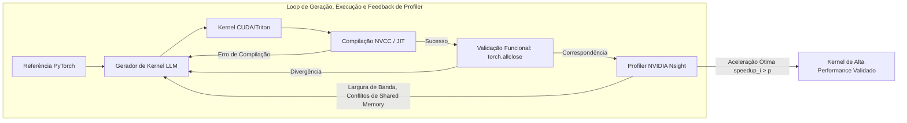

# Stanford CS329A (Ep 10): SWE-Agents — Engenharia de Software Autônoma, CodeMonkeys, KernelBench e Agent-System Interface

A engenharia de software em ambientes de produção reais praticamente não possui semelhança com quebra-cabeças isolados de programação competitiva ou problemas acadêmicos simplificados. Um relatório de bug real no GitHub nunca chega empacotado com testes unitários prontos; ele está profundamente enraizado em centenas de arquivos, dependências legadas complexas e milhões de linhas de código distribuído. Além disso, softwares em produção não podem ser meramente corretos no aspecto funcional — eles precisam ser velozes, eficientes em memória e perfeitamente ajustados a arquiteturas de hardware paralelo de baixo nível.

Para inaugurar a **Parte 3: Engenharia de Agentes (Aulas 10 a 12)** de **Stanford CS329A: Self-Improving AI Agents**, deixamos os clusters de treinamento de modelos fundamentais e entramos diretamente nas trincheiras técnicas do desenvolvimento de software industrial:
> **"Como agentes autônomos de IA navegam por repositórios com milhões de tokens, isolam bugs de regressão elusivos, sintetizam ambientes de teste reprodutíveis e criam kernels de GPU sob medida que superam baselines manuais do PyTorch?"**

Este artigo investiga a fronteira moderna de **SWE-Agent Autonomous Coding** através de três marcos fundamentais: o **CodeMonkeys Automated Refactoring** no benchmark **SWE-bench Benchmark GitHub**, a otimização de desempenho **KernelBench GPU Performance Tuning** via loops de profiling de hardware, e a arquitetura **Agent-Computer Interface ACI** (Agent-System Interface, ASI) de Stanford, concebida para eliminar o desalinhamento semântico entre a intenção estratégica do agente e o hardware paralelo físico.

{/* truncate */}


---

## 1. As Realidades da Engenharia de Software Autônoma

Resolver issues reais no GitHub exige superar três grandes desafios de engenharia de sistemas:
1. **O Dilema da Explosão de Contexto:** Um repositório corporativo típico ultrapassa 3.000.000 de tokens. Injetar todo esse código em LLMs de ponta acarreta custos proibitivos e degradação crítica de atenção (falha de agulha no palheiro).
2. **O Dilema da Verificação:** Agentes frequentemente produzem patches complacentes que alteram os testes em vez de consertar o defeito arquitetural subjacente, gerando falsos sucessos.
3. **A Barreira do Hardware:** Ir além de scripts Python para programação de aceleração em GPU (CUDA, Triton) requer domínio de coalescência de memória, sincronização de blocos de threads e pressão de registradores.

```
┌─────────────────────────────────────────────────────────────────────────┐
│               Os 3 Pilares dos SWE-Agents de Produção                   │
└────────────────────────────────────┬────────────────────────────────────┘
                                     │
       ┌─────────────────────────────┼─────────────────────────────┐
       ▼                             ▼                             ▼
┌──────────────────────────┐  ┌──────────────────────────┐  ┌──────────────────────────┐
│  CodeMonkeys SWE-bench   │  │   KernelBench Profiler   │  │  Agent-System Interface  │
├──────────────────────────┤  ├──────────────────────────┤  ├──────────────────────────┤
│ • Compressão 50.5x ctx   │  │ • Métrica fast_p         │  │ • Compressão DSL 14x     │
│ • Depuração bilateral    │  │ • Feedback profiler E+P  │  │ • Tradutor AutoGuide     │
│ • Testes discriminadores │  │ • Fusão & memória compart│  │ • Alinhamento semântico  │
│ • 57,4% SWE-bench Verif. │  │ • 13x Aceleração de GPU  │  │ • Ganho 3,8x vs otimizad.│
└──────────────────────────┘  └──────────────────────────┘  └──────────────────────────┘
```

---

## 2. Resolvendo Issues Reais no GitHub: CodeMonkeys (2025)

O padrão ouro global para avaliar agentes autônomos de engenharia de software é o **SWE-bench Verified** (selecionado a partir de 500 pull requests reais de grandes repositórios open-source como Django, SymPy e scikit-learn).

Apresentado no início de 2025, o **CodeMonkeys** atingiu uma taxa recorde de resolução de 57,4% ao estruturar o processo em três fases rigorosas:

```
                  [Issue Real do GitHub & Repositório de 3M Tokens]
                                     │
                                     ▼
           1. Pipeline de Contexto (Varredura do Repo & Compressão 50.5x)
              (Varredura local Qwen2.5-Coder-32B -> Resumo -> Ranking -> 128k)
                                     │
                                     ▼
           2. Máquinas de Estados de Geração (Loop de Depuração Bilateral)
              ┌────────────────────────────────────────────────────────┐
              │ Testing Machine: Sintetiza teste de repro (Exit 2)     │
              │                       │                                │
              │                       ▼                                │
              │ Editing Machine: Aplica patch no código -> Teste (Exit 0)│
              └────────────────────────────────────────────────────────┘
                                     │
                                     ▼
           3. Máquina de Estados de Seleção (Síntese de Testes Discriminadores)
              (Gera testes diferenciais de borda para descartar falsos patches)
                                     │
                                     ▼
                         [Submissão do Patch Final]
                    (57,4% Resolvido no SWE-bench Verified)
```

### Fase 1: Pipeline de Contexto (Compressão de 50.5x)
Consultar modelos proprietários de ponta (Claude 3.5 Sonnet) sobre repositórios de milhões de tokens é economicamente inviável. O CodeMonkeys desacopla a exploração de contexto da geração do código:
- Um modelo local econômico (`Qwen2.5-Coder-32B`) varre todos os arquivos Python do repositório.
- São extraídas definições de classes, assinaturas de funções e docstrings relevantes.
- Uma etapa de ranqueamento filtra os arquivos mais prováveis, comprimindo uma base de 3.000.000 de tokens para uma **janela de trabalho de 128.000 tokens (redução de 50,5 vezes)**.
- Como esse artefato de contexto é reaproveitado por múltiplos caminhos de geração paralelos, a fase de contexto representa menos de **15% do custo financeiro total**.

### Fase 2: Máquinas de Estados de Depuração Bilateral
Um modo clássico de falha de agentes de codificação é a "autoilusão na edição" — alterar o código sem garantir previamente que o bug foi de fato reproduzido. O CodeMonkeys conecta duas máquinas de estados especializadas:
1. **Testing State Machine:** Antes de tocar no código-fonte, o agente gera um script independente de reprodução (`reproduce_issue.py`). Esse script precisa obrigatoriamente rodar na base original não modificada e retornar **Exit Code 2 (Falha reproduzida)**. Se ele passar direto, o teste é considerado inválido e regenerado.
2. **Editing State Machine:** Guiada pelo teste reprodutor que falhou, a máquina de edição realiza as modificações no código. Ela itera até 8 vezes contra erros de compilação, tracebacks e asserções até que o teste retorne **Exit Code 0 (Sucesso)**.

### Fase 3: Máquina de Estados de Seleção (Testes Discriminadores)
Executar 10 caminhos paralelos atinge uma cobertura teórica de resolução de **69,8%** (existe ao menos um patch correto no conjunto). Porém, selecionar um patch aleatoriamente faz a precisão cair para **45,8%**, pois muitos candidatos quebram testes secundários de regressão.

Para solucionar esse problema, o CodeMonkeys introduziu a **Máquina de Seleção Discriminadora**:
- Analisa divergências sutis de comportamento entre dois patches concorrentes $P_A$ e $P_B$.
- Instrui o LLM a escrever um **teste discriminador diferencial** feito especificamente para passar em $P_A$ e falhar em $P_B$.
- Ao rodar essas suítes discriminadoras em sandboxes isoladas, patches inconsistentes são eliminados um a um, elevando a taxa final para **57,4%**.

---

## 3. Além da Correção: KernelBench & Otimização de GPU (2025)

A correção funcional é apenas metade da equação. Na infraestrutura contemporânea de inteligência artificial, operadores customizados de GPU determinam o custo e a latência de treinamento e inferência. Engenheiros humanos levaram quase cinco anos após a publicação do artigo do Transformer para conceber e refinar o FlashAttention em CUDA. Agentes autônomos conseguem criar kernels de GPU de alto desempenho diretamente a partir de especificações PyTorch?

Lançado em fevereiro de 2025, o **KernelBench** avalia agentes em 250 operadores diversos do PyTorch, medindo tanto a exatidão matemática quanto a aceleração real de hardware.

```text
A Métrica fast_p Speedup Frontier:
========================================================================================
fast_p = (1 / N) * Σ_{i=1}^N  1[ correct_i  E  speedup_i > p ]

Onde:
  • fast_0 : Correção Funcional (Saída do tensor idêntica ao PyTorch)
  • fast_1 : Correção + Mais rápido que PyTorch nativo (Speedup > 1.0x)
  • fast_2 : Correção + Duas vezes mais rápido que PyTorch nativo (Speedup > 2.0x)
========================================================================================
```



### A Revolução do Feedback por Profiler
Em geração direta e isolada (*single-shot*), mesmo modelos topo de linha como OpenAI o1 ou DeepSeek-R1 falham gravemente: **menos de 20% dos kernels CUDA criados alcançam qualquer aceleração frente ao PyTorch padrão ($fast_1 < 20\%$)**, quebrando frequentemente por acessos inválidos de memória ou conflitos de bancos de memória compartilhada.

Contudo, quando o KernelBench conecta o agente a um loop fechado de 3 níveis:
1. **Geração:** Criação da implementação em Triton ou CUDA.
2. **Execução:** Feedback de mensagens de erro do compilador e limites numéricos (`torch.allclose`).
3. **Feedback de Profiler (E+P):** Diagnóstico detalhado via NVIDIA Nsight revelando os gargalos físicos (ex.: *"Memory bound: interrupção em memória global na linha 42; conflito de 8 vias no bloco de memória compartilhada"*).

Sob esse loop, a taxa de sucesso do DeepSeek-R1 na otimização de operadores compostos de nível 2 saltou de **36% para 72%**, sintetizando de maneira autônoma padrões de atenção fundida, particionamento de registradores e reduções warp-shuffle com ganhos de até **13x sobre o PyTorch padrão**.

---

## 4. Alinhamento Semântico: Agent-System Interface (ASI, Stanford 2025)

Quando agentes tentam otimizar sistemas distribuídos complexos em C++, surge um severo descasamento de impedância arquitetural. Apresentar ponteiros brutos de C++, primitivas de sincronização de threads e mensagens crípticas de compilador a um LLM equivale a exigir que um arquiteto de software depure microcódigo em nível de assembly.

Apresentado na ICML 2025 pelo grupo de pesquisa do professor Alex Aiken em Stanford, o **Agent-System Interface (ASI)** soluciona esse abismo:
> **"Em vez de forçar os LLMs a escrever código frágil em C++ ou decifrar stack traces ilegíveis, devemos construir uma camada intermediária de abstração: uma linguagem específica de domínio (DSL) declarativa que delimita o espaço de busca, e um tradutor AutoGuide que converte asserções de hardware em orientações claras em linguagem natural."**

```text
┌─────────────────────────────────────────────────────────────────────────┐
│                          Agente de Raciocínio LLM                       │
│             (Intenção Estratégica & Design Algorítmico)                 │
└────────────────────────────────────▲────────────────────────────────────┘
                                     │
          ┌──────────────────────────┴──────────────────────────┐
          │ Diretivas de Otimização  ▲ Recomendações Práticas   │
          │ DSL de Alto Nível        │ em Linguagem Natural     │
          ▼                          │                          │
┌────────────────────────────────────┴────────────────────────────────────┐
│                    Camada Agent-System Interface (ASI)                  │
│  • Domain-Specific Language (DSL): Compressão de código de 14x          │
│  • Tradutor AutoGuide: Converte falhas de hardware em ações claras      │
└────────────────────────────────────▲────────────────────────────────────┘
                                     │
          │ Código C++ Gerado        ▲ Falhas Reais de Hardware │
          │ & Alocações de Memória   │ & Mensagens do Compilador│
          ▼                          │                          │
┌────────────────────────────────────┴────────────────────────────────────┐
│                   Execução em Hardware Paralelo Físico                  │
│               (Memória Distribuída, Cores de GPU, VRAM)                 │
└─────────────────────────────────────────────────────────────────────────┘
```

### Os Dois Pilares da ASI
1. **Domain-Specific Language (DSL):** Mapear tiling de dados, desenrolamento de loops e alocação na hierarquia de memória em primitivas declarativas reduz o código do sistema em **14 vezes**, eliminando alucinações sintáticas.
2. **Tradutor AutoGuide:** Quando um kernel dispara uma falha de baixo nível (ex.: `Assertion failed: stride mismatch at dim 1; invalid warp alignment`), o AutoGuide intercepta o erro e emite uma orientação contextualizada:
   > *"Diagnóstico de Hardware: O alinhamento de stride falhou porque a dimensão 1 do tensor não é múltipla de 32. Ajuste o layout de memória row-major para incluir alinhamento de 32 bytes."*

### Resultados Empíricos: 10 Iterações Superam 1.000
Com a assistência da ASI, um agente LLM autônomo precisou de apenas **10 iterações** para descobrir um escalonamento de tensores paralelos **3,8 vezes mais rápido** que o plano encontrado pelo **OpenTuner após 1.000 iterações**. Tarefas complexas de simulação de circuitos que antes demandavam dias de trabalho de engenheiros seniores foram resolvidas em apenas **10 minutos**.

---

## 5. Comparativo Arquitetural dos Paradigmas de Engenharia

```text
=========================================================================================================
Dimensão              Assistente de Código Tradicional  CodeMonkeys (SWE-bench)  KernelBench + ASI
---------------------------------------------------------------------------------------------------------
Artefato Alvo         Funções Isoladas / Trechos        Patches em Vários Arquivos Kernels CUDA/Triton
Gestão de Contexto    Arquivo Aberto Local (4k-8k)      128k Comprimido (50.5x)    DSL Declarativa (14x)
Loop de Verificação   Execução de Testes Unitários      Máquina de Estados Dupla   Profiler Nsight (fast_p)
Sinal de Feedback     Mensagens de Erro Traceback       Alternância Exit 2 -> 0   Dicas de Hardware AutoGuide
Objetivo Central      Correção Sintática / Funcional    Resolução de Regressões    Aceleração Real de Hardware
=========================================================================================================
```

---

## 6. Análise Técnica Aprofundada (Q&A)

### P1: Por que o CodeMonkeys exige criar um teste de reprodução ANTES de alterar o código?
Se o agente começar editando o código antes de consolidar um teste confiável, ele cairá na armadilha da "verificação autoiludida": escreverá um patch incompleto ou falho e, em seguida, fará um teste enviesado para validar seu próprio erro.

Ao forçar a **Testing State Machine** a produzir primeiro um script independente que comprove o bug gerando **Exit Code 2 (Falha reproduzida)** no repositório intocado, o sistema constrói um oráculo imutável e objetivo. Somente quando a **Editing State Machine** consegue transformar esse mesmo teste em **Exit Code 0** a resolução do problema é comprovada matematicamente.

### P2: O que faz os LLMs falharem na geração direta de kernels CUDA e como o loop de profiler resolve isso?
Modelos de linguagem compreendem bem operações matemáticas em tensores, mas têm dificuldade com concorrência massiva em hardware:
- **Cálculo de Índices de Threads:** Expressões como `int idx = blockIdx.x * blockDim.x + threadIdx.x` frequentemente negligenciam casos de borda, causando falhas de segmentação.
- **Conflitos de Bancos de Memória Compartilhada:** Múltiplas threads acessando o mesmo banco de memória no mesmo ciclo serializam a execução e destroem a taxa de transferência.

Erros comuns de compilação apenas atestam validade de sintaxe, sem revelar gargalos dinâmicos. O **Loop de Feedback por Profiler (E+P)** alimenta o agente com métricas reais de ocupação de memória e conflitos de warps, capacitando-o a refatorar o código com precisão cirúrgica.

---

## Conclusão & Próximos Passos

Os agentes de engenharia de software evoluíram muito além de simples mecanismos de autocompletar código. Com o **CodeMonkeys**, compreendemos como pipelines de contexto inteligentes e máquinas de estados bilaterais solucionam issues de repositórios reais no SWE-bench. Com o **KernelBench** e a **ASI**, demonstramos como profilers de hardware e abstrações declarativas capacitam a IA a otimizar a infraestrutura de computação de alto desempenho.

Na **Aula 11**, abordaremos o gargalo estrutural para agentes de engenharia contínua: **Agent Memory — Sistemas de Memória Hierárquica, Cartuchos, CacheBlend e Persistência de Contexto de Longo Prazo (MemGPT)**.

---

### Principais Conclusões
- **Descoberta Contextual Otimizada:** Pré-filtrar repositórios massivos com modelos locais leves (redução de 50.5x) torna a engenharia de software completa viável e econômica.
- **Depuração Bilateral Evita Falsos Patches:** Uma issue só está resolvida quando um script reprodutor verificado (Exit 2) transita de forma sólida para Exit 0.
- **Desempenho Exige Loop Iterativo:** Respostas isoladas raramente produzem kernels CUDA competitivos; integrar métricas de profiler (fast_p) é indispensável para computação de alta performance.