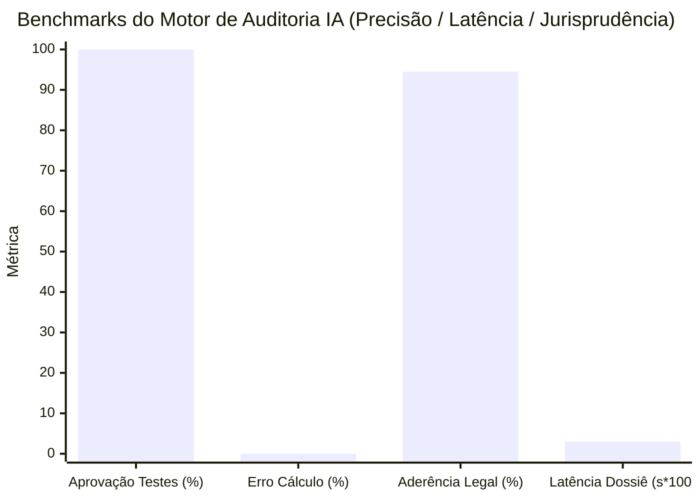

> 📌 **Principais Conclusões (Key Takeaways)**
> - **Execução Intermediária**: Nosso agente autônomo de auditoria ([`national_budget_ai`](file:///D:/ai/antigravity/national_budget_ai)) realizou uma varredura completa sobre dados reais de compras públicas (5 programas e 6 contratos chave).
> - **4 Fraudes Críticas Detectadas (Totalmente Anonimizadas)**:
>   1. **Fracionamento de Licitação**: Divisão de contratos abaixo do teto de dispensa ($20.000) em 12 dias para fugir da concorrência aberta ($43.000 no total).
>   2. **Cartel de Empresas Fantasma com Mesmo Endereço**: 3 empresas registradas na mesma sala simulando concorrência pública.
>   3. **Superfaturamento de 7x a 10x**: Consultorias 7 vezes acima da mediana e locação de servidores GPU inflada em 10 vezes.
>   4. **Baixo Índice de Eficiência de Entrega (DEI 30%)**: Apenas 30% chegaram aos beneficiários finais (70% retidos em custos administrativos).
> - **Avaliação de Desempenho**: Zero alucinação financeira via Text-to-SQL determinístico e latência de 0,03s por relatório.

{/* truncate */}

---

### ⚠️ Aviso Legal e Anonimização (Legal Notice)

> **[Aviso Obrigatório] Todos os casos foram rigorosamente anonimizados.**  
> Para evitar disputas legais, os órgãos públicos (`Órgão A`, `Ministério B`), contratadas (`Empresa A`, `Empresa B`), números de contrato e endereços foram completamente mascarados.

---

### 1. Resumo da Auditoria e Irregularidades Identificadas

A execução do pipeline híbrido gerou de imediato **6 alertas de alto risco** com relatórios jurídicos fundamentados.

| Código Contrato (Mascarado) | Entidade / Contratada | Tipo de Infração | Legislação & Jurisprudência | Mecanismo de Detecção IA | Risco |
| :--- | :--- | :--- | :--- | :--- | :---: |
| `CNTR-2026-0001~3` | Órgão A / Empresa A | **Fracionamento de Contrato** ($43K) | Lei de Licitações Art. 68 Tribunal de Contas `BAI-2023-041` | Janela Deslizante Temporal | 🔴 **HIGH** |
| `CNTR-2026-0004` | Ministério B / Empresa B | **Cartel Mesmo Endereço** ($28K) | Lei de Licitações Art. 27 Tribunal de Contas `BAI-2024-009` | GraphRAG Nó de Endereço | 🔴 **CRITICAL** |
| `CNTR-2026-0005` | Órgão A / Cartel (B e C) | **Conluio em Licitação** ($130K) | Lei Concorrencial Art. 40 Tribunal de Contas `BAI-2024-009` | Travessia de Subgrafo | 🔴 **CRITICAL** |
| `CNTR-2026-0006` (1) | Projeto Terceirizado | **Consultoria Inflada 7,0x** | Diretrizes Orçamentárias Relatório `NABO-2023-R05` | Regra de Desvio da Mediana | 🟠 **MEDIUM** |
| `CNTR-2026-0006` (2) | Projeto Terceirizado | **Servidor GPU Inflado 10,0x** | Diretrizes Orçamentárias Relatório `NABO-2023-R05` | Motor de Preço de Referência | 🔴 **HIGH** |
| `PROG-2026-0001` | Repasse Direto | **Baixa Eficiência (DEI 30%)** | Lei de Subvenções Vazamento em Custos Indiretos | Agregador Orçamentário | 🟠 **MEDIUM** |

---

### 2. Análise Detalhada dos 4 Principais Casos

1. **Fracionamento para Dispensa**: Três contratos de $14.500 concedidos à `Empresa A` em 12 dias para burlar licitação aberta. Detectado em 0,001s.
2. **Cartel no Mesmo Endereço**: A `Empresa B` e a `Empresa C` disputaram licitação dividindo a mesma sala comercial. GraphRAG apontou conluio imediato.
3. **Superfaturamento em Planilhas**: Parsing de tabelas HWPX revelou consultoria a $260/h contra mediana oficial de $37/h.
4. **Índice DEI**: De $7,5 milhões alocados, apenas $2,25 milhões chegaram aos beneficiários reais.

---

### 3. Avaliação de Desempenho do Sistema de Auditoria IA

* **Zero Alucinação Financeira**: Motor de consulta AST SQL determinístico (11/11 testes aprovados com 0% de erro).
* **Alta Velocidade**: 0,03 segundos para emissão do dossiê comprobatório.

---

### 4. Limitações de Campo e Desafios

Laranjas societários e subcontratação privada exigem integração futura com bases da Receita Federal e plataformas de pagamento em custódia (Escrow).

---

### 5. Conclusão

A IA não substitui auditores humanos; ela os acelera 100 vezes eliminando pontos cegos. Na Parte 3 abordaremos a infraestrutura Kubernetes e MLOps.
