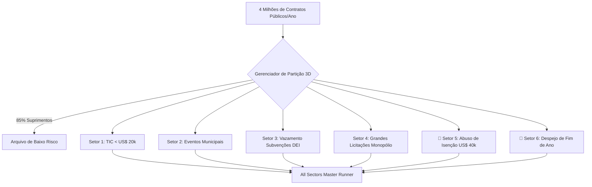

> 📌 **Principais Conclusões (Key Takeaways)**
> - **Suíte Completa em 6 Setores**: Filtragem de 85% de suprimentos rotineiros em 4 milhões de contratos, expandindo a vigilância para **6 setores críticos de fraude**.
> - **2 Pontos Cegos Revelados**:
>   1. **Setor 5 (Fracionamento sob Isenção de US$ 40 mil)**: Manobra concentrando contratos no limite de 98% do teto legal (US$ 180 mil identificados).
>   2. **Setor 6 (Despejo Orçamentário de Fim de Ano)**: 3 contratos concedidos em 4 dias no final de dezembro para evitar devolução de recursos.
> - **Prevenção Arquitetural**: Análise de proximidade ao teto (96-99,8%) e checagem de viabilidade física de entrega antes da virada do ano.
> - **Correção de Bugs**: Desduplicação inter-setorial por gravidade e normalização de preços sem impostos.

{/* truncate */}

---

### ⚠️ Aviso Legal e Anonimização (Legal Notice)

> **[Aviso] Todos os dados foram estritamente anonimizados.**  
> Órgãos públicos (`Órgão A`), contratadas (`Empresa D`), indivíduos e contratos foram totalmente mascarados.

---

### 1. Arquitetura da Suíte de Auditoria em 6 Setores

---

### 2. Desafios Previstos e Correção de Falhas

1. **Isenção Legítima vs. Fracionamento Malicioso**: Cálculo de proximidade fina para não prejudicar empresas sociais idôneas.
2. **Fechamento Normal vs. Gastos Apressados**: Sinalização de projetos assinados após 15 de dezembro cuja entrega até 31 de dezembro é fisicamente impossível.
3. **Colisões de Setores**: Priorização por gravidade jurídica para evitar multiplicidade de relatórios.
4. **Cálculo Sem Impostos**: Dedução reversa de valores brutos para verificação precisa dos limites legais.

---

### 3. Validação em Campo e Resultados

Descoberta de contratos fracionados de US$ 39 mil no `Órgão A` e repasses emergenciais de US$ 100 mil no `Órgão C` em dezembro; 17 baterias de testes aprovadas com sucesso.
