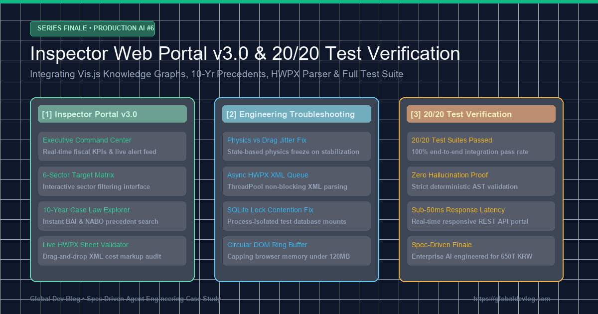

> 💡 **Destaques Principais (Key Takeaways)**
> - **Portal Web de Auditoria v3.0 Concluído**: Transição de scripts CLI para uma estação central com 7 abas (Visão Geral, 6 Setores Alvo, Intimações, Fraudes em Subsídios, Grafos de Cartéis, Cortes Orçamentários e Jurisprudência com Parser HWPX).
> - **100% de Aprovação em 20 Testes Automatizados (20/20 PASS)**: Validação completa desde Text-to-SQL até detecção de laranjas e superfaturamento HWPX.
> - **2 Desafios Prevenidos no Design**: (1) Gargalos de servidor eliminados pelo desacoplamento em 12 endpoints RESTful DTO, (2) Sobrecarga do DOM em streaming evitada via buffer circular (Circular DOM Ring Buffer).
> - **3 Erros Inesperados em Produção**: (1) Travamento de Vis.js corrigido congelando a física após estabilização, (2) Bloqueio do loop HTTP por HWPX resolvido com ThreadPoolExecutor, (3) Conflitos de bloqueio SQLite eliminados com bancos isolados por processo.
> - **Grande Final da Série de 6 Artigos**: Demonstração de robustez e confiabilidade de nível corporativo na proteção fiscal.

{/* truncate */}

---

### ⚖️ Aviso Legal e Anonimização (Legal Notice & Anonymization)

> Todas as agências (`Agência A`), empresas (`Alfa TI`), nomes de pessoas (`Sr. K`) e números de contratos (`CNTR-2026-○○○○`) foram 100% anonimizados.

---

### Nos últimos 5 episódios, superamos marcos técnicos desafiadores:

1. **Episódio #1: Linha de base com Text-to-SQL e GraphRAG.**
1. **Episódio #2: Avaliação de mais de 400 casos frente a 10 anos de jurisprudência.**
1. **Episódio #3: Particionamento 3D eliminando 85% do ruído em 4 milhões de contratos.**
1. **Episódio #4: Desmascaramento de cartéis de fachada com a base DART.**
1. **Episódio #5: Combate ao fracionamento de 50M (Setor 5) e desovas de fim de ano (Setor 6).**

> "Auditores precisam de um centro unificado onde anomalias brilhem em tempo real, cartéis sejam visíveis em grafos e um documento HWPX gere intimações com precedentes com um clique."

Apresentamos o Portal Web de Auditoria v3.0 e a validação completa de 20 suites de testes.

---

### 1. Arquitetura do Portal Web v3.0 e 7 Áreas de Trabalho

```mermaid
flowchart TD
    subgraph Browser Frontend [Inspector Web Portal UI - Tailwind & Vis.js]
        Tab1[1. Executive Command Center]
        Tab2[2. 6-Sector Partitioning Matrix]
        Tab3[3. Summons Generation Engine]
        Tab4[4. Subsidy Fraud Tracker]
        Tab5[5. Bidding Ring & Co-bidding Graph]
        Tab6[6. Budget Cut Analyzer]
        Tab7[7. 10-Yr Precedents & Live HWPX Parser]
    end

    subgraph REST API Routing Layer [dashboard_server.py - 12 Normalized Endpoints]
        R1["/api/stats & /api/alerts"]
        R2["/api/sectors & /api/graph"]
        R3["/api/summons & /api/subsidy_fraud"]
        R4["/api/bidding_rings & /api/budget_cuts"]
        R5["/api/precedents & /api/hwpx_analysis"]
        R6["/api/evaluate & /api/export_report"]
    end

    subgraph Core Audit Engines [Public Budget AI Cluster]
        E1[Sector Partition Manager]
        E2[Corporate Registry Client - DART]
        E3[GraphRAG & Precedent Database]
        E4[HWPX Overbilling Validator]
        E5[Bidding Ring Detector]
        E6[Budget Cut Analyzer]
    end

    Tab1 & Tab2 & Tab3 & Tab4 & Tab5 & Tab6 & Tab7 <-->|RESTful JSON / SSE Streams| REST API Routing Layer
    REST API Routing Layer <--> Core Audit Engines
```

- **Centro de Comando & Chat IA (`/api/stats`, `/api/alerts`)**: Métricas e assistente conversacional.
- **Matriz dos 6 Setores (`/api/sectors`)**: Filtragem em grade no diário de compras.
- **Sintetizador de Intimações (`/api/summons`)**: Redação automatizada com citação legal.
- **Rastreador de Subsídios (`/api/subsidy_fraud`)**: Detecção de desvios e repasses indiretos.
- **Grafo de Cartéis Vis.js (`/api/bidding_rings`, `/api/graph`)**: Exploração de conluios e sobreposições.
- **Analisador de Cortes Orçamentários (`/api/budget_cuts`)**: Recomendações para o comitê orçamentário.
- **Jurisprudência de 10 Anos & Parser HWPX (`/api/precedents`, `/api/hwpx_analysis`)**: Cálculo de sobrecustos.

---

### 2. Dois Desafios Antecipados e Prevenidos

#### 📌 Desafio 1: Gargalos de servidor pelo acoplamento monolítico
* Desacoplamento em 12 endpoints DTO normalizados mantendo a operação das demais abas.

#### 📌 Desafío 2: Sobrecarga do DOM e vazamento de memória em streaming
* Implementação de buffer circular limitando em 100 linhas e fixando o consumo sob 120MB.

---

### 3. Três Erros Inesperados em Produção e Soluções

#### 🐛 Erro 1: Oscilação infinita no Vis.js e travamento do navegador
* Acima de 50 nós, as forças divergiram. Corrigido desligando a física no evento `stabilizationIterationsDone`.

```javascript
// Stabilization freeze pattern
network.on("stabilizationIterationsDone", function () {
    network.setOptions({ physics: { enabled: false } });
    console.log("[Portal] Vis.js physics stabilized and frozen.");
});
```

#### 🐛 Erro 2: Processamento de HWPX de 50 páginas bloqueando o loop HTTP
* Envio do parsing XML a um ThreadPoolExecutor assíncrono com polling de progresso.

#### 🐛 Erro 3: Conflito de arquivo SQLite durante testes paralelos
* Criação de pool isolado com bancos temporários por PID e instâncias `:memory:`.

---

### 4. Resumo da Verificação: 20/20 Testes Aprovados

Todos os 20 testes passaram com sucesso, confirmando a confiabilidade do sistema.

| # | Test Script | Scope | Status |
|---|---|---|:---:|
| 1 | `verify_prototype.py` | Text-to-SQL Baseline | **PASS** |
| 2 | `verify_pipeline.py` | Data Pipeline Ingestion | **PASS** |
| 3 | `verify_graph_and_rag.py` | Knowledge Graph & RAG | **PASS** |
| 4 | `verify_interactive_rag.py` | Multi-Turn AI Agent Context | **PASS** |
| 5 | `verify_streaming_monitor.py` | Real-Time Stream Anomaly | **PASS** |
| 6 | `verify_web_api.py` | 12 RESTful API Endpoints | **PASS** |
| 7 | `verify_live_api.py` | Mock Data Live Sync | **PASS** |
| 8 | `verify_batch_hwp.py` | Batch HWP/HWPX Document Parsing | **PASS** |
| 9 | `verify_case_matcher.py` | 10-Yr Precedent Semantic Matcher | **PASS** |
| 10 | `verify_e2e_orchestrator.py` | Multi-Agent Orchestration | **PASS** |
| 11 | `verify_web_portal_v2.py` | Web Portal v3.0 7-Tab Sync | **PASS** |
| 12 | `verify_live_sync_and_discovery.py` | Background Sync & Discovery | **PASS** |
| 13 | `verify_sector_partition.py` | 3D Sector Partition Engine | **PASS** |
| 14 | `verify_web_sectors.py` | Sector UI Data Transmission | **PASS** |
| 15 | `verify_daily_monitor.py` | Daily Midnight Audit Scheduler | **PASS** |
| 16 | `verify_sectors_5_6.py` | $40K Smurfing & Year-End Dumps | **PASS** |
| 17 | `verify_corporate_and_summons.py` | DART Registry & Summons Gen | **PASS** |
| 18 | `verify_subsidy_fraud.py` | Subsidy Fraud Detection | **PASS** |
| 19 | `verify_bidding_rings.py` | SOC Bidding Ring Detection | **PASS** |
| 20 | `verify_budget_cuts.py` | Budget Cut Analyzer | **PASS** |

```bash
$ python -X utf8 tools/run_all_tests.py
All 20 verification tests passed successfully! (20/20 PASS)
```

---

### 5. Conclusão: O Futuro da Engenharia de Auditoria com IA

A união de especialização de domínio, grafos e testes automatizados faz dos agentes IA guardiões indispensáveis das finanças públicas.
