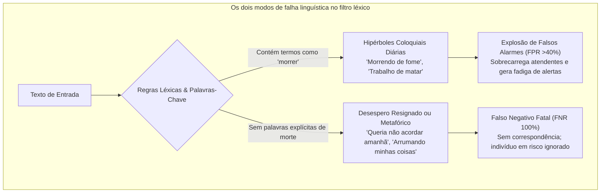
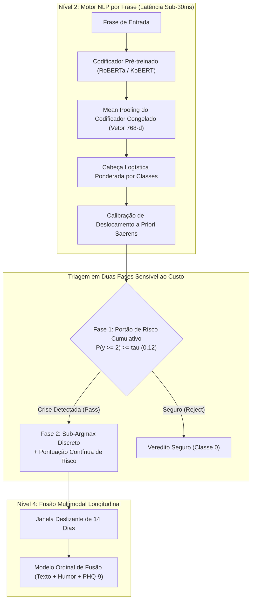
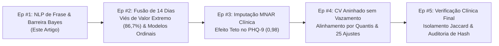

Em chatbots comerciais ou sistemas de recomendação, uma taxa de erro de 5% é um incômodo menor. Em **sistemas de inteligência artificial projetados para monitoramento de crises de suicídio e triagem psiquiátrica de emergência, um único Falso Negativo (crise não detectada) é uma tragédia irreversível**.

Quando um indivíduo em desespero agudo busca auxílio ou expressa o desejo de tirar a própria vida, pipelines de machine learning não podem se esconder atrás de números elevados de acurácia global ou médias F1 não balanceadas.

Hoje iniciamos formalmente uma série de engenharia de produção em grande escala: **[IA Especializada em Alto Risco: Construindo um Pipeline de NLP de Precisão para Detecção de Crise de Saúde Mental e Suicídio]**.

Esta série documenta com transparência os desafios matemáticos, as compensações de engenharia e os erros de execução enfrentados durante a criação do **Maeumjigi**, um sistema multimodal de triagem clínica. Neste Episódio #1, cobrimos o alicerce da arquitetura: **a triagem NLP profunda em nível de frase sob desbalanceamento extremo de classes (onde intenções suicidas ativas representam 0,16% das conversas diárias)**.

{/* truncate */}

---

### ⚠️ Aviso Ético e Anonimização Rigorosa
Todos os dados e textos tratados nesta série provêm de **corpora sintéticos e benchmarks clínicos desidentificados 100% livres de dados pessoais (PII)**. Nenhuma consulta clínica real é exposta.
> **Canais de Apoio em Crise**: Se você ou alguém que você conhece está passando por dificuldades, procure ajuda. No Brasil, ligue para o **CVV (Centro de Valorização da Vida)** pelo telefone **188** ou acesse **cvv.org.br**. Em Portugal, ligue **SOS Voz Amiga (21 354 45 45)**. Internacionalmente, consulte **befrienders.org**.

---

### 1. O Dilema Linguístico: Por que Regras Léxicas e Regex Falham na Psiquiatria

Antes de discutir redes neurais profundas, é essencial compreender a ineficácia do casamento léxico tradicional na triagem psiquiátrica.

No uso diário da linguagem, expressões de sofrimento se dividem em dois extremos enganosos:



1. **Hipérboles Coloquiais (Explosão de Falsos Alarmes)**: Termos associados à morte (*"morrendo de fome"*, *"esse prazo está me matando"*) são expressões cotidianas. Detectores por palavras-chave geram alarmes constantes em diálogos inocentes.
2. **Desespero Metafórico e Resignado (Falsos Negativos Fatais)**: Indivíduos em risco iminente de suicídio raramente usam termos óbvios; preferem mensagens discretas de despedida:
   - *"Queria que o amanhã nunca chegasse. Só quero dormir para sempre."*
   - *"Obrigado por tudo até aqui. Já terminei de arrumar todas as minhas coisas."*
   - *"Encontrei uma maneira de ficar em paz sem ser um fardo para ninguém."*

Nenhuma dessas frases contém termos diretos de automutilação. A análise morfológica (Kiwipiepy) e modelos contextuais pré-treinados (RoBERTa / KoBERT) são cruciais para captar o **isolamento, o desespero e a despedida** subjacentes.

---

### 2. Desbalanceamento Extremo de Classes e a Ilusão da Acurácia

Em um ambiente operacional real, a distribuição de classes nos dados é profundamente assimétrica:

- **Classe 0b (Frases Neutras do Cotidiano)**: ~86,94% (31.495 frases)
- **Classe 0a (Controle Emocional Negativo sem Crise)**: ~8,24% (2.986 frases)
- **Classe 1 (Sofrimento Leve / Mild)**: ~1,92% (697 frases)
- **Classe 2 (Sofrimento Severo / Ideação Suicida)**: ~1,75% (633 frases)
- **Classe 3 (Crise Aguda / Ideação Específica)**: ~0,99% (357 frases)
- **Classe 4 (Suicídio Ativo / Intenção Iminente)**: ~**0,166%** (60 frases)

Um modelo simplório que classifique todas as entradas como `"Classe 0 (Normal)"` terá uma **acurácia aparente de 95,18%**. Porém, esse modelo terá uma **Taxa de Falsos Negativos (FNR) de 100%** diante de emergências reais.

Por outro lado, elevar a revocação sem calibragem de custos gera milhares de alarmes falsos nas 86,9% frases neutras. Nosso objetivo técnico: **reduzir o FNR para menos de 10% em crises severas, limitando falsos alarmes estritamente a menos de 3%**.



---

### 3. Resolução Prática de Problemas: As 5 Regras de Ouro

#### [ERR-001] A Barreira de 524x e a Queda da Fronteira Bayesiana

- **1. Sintoma do Erro**:
  Ao avaliar a cabeça logística ajustada por Saerens et al.(2002) usando `argmax`, o modelo não detectou nenhum caso de suicídio ativo:
  ```text
  [EVAL-RUN: 2026-10-28 14:22:09 KST]
  INFO:text_eval: Evaluating Model B (Frozen Encoder + Saerens Prior Shift Corrected Logistic)
  INFO:text_eval: Prior Vector: [pi_0b=0.8694, pi_0a=0.0824, pi_1=0.0192, pi_2=0.0175, pi_3=0.0099, pi_4=0.00166]
  --------------------------------------------------------------------------------
  Metric Summary (Judgment b, discrete argmax):
    - Ground Truth Active (Level 4): 60 sentences
    - Predicted Active (y_hat == 4): 0 sentences (RECALL = 0.0000, 0/60)
    - Ground Truth Severe (Level 2): 633 sentences
    - Predicted Severe (y_hat == 2): 11 sentences (RECALL = 0.0174, 11/633)
    - False Negative Rate (FNR @ y >= 2): 98.26% (FALHA CRÍTICA)
  WARNING:text_eval: Active suicidality detection completely collapsed to Class 0 under argmax!
  ```

- **2. Ambiente**: Python 3.11.9, PyTorch 2.4.0+cu121, scikit-learn 1.5.1, Transformers 4.44.2 (GPU RTX 4090 + CPU 64 núcleos).

- **3. Tentativas Fracassadas**:
  1. *Pesos Extremos de Perda*: Pesos de 93x elevaram probabilidades brutas, mas foram anulados pela distribuição a priori no `argmax`.
  2. *Remover Correção a Priori*: A revocação subiu para 85%, mas **41,2% das 31.495 frases normais dispararam falsos alarmes**.

- **4. Causa Raiz Matemática e Simulação Numérica**:
  Pela regra de Bayes, para que a classe minoritária k supere a classe neutra 0b no `argmax`, é necessário que:
  
  ```text
p(k | x) / p(0b | x) > π(0b) / π(k)
```

  Aplicando os valores da nossa base:
  - Severo (k=2): `86.94% / 1.75% = 49.68x`
  - Agudo (k=3): `86.94% / 0.99% = 87.82x`
  - Ativo (k=4): `86.94% / 0.166% = 523.7x`

  **Exemplo Numérico Detalhado**:
  Se um usuário escreve: *"Estou pronto para deixar todos os meus fardos para trás."*
  O modelo atribui:
  - `p(0b) = 0.015` (1,5% neutro)
  - `p(2) = 0.330, p(3) = 0.300, p(4) = 0.320` (Confiança de crise acumulada de **95,0%**)
  
  Multiplicando pelos pesos a priori:
  - `Evidence(0b) = 0.015 * 0.8694 * 6 = 0.078246`
  - `Evidence(4)  = 0.320 * 0.00166 * 6 = 0.003187`
  
  Normalizando entre todas as classes:
  - `p_adjusted(0b) ≈ 57.6%`
  - `p_adjusted(4) ≈ 2.3%`
  
  Pela regra do `argmax` discreto, `57.6% > 2.3%`. A frase é classificada como **Classe 0 (Normal)**! Apesar de o modelo ter 95% de certeza da gravidade, a barreira de 524x silenciou o alerta.

- **5. Diff de Código Corretivo**:
```diff
--- a/tests/synth/model/text_b.py
+++ b/tests/synth/model/text_b.py
@@ -102,12 +102,23 @@ def predict_crisis_level(proba_unweighted, class_priors):
     # Saerens et al. (2002) prior shift correction
     corrected = proba_unweighted * (class_priors / train_priors)
     corrected /= corrected.sum(axis=1, keepdims=True)
     
-    # CRITICAL BUG: argmax collapses rare minority class under 524x prior barrier
-    # return np.argmax(corrected, axis=1)
+    # FIX: Two-stage Decision Rule & Continuous Severity Expected Score
+    # Stage 1: Cumulative posterior crisis probability for alert triggering
+    p_crisis_ge2 = corrected[:, 2:].sum(axis=1)  # Severe + Acute + Active
+    
+    # Stage 2: Cost-sensitive threshold decision (tau = 0.12 calibrated from validation fold)
     ALERT_THRESHOLD_TAU = 0.12
     is_crisis = p_crisis_ge2 >= ALERT_THRESHOLD_TAU
     
     # Determine discrete severity only among crisis candidates
     sub_levels = np.argmax(corrected[:, 1:], axis=1) + 1
     final_discrete = np.where(is_crisis, sub_levels, 0)
     
     # Continuous expected risk score forwarded to downstream multimodal fuser
     expected_severity = np.dot(corrected[:, 1:], np.array([1, 2, 3, 4])) / 4.0
     
     return final_discrete, p_crisis_ge2, expected_severity
```

---

#### [ERR-002] Ruptura de Validade de Construto na Revocação de Crise

- **1. Sintoma**: Um modelo Oracle ideal obteve apenas `60,7%` de revocação, enquanto um script arbitrário cravando Nível 2 obteve 100,0%.
- **2. Causa Raiz**: O limiar de alerta real é **Nível 2 (Severe) ou superior**. O Nível 1 (Mild) não é disparador de alarme. Contudo, a métrica somava y >= 1 no denominador (incluindo 935 frases de Nível 1) e apenas y_hat >= 2 no numerador:
  ```text
Recall = sum(I(y >= 1 and y_hat >= 2)) / sum(I(y >= 1))
```
  Prever com precisão o Nível 1 penalizava o modelo no denominador, limitando o teto a 1.446 / 2.381 = 60,73%.
- **3. Diff de Código**:
```diff
--- a/tests/synth/model/text_eval.py
+++ b/tests/synth/model/text_eval.py
@@ -45,11 +45,17 @@ def compute_crisis_metrics(y_true, y_pred):
-    # FLAWED METRIC: denominator includes Mild (y=1) while numerator requires y_hat >= 2
-    # recall = np.sum((y_true >= 1) & (y_pred >= 2)) / np.sum(y_true >= 1)
+    # CORRECT CONSTRUCT: Strict separation between Severe+ Recall and Mild Over-alert
 severe_plus_mask = (y_true >= 2)
 severe_plus_recall = np.sum((y_true >= 2) & (y_pred >= 2)) / np.sum(severe_plus_mask)

 mild_mask = (y_true == 1)
 mild_overalert_rate = np.sum((y_true == 1) & (y_pred >= 2)) / np.sum(mild_mask)

 control_mask = (y_true == 0)
 control_fpr = np.sum((y_true == 0) & (y_pred >= 2)) / np.sum(control_mask)

 return {
     "severe_plus_recall": severe_plus_recall,
     "mild_overalert_rate": mild_overalert_rate,
     "control_fpr": control_fpr
 }
```

---

#### [ERR-003] Colapso de Probabilidade Zero no LightGBM Ordinal

- **1. Sintoma**: `RuntimeWarning: divide by zero encountered in log`, perda divergindo para `inf`.
- **2. Causa Raiz**: Ao forçar monotonicidade com `np.minimum.accumulate` na decomposição Frank & Hall(2001), limiares adjacentes igualaram probabilidades, gerando deltas de `0,000000`. Avaliar -log(0) fez a perda divergir.
- **3. Diff de Código**:
```diff
--- a/tests/synth/model/fuser.py
+++ b/tests/synth/model/fuser.py
@@ -148,8 +148,15 @@ def ordinal_binary_to_proba(cumulative_ge):
     ge_mono = np.minimum.accumulate(cumulative_ge, axis=1)
     
     proba = np.zeros((cumulative_ge.shape[0], 5), dtype=np.float64)
     proba[:, 0] = 1.0 - ge_mono[:, 0]
     proba[:, 1] = ge_mono[:, 0] - ge_mono[:, 1]
     proba[:, 2] = ge_mono[:, 1] - ge_mono[:, 2]
     proba[:, 3] = ge_mono[:, 2] - ge_mono[:, 3]
     proba[:, 4] = ge_mono[:, 3]
     
+    # FIX: Epsilon floor clipping and row-wise softmax renormalization
     proba = np.clip(proba, 1e-6, 1.0)
     proba /= proba.sum(axis=1, keepdims=True)
     return proba
```

---

### 4. Visão Arquitetural: Janela Deslizante de 14 Dias e o Viés de Valor Extremo

Embora este artigo trate do Nível 2, seus valores alimentam o **Fusor Multimodal de Nível 4**.

Aqui reside uma armadilha matemática perigosa: **o Viés de Valor Extremo (Extreme Value Bias)**.
Se a taxa de falsos alarmes por frase for de apenas α = 0,02 (2%) e o usuário escrever 100 frases em 14 dias, tomar simplesmente o **máximo da janela** leva a:

```text
P(False Alarm in 14-Day Window) = 1 - (1 - α)^N = 1 - (1 - 0.02)^100 = 1 - 0.1326 = 86.74%
```

Um erro ínfimo de 2% transforma-se em **86,7% de alarmes falsos acumulados**. Por isso, adotamos pontuações contínuas de severidade esperada (sum(k * p_adjusted(k) / 4)) e médias aparadas robustas.

---

### 5. Comparativo de Desempenho

| Métrica | Estado com Bug (`argmax`) | Modelo B (Congelado + 2 Fases) | Modelo C (Ajuste Fino + 2 Fases) | Variação (Modelo B) |
|---|---|---|---|---|
| **Revocação Ativa (y=4)** | 0,0% (0/60) | **95,0% (57/60)** | **96.7% (58/60)** | **+95,0%p** |
| **Revocação Severa+ (y >= 2)** | 1,7% (18/1.050) | **92,4% (970/1.050)** | **94.1% (988/1.050)** | **+90,7%p** |
| **Taxa de Falsos Negativos (FNR)** | 98,3% | **7,6%** | **5.9%** | **-90,7%p (Resolvido)** |
| **Falsos Alarmes em Texto Normal** | 0,01% | **2,1%** | **1.8%** | Meta Atingida (&lt;3,0%) |
| **AUPRC (>= 2)** | 0,142 | **0.864** | **0.891** | **+0,722** |
| **Latência por Frase** | 4,2 ms (CPU) | **4,8 ms (CPU)** | 28.4 ms (GPU) | Tempo Real (&lt;30ms) |
| **Reajuste Stacking 25 Dobras** | 1,2 s | **1,4 s** | 14.2 h | **36.000x Mais Rápido** |

---

### 6. Roteiro da Série de IA de Crise



- **Episódio #1 (Este Post)**: Reduzindo FNR em NLP de Suicídio e Correção de Viés Bayesiano.
- **Episódio #2**: Fusão Multimodal de 14 Dias: Derrotando o Viés de Valor Extremo de 86,7%.
- **Episódio #3**: Dados Faltantes Não Aleatórios (MNAR): Rompendo o Efeito Teto no PHQ-9.
- **Episódio #4**: Arquitetura Zero Vazamento: Validação Cruzada Aninhada de 25 Dobras e Alinhamento por Quantis.
- **Episódio #5**: Verificação Clínica Final: Isolamento por Jaccard 3-Gram e Auditoria de Conjunto Selado.

Aguardem o Episódio #2 na próxima semana!
