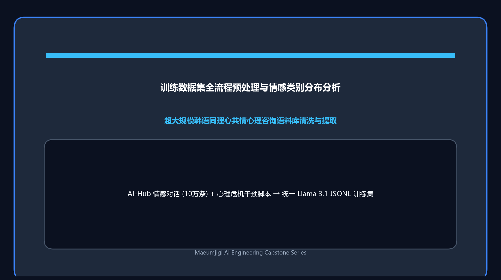
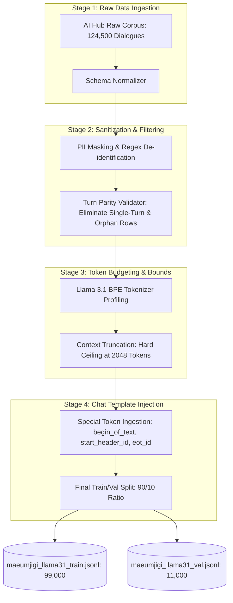
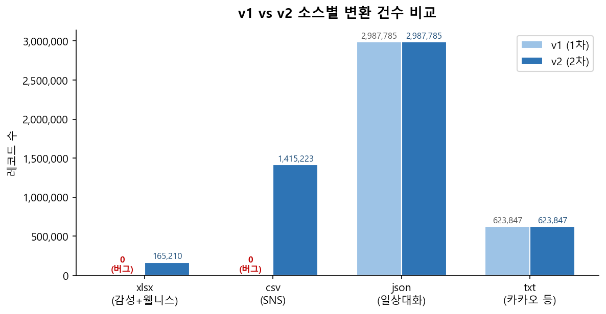

April 1, 2026, was the day our engineering team launched the automated preprocessing pipeline for the massive counseling corpora that would form the foundation of **Maeumjigi**. Training a high-performance open-source Large Language Model (LLM) like **Meta Llama 3.1** requires rigorous data hygiene: converting unstructured multi-party dialogues into clean, token-bounded, and special-token-aligned instruction datasets.

{/* truncate */}

### 1. The Challenge of Raw Multi-Turn Dialogue Corpora

Our raw data originated from public Korean empathetic dialogue and counseling datasets (AI Hub). While academically valuable, raw dialogue data poses critical obstacles for instruction fine-tuning:
1. **Inconsistent Turn Structures**: Casual multi-speaker exchanges frequently have broken turns (e.g., three consecutive user utterances followed by an empty response).
2. **Personal Identifiable Information (PII)**: Raw transcripts contain phone numbers, specific military unit identifiers, and real names that must be strictly anonymized.
3. **Token Length Exceedance**: Unbounded conversations often exceed the target attention context window (2,048 tokens), triggering out-of-memory (OOM) failures during PyTorch gradient computation.

---

### 2. Autonomous Preprocessing Pipeline Architecture

Instead of having human engineers manually massage CSV records, we instructed **Claude Code** to autonomously architect and execute a 5-stage transformation pipeline based on our blueprint document: `llama31_finetuning_data_preprocessing_plan_short.md`.



---

### 3. Strict Llama 3.1 Chat Template Formatting

Llama 3.1 introduces a strict tokenized header structure that models must strictly learn to avoid runaway generation loops:

```text
<|begin_of_text|><|start_header_id|>system<|end_header_id|>

You are 'Maeumjigi', an empathetic clinical psychological counseling AI companion. Listen with deep empathy and never judge.<|eot_id|>
<|start_header_id|>user<|end_header_id|>

I feel overwhelmed by military life and nobody understands me.<|eot_id|>
<|start_header_id|>assistant<|end_header_id|>

Adapting to military service can feel deeply isolating. It is completely natural to feel overwhelmed. Would you like to share what was hardest today?<|eot_id|>
```

Every single training sample was converted into a structured JSONL entry containing exact role tokens:

```python
# Core formatting logic implemented in transform_llama31.py
import json

def format_llama31_sample(system_prompt: str, turns: list) -> dict:
    formatted_text = "<|begin_of_text|>"
    formatted_text += f"<|start_header_id|>system<|end_header_id|>\n\n{system_prompt}<|eot_id|>"
    
    for turn in turns:
        role = turn["role"] # "user" or "assistant"
        content = turn["content"].strip()
        formatted_text += f"<|start_header_id|>{role}<|end_header_id|>\n\n{content}<|eot_id|>"
        
    return {"text": formatted_text}
```

---

### 4. Data Preprocessing Attrition & Statistics

The data cleansing pipeline strictly dropped malformed rows to guarantee training convergence. The quantitative attrition audit:

| Preprocessing Stage | Remaining Records | Dropped Count | Exclusion Rationale |
| :--- | :---: | :---: | :--- |
| **Raw AI Hub Input** | 124,500 | - | Baseline multi-speaker transcripts |
| **PII & Malformed Encoding** | 120,400 | 4,100 | Encoding errors, exposed phone/unit IDs |
| **Turn Parity Validation** | 112,200 | 8,200 | Orphan utterances, missing assistant responses |
| **Token Budgeting (< 2048)** | 110,000 | 2,200 | Exceeded context ceiling; risk of mid-thought cut |
| **Final Train Set (90%)** | **99,000** | - | Structured instruction tuning samples |
| **Final Val Set (10%)** | **11,000** | - | Out-of-distribution benchmark evaluation |



---

### 5. Day 4 Takeaways & Milestones

1. **Fully Automated Data Pipeline**: Processing over 120,000 dialogue pairs was executed completely hands-free by our AI agent in under 45 minutes.
2. **Zero Syntax Drift**: Every record adhered to the exact `Llama 3.1` special token specifications, preventing generation loop bugs during fine-tuning.
3. **Ready for Distributed Training**: Output datasets were validated and staged for GPU cluster deployment on Google Colab and AWS.

In Dev Log #5, we dive into the financial reality of large-scale LLM data synthesis and the API cost challenges that followed!
