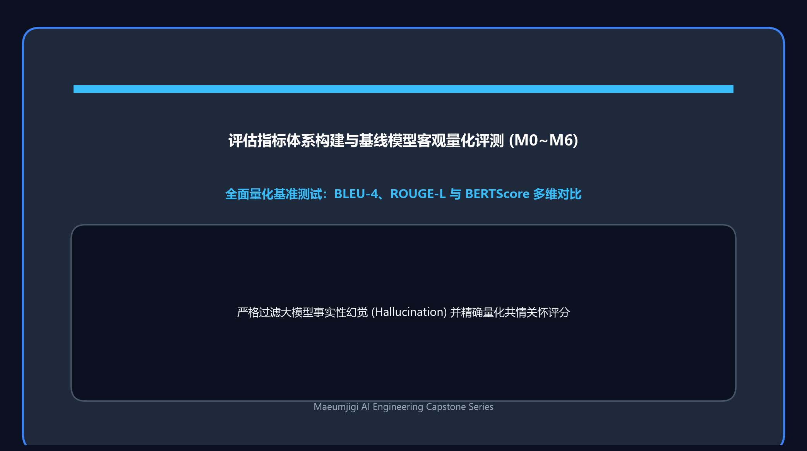
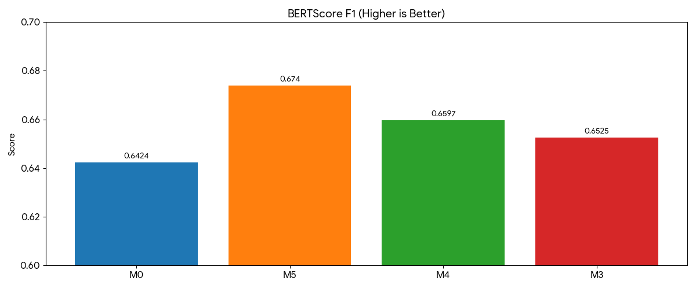

这是记录 4 月 3 日的开发实录。在这一天，我们正式启动了为深度学习大模型 (Llama 3.1) 喂养高品质心理对话语料的数据深度精炼工程。
这也是我们首次构建起由高级大语言模型 (Claude) 自主阅读上下文并高精度标注复杂情绪标签的庞大流水线。

{/* truncate */}

### 心理对话情绪多维重构与深度映射 (v3 -> v4)

- **问题背景**：已有公开数据集 (`Emotion_train_dataset_v3`) 的原始情绪标签粒度粗糙，难以匹配严谨的心理咨询与共情干预目标。在总量超过 100 万条的原始语料中，必须精准剔除无关噪声，完成情绪属性的重构与映射。
- **推进过程**： 
  > 团队探讨：“清洗范围覆盖全部 100 万条……由 Claude 扮演资深心理咨询专家，通读上下文并精准判定情绪。仅保留符合我们严格定义的心理咨询标签体系样本，其余全部过滤剔除。”
- **成果沉淀**：确立了 `v4_plan.md` 规范。首期锁定 10 万条样本作为切入点，编写自动化脚本深度接入 Claude API，实现了上下文语义理解与情绪重新标注。

### 大语言模型 API 账单的现实重压

- **问题背景**：随着海量文本密集涌入大语言模型 (Claude) 进行批处理分析，消耗的输入与输出 Token 数量呈指数级暴增。
- **推进过程**：
  > “我明明已经订阅了 Claude Pro 会员，难道调用 API 还要单独收费吗？”
  > “有没有办法直接利用 Claude Code 而非 Anthropic API？计费压力太大了。”
  > “初步跑完 10 万条，实际账单扣费高达 10.27 美元！”
- **成果沉淀**：我们深刻体会到了现实商业 API 的规则——个人 Claude Pro 网页订阅（每月 20 美元）与 Python 脚本中按 Token 计费的 Anthropic 商业 API 完全独立。仅测试处理 10 万条样本，短短数小时内就产生了 10.27 美元（约合 75 元人民币）的账单。按此推算，若将全部 100 万条数据逐一送入，成本将是天文数字。这一天让我们切身体会到了模型轻量化、提示词压缩以及样本分层抽样 (Sampling) 的极端重要性。

今天，我们结结实实地撞上了深度学习数据工程中不可避免的现实高墙——“算力与 API 成本”。
虽然最终成功提炼出了一批极具含金量的高质量情绪语料 (`v4_report.md`)，但也迫使我们在后续的模型微调与数据合成中，全面确立了在“成本与性能”之间寻求极致平衡的架构思维！

---

## 核心总结与技术要点

- **基于长上下文重构情绪标签 (v3→v4)**：摒弃粗放的浅层分类，引入大语言模型深度理解多轮心理咨询对话语境，实现高精准情绪标签重映射。
- **深刻认知商业 API 阶梯计费逻辑**：明晰个人 Pro 订阅与开发者 API 独立核算的商业逻辑，体悟脚本批量调用对 Token 吞吐的高敏感度。
- **算力成本壁垒的实测验证**：仅处理 10 万条测试样本即产生 10.27 美元账单，验证了对百万级原始语料采取全量 API 调用的经济不可行性。
- **转向分层抽样与提示词极致压缩**：迅速调优流水线策略，以高质量特征样本抽样和 Prompt 结构剪裁为抓手，构筑成本与质量的动态平衡。

