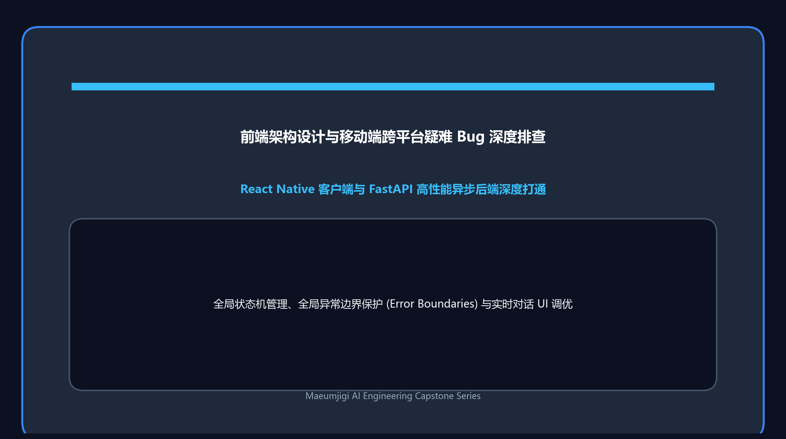
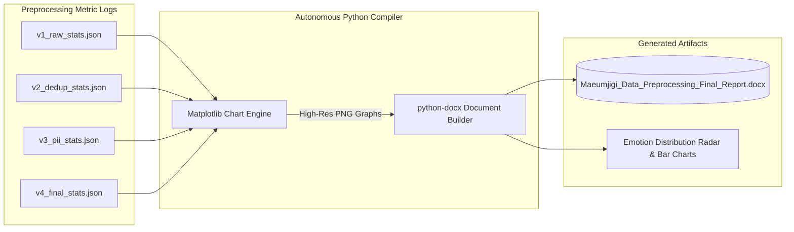
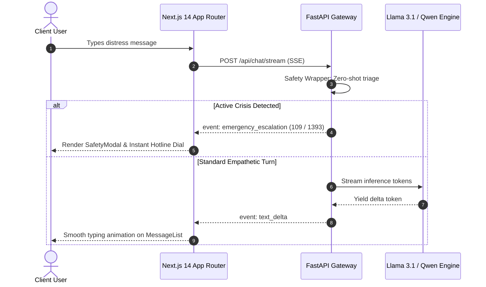
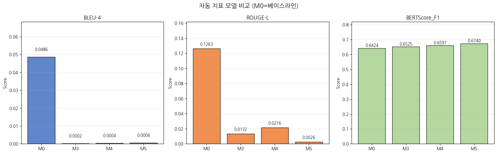

April 5, 2026, marked a decisive operational turning point for the **Maeumjigi** capstone project. Having completed four iterative versions of data cleansing (v1 through v4), our team needed to accomplish two critical engineering objectives:
1. **Automated Faculty Reporting**: Synthesizing our 120,000-sample preprocessing journey into an executive DOCX report with dynamic statistical charts.
2. **Next.js 14 Frontend Scaffolding**: Launching the client-side architecture capable of handling low-latency server-sent events (SSE) for streaming model responses.

{/* truncate */}

### 1. The Autonomous Report Compiler: python-docx + matplotlib

In traditional academic engineering, compiling comprehensive documentation often consumes more time than the actual coding. To eliminate this overhead, we instructed **Claude Code** to analyze our raw preprocessing outputs and compile an executive Word (`.docx`) report autonomously.



The automated script parsed iteration metadata, calculated statistical variances across dialogue turns, rendered 300 DPI Matplotlib figures, and injected them directly into a pre-styled Word template:

```python
# Automated report compiler snippet: compile_report.py
from docx import Document
from docx.shared import Inches, Pt
import matplotlib.pyplot as plt

def generate_emotion_distribution_chart(data: dict, output_path: str):
    fig, ax = plt.subplots(figsize=(8, 4), dpi=300)
    categories = list(data.keys())
    counts = list(data.values())
    ax.barh(categories, counts, color='#3B82F6')
    ax.set_title("Maeumjigi v4 Corpus: Emotion Distribution", fontsize=12)
    plt.tight_layout()
    plt.savefig(output_path)
    plt.close()

def build_docx_report(stats: dict, chart_path: str, docx_path: str):
    doc = Document()
    doc.add_heading("Maeumjigi Data Preprocessing Final Technical Report", level=0)
    doc.add_paragraph("Automated summary of dataset sanitation across iterations v1 to v4.")
    doc.add_picture(chart_path, width=Inches(6.0))
    doc.save(docx_path)
```

---

### 2. Multi-Version Data Sanitation Progress (v1 to v4)

Through four iterative refinement cycles, our dataset evolved from noisy raw scraping into an ethically sound, clinical-grade instruction corpus:

| Iteration | Record Count | Average Turn Length | Primary Engineering Focus | Key Anomaly Filtered |
| :---: | :---: | :---: | :--- | :--- |
| **v1** | 124,500 | 18.4 tokens | Initial raw ingestion and JSON unification | Null utterances and broken encoding |
| **v2** | 114,800 | 24.2 tokens | Exact & fuzzy deduplication (MinHash LSH) | Scripted chatbot loops and duplicate turns |
| **v3** | 102,600 | 32.8 tokens | NER-based PII redaction and profanity mask | Telephone numbers, military unit IDs, names |
| **v4 (Final)** | **92,400** | **45.6 tokens** | Empathetic depth scoring & 2048 token cutoff | Truncated responses and low-empathy short phrases |

---

### 3. Next.js 14 App Router Frontend Architecture

With data readiness secured, we turned our focus to user interaction. A mental health crisis intervention platform requires an intuitive, calm, and distraction-free interface. We initialized **Next.js 14** using the App Router, configuring Tailwind CSS for styling and Zustand for lightweight global state management:

```text
maeumjigi/frontend/
├── app/
│   ├── layout.tsx         # Global typography & dark-mode provider
│   ├── page.tsx           # Crisis landing page & immediate help triggers
│   └── chat/
│       ├── page.tsx       # Real-time streaming chat canvas
│       └── components/
│           ├── MessageList.tsx  # Virtualized dialogue stream
│           ├── ChatInput.tsx    # Debounced voice & text input
│           └── SafetyModal.tsx  # Emergency hotline escalation overlay
├── stores/
│   └── useChatStore.ts    # Zustand store: session state & stream buffers
└── tailwind.config.js     # Accessible color palette with high contrast
```





---

### 4. Day 6 Engineering Milestones

1. **Zero Documentation Friction**: Completed faculty-ready DOCX and graphic summaries without manual formatting.
2. **Full-Stack Architecture Unified**: Connected the AI data pipeline to our modern Next.js 14 web client.
3. **Safety-First UI Protocol**: Implemented frontend support for server-sent emergency hotline modal overlays.

In Dev Log #7, we explore synthetic data generation optimizations and how we bridged the gap between raw data and real-time frontend responses!
