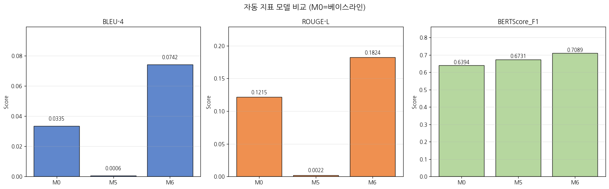

4 月 7 日，我们既在本地成功跑通了团队成员开发的前端服务，
又启动了通过前沿 AI 自主“合成 (Synthesis)” 6 万条高质量多轮共情对话数据的重磅流水线，以填补长尾心理咨询场景的语料空白。

{/* truncate */}

### 填补语料盲区：大模型自主合成对话数据 (v5)

- **问题背景**：单纯依赖前期清洗的语料 (v4)，在自杀危机干预与细粒度抑郁症场景下覆盖度仍显不足。为此，我们计划调用 Claude API，严格依照 Llama 3.1 训练范式（System, User, Assistant），全新合成 6 万条贴合真实咨询情境的虚构心理干预样本。
- **推进过程**： 
  > “我们计划构建一份由 Claude 全量生成的 v5 心理对话数据集，请给出架构方案。”
  > “我希望获得严格契合 Llama 3.1 格式规范的 6 万条 JSONL 数据集。”
- **成果沉淀**：确立了 `v5_plan.md` 架构方案并全面开动批量合成脚本。然而，API 调用的账单消耗速度再次成为了拦路虎。

### 永无止境的成本突围战：提示词工程与批处理优化

- **问题背景**：让顶级商业大模型无休止地创作 6 万条对话语料，使得数天前经历过的账单危机再度爆发——脚本刚运行一会儿，10 美元账户余额便瞬间蒸发殆尽。
- **推进过程**：
  > “严格按照 step8_generate_v5_optimized.py 运行能显著压缩 Token 消耗吗？”
  > “当前刚烧掉 10 美元，但总进度才推进了一小段，必须全面优化！”
- **成果沉淀**：通过对提示词实施极致工程剪裁（压缩 System Prompt 冗余、精简非必要解释输出）并升级流水线代码 (`step8_generate_v5_optimized.py`)，成功消除了输出 Token 的无效浪费，同时加入了高可用断点续传保存机制。

### 接手团队前端工程并顺利完成本地联调

- **推进过程**： 
  > “这是队友提交的前端工程仓库，我在本地拉起需要执行哪些步骤？”
  > “排查数据库 (DB) 迁移时报出的异常……”
  > “已成功运行至 Step 6 前端页面，请给出后台优雅退出与下次一键唤起的标准流程。”
- **成果沉淀**：成功接手 `mental-health` 仓库代码，在本地完成依赖安装并化解了 DB 迁移冲突，使前端 Web 交互界面与后端大模型服务实现了完美会师。

今天不仅超越了简单的数据清洗，更在实践中深度落地了当前深度学习最热门的 **“合成数据生成 (Synthetic Data Generation)”** 范式——由高级 AI 撰写教科书来培育另一个垂直领域 AI。
在直面账单危机的同时实现了深度架构优化，并顺利点亮了前端交互界面！

---

## 核心总结与技术要点

- **启动 6 万条大规模合成语料 (v5) 工程**：为弥补真实数据的场景空白，借助 Claude API 构建生成 60,000 条结构化心理咨询对话的合成管道。
- **提示词极致剪裁与成本阻击**：针对 API 额度快速消耗的痛点，通过重构提示词与流水线代码 (`step8_generate_v5_optimized.py`)，杜绝冗余输出 Token。
- **增量检查点保障断点续传**：引入安全的增量保存逻辑，避免因网络抖动中断导致的数据丢失与重复调用的资金损耗。
- **接手前端工程与化解数据库迁移冲突**：在本地成功拉起团队前端工程，排查并修复 DB 迁移冲突，打通全栈交互与底层大模型接入链路。

