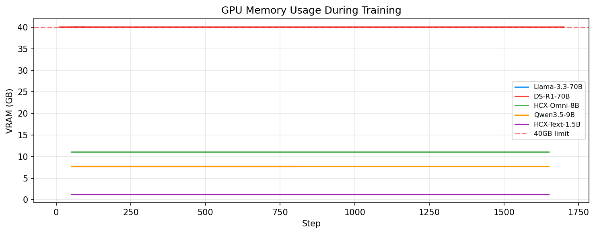

4 月 8 日，是我们在推进 Maeumjigi 项目期间经历的最严峻危机，也是令人哭笑不得的技术插曲——**Claude API 达到月度配额上限与突发扣费账单危机**。

{/* truncate */}

### 后台挂机的惨痛教训：“生成 10 条数据居然要烧掉 1 美元？”

- **问题背景**：以为昨天做完初步优化便高枕无忧，我们便将大规模合成数据集脚本挂在后台持续运转后离开。
- **推进过程**： 
  > “紧急问题：调用触发了月度消费告警，账单超额熔断！本以为后台会安稳执行，结果扣费失控！”
  > “这怎么可能？仅生成 10 条多轮对话居然消耗了整整 1 美元？这不合常理！”
- **成果沉淀**：在大模型深度合成高质量心理语料的过程中，随着多轮历史上下文（Input Tokens）不断累积叠加，每个请求的 Token 开销呈阶梯式暴涨，最终触发平台月度配额上限导致程序中止。我们紧急下达整改指令：“立刻在控制台实时打印预计 Token 消耗、实时账单金额与推进进度百分比，并强制加入硬性预算阻断熔断机制。”这成为我们使用云端 API 与大模型基础设施时极其深刻的工程监控启示录。

### 编写面向 Llama 3.1 训练的 Colab 全套代码

- **问题背景**：随着高质量清洗语料逐渐齐备，必须编写驱动 Llama 3.1 模型深度微调的代码。面对个人电脑消费级显卡显存严重不足的现实，团队转向 Google Colab 云端 GPU 训练环境。
- **推进过程**：
  > “请编写一份能在 Google Colab 上无缝执行 llama31_finetuning_experiment_plan_revised.md 的完整 Jupyter Notebook。”
  > “将训练数据严格按 9:1 的比例切分为 Train/Val 集合，剔除多余的 Test 切分以最大化训练样本量。”
- **成果沉淀**：AI 自主解析了微调实验方案，编写了结构精炼的 `llama31_finetuning_colab.ipynb` 脚本。代码完美集成了 Unsloth 等前沿显存轻量化微调框架，并稳固实现了 9:1 划分、梯度累积与动态评估逻辑。

今天，我们以一场令人心惊肉跳的“API 账单洗礼”跨越了真实世界的工程高墙。但作为回报，我们迎来了规整完备的合成训练集以及专为 Colab 打造的自动化微调 Notebook。
终于，下一站我们将正式踏入大模型的 GPU 实际训练征程！
