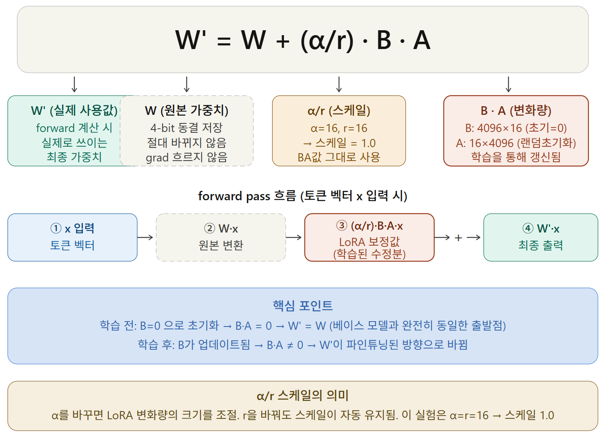

4 月 9 日，依托昨天完成的自动化 Notebook，我们终于迎来了人工智能大模型 (Llama 3.1) 的首轮正式微调训练。
然而现实充满荆棘，无数报错接踵而至。与此并行的，还有必须在深夜同步赶制第 6 周毕业设计中期答辩材料的极限挑战。

{/* truncate */}

### 云端微调深陷报错泥潭与技术攻坚

- **问题背景**：在 Google Colab 上刚运行 `llama31_finetuning_colab.ipynb`，各色红字报错便铺天盖地而来。
- **推进过程**： 
  > “请分析在 llama31_finetuning_colab (3).ipynb 中执行 M1 微调时报错的根本诱因是什么？”
  > “推理测试生成的文本末尾残留着未被解码剥离的 `<|eot_id|>` 和 `eos_token`，为什么会出现该截断异常？”
- **成果沉淀**：大模型在吐出长文本训练数据时，因特殊截断标记 (`eos_token`) 未被正确掩码以及 GPU 显存 OOM 溢出等问题连环爆发。我们将完整的报错堆栈日志全量复制投喂给 Claude，开展多轮交互式排错重构。历经反复调试，训练终于顺利收官，成功导出了直观印证收敛趋势的关键图表 `학습데이터별학습결과.png`（不同数据集下损失收敛对比图）！

### 让 AI 助理全权承接答辩 PPT 制作与数据库 ERD 重构

- **问题背景**：深夜紧盯模型收敛曲线的同时，下周一清晨就要面向教授进行第 6 周前端进展与数据库架构中期答辩。
- **推进过程**：
  > “Capstone_Week6_Frontend.pptx 包含了现阶段的原型截图。请据此撰写本周答辩逐字稿与幻灯片骨架。”
  > “依据后端已落地的表结构生成实体关系图 (ERD)……图表层级过于臃肿分散，请严格将 User 核心表居中对齐重构。”
- **成果沉淀**：令人惊喜的是，AI 自动将前端截图整合成逻辑清晰的答辩逐字稿与幻灯片骨架。面对我们关于“将 User 用户表置于视觉核心”的高强度多轮微调指令，AI 完美理清了多对多关联与外键约束，输出了极其规范的数据库架构关系全景图。

今天，我们真正体会到了亲手驾驭最新开源基座 Llama 3.1 领域微调的巨大成就感。同时，也彻底解锁了让 AI 全面赋能“代码工程、答辩宣讲、系统级 DB 架构图设计”的综合生产力极限。
经过微调洗礼的心语伴侣 AI 究竟进化得多么敏锐聪慧？下期我们将全面揭晓定性推理评测战报！
