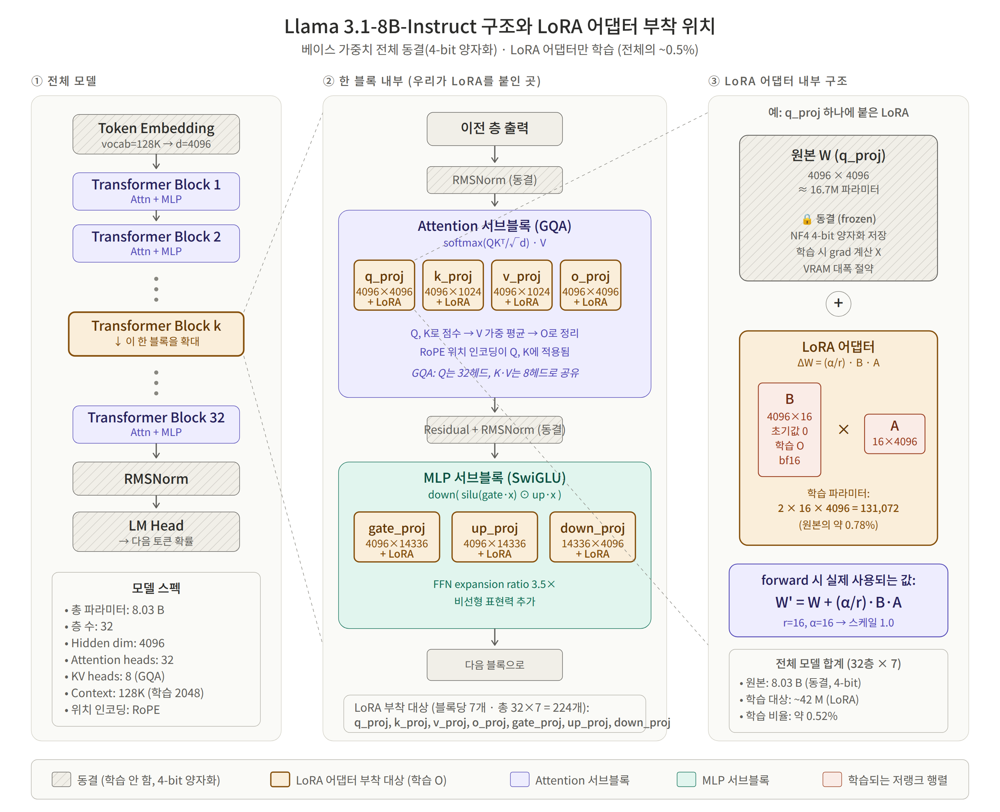

4 月 19 日，我们对历经心血生成的虚拟合成数据集 (v5) 训练出的全量微调大模型 (M6) 展开了多维度定性与定量评测，
并据此系统梳理并生成了第 7 周研发周报。那笔顶着扣费压力换来的合成语料，究竟能否在真实对话中交出令人惊艳的答卷？

{/* truncate */}

### 模型实战真刀真枪大对决：M0 vs. M5 vs. M6

- **问题背景**：为了向指导教授与评审专家论证微调成效，空洞的“效果显著提升”毫无说服力，必须拿出包含量化评测指标与微观文本对比的硬核证据链。
- **推进过程**： 
  > “请重构第 7 周报告。核心聚焦于基于 v4 语料的 M5 与基于全新 v5 语料的 M6 横向对比……详细列出各数据集的典型微调对话样本。”
  > “在阐述评测结论时，必须增加微调前基座原生模型 (M0) 与 M6 的直观差异对照实例。”
- **成果沉淀**：AI 系统分析了 M0、M5 与 M6 针对相同评测集的推论回复，输出了对比分析集 (`m0_m6_compare.json`)。评测印证：原生基座 Llama 3.1 (M0) 在处理韩语深度心理倾诉时显得机械冰冷；在清洗数据 (v4) 上微调的 M5 表现有所改善但同理心浅白；而在高质量合成数据 (v5) 上训练的 M6 模型，则展现出了心理咨询专家独有的温暖、细腻且极具同理心的专业引导力。

### 让 AI 助理全自动输出两套标准 DOCX 研发周报

- **推进过程**：
  > “以实验结论与学术意义为核心，分别撰写两份第 7 周周报（5 页以内的精炼答辩版，以及详尽工程复盘版）。并基于这两份 Markdown 分别编译导出规整的 DOCX 报告。”
- **成果沉淀**：指令下达后，`7주차_보고서_v1_간결.md` 与 `7주차_보고서_v2_상세.md` 双版本瞬时落成，并全自动转换为格式规范的 Word 文件。

### 引入 RAG 架构：构建 FAISS 向量检索知识库

- **推进过程**：
  > “我们搭建了基于 FAISS 的外部向量知识库，并编写了构建复盘报告。请对我们的架构设计与实施成果进行客观技术评审。”
- **成果沉淀**：除了通过监督微调修正大模型参数权重之外，为了彻底压制事实幻觉并注入权威心理学干预指南，我们引入了基于 FAISS 的 RAG（检索增强生成）架构。AI 对该外挂知识库设计给予了高度肯定的评审反馈 (`FAISS_DB_evaluation.md`)。

今天所有的付出都迎来了沉甸甸的汇报。当亲眼见证微调后的大模型在理解人类脆弱情绪方面展现出飞跃般的同理心时，那种震撼无与伦比！
模型能力得以验证，FAISS 向量知识库成功挂载，心语伴侣机器人距离全功能落地又跨出了决定性的一大步。

---

## 核心总结与技术要点

- **合成数据微调模型三方横向评测**：系统比对未经微调的原生底模 (M0)、清洗数据微调模型 (M5) 与高质量合成数据集 v5 训练模型 (M6) 的对话表现。
- **心理共情与专业对话质感飞跃**：M6 模型成功摆脱机械生硬的套话回应，呈现出符合专业心理咨询师水准的细腻共情力与临床温润感。
- **自动化产出学术周报工程**：基于结构化评测产物 (`m0_m6_compare.json`)，借助 AI 一键生成第 7 周精简版与详版 Word (`.docx`) 研发报告。
- **引入 FAISS 向量检索 RAG 架构**：在权重微调之外引入外挂知识库检索增强生成机制，有效压制大模型事实幻觉并夯实干预依据。

