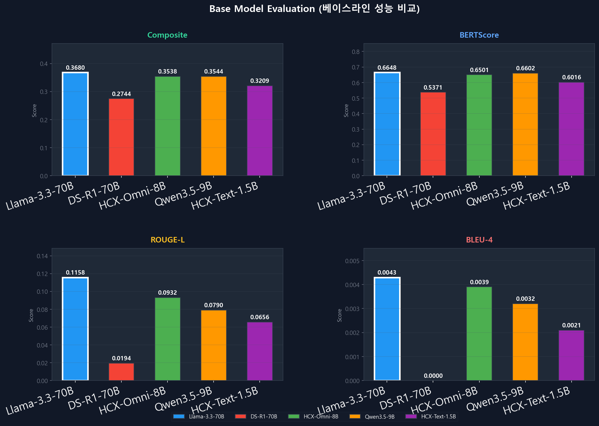

在彻底修复昨天排查出的别名硬编码缺陷后，5 月 13 日，我们终于重启了第二轮微调大模型真实端到端的推理生成能力基准测试。

{/* truncate */}

### 破除生硬断裂：放宽生成 Token 长度上限释放深层共情

逐句审读推理生成的应答文本时，我们发现 `Llama33-70B_a8` 模型的输出依然呈现出一种微妙的干瘪与机械紧缩感：

> “这是 Llama33-70B_a8 输出的典型答复。明显感觉 max_seq_length 与 max_new_tokens 设得太紧，严重束缚了模型表达。结合当前物理显存富余量，极限能上调至多少？”

结合当时约 39.8GB 的空闲 VRAM，我们果断将最大生成 Token 预算 (`max_new_tokens`) 调宽至 384。调整带来的生成质变立竿见影：

```text
[修改前] “产生这种消极念头一定让您备受折磨。及时向专业咨询师求助非常重要。”
[修改后] “产生这样的念头一定让您独自承受着巨大的痛苦。但请相信，这绝不代表您内心软弱，而是身体在向您发出信号——说明您此刻背负的压力已经严重超载了。我由衷建议您在专业咨询师的陪同下，试着把这些郁结的情绪一点一点倾诉梳理出来。”
```

仅仅是松绑了生成长度配额，模型便能从容保持长程逻辑一致性，吐露出层层递进、饱含人情温度与心理抚慰力量的真挚共情长句。此前模型之所以三缄其口，纯粹是被狭窄的生成长度强行截断了思路。

### LoRA 超参深度剖析：Alpha 缩放因子对比（a=8 vs. a=16）



第二轮微调的核心科研目的——验证 LoRA 缩放因子 `alpha` 对领域适应能力的影响也迎来了定量结论。
通过深入挖掘 `fine_tuning_2` 目录下的收敛日志，我们绘制出了 `05_alpha_comparison_daily.png` 等对比折线。在固定 `rank=16` 的前提下，清晰揭示了 $\alpha=8$（欠拟合防漂移）与 $\alpha=16$（强化领域风格吸收）在训练后期的损失震荡差异与主观咨询质量的微妙权衡。

在被赋予合理的超参数与充裕的生成空间后，各大模型终于蜕变出了我们最初构想中那个体贴细腻、专业包容的“心语伴侣”。
中期答辩材料的最终拼图，在此刻宣告圆满合拢！
