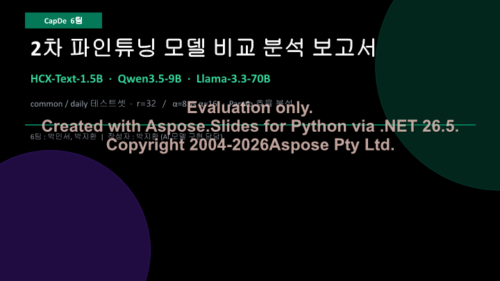

5 月 17 日，我们迎来了工程量极为密集的后端数据库联调与实验报告全自动生成攻坚战。

{/* truncate */}

### 借助 AI 实现复杂实验报告与 DOCX 自动化装配

面对第二轮微调 (`fine_tuning_2`) 沉淀的海量指标与模型横向对比图，人工撰写长篇技术报告已不现实。

> “请设计一套专门用于解析各模型推理评测数据的提示词框架，保存为 report_prompt.md，并驱动大模型全自动撰写综合对比报告。”
> “最终产物必须为排版规整的 Word (.docx) 文件而非纯文本 Markdown。”

我们通过精准的元提示词工程，驱使 AI 自主解析多维指标（Loss 趋势、困惑度、Alpha 缩放因子下的语义敏感度），一键导出了图文并茂的正式技术报告草案。

### 后端 PostgreSQL 数据库联调与“401 Unauthorized”死锁泥潭

报告编写告一段落，为了全面压测系统端到端稳定性，我们将 `backup.sql` 数据全量灌入本地 PostgreSQL 数据库。

> “向数据库导入备份完成，前端与后端成功拉起并访问首页，但点击所有子菜单均毫无响应。”
> “输入凭据反复提示密码错误：INFO: POST /auth/login 401 Unauthorized”

数据库虽成功恢复，系统却深陷登录鉴权全面瘫痪的死锁陷阱。我们编写了独立诊断脚本 `debug_login.py`，通宵排查密码哈希加盐算法与 FastAPI JWT 校验机制，反复重启 Uvicorn 调试服务，最终精准修复了迁移导致的散列模式错配。

### 技术架构升维思考：引入本体与知识图谱 (Knowledge Graph)

> “防自杀心理干预的核心生命线在于确定性的高安全底线。单纯押注黑盒 LLM 难免面临幻觉风险，结合本体论 (Ontology) 与知识图谱 (Knowledge Graph) 构建复合护栏，才能实现高稳定性的自律系统。”

深夜，为了打破单一模型参数记忆的黑盒局限，我们开始起草 `chatbot_design_prompt.md`，深度布局知识图谱与外部规则引擎的融合方案。随着五月中旬的推进，心语伴侣的技术架构正在迈向宏大的全栈工程新高度！
