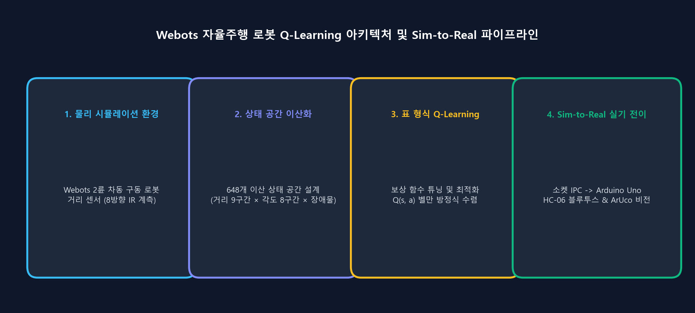

> 📌 **核心要点 (Key Takeaways)**
> - **问题痛点**：连续传感器数值（距离、朝向角）会导致表格型强化学习遭遇维数灾难（State-Space Explosion），同时 Python 强化学习智能体与 Webots 仿真内核之间需要维持微秒级、低延迟的物理同步。
> - **解决方案**：设计了基于几何学空间划分的 5 维连续传感器量化器（`discretizer.py`），生成 3 × 8 × 3 × 3 × 3 = 648 维离散状态；搭建了基于 TCP 5000 端口的极轻量级行分隔 JSON 套接字通信流水线。
> - **落地成效**：实现了 O(1) 复杂度的超高速 Q-Table 寻址更新，确保了仿真器与 Python 端 32ms 物理仿真步长的严格无阻塞同步。

{/* truncate */}

---

## 1. 项目研发背景：为何选择 Webots 与经典 Q-Learning？

让差速驱动机器人在未知的室内场馆中自主导航避障并抵达目标点，是移动机器人学的经典基石课题。尽管深度强化学习（DQN, PPO）在处理高维图像方面表现亮眼，但其庞大的参数量在边缘微控制器上推断延迟高，且缺乏数学上的完全可解释性。

在本专栏项目中，我们在 **Webots 3D 物理仿真引擎** 中应用经典的 **表格型 Q-Learning (Off-policy TD(0))**，旨在在 1.2m × 1.2m 的室内竞技场内训练出一套数学上完全可验证的最优避障与导航策略。

---

## 2. 系统架构设计：Webots 控制器 ↔ Python 强化学习引擎

系统解耦为清晰的两大层级：**Webots 仿真端（服务端）** 与 **Python 算法端（客户端）**：

```mermaid
flowchart LR
    subgraph Webots["Webots 3D 仿真器 (localhost:5000)"]
        Robot["Supervisor 机器人<br>(超声波传感器 + 驱动轮)"]
        HeadScan["摇头扫描机制<br>(左右 1.1 rad 舵机摆动)"]
        Server["TCP Socket 服务端<br>(行分隔 JSON 协议)"]
        Robot -→ HeadScan -→ Server
    end

    subgraph Python["Python 强化学习引擎 (客户端)"]
        Env["WebotsEnv (类似 gym 接口)<br>reset() / step()"]
        Disc["离散化映射器<br>(连续传感器 → 0~647 Bin)"]
        Agent["QLearningAgent<br>(Q-Table 形状 648x4)"]
        Env -→ Disc -→ Agent
    end

    Server <-→|"请求: {type: step, action: 0..3}<br>响应: {state: [...], reward, done}"| Env
```

* **Webots 控制器 (`RL_controller.py`)**：负责执行具体的动作指令 480ms（对应 15 个仿真步长 × 32ms），并驱动机载超声波传感器左右摆动 1.1 rad（约 63°）以消除盲区。
* **Socket 协议**：采用极度轻量的行分隔 JSON 格式进行 TCP 本地环回通信：
  * 发送动作请求：`{"type": "step", "action": 0}` (0: 前进, 1: 后退, 2: 左转, 3: 右转)
  * 接收环境反馈：`{"state": [0.45, 0.12, 0.35, 0.28, 0.40], "reward": 0.05, "done": false, "info": {...}}`

---

## 3. 连续传感器读数的 648 维离散状态量化

为了应用表格型强化学习，连续浮点读数必须被映射至有限离散状态空间。根据运动学关键特征，我们选取了 5 个核心状态变量：

| 传感器特征 | 量化区间数 (Bins) | 划分物理阈值 | 语义解释 |
| :--- | :---: | :--- | :--- |
| **`goal_distance`** (目标距离) | **3** | `[0.6m, 1.2m]` | 近距离 (Near), 中距离 (Mid), 远距离 (Far) |
| **`goal_heading`** (目标夹角) | **8** | [-π, π] (8个扇区, 每区45°) | 正前, 右前, 正右, 右后, 正后, 左后, 正左, 左前 |
| **`front_distance`** (前向测距) | **3** | `[0.15m, 0.30m]` | 碰撞危险 (Danger), 警示 (Caution), 安全 (Safe) |
| **`left_distance`** (左向测距) | **3** | `[0.15m, 0.30m]` | 危险, 警示, 安全 |
| **`right_distance`** (右向测距) | **3** | `[0.15m, 0.30m]` | 危险, 警示, 安全 |

总状态数规模：
**N_states = 3 × 8 × 3 × 3 × 3 = 648**

由此构建的 Q-Table 仅包含 **648 × 4 = 2,592 个浮点数条目（内存仅占约 2.5 KB）**，能在单片机微秒级寻址，彻底摆脱对 GPU 的依赖。

### 💻 状态离散化核心代码 (`discretizer.py`)

```python
import numpy as np

# 5个维度的量化分区基数
N_GOAL_D, N_GOAL_H, N_FRONT, N_LEFT, N_RIGHT = 3, 8, 3, 3, 3
N_STATES = N_GOAL_D * N_GOAL_H * N_FRONT * N_LEFT * N_RIGHT  # 648

_HEADING_BINS = np.linspace(-np.pi, np.pi, 9)[1:-1]
_NEAR_BINS    = np.array([0.15, 0.30])
_DIST_BINS    = np.array([0.6, 1.2])

def discretize(state_dict: dict) -> int:
    """将5元组连续传感器浮点读数映射至 [0, 647] 之间的1维整数索引。"""
    gd = int(np.digitize(state_dict["goal_distance"], _DIST_BINS))
    gh = int(np.digitize(state_dict["goal_heading"], _HEADING_BINS))
    df = int(np.digitize(state_dict["front_distance"], _NEAR_BINS))
    dl = int(np.digitize(state_dict["left_distance"], _NEAR_BINS))
    dr = int(np.digitize(state_dict["right_distance"], _NEAR_BINS))

    # 计算平铺的一维索引 (扁平化)
    index = ((((gd * N_GOAL_H + gh) * N_FRONT + df) * N_LEFT + dl) * N_RIGHT + dr)
    return int(index)
```

---

## 4. 舵机摇头扫描与物理碰撞判定逻辑



固定的前置单向传感器存在致命的侧方盲区。我们实现了主动式的 **摇头扫描机制 (Head-Scan)**：

1. **执行动作步**：轮子以 3.0 rad/s 驱动 480ms。
2. **头部旋转测距**：舵机向左摆动 +1.1 rad 采集左侧净空，随后向右打到 -1.1 rad 采集右侧净空。
3. **回正复位**：回位至 0 rad 更新正前方障碍物距离。
4. **终止状态条件**：
   * **抵达目标 (Goal Reached)**：与目标点欧氏距离 ≤ 0.10m → 成功 (`done = True`, 奖励 $+1.0$)
   * **碰撞发生 (Collision)**：任一方向实测距离 ≤ 0.08m → 失败 (`done = True`, 惩罚 $-1.0$)

---

## 5. 下篇预告

环境框架、Socket IPC 通信与 648 维状态离散化体系已经就位。

在第 2 篇中，我们将深入解析 **表格型 Q-Learning 更新公式的数学推导、ε-贪婪指数衰减策略，以及攻克稀疏奖励难题的稠密奖励函数设计 (Reward Shaping)**！
