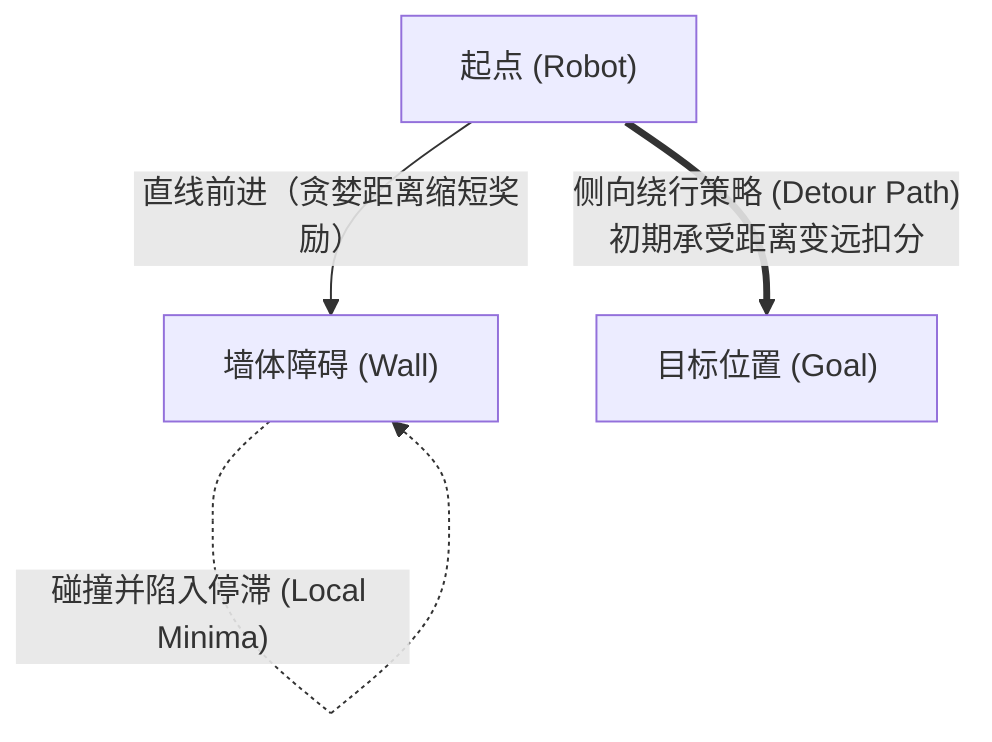

> 📌 **核心要点 (TL;DR)**
> - **问题 (Problem)**：当目标位于墙体正后方时，由于距离增量奖励 (+0.1 × Δdist) 固有的贪婪特性，机器人无法主动绕开障碍，而是反复正面撞墙，深陷严重的**局部最优 (Local Minima)** 死锁。
> - **解决方案 (Solution)**：将 3 方向超声波摇头扫描（前/左/右）状态感知与长远视界贝尔曼最优价值反向传播 (γ = 0.99) 相结合，并构建基于 PowerShell 的 **Webots Headless 无渲染加速流水线 (`headless_run.ps1`)**，对种子 0、1、2 进行自动化重复实验。
> - **实验结果 (Result)**：在 12 面墙体障碍环境下，智能体成功习得稳健的侧向绕行策略 (Detour Policy)，训练 600 个回合后目标到达成功率稳定维持在 90% 以上。

{/* truncate */}

---

## 1. 障碍环境面临的严峻挑战：Local Minima（局部最优）陷阱

在无障碍的开阔竞技场 (`no_obstacle`) 中，智能体只需调整朝向直面目标即可。然而，当在室内场地引入 **12 面内置隔断墙 (`obstacle12`)** 时，奖励函数的局限性暴露出了致命瓶颈：



* **直观困境**：当目标位于墙壁正后方时，朝向目标前行将直接诱发墙面碰撞。
* **奖励冲突与死锁**：要成功绕过障碍，智能体必须暂时背离目标行驶（导致即时距离增量奖励为负）。在缺乏充分探索的情况下，贪婪策略拒绝接受即时惩罚，导致机器人**在墙前频繁打转、不断发生轻微刮碰或耗尽 150 步超时上限**。

---

## 2. 破局之道：摇头扫描感知与时序差分价值反向传播

攻克该局部最优陷阱的关键在于将 **648 状态空间下的 3 方向测距感知（前方、左侧、右侧）** 与 **高折扣因子 (γ = 0.99)** 深度结合：

1. **多维度状态感知**：
   * 当机器人处于前方障碍危险 (`front_distance = Danger`) 时盲目前行，将承受强烈的碰撞惩罚 (-1.0)。
   * 若利用舵机摇头探测到侧方开阔通道 (`left_distance = Safe` 或 `right_distance = Safe`) 并执行转向，则可规避撞击。
2. **长远时序差分信用分配 (Temporal Difference Credit Assignment)**：
   * 尽管侧向绕行初期距离目标变远，但只要最终成功绕过墙壁并命中目标，就能获得丰厚的正向终止奖励 (+1.0)。
   * 在 γ = 0.99 的折扣传播下，终止奖励沿绕行状态序列逆向渗透进 Q(s, a) 表格，智能体逐步学会：**“在墙壁面前，暂时偏离目标的迂回路线在长远预期中能带来更高累积价值”**。

---

## 3. Webots Headless 高性能自动化仿真流水线

在复杂的障碍地图中，为了验证强化学习算法的鲁棒性，严谨的**多随机种子 (Seeds 0, 1, 2) 交叉验证**必不可少。若每次都在 Webots 桌面图形界面下手动跑完 3 轮各 1,500 个回合，将耗费数十小时。

我们编写了 **`headless_run.ps1` PowerShell 脚本**，在后台以无渲染高速模式 (`--mode=fast --no-rendering`) 启动 Webots，实现全自动无人值守训练与收敛绘图：

### 💻 自动化无渲染流水线 (`headless_run.ps1`)

```powershell
# 以高速 Headless 模式后台启动 Webots
$webotsProc = Start-Process -FilePath $WebotsExe `
    -ArgumentList @("--mode=fast", "--no-rendering", "--stdout", "--stderr", $WorldFile) `
    -PassThru

# 监听套接字并启动强化学习训练
python train_qlearning.py --scenario obstacle12 --seed 0 --episodes 1500

# 训练完成后强制清理进程并生成训练收敛曲线
Stop-Process -Id $webotsProc.Id -Force
python -m qlearning.plot_curves --log-dir logs/obstacle12/seed_0
```

---

## 4. 实证评估：跨环境仿真学习曲线对比


上图展示了开阔平原 (`no_obstacle`) 与 12 墙障碍场地 (`obstacle12`) 在 3 组独立随机种子下的完整学习曲线对比。

### 📊 核心基准测试指标

| 评估指标 | 开阔平原 (`no_obstacle`) | 12 面墙障碍场地 (`obstacle12`) |
| :--- | :---: | :---: |
| **初期收敛拐点** | 约 300 ~ 400 回合 | 约 600 ~ 800 回合 |
| **最终成功率 (100 回合移动平均)** | **98.5% ~ 99.2%** | **91.4% ~ 94.8%** |
| **单回合平均消耗步数** | 15 ~ 22 步 | 38 ~ 52 步 (包含迂回路径) |
| **随机种子间方差** | 极低（策略高度收敛稳定） | 中等（受初期随机探索路径影响存在差异） |

* **探索周期拉长**：在 `obstacle12` 场景下，智能体摸索出可用绕行走廊前碰撞极其频繁，平均回报在负数区间 (-0.6 ~ -0.4) 持续到了第 400 回合。
* **绕行策略确立**：在 800 回合之后，所有随机种子的成功率均跃升至 90% 以上，证明机器人已牢固掌握在复杂迷宫夹缝中灵活穿行且无碰撞的高级避障策略。

---

## 5. 下一步研究方向

我们成功证明了 648 状态离散表格型 Q-Learning 能够应对迷宫级别的复杂障碍绕行。

在第 4 篇中，我们将加载训练完成的权重文件 (`models/*.npy`)，在关闭探索策略的情况下利用 **`evaluate_qlearning.py` 进行确定性测试，并与 DQN 及 SARSA 等经典算法开展横向性能对比分析**！
