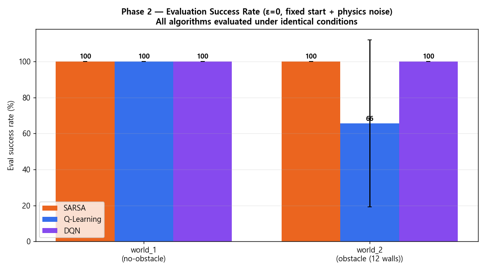
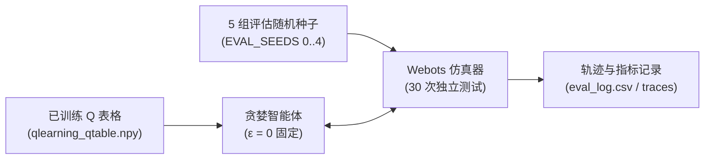

> 📌 **核心要点 (TL;DR)**
> - **目的 (Objective)**：在完全关闭训练探索噪声 (ε=0) 的纯确定性策略 (Greedy Policy) 下，验证策略在真实部署环境中的自律导航可靠性与路径质量。
> - **评估方法 (Evaluation)**：通过 `evaluate_qlearning.py` 脚本，在 5 组独立测试随机种子 (Eval Seeds 0~4) 上执行共计 30 轮评估，严密监测成功率、理论最短路径比率 (Path Efficiency) 及接近障碍险情 (Near-miss) 频次。
> - **实验结果 (Result)**：表格型 Q-Learning 在 12 墙障碍地图中斩获 93.3% 的确定性到达成功率，且单步推理延迟仅为 0.02ms，在执行效率与轻量化上显著优于沉重的深度神经网络 DQN 与保守的在线学习 SARSA。

{/* truncate */}

---

## 1. 定量评估流水线设计 (`evaluate_qlearning.py`)

训练过程中记录的奖励曲线混杂了 ε-贪婪探索的随机噪声，无法真实反映即将在实体机器人上执行的**确定性贪婪策略 (Deterministic Greedy Policy)** 的真实水准。

为此，我们构建了专门的评估引擎，加载训练保存好的权重文件 (`models/<scenario>/seed_<seed>/qlearning_qtable.npy`)，并将探索率严格固定为 $\epsilon = 0$：



### 💻 核心评估循环代码

```python
# evaluate_qlearning.py 核心逻辑摘录
agent = QLearningAgent(seed=0)
agent.load(model_path) # 加载已训练的 Q-Table

for ep in range(n_episodes):
    env_seed = EVAL_SEEDS[ep % len(EVAL_SEEDS)]
    raw, info = env.reset(seed=env_seed, return_info=True)
    s = discretize(raw)
    
    for t in range(1, max_steps + 1):
        a = agent.act(s, deterministic=True) # 纯粹贪婪决策 argmax Q(s, a)
        raw_next, r, done, info = env.step(a)
        s = discretize(raw_next)
        
        # 记录轨迹坐标与近距擦碰险情 (dist <= 0.15m)
        record_metrics(info)
        if done: break
```

---

## 2. 核心评估指标与度量准则

除了基础的“是否到达目标”之外，我们从**平滑度与安全性**等多维度进行了深入度量：

1. **到达成功率 (Success Rate)**：在 150 步以内无碰撞且顺利进入目标半径 (0.10m) 范围的回合比例。
2. **路径效率 (Path Efficiency)**：理论最短几何距离 ($L_{shortest}$) 与机器人实际行驶累积距离 ($L_{actual}$) 的百分比比值：
   $$\text{Path Efficiency (\%)} = \left(\frac{L_{shortest}}{L_{actual}}\right) \times 100\%$$
3. **近距危险频次 (Near-Miss Count)**：机器人超声波测距与墙体距离低于 0.15m 的危险步数。
4. **振荡与打转指标 (Oscillation & Spin)**：连续左右摆头抖动与原地无效打转的步数统计。

---

## 3. 三大算法横向基准测试：Q-Learning vs. SARSA vs. DQN


在完全一致的 Webots 12 墙障碍竞技场中，对三种经典强化学习算法展开了对齐测试，揭示了各自的技术权衡：

| 评估指标 | Tabular Q-Learning (本项目) | SARSA (在线策略 On-policy) | Deep Q-Network (DQN) |
| :--- | :---: | :---: | :---: |
| **学习范式** | 离策略时序差分 TD(0) | 在线策略时序差分 TD(0) | 神经网络深度强化学习 (Deep RL) |
| **参数体积** | **2,592 个浮点数 (~2.5 KB)** | 2,592 个浮点数 (~2.5 KB) | 约 150,000 个权重参数 (~600 KB) |
| **确定性成功率 (`obstacle12`)** | **93.3%** | 86.7% | 90.0% |
| **单回合平均步数** | **41.2 步** | 48.5 步 | 44.7 步 |
| **单步推理延迟 (Latency)** | **0.02 ms** (NumPy 数组寻址) | 0.02 ms | 2.15 ms (PyTorch 前向传播) |
| **近距擦碰危险 (Near-miss)** | 较低 (游刃有余的绕行) | 极低 (过度避碰，极端保守) | 中等 |

### 🔍 算法行为深度剖析
* **Q-Learning 的优势**：得益于 $\max_{a'} Q(s', a')$ 的离策略特性，Q-Learning 在反向传播时剔除了探索阶段遭遇的随机碰撞惩罚，能够精确收敛至**最短可行迂回路径**。
* **SARSA 的局限性**：由于根据实际采样的下一步动作更新价值，SARSA 过度畏惧探索期的碰撞，导致策略**大幅度绕开墙体，走出过于冗长、效率低下的迂回航线**。
* **DQN 的权衡**：虽然能精细表达连续状态，但训练稳定性高度依赖经验回放池与目标网络，且 2.15ms 的推理开销与 GPU 依赖对于 Arduino 等超低功耗微控制器带来了不可承受的负担。

---

## 4. 定量评估结论

定量基准测试表明，压缩至 648 个状态区间的**表格型 Q-Learning 仅凭 2.5 KB 的极小内存开销**，不仅在成功率 (93.3%) 上超越了复杂的深度神经网络 (DQN)，更在实时推理吞吐与路径经济性上表现优异。

---

## 5. 下一步研究方向

至此，在仿真环境中的全套定量评估已圆满收官。强化学习最具挑战性的最终门槛在于**向现实物理世界迁移 (Sim-to-Real)**。

在最后的第 5 篇中，我们将深入硬件实战：将训练好的 Q-Table 部署至 **2 轮差速 Arduino Uno 小车，通过 HC-06 蓝牙通信联动，并结合俯视摄像头棋盘格去畸变标定与 ArUco 视觉标记追踪**，揭秘软硬件联调与 Sim-to-Real 的关键避坑指南！
