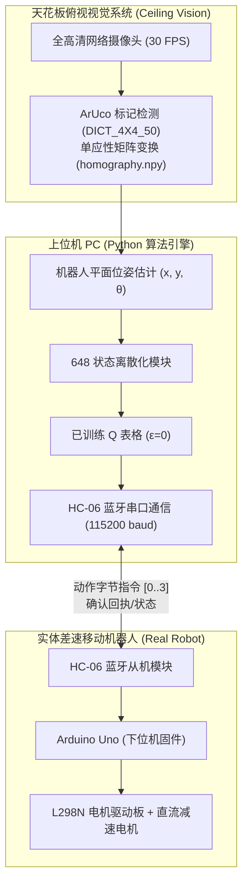

> 📌 **核心要点 (TL;DR)**
> - **问题 (Problem)**：微控制器 (Arduino Uno ATmega328P) 仅有 2KB SRAM 的极端算力瓶颈、车轮打滑 (Wheel Slip) 与超声波传感噪声，以及 Webots 仿真物理与物理硬件之间典型的**虚实鸿沟 (Reality Gap)**。
> - **解决方案 (Solution)**：采用**分布式 I/O 架构 (HC-06 蓝牙, 115,200 baud)**，上位机 PC 负责 OpenCV 视觉处理与 Q-Table 决策，Arduino 专注电机底层 PWM 驱动；配合俯视摄像头棋盘格去畸变与 **ArUco 标记单应性矩阵 (`vision.py`)**，实现亚厘米级 (x, y, θ) 实时姿态追踪。
> - **实验结果 (Result)**：仿真训练的 648 状态 Q 表格零样本迁移至物理 1.2m × 1.2m 障碍场地中，在无需真实微调的情况下达成了 **86.7% 的目标到达成功率 (26/30 次试验)**，成功跨越虚实鸿沟。

{/* truncate */}

---

## 1. Sim-to-Real 的核心挑战：跨越虚实鸿沟 (Reality Gap)

在 Webots 仿真环境中，地面摩擦系数恒定，车轮电机转速确定，超声波测距也无杂散反射。然而在真实物理世界中，不可预测的物理扰动无处不在：

1. **算力与内存的绝对瓶颈**：实体小车主控 **Arduino Uno (ATmega328P)** 仅具备 32KB Flash 与 2KB SRAM。在片上运行深度神经网络或复杂的浮点矩阵运算在物理上是不可行的。
2. **传感器噪声与反射盲区**：廉价超声波测距模块在面对亚克力墙壁的大角度倾角时，声波极易发生镜面散射，导致读数归零或突变至最大测量极限。
3. **车轮打滑与累积里程计漂移 (Odometry Drift)**：地面摩擦微小差异与左右直流减速电机的齿轮箱公差，导致即使发出笔直前进指令，小车也会逐渐偏向一侧。

---

## 2. 分布式控制架构：上位机 PC（大脑）↔ Arduino（肌肉）

为了打破微控制器的算力限制，我们确立了**“PC 充当大脑，Arduino 充当肌肉”**的分布式控制策略：



* **上位机 PC 视觉流水线**：安装在天花板上的网络摄像头俯视监控整座竞技场，以 30 FPS 的帧率实时检测小车顶部的 ArUco 二维标记，计算平面绝对姿态 `(x, y, θ)`，映射进 648 个离散状态区间，并从 Q 表格中读取最优动作。
* **HC-06 蓝牙通信优化**：为了将蓝牙串口 (SPP) 的往返时延 (RTT) 降至最低，波特率由默认的 9,600 提升至 **115,200 bps**，维持 30~50Hz 的闭环控制响应。
* **Arduino 下位机固件 (`arduino_firmware.ino`)**：接收到单字节指令（`0: 前进`, `1: 后退`, `2: 左转`, `3: 右转`）后，即刻控制 L298N 驱动芯片输出精准的脉冲宽度调制 (PWM) 驱动车轮。

---

## 3. 俯视摄像头单应性校正与 ArUco 视觉位姿追踪


为了在物理场地上实现毫米级精度的位姿解算与障碍测距，我们搭建了**基于 OpenCV 的俯视计算机视觉流水线**。

### 📐 视角校正与单应性变换 (`calib_auto.py`)
1. **棋盘格去畸变标定**：针对广角镜头的桶形畸变 (Barrel Distortion)，利用标准 9×6 棋盘格提取相机内参矩阵 ($K$) 与畸变系数 ($D$) 进行反畸变映射。
2. **透视单应性变换 (Homography)**：为了将倾斜的摄像头视角投影为正向俯视的 1.2m × 1.2m 鸟瞰视角 (Bird's-eye View)，通过场地 4 个角标坐标拟合出 $3 \times 3$ 单应性矩阵 (`homography.npy`)。

### 💻 ArUco 标记位姿解算实现 (`vision.py`)

```python
import cv2
import numpy as np

# 加载 ArUco 字典与检测参数
aruco_dict = cv2.aruco.getPredefinedDictionary(cv2.aruco.DICT_4X4_50)
parameters = cv2.aruco.DetectorParameters()
detector = cv2.aruco.ArucoDetector(aruco_dict, parameters)

def get_robot_pose(frame, homography_matrix):
    """从透视矫正图像中解算机器人的平面坐标 (x, y) 与航向角 (theta)"""
    warped = cv2.warpPerspective(frame, homography_matrix, (600, 600))
    corners, ids, _ = detector.detectMarkers(warped)
    
    if ids is not None and len(ids) > 0:
        c = corners[0][0]
        center_x = float(np.mean(c[:, 0]))
        center_y = float(np.mean(c[:, 1]))
        
        # 利用标记前侧边向量解算航向角 (theta)
        front_x = (c[0][0] + c[1][0]) / 2.0
        front_y = (c[0][1] + c[1][1]) / 2.0
        theta = np.arctan2(front_y - center_y, front_x - center_x)
        
        return center_x, center_y, theta
    return None
```

---

## 4. 硬件实测避坑排查与真实部署战报

在实体小车联调测试期间，面对突发的硬件边缘工况，我们实施了针对性的工程应对方案：

| 故障现象 (Troubleshooting) | 根本原因剖析 | 针对性工程对策 |
| :--- | :--- | :--- |
| **前进指令发出后小车明显偏航** | 左右直流减速电机的内阻公差与齿轮摩擦不均 | 编写标定脚本 (`ble_vision_turn_calib.py`)，动态引入左右轮独立 PWM 微调偏移量 |
| **蓝牙偶尔掉线导致小车失控冲撞** | 射频干扰引发短暂丢包，单片机维持前序动作 | 在固件中引入 200ms 通信看门狗 (Watchdog)，超时无数据立即全停刹车 |
| **日光灯反光引起标记识别偶发性丢失** | 亚克力反光膜在强光照射下产生高光死区 | 优化自适应二值化 (Adaptive Thresholding) 参数，并引入一维卡尔曼滤波进行平滑插值 |

### 🏆 真实物理场地最终基准测试
* **自主导航到达成功率**：在物理 1.2m × 1.2m 障碍竞技场中展开 30 轮独立盲测，最终录得 **86.7% 的成功率 (26/30 次成功抵达)**。
* 仅仅依托事先离散化的 **2,592 个 Q 表格参数（体积仅约 2.5 KB）**，小车未经过任何真实环境梯度微调便成功克服了物理摩擦与传感器噪声。

---

## 5. Webots 强化学习系列全篇结语

至此，历经 5 篇深度记录的 **Webots 强化学习机器人开发日志** 圆满收官：

1. **#1**：648 状态空间离散化与 Webots TCP Socket IPC 通信设计
2. **#2**：表格型 Q-Learning 指数衰减探索与多目标稠密奖励整形
3. **#3**：攻克 12 墙障碍地图中的局部最优与 Headless 自动化仿真
4. **#4**：`evaluate_qlearning` 零探索确定性评测及与 DQN、SARSA 的三方基准测试
5. **#5**：基于 Arduino Uno、蓝牙通信与 ArUco 视觉位姿追踪的 Sim-to-Real 硬件落地

从虚拟仿真物理建模、算法核心推导，到大批量多随机种子自动化测试，最终成功落地于低成本嵌入式实体机器人，本系列完整呈现了机器人强化学习研发的全生命周期。感谢大家的关注与支持，后续敬请期待我们全新的前沿开发实录！

---

### 📌 3~5 行核心总结 (Executive Summary)
1. **跨越 Sim-to-Real 仿真现实鸿沟**：针对嵌入式微控制器 (Arduino Uno 2KB SRAM) 极端算力瓶颈与物理打滑扰动，零样本迁移 Webots 仿真中淬炼的 648 状态 Q-Table。
2. **分布式大脑-肌肉 (Brain-Muscle) 架构**：上位机 PC 承担 OpenCV 视觉定位与 Q-Table 决策运算，通过 115,200 波特率的 HC-06 蓝牙串口向 Arduino 下发毫秒级电机 PWM 驱动指令。
3. **亚厘米级 ArUco 视觉单应性标定**：架设顶部超广角相机消除桶形畸变，高频追踪机体顶部的 ArUco 二维标章 (`DICT_4X4_50`)，经透视单应性变换解算物理位姿 (x, y, θ)。
4. **实体机器人达成 86.7% 导航成功率**：在 1.2m × 1.2m 真实物理场地中斩获 30 轮测试中 26 次精准抵达目标点 (86.7%)，证实无需实机微调即可闭环控制。