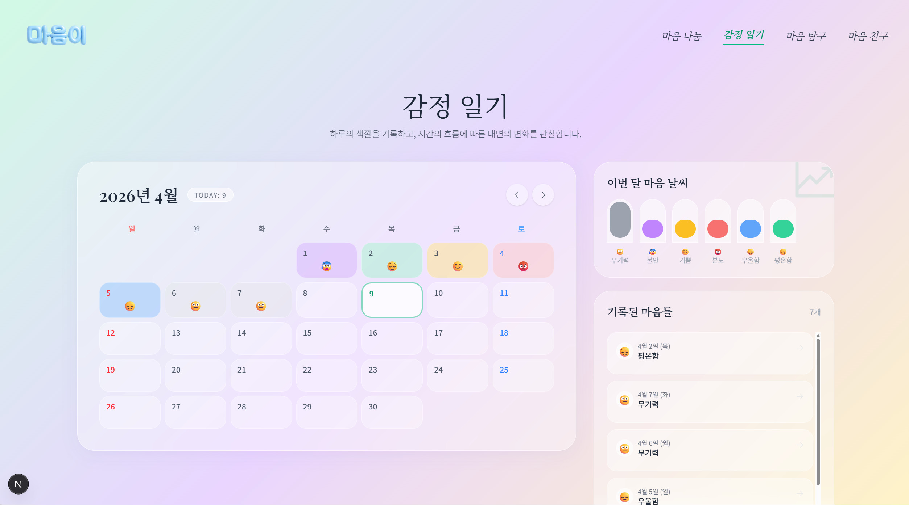

5 月 21 日与 22 日两天，Maeumjigi 毕业设计团队全量投入了针对全新高品质语料的大规模批处理生成，并正式拉开了**第 4 轮微调实验 (fine_tuning_4)** 的帷幕。

{/* truncate */}

### 摆脱“情绪过敏”：共情咨询与日常闲聊的博弈

在严密盲测第 3 轮微调模型时，我们捕获了一个致命缺陷：

> “使用纯粹心理咨询语料微调后，模型的回答被严重‘情绪绑架’。如何才能在保留深层共情的同时，捍卫模型处理日常对话的自然常识能力？”

我们的核心初衷是打造一位“传递温暖共情力量的专业心理防自杀干预导师”。但在全量心理语料过拟合 (Overfitting) 后，面对用户诸如“今天天气如何？”或“午饭吃点什么？”等毫无负面情绪的日常随想，大模型依然表现出过度严肃、沉重且充满心理病理化倾向的回应。

为彻底打破这一失衡，我们确立了按科学配比深度混合“情绪干预语料”与“日常百科/闲聊语料”的全新实验假说。

### 借助 API 批处理高效合成 10,000 条 v6 情绪增强语料

> “参数约束：统一定长 512 Tokens / 单条平均有效长度 500 Tokens / 覆盖 20 种典型心理咨询人设 / 持久化目标：v6.jsonl”

为了锻造最顶级的训练集，我们调用 Anthropic API (Haiku) Batch 批处理模式，一口气合成了整整 10,000 条长程心理对话数据 (`Emotion_train_dataset_v6.jsonl`)。中间虽历经异步批处理无进度回传的紧张焦虑，但借助补全校验脚本 (`fill_v6.py`) 成功补齐了所有样本。

### 探寻黄金分割率：第 4 轮多比例矩阵微调

> “1 万条 Emotion_train_dataset_v6 已就绪。请分别按 7:3、2:1 以及 5:5 比例混合日常与情绪语料。”
> “本次 fine_tuning_4 摆脱单纯调整 LoRA Alpha，转向以语料混合比例 (mixed_2_1, mixed_5_5, mixed_7_3) 作为核心自变量展开横向对抗实验。”

第 4 轮微调自此化身为一场验证“日常常识”与“专业共情”能否达成最完美动态平衡的技术竞技场。三组异构数据集被注入 Qwen3.5-9B 底座，新一轮 GPU 矩阵训练轰鸣打响！

---

## 核心总结与技术要点

- **精准捕捉日常对话失衡问题**：排查发现第 3 轮微调模型对天气或用餐等日常闲聊也表现出过于沉重的心理治疗说教倾向，存在严重过度拟合。
- **万级规模 v6 高质量语料生成**：通过 Anthropic Haiku Batch API 批量生成了涵盖 20 类受众画像、统一 500 词元规格的 10,000 条专业情绪对白数据集（`v6.jsonl`）。
- **配比实验矩阵系统设计**：科学配置了 7:3、2:1 及 5:5 三组对照混合数据集，系统化探索专业危机咨询与开放域社交闲聊的黄金平衡点。
- **启动第 4 轮微调攻坚实验**：正式在 Qwen 3.5-9B 基座上展开全量训练，旨在兼具高度临床危机共情力与自然流畅的日常对答体验。