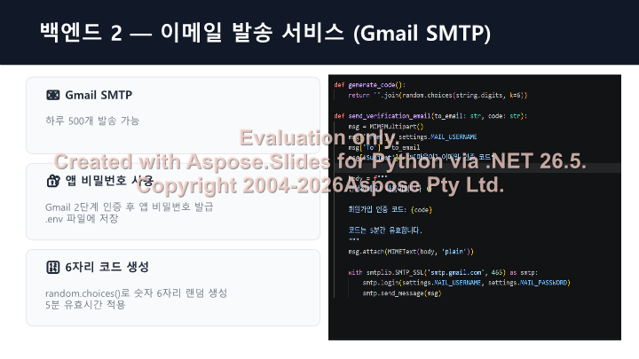

步入 6 月，Maeumjigi 毕业设计团队完成了第一学期全部核心功能的攻坚研发，
将全部精力倾注于生产发布不可或缺的**安全护栏 (Safety Wrapper) 构筑**与**学期终期答辩**冲刺。

{/* truncate */}

### 2:1 黄金配比模型的胜利与 Safety Wrapper 安全护栏架构

> “我们最终选定大模型的科学依据与决策结果是什么？”
> “确立为 2:1 配比模型。请基于 safety_wrapper 设计外挂安全锁方案，将其深度接入主大模型 (Main LLM 2:1) 作为强制防御链路。”

依托第 4 轮微调的严格基准横向测评，我们将“共情咨询语料”与“日常闲聊语料”按 2:1 科学配比训练的模型正式敲定为主服务 LLM。然而，鉴于心理防自杀干预系统的特殊敏感性，系统绝不容许哪怕一次大模型幻觉 (Hallucination) 或致命诱导回答。

为此，我们架构并落地了 **Safety Wrapper 双层安全过滤护栏**：在用户输入与大模型输出两端设置双向实时拦截器。一旦检测到极高危自杀倾向信号 (Active Suicidality)，系统绕过黑盒大模型，毫秒级无缝熔断切换至预先固化的危机干预专业应急响应协议 (Resource Inquiry Cues)。

### 云端 GPU (AWS EC2) 预算测算与终期答辩完美谢幕

> “我们需要一份契合系统部署规格的 AWS EC2 成本测算清单。连续运行 5 个月 g5.2xlarge 实例的预算是多少？”
> “基于全周期研发成果，编写第一学期终期答辩演示文稿 1학기_최종발표_마음지기.pptx！”

针对暑假期间全栈服务（前端/后端/向量知识库/微调大模型）的持续运行，我们测算了基于 Amazon EC2 GPU (g5.2xlarge) 实例的 5 个月生产部署预算方案。

6 月 18 日，我们汇聚了后端架构（PostgreSQL、分页、鉴权）、前端交互（情绪日记、社区看板）以及大模型核心算法（4 轮微调演进与 Safety Wrapper 安全护栏）的全景成果，圆满完成了**第一学期毕业设计终期答辩演示 (PPTX)**！

至此，心语伴侣在第一学期规划的各项核心指标全部高质量超额达成。前后端稳定联动、微调大模型与双层安全护栏严丝合缝，各模块如精密齿轮般顺畅运转。暑假期间，我们将完成系统在云端 GPU 服务器的全面安家，在即将到来的第二学期，携真实用户的定向测试与更强大的定制化心理干预服务重装归来！
敬请继续见证心语伴侣团队永不落幕的前沿创新征程！
