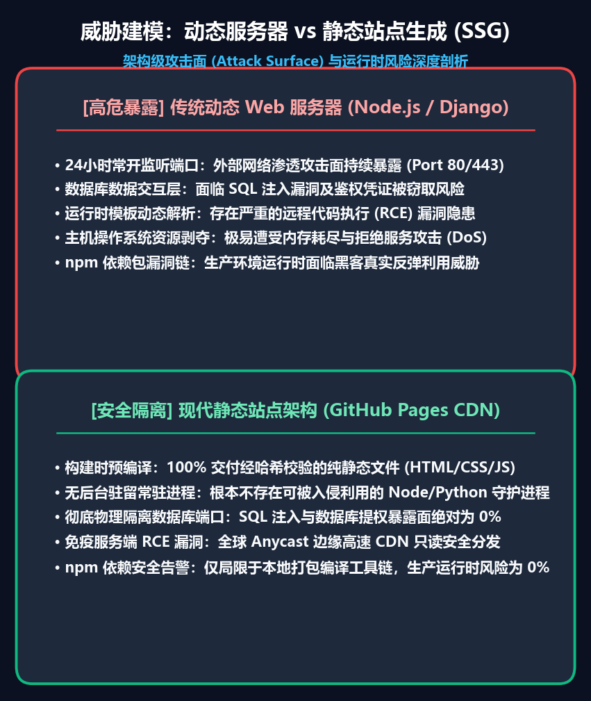
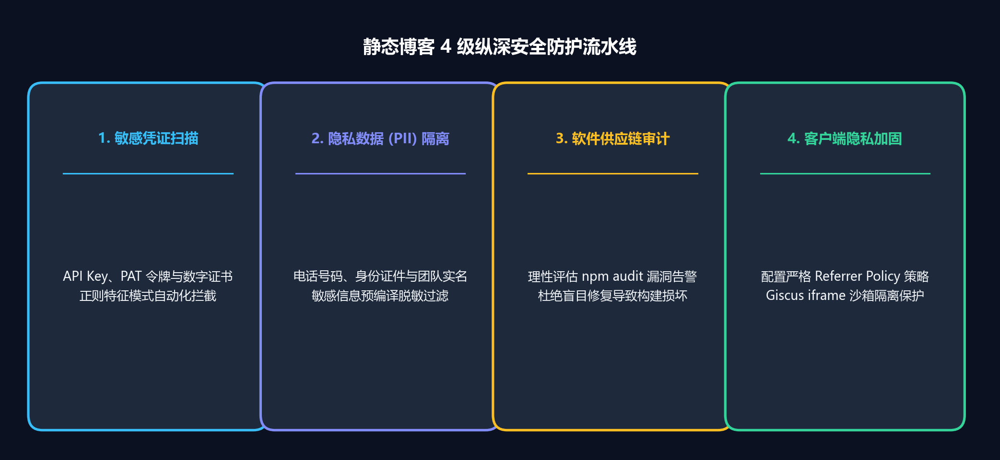

每一位现代前端开发者都曾体验过肾上腺素飙升的瞬间：当你在一个干净整洁的文档或博客代码库中运行 `npm audit` 时，终端突然喷涌出一片触目惊心的鲜红警告：

```text
45 vulnerabilities (15 moderate, 15 high, 15 critical)
To address all issues (including breaking changes), run:
  npm audit fix --force
```

看到诸如 **Critical (严重)**、**Remote Code Execution (远程代码执行/RCE)** 和 **Prototype Pollution (原型链污染)** 这样的高危词汇，人类的第一反应往往是毫不犹豫地敲下 `npm audit fix --force`，试图让这些刺眼的红字立刻消失。

然而，在基于 **静态站点生成器 (SSG)**（例如部署在 GitHub Pages 或 AWS S3 上的 Docusaurus、Next.js 或 Hugo）的世界里，这样做往往是一个严重的工程误判——它不仅无法真正提升你的安全水位，反而会破坏生产环境的构建流程。

在本文中，我们将深入剖析 **静态网站的威胁模型 (Threat Model)**，揭示打包编译期漏洞与线上服务端漏洞的本质差异，并分享一套经生产检验的 **4 层静态安全加固蓝图**，保护真正核心的资产：你的机密凭据、访客隐私以及代码库完整性。

{/* truncate */}

---



---

## 1. 核心工程权衡概述

1. **编译期工具不等于线上运行时**：在 `npm audit` 中被标记的依赖包（例如 `tinypool`、`serialize-javascript`、`postcss-selector-parser`）是仅在开发者本地执行 `npm run build` 时被 Node.js 调用的编译打包依赖。
2. **CDN 边缘零后端服务**：一旦编译完成，GitHub Pages 分发的仅仅是不可变的纯静态 HTML、CSS 和客户端 JavaScript。在生产环境中，**不存在任何常驻运行的 Node.js 守护进程**，没有任何开放监听的后端端口，也完全没有数据库连接。
3. **`--force` 的破坏性**：盲目执行 `npm audit fix --force` 会强行降级核心框架（例如将 Docusaurus 回退到旧版本），破坏对 React 19 的兼容性、MDX v3 渲染流水线以及未来功能开关架构。
4. **静态网站真正的攻击面**：静态博客面临的真正威胁是 **公开 Git 提交历史中的 API 密钥泄漏**、**数据集中的个人隐私 (PII) 暴露** 以及 **客户端跨域数据泄露**。

---

## 2. 深度拆解 45 个漏洞：编译期 vs 运行时

让我们审查一下审计日志中实际报告的典型 CVE：

### A. Tinypool 原型链污染 (`GHSA-5gmw-xhrv-c9v3` - Critical 严重)
- **漏洞原理**：如果向 `tinypool` 的 Worker 初始化选项中传入不可信的用户输入，攻击者可污染 `Object.prototype`。
- **静态网站现实**：`tinypool` 仅在 `@docusaurus/faster` 内部用于在构建期间跨 CPU 核心并行处理打包任务。所有的输入参数均严格来自于开发者自身的 `docusaurus.config.ts`。线上外部访客根本无法向你本地的 CPU 进程池发送任何 HTTP 载荷。

### B. Serialize-JavaScript 远程代码执行 (`GHSA-5c6j-r48x-rmvq` - High 高危)
- **漏洞原理**：通过精心构造的 RegExp 标志或序列化日期实现远程代码执行。
- **静态网站现实**：Webpack 仅使用它将内部编译区块序列化为静态 `.js` 代码束。一旦写入 `build/` 目录，这些 JavaScript 仅仅是通过 HTTPS 分发的静态资源文件，服务端完全不发生任何反序列化过程。

### C. PostCSS Selector Parser CPU 耗尽 (`GHSA-rj75-hqrm-r3gf` - Moderate 中危)
- **漏洞原理**：解析器在处理特定平铺选择器时具有二次方时间复杂度，可通过恶意 CSS 字符串导致拒绝服务 (DoS)。
- **静态网站现实**：被解析的 CSS 文件完全是项目自身的主题样式表（`custom.css`）。除非攻击者拥有向你 Git 仓库推送代码的权限，否则构建机器永远不会解析不可信的外部 CSS。

在这种情况下强行执行 `npm audit fix --force`，npm 会尝试将 `@docusaurus/core` 从 `3.10.2` 强制降级到 `3.7.0`。这会直接导致 Docusaurus v4 特性与 React 19 渲染彻底崩溃——为了修复一个在你的物理架构中根本不可能被触发的漏洞，反而亲手向生产代码中引入了致命 Bug。

---

## 3. 真正重要的防线：4 层静态安全加固蓝图

如果构建工具漏洞风险极低，静态网站工程师应该将安全精力投入到哪里？以下是本博客实施的纵深防御体系。



### 第一道防线：Git 提交前自动化密钥扫描 (Pre-Commit Secret Scanning)

对于公开开源的技术博客而言，最大的灭顶之灾是在 Git 提交中不慎泄露 OpenAI 密钥 (`sk-...`)、GitHub Token (`ghp_...`) 或 AWS 访问凭据 (`AKIA...`)。

我们编写了自动化审计脚本（`tools/audit_security.py`），利用 Git 的底层对象数据库，在提交前扫描所有追踪文件：

```python
PATTERNS = [
    (r'(?i)(api[_-]?key|secret|token|password|auth|bearer)\s*[:=]\s*["\']([^"\']{8,})["\']', "Potential Key Assignment"),
    (r'ghp_[a-zA-Z0-9]{36}', "GitHub Personal Access Token"),
    (r'sk-[a-zA-Z0-9]{32,}', "OpenAI API Key"),
    (r'AIzaSy[a-zA-Z0-9_-]{33}', "Google API Key"),
    (r'AKIA[0-9A-Z]{16}', "AWS Access Key"),
    (r'-----BEGIN\s+(RSA\s+)?PRIVATE\s+KEY-----', "Private Key Certificate"),
]
```

在每次代码发布前运行此审计工具，确保硬编码的敏感 Token 绝不会逃逸至远程公开仓库。

### 第二道防线：个人身份识别信息 (PII) 严格脱敏

在发布涉及 AI 数据集的技术专栏时（例如我们的 23 篇心灵守护者心理咨询系列或 5 篇 ANPR 视觉 AI 系列）：
- **合成数据优先**：所有心理对话案例均由大模型流程（`synth_gen`）端到端合成，绝不使用真实患者对话记录，从源头上杜绝医疗隐私泄露。
- **正则敏感信息排查**：自动化校验所有 Markdown 内容，防范电话号码或身份登记号码等敏感字段意外流出。

### 第三道防线：深度强化的 `.gitignore` 规范

许多标准的 `.gitignore` 仅仅忽略了 `.env.local`，却留下了 `.env`。我们将配置进行了工业级强化，彻底阻断敏感密钥、证书及原始分析日志：

```gitignore
# 环境变量与机密凭据保护
.env
.env.*
*.pem
*.key
*.pfx
*.cert
*credential*
*.secret

# 数据分析原始导出文件
*.csv

# 废弃的旧版本模板
_old/
```

### 第四道防线：客户端隐私保护与 Iframe 沙盒隔离

即使没有后端服务器，静态网站也必须尊重访客隐私并防止数据外泄：

1. **严格的 Referrer 策略**：在 `docusaurus.config.ts` 的 `<head>` 中注入安全请求头：
   ```typescript
   themeConfig: {
     metadata: [
       { name: 'referrer', content: 'strict-origin-when-cross-origin' },
     ],
   }
   ```
   确保访客点击外链跳转时，浏览器会自动截断博客的具体文章路径及参数，防止内部 URL 泄漏。

2. **Giscus 评论系统沙盒化**：通过 GitHub Discussions 承载互动评论时，配置：
   - `emitMetadata="0"`：禁止 iframe 广播跨页面消息，防范第三方脚本窥探讨论详情；
   - `loading="lazy"`：延迟加载评论模块，直到访客真正滚动至文章底部才触发执行。

---

## 4. 给开发者的核心启示

- **面对 `npm audit` 保持清醒**：时刻区分 **构建期依赖** 与 **线上运行时依赖**。
- **警惕 `--force` 陷阱**：自动降级往往会在修复虚幻安全隐患的同时，亲手向生产环境注入真实的破坏性 Bug。
- **聚焦真正的攻击面**：建立代码提交前密钥扫描、清洗敏感数据集、配置严密的客户端隐私策略，守护真正的数字核心。