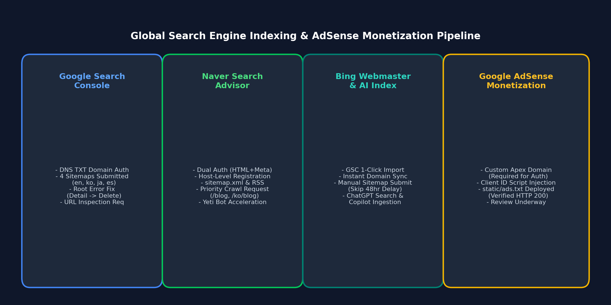

在 GitHub Pages 的二级子域名（`username.github.io/project`）下托管技术博客，对于开发者而言是一种极其敏捷的分享途径。然而，随着技术读者群的扩大以及开启商业化变现的需要，你会撞上一堵坚硬的规则高墙：**Google AdSense（谷歌广告联盟）严格禁止针对 `*.github.io` 等免费二级子域名提交站点申请**。为了取得 AdSense 官方发布商资格、积累长期的域名权威度（Domain Authority）并获取全球各区域的自然搜索流量，拥有一个专属的**顶级独立根域名（Apex Custom Domain）**是必不可少的基石。

将静态文档或技术博客迁移至独立域名，绝非只是简单修改一条 DNS 解析记录。它涉及域名注册商的权威名称服务器委派、边缘 SSL 终结、规范化重定向、自动化发布商 `ads.txt` 托管，以及跨越各大搜索引擎站长工具平台特有的 UI 隐蔽陷阱。

在本指南中，我们将全面复盘从 `jbjihwan.github.io/global_blog` 零停机迁移至 `https://globaldevlog.com` 的端到端全过程，涵盖高可用 DNS 架构设计、AdSense 审核合规设置，以及在 Google Search Console、Naver Search Advisor 和 Bing Webmaster Tools 中遇到的真实索引问题的排查方案。

{/* truncate */}

---


---

## 1. 架构战略：Porkbun + Cloudflare + GitHub Pages

将根域名（例如 `globaldevlog.com`）绑定至 GitHub Pages 时，最原始的方法是将 `A 记录` 直接指向 GitHub 官方的 4 个 Anycast IP（`185.199.108.153` 等）。这种方式虽然可用，但缺失了现代云端必备的边缘安全防护、DDoS 攻击清洗以及自动化 HTTPS 证书续期。

为此，我们构建了高可用的**三层解耦生产架构**：

| 层级 | 服务商 | 核心职责 |
| :--- | :--- | :--- |
| **域名注册商 (Registrar)** | **Porkbun** | 域名购买、终身免费 WHOIS 隐私保护、DNSSEC 支持、权威 NS 委派 |
| **边缘 DNS 与安全层** | **Cloudflare** | 全球 Anycast DNS、**根域名 CNAME 扁平化 (Flattening)**、Universal SSL 边缘证书、恶意 Bot 清洗 |
| **静态源站 (Origin SSG)** | **GitHub Pages** | 承载由 Docusaurus 编译生成的纯静态产物、零服务器维护成本、`gh-pages` 分支自动化同步 |

### Porkbun 名称服务器委派
在 Porkbun 域名管理控制台中，将默认的注册商 Nameservers 替换为 Cloudflare 分配的专用边缘服务器：
```text
NS: roan.ns.cloudflare.com
NS: sneh.ns.cloudflare.com
```

### Cloudflare CNAME 扁平化设置
根据 RFC 1034 规范，根域名（`@`）因需共存 SOA/NS 记录而在传统上无法配置 CNAME。Cloudflare 借助其专利技术 **CNAME 扁平化 (CNAME Flattening)** 完美解决了这一限制，可无缝将 `@` 解析指向 GitHub Pages：
- **Type**: `CNAME` | **Name**: `@` | **Target**: `jbjihwan.github.io` | **Proxy status**: Proxied (已开启代理/橙色云朵)
- **Type**: `CNAME` | **Name**: `www` | **Target**: `jbjihwan.github.io` | **Proxy status**: Proxied (已开启代理/橙色云朵)
- **SSL/TLS 模式**: 设置为 **Full (完全)** 或 **Full Strict (完全严格)**，确保端到端的 HTTPS 双向加密传输。

---

## 2. Docusaurus 核心配置迁移

为了平滑地将子路径路由（`/global_blog/`）整体切换为独立域名根路径（`/`），我们需要更新 `docusaurus.config.ts`：

```typescript
const config: Config = {
  title: 'Global Dev Blog',
  url: 'https://globaldevlog.com',
  baseUrl: '/',
  organizationName: 'jbjihwan',
  projectName: 'global_blog',
  trailingSlash: false,
  // ...
};
```

### 静态 CNAME 文件配置
GitHub Pages 依靠部署分支根目录下的纯文本 `CNAME` 文件来识别流量归属。必须将其放置在 `static/CNAME`：
```text
globaldevlog.com
```
执行 `npm run deploy` 时，Docusaurus 会自动将 `static/` 目录中的所有文件拷贝到编译输出的根目录，确保 GitHub 路由引擎始终将指向 `globaldevlog.com` 的访问请求正确映射到该仓库。

---

## 3. 静态博客 Google AdSense 审核配置

Google AdSense 审核的核心流程包括：确认站点所有权、检测合规的发布商异步脚本、以及抓取位于网站根目录下的 `ads.txt` 文件。

### A. 异步植入发布商脚本
在 `docusaurus.config.ts` 的 `scripts` 数组中异步引入 Google AdSense 加载器：

```typescript
  scripts: [
    {
      src: 'https://pagead2.googlesyndication.com/pagead/js/adsbygoogle.js?client=ca-pub-4654073335496617',
      async: true,
      crossorigin: 'anonymous',
    },
  ],
```

### B. 根目录部署 `ads.txt` 并完成线上验证
在 `static/ads.txt` 中填入官方认证的发布商凭证：
```text
google.com, pub-4654073335496617, DIRECT, f08c47fec0942fa0
```
部署后通过终端 curl 立即验证 HTTP 200 状态码：
```bash
curl -I https://globaldevlog.com/ads.txt
# HTTP/2 200
# content-type: text/plain; charset=utf-8
```

---



---

## 4. 多搜索引擎 SEO 实战与疑难杂症排查

向各大搜索引擎提交站点地图时，各家平台往往有着独特的交互规则和容易误踩的 UI 陷阱：

### A. Google Search Console：无法删除错误站点地图的交互陷阱
在提交多语言站点地图（`sitemap.xml`, `ko/sitemap.xml`, `ja/sitemap.xml`, `es/sitemap.xml` 等）时，若不慎误将网站根网址 `https://globaldevlog.com/` 作为站点地图提交，会在列表里留下永久性的“包含错误”告警。

许多开发者点击该行表格右侧的纵向三点图标（`⋮`），却发现弹出的菜单中只有置灰的“查看网页编入索引情况”，完全找不到任何删除按钮。

**解决策略：**
1. 切勿点击表格行最右侧的菜单按钮。**请直接点击该站点地图的网址文本本身**，进入**站点地图详情页面**。
2. 在详情页面右上角（靠近搜索栏下方区域），点击页面顶部的三点图标（`⋮`）。
3. 在弹出的菜单中点击 **[删除站点地图]**，即可干净彻底地移除该错误条目。
4. 若多语言站点地图（如 `es/sitemap.xml`）因网络或 DNS 缓存抖动偶发“无法抓取”，直接在上方“添加新站点地图”输入框中重新输入并提交，系统会立即发起二次抓取并刷新为**成功**状态。

### B. Naver Search Advisor：“请按主机级别输入 URL”
Naver 占据韩国本土主流搜索份额。在其站长平台操作时需注意：
1. **主机级别报错**：在初始“站点登记”弹窗中直接提交 `https://globaldevlog.com/sitemap.xml` 会触发弹窗警告：*“URL을 호스트 단위로 입력해주세요 (请按主机级别输入 URL)”*。该窗口仅用于登记主域名（`https://globaldevlog.com`）。
2. **所有权双保险**：同时部署 HTML 校验文件（`static/naver<hash>.html`）与页面元标签（`themeConfig.metadata`），确保无论采用何种检验机制均能秒级通过。
3. **提交站点地图与 RSS**：在管理控制台（点击站点列表中的域名）：
   - 进入 **[请求] > [提交站点地图]**：输入 `sitemap.xml`
   - 进入 **[请求] > [提交 RSS]**：输入 `https://globaldevlog.com/blog/rss.xml`
4. **加速 Yeti 蜘蛛抓取**：在 **[请求] > [网页抓取]** 中，手动提交核心路径（`blog`, `ko/blog` 等），促使搜索引擎蜘蛛快速访问。

### C. Bing 站长工具与 AI 搜索 (Copilot / ChatGPT Search) 接入
Bing Webmaster Tools 不仅为必应搜索提供数据，同时也是 Copilot、ChatGPT Search、Yahoo 和 DuckDuckGo 的底层索引源泉。
- **GSC 一键导入**：直接授权 Google 账号登录，可瞬间同步已验证的域名所有权与全部站点地图。
- **跨越 48 小时数据同步延迟**：GSC 自动同步通常需要 24 至 48 小时。直接进入左侧 **[Sitemaps]** > 点击 **[Submit sitemap]** 手动录入 `https://globaldevlog.com/sitemap.xml`，即可免去等待，即刻驱动必应爬虫全量入库。

---

## 5. 生产环境最终检查清单

在正式推广你的独立域名之前，请确保以下项目全部核验通过：

- [x] **DNS 解析状态**：`globaldevlog.com` 和 `www` 均在无 SSL 证书告警的前提下正常响应。
- [x] **规范化 CNAME**：`static/CNAME` 已打包部署至 GitHub Pages 源站。
- [x] **AdSense 核心资产**：`https://globaldevlog.com/ads.txt` 正常返回 HTTP 200 且发布商 ID 完全匹配。
- [x] **多语言站点地图**：各语言专属站点地图（`/sitemap.xml`, `/ko/`, `/ja/`, `/es/`, `/zh-Hans/`, `/zh-Hant/`）均返回 HTTP 200。
- [x] **三大搜索引擎收录**：Google、Naver 和 Bing 均已成功完成所有权验证，RSS 订阅源均处于活跃抓取状态。

凭借这套现代化的工程基础设施，你的静态博客不仅享有边缘 CDN 的极致加载速度、零服务器账单开支，更获得了覆盖全球主要语种的顶级搜索可见度，并为 Google AdSense 商业化变现奠定了坚实的基石。
