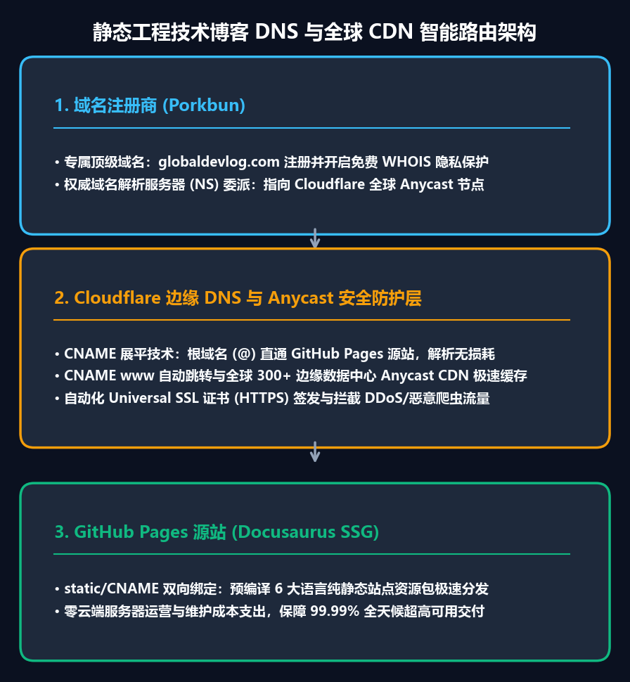

对于技术开发者而言，利用 GitHub Pages 的免费二级域名（`username.github.io/project`）搭建博客几乎是零成本的最佳入门选择。只需一次 Git Push，即可通过全球 CDN 免费分发静态页面，完全无需维护底层服务器。

然而，一旦你计划打造具有专业影响力的技术品牌并开启 **Google AdSense（谷歌广告联盟）流量变现** 时，就会遭遇一道无法逾越的规则红线：**Google AdSense 严格禁止针对 `*.github.io` 等免费二级子域名提交站点审核**。此外，搜索引擎积累的域名权重（Domain Authority）也无法沉淀为个人数字资产。要想通过商业化审核并沉淀 SEO 资产，拥有独立的**顶级根域名（Apex Custom Domain，例如 `globaldevlog.com`）**是必经之路。

作为静态站点工程化系列的第一篇，本文将以我们的技术博客从 `jbjihwan.github.io/global_blog` 迁移至 `https://globaldevlog.com` 的实战经历为基础，详细拆解由 **Porkbun + Cloudflare + GitHub Pages 构建的高可用三层生产架构与 DNS 深度配置要点**。

{/* truncate */}

---



---

## 1. 架构设计哲学：三层专业化高可用体系

初学者在为 GitHub Pages 绑定独立域名时，最常规的做法是在域名注册商处将 `A 记录` 直接指向 GitHub 的 4 个固定 IP（`185.199.108.153` 等）。

这种传统模式虽然简单，但存在明显的生产运维缺陷：
- 缺乏边缘层 DDoS 攻击防护与恶意爬虫清洗；
- 遭遇宕机或底层迁移时，DNS 生效速度缓慢；
- 无法对静态资源（CSS/JS/图片）进行灵活的边缘 CDN 缓存调优。

为此，我们将职责解耦为三个专业化的服务层级：

| 层级 | 选用服务 | 核心职责与入选理由 |
| :--- | :--- | :--- |
| **1. 域名注册商 (Registrar)** | **Porkbun** | 顶级域名首购与每年续费价格全网极具优势，终身免费赠送 WHOIS 隐私保护，无套路加价 |
| **2. 边缘 DNS 与安全层** | **Cloudflare** | 全球超低延迟 Anycast DNS，**根域名 CNAME 扁平化 (Flattening)**，免费 Universal SSL，自动化强制 HTTPS |
| **3. 静态托管源站** | **GitHub Pages** | 承载由 Docusaurus 编译生成的纯静态产物，`gh-pages` 分支自动化部署，零服务器成本 |

---

## 2. 第一步：Porkbun 域名购买与 Cloudflare 权威名称服务器委派

1. **域名选购**：在 Porkbun 检索并购买心仪的顶级根域名（如 `globaldevlog.com`）。
2. **接入 Cloudflare**：登录 Cloudflare 控制台，点击 **[添加站点]** 输入该域名，方案选择 **Free (免费版)**。
3. **获取分配的名称服务器**：Cloudflare 会自动分配一对专有的权威 Nameservers，例如：
   ```text
   roan.ns.cloudflare.com
   sneh.ns.cloudflare.com
   ```
4. **修改 Porkbun DNS 委派**：进入 Porkbun 的域名管理面板，找到 `Authoritative Nameservers` 设置项，删除 Porkbun 默认地址，填入 Cloudflare 分配的 2 个服务器地址并保存。通常在 5 到 15 分钟内全球生效。

---

## 3. 第二步：Cloudflare CNAME 扁平化 (Flattening) 与 Full SSL 模式

按照 DNS 国际标准（RFC 1034），根域名（`@`）必须包含 SOA 和 NS 记录，因此传统上无法直接配置 `CNAME 记录`。

Cloudflare 的 **CNAME 扁平化 (CNAME Flattening)** 技术彻底解决了这一痛点：在 DNS 解析查询时，Cloudflare 边缘节点会在底层实时解析目标地址（`username.github.io`）对应的 IP，并以 `A 记录` 的形式直接向客户端应答，从而让根域名完美享有 CNAME 的所有敏捷特性。

### A. 配置 Cloudflare DNS 解析记录
在 Cloudflare 仪表盘 **[DNS] > [记录]** 中，添加以下两条开启代理的记录：

| 类型 (Type) | 名称 (Name) | 目标 (Target) | 代理状态 (Proxy status) | TTL |
| :--- | :--- | :--- | :--- | :--- |
| **CNAME** | `@` | `jbjihwan.github.io` | **已代理 (点亮橙色云朵)** | 自动 |
| **CNAME** | `www` | `jbjihwan.github.io` | **已代理 (点亮橙色云朵)** | 自动 |

> **必须点亮橙色云朵**：只有处于代理模式下，访问流量才会经由 Cloudflare 全球 Anycast 节点接入，享受自动化边缘 SSL 终结、Brotli 极速压缩以及抗 DDOS 保护。

### B. 设置 SSL/TLS 加密模式
前往 Cloudflare 左侧导航栏 **[SSL/TLS] > [概述]**：
- 将加密模式设为 **Full (完全)** 或 **Full (Strict) (完全严格)**；
- 确保从访客浏览器到 Cloudflare、以及从 Cloudflare 到 GitHub Pages 源站的端到端 HTTPS 双向链路均得到高强度加密。

---

## 4. 第三步：更新 Docusaurus 核心配置 (`docusaurus.config.ts`)

当博客从子目录路径（`/global_blog/`）整体迁移至独立根域名时，必须相应修正 `docusaurus.config.ts`：

```typescript
const config: Config = {
  title: 'Global Dev Blog',
  tagline: 'Engineering Deep Dives in AI, Robotics, Computer Vision',

  // 替换为全新的顶级自定义域名
  url: 'https://globaldevlog.com',
  // 从子目录 '/global_blog/' 改为顶级根路径 '/'
  baseUrl: '/',

  organizationName: 'jbjihwan',
  projectName: 'global_blog',
  trailingSlash: false,
  // ...
};
```

---

## 5. 第四步：彻底攻克 GitHub Pages 部署后域名被重置的隐蔽陷阱 (`static/CNAME`)

在配置 GitHub Pages 自定义域名时，几乎所有开发者都踩过这个著名的“大坑”：
1. 在 GitHub 仓库页面的 `Settings > Pages > Custom domain` 中手动填入 `globaldevlog.com` 并保存生效；
2. 本地写完新文章，终端执行 `npm run deploy` 重新部署；
3. 部署一完成，刷新 GitHub 页面发现自定义域名输入框**再次变成了空白**，线上站点瞬间爆出 404 错误或 SSL 证书失效警告！

### 陷阱根源
Docusaurus 的发布脚本在编译完成后，会将 `build/` 目录强制推送到 `gh-pages` 分支（`git push --force`）。如果该打包产物的根目录下缺少纯文本 `CNAME` 文件，GitHub 会默认判定用户已主动取消了自定义域名绑定。

### 永久解决方案
在项目的 `static/` 目录下创建一个名为 `CNAME` 的纯文本文件（无任何后缀扩展名），内容仅写入一行你的域名：

```text
globaldevlog.com
```

由于 Docusaurus 在构建时会自动将 `static/` 目录下的所有文件原封不动复制到打包输出根目录，因此每次执行部署时，`CNAME` 文件都会被永久提交至 `gh-pages` 分支的最顶层，域名绑定永不丢失。

---

## 6. 生产环境连通性验证

在项目根目录下执行部署指令：
```bash
npm run deploy
```

部署成功后，在终端通过 curl 命令验证 HTTP 状态码与 SSL 证书链响应：

```bash
curl -I https://globaldevlog.com
# HTTP/2 200
# server: cloudflare
# strict-transport-security: max-age=31536000

curl -I https://www.globaldevlog.com
# HTTP/2 200 (或 301 重定向至根域名)
```

---

## 🔜 下篇预告

独立域名成功上线后，真正的商业化与多引擎搜索获客工作才刚刚拉开序幕：
- **第二篇**：*[静态网站商业化 #2] Docusaurus 接入 Google AdSense 审核实战：解决 ads.txt 404 爬取故障与异步脚本安全植入*
- **第三篇**：*[全球多搜索引擎 SEO #3] Google、Naver 与 Bing 站长平台权威配置：Sitemap 无法删除之谜与主机级别报错排查*

---

### 📌 3~5 行核心总结 (Executive Summary)
1. **零服务器成本的企业级全栈架构**：通过融合成本价域名注册商 (Porkbun)、全球 Anycast CDN 与 DNS (Cloudflare) 以及零成本静态托管 (GitHub Pages)，以零运维开销打造毫秒级全球加速博客。
2. **借助 CNAME 扁平化技术突破 RFC 1034 限制**：利用 Cloudflare 的 CNAME Flattening 机制，完美攻克根域名 (`@`) 无法配置别名解析的行业死结，将裸域名平滑直连 GitHub Pages。
3. **Full (Strict) 全链路 HTTPS 强加密**：开启 Cloudflare 严格加密模式，实现“访客 ↔ CDN 边缘 ↔ GitHub Pages 源站”的全程双向 TLS 加密防护。
4. **static/CNAME 实现部署配置永固**：将 `CNAME` 文件固化在 Docusaurus 的 `static/` 目录下，彻底杜绝 CI/CD 自动发布时自定义域名被冲刷重置的行业顽疾。
