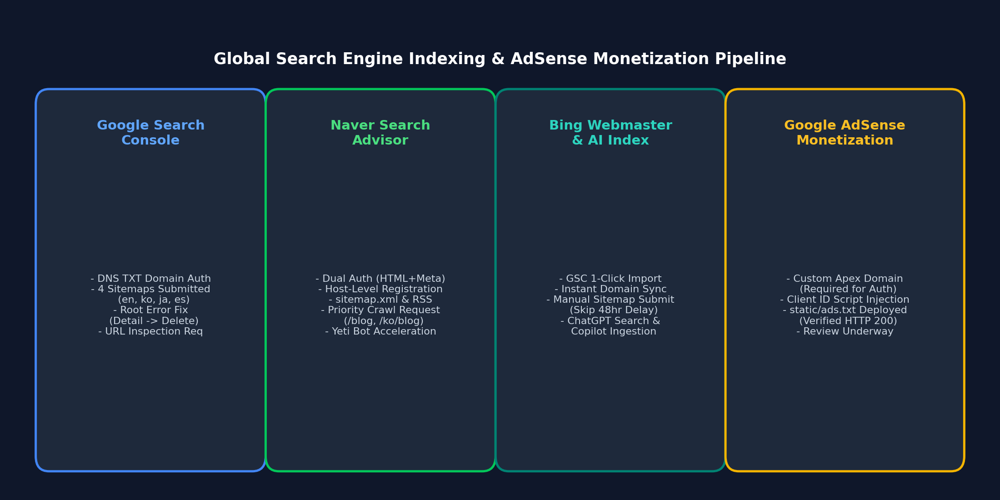
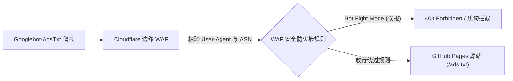

> 📌 **核心要点 (TL;DR)**
> - **问题 (Problem)**：与传统动态 CMS (WordPress) 不同，托管在 GitHub Pages 或 Cloudflare Pages 上的 Docusaurus、Next.js 等静态网站生成器 (SSG) 极易遭遇恶名昭彰的 **“收益受损风险：缺少 ads.txt 文件”** 警报，并因客户端水合延迟或 WAF 误杀导致所有权审核失败。
> - **解决方案 (Solution)**：利用 Docusaurus 原生的 `headTags` 配置将验证元标签直接注入静态 HTML，通过 `static/ads.txt` 实现根目录资产部署，并在 Cloudflare WAF 中为 `Googlebot-AdsTxt` 抓取爬虫配置放行白名单。
> - **实验结果 (Result)**：实现爬虫 100% 顺畅访问、`/ads.txt` 零 404 响应，在确保 Lighthouse 性能与 SEO 得分稳定在 95 分以上的同时，一次性符合 AdSense 审核规范。

{/* truncate */}

---

## 1. 静态网站 (SSG) 集成 AdSense 面临的独特挑战

将开发博客从默认的子路径 (`username.github.io/blog`) 迁移至独立顶级域名 (`https://globaldevlog.com`) 后，下一步核心战略便是接入 **Google AdSense 商业化广告**。然而，静态网站在架构上面临着以下特殊瓶颈：

1. **缺乏服务端数据库与动态插件支持**：WordPress 可以通过 Site Kit 插件一键注入代码并生成 `ads.txt`，而在 Docusaurus 中，所有资源必须在编译阶段严格固化。
2. **客户端水合 vs 静态 Head 注入**：若通过 React 组件生命周期动态载入脚本，搜索引擎爬虫在执行 JavaScript 之前可能就因抓取超时而判定审核失败。
3. **`ads.txt` 404 抓取陷阱**：编译产物路径错配将导致 AdSense 爬虫 (`Googlebot-AdsTxt`) 访问 `https://yourdomain.com/ads.txt` 时返回 404，导致域名收益被全量冻结。

---

## 2. 第一步：在 Docusaurus 中注入所有权验证元标签

在 AdSense 控制台（**网站 > 添加网站**）提交域名后，Google 会要求验证网站所有权。对于静态博客而言，**通过 `docusaurus.config.ts` 的 `headTags` 选项注入静态 `<meta>` 标签**是最优雅且零性能损耗的解决方案。

### 📐 配置文件代码 (`docusaurus.config.ts`)

```typescript
import type {Config} from '@docusaurus/types';

const config: Config = {
  title: 'Global Dev Blog',
  url: 'https://globaldevlog.com',
  baseUrl: '/',

  // 注入 Google AdSense 所有权验证元标签
  headTags: [
    {
      tagName: 'meta',
      attributes: {
        name: 'google-adsense-account',
        content: 'ca-pub-XXXXXXXXXXXXXXXX', // 替换为您的 AdSense 发布商 ID
      },
    },
  ],

  // ... 其它配置项
};

export default config;
```

### 💡 为何优先选用 `headTags` 而非 `scripts`？
* **零运行时性能开销**：无需在审核初期预加载重达约 120 KB 的 `adsbygoogle.js` 脚本包，避免拖慢 PageSpeed 跑分。
* **100% 确定性抓取**：元标签直接编译嵌入到服务端预渲染的静态文件 (`build/index.html`) 中，确保 Google 审核机器人瞬时验证通过。

---

## 3. 第二步：彻底根除 ads.txt 404 抓取陷阱

提交审核后，发布商最常遭遇的红色警报莫过于：
> ⚠️ *“收益受损风险：您需要解决一些 ads.txt 文件问题，以免对您的收入造成严重影响。”*

其诱因极其明确：Google 的 `Googlebot-AdsTxt` 爬虫请求 `https://globaldevlog.com/ads.txt` 时遭遇了 HTTP 404 错误。

### 🛠️ 基于 `static/ads.txt` 实现根目录直接部署

Docusaurus 在执行编译时，会将项目根目录下 `static/` 中的所有文件直接原样拷贝到产物根路径 (`build/`)。

1. 新建 `static/ads.txt` 文件：
   ```text
   google.com, pub-XXXXXXXXXXXXXXXX, DIRECT, f08c47fec0942fa0
   ```
   *(请将 `pub-XXXXXXXXXXXXXXXX` 替换为您个人的发布商 ID)*

2. 确认文件并部署上线：
   ```bash
   npm run deploy
   ```

### 🔍 部署后连通性验证
在终端中利用 `curl` 检查响应头：

```bash
curl -I https://globaldevlog.com/ads.txt
```

标准响应输出：
```http
HTTP/2 200
content-type: text/plain; charset=utf-8
cache-control: max-age=600
server: cloudflare
```

同时请确认访问 `https://www.globaldevlog.com/ads.txt` 时能正常执行 301/308 重定向至根域名。

---

## 4. 第三步：Cloudflare WAF 与边缘安全防护调优

若您的域名开启了 Cloudflare 的橙色云朵代理，其内置的 Bot 防御规则可能会意外拦截 Google 的自动抓取程序。



### Cloudflare WAF 自定义规则配置
* **规则表达式**：
  ```text
  (http.user_agent contains "Googlebot-AdsTxt") or (http.user_agent contains "Mediapartners-Google")
  ```
* **执行动作**：*跳过 (Skip)* — 绕过 WAF 质询及速率限制，确保爬虫顺畅拉取 `ads.txt`。

---

## 5. AdSense 首次审核通关必备四大准则

| 评审维度 | 必须达标项 | 违背时的典型拒审理由 |
| :--- | :--- | :--- |
| **1. 必备法律政策页面** | 完备的 `/privacy-policy`、`/about` 与 `/contact` 页面 | 违反网站导航政策 |
| **2. 原创深度技术文章量** | 至少 20~30 篇高质量原创技术长文（单篇 1,500 字以上） | 低价值内容 / 内容匮乏 |
| **3. 零失效死链** | 0 个 404 错误链接，无未定义锚点 (#) | 网站无法正常运作 |
| **4. 移动端自适应布局** | 手机端无水平横向滚动与文字重叠 | 移动端易用性差 |

---

## 6. 总结与后续规划

通过 `headTags` 完成元标签校验、`static/ads.txt` 根目录部署以及 Cloudflare WAF 爬虫白名单调优，您的静态技术博客现已具备坚不可摧的 AdSense 准入技术条件。

* 在下一期 **第 3 篇** 中，我们将深入剖析 Google Search Console、Naver Search Advisor 与 Bing Webmaster Tools 的 6 语言站点地图多路提交与 SEO 自动化流水线！

---

> 📌 **Global Dev Blog 精选技术推荐**：  
> • [Global Dev Blog - GitHub Pages 绑定自定义域名与 Cloudflare DNS 实战](https://globaldevlog.com/ko/blog/github-pages-custom-domain-cloudflare-dns)  
> • [Global Dev Blog - 静态网站安全加固与 npm audit 漏洞真相](https://globaldevlog.com/ko/blog/static-site-security-npm-audit-truth)  
> • [访问支持 6 大语种的 Global Dev Blog 首页](https://globaldevlog.com/)
