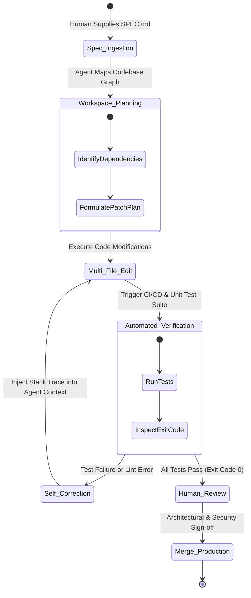
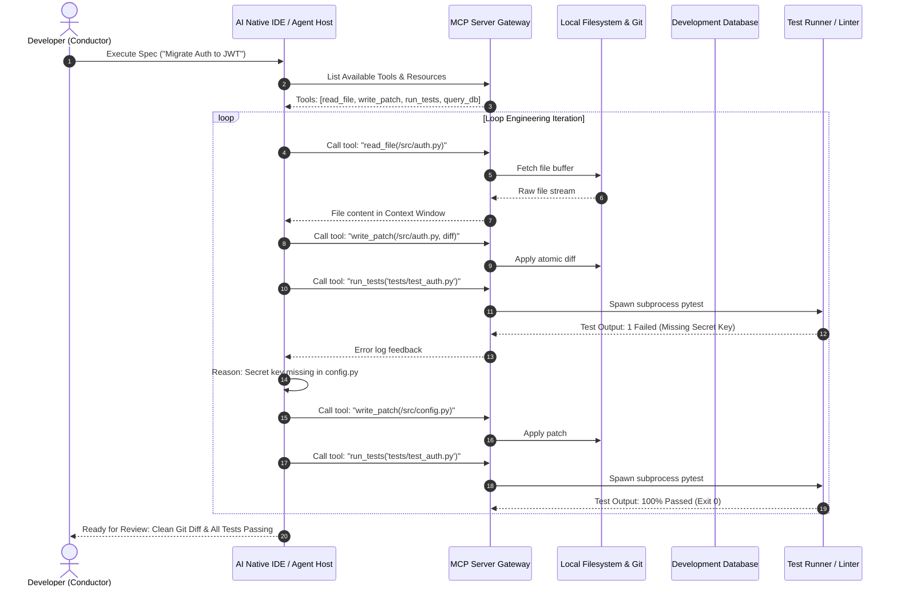

Welcome to the comprehensive technical breakdown of **Stanford University's CS146S: The Modern Software Developer**. 

For the past five decades, computer science education has trained developers to be meticulous typists: memorizing syntactic permutations, writing algorithmic routines from scratch, and manually hand-crafting thousands of lines of boilerplate code. Today, the software engineering industry is undergoing its most radical transformation since the invention of the compiler: the transition from **Manual Coding** to **Human-Agent Engineering**.

In this foundational inaugural lecture, we unpack how high-velocity engineering organizations (Google, Meta, OpenAI) are redefining developer productivity, why the developer is transforming from a code typist into an orchestra conductor, and how **Spec-Driven Development (SDD)**, **Agentic Workflows**, and the **Model Context Protocol (MCP)** constitute the indispensable toolkit for the modern engineer.

{/* truncate */}

---

### 1. The Paradigm Shift: From Syntax Typist to System Conductor

In traditional software engineering workflows, the primary bottleneck has always been human keyboard throughput and cognitive syntax recall. An engineer conceives an architectural intent, translates that intent into concrete language tokens (Java, TypeScript, Python), and spends 70% of their time navigating mundane plumbing: defining schema interfaces, wiring REST controllers, writing boilerplate CRUD tests, and fixing trivial syntactic typos.

With the advent of foundation reasoning models and autonomous coding agents (Claude Code, Cursor, GitHub Copilot Workspace), the generation of syntactically valid code has effectively reached near-zero marginal cost.

```mermaid
flowchart TD
    subgraph Traditional_Workflow ["Traditional Manual Paradigm: Developer as Typist"]
        A1[Human Architectural Idea] -->|Manual Typing 70% Time| B1[Boilerplate Syntax & Plumbing]
        B1 -->|Manual Test Writing| C1[Local Compilation & Debugging]
        C1 -->|Slow Linear Velocity| D1[Single Feature Delivery]
    end

    subgraph Modern_Agentic_Workflow ["Stanford CS146S Paradigm: Developer as Conductor"]
        A2[Human Architect: Specification & Invariants] ==>|High-Level Spec.md| B2[Autonomous AI Agent Squad]
        B2 -->|Multi-File Edit via MCP| C2[Automated Loop Engineering: Test & Self-Heal]
        C2 -->|Continuous Feedback| B2
        C2 ==>|Verified Code Base| D2[Human Architectural & Security Review]
        D2 ==>|10x Scaled Velocity| E2[Production Deployment]
    end
```



Modern developers are no longer evaluated by how many lines of code (LOC) they write per day. Instead, they operate as **Engineering Managers presiding over a squad of autonomous AI agents**. When an engineering manager delegates work to junior engineers, they do not dictate every keypress. Instead, they provide unambiguous specifications, outline system boundaries, and define deterministic acceptance criteria.

---

### 2. Spec-Driven Development (SDD): "What" Over "How"

The central methodology championed by Stanford CS146S is **Spec-Driven Development (SDD)**. In naive AI-assisted coding, developers interact with models through chatty, conversational prompts like: *"Can you make a user login system?"* 

This approach invariably leads to architectural divergence, code hallucination, and missing edge-case handling. Under SDD, the primary engineering deliverable is not the raw code, but a formal, machine-actionable **Specification Document (`SPEC.md`)**.

```markdown
# Engineering Specification Template (SPEC.md)

## 1. Context & Business Domain
- Implement idempotent payment webhook processing for Stripe API v2024-06.
- Database: PostgreSQL 16 with Row-Level Security (RLS) enabled.

## 2. Invariants & Non-Negotiable Constraints
- All database mutations MUST occur inside an explicit database transaction.
- Webhook signature validation (HMAC-SHA256) MUST fail closed before any payload parsing.
- Latency threshold: P99 response time < 80ms.

## 3. Interfaces & Schemas
- Input: `POST /api/v1/payments/webhook` with raw request body buffer.
- Event Types Handled: `payment_intent.succeeded`, `payment_intent.payment_failed`.

## 4. Verification & Test Suite Requirements
- Unit test coverage > 95% for transaction rollbacks on duplicate event IDs.
- Concurrency test: 50 concurrent duplicate webhooks MUST produce exactly 1 database insert.
```

By investing deep cognitive effort into crafting rigorous specifications, human developers establish unbreakable guardrails. The AI agent is given total autonomy over the *"How"* (synthesizing the implementation), while the human retains absolute authority over the *"What"* and the *"Why"*.

---

### 3. Agentic Workflows & Automated Loop Engineering

A defining concept introduced in Lecture 1 is **Loop Engineering**. Foundation models are probabilistic engines; expecting an LLM to generate a complex, multi-file distributed system in a single forward pass without errors is mathematically flawed.

Instead of expecting one-shot perfection, modern software engineering structures the agent workflow into a closed, self-correcting autonomous loop:



#### The Four Stages of the Autonomous Loop:
1. **Planning (Workspace Discovery)**: The agent traverses the project file graph, reading interface contracts and schema definitions.
2. **Execution (Multi-File Transformation)**: The agent applies diffs across client, server, and migration files simultaneously.
3. **Verification (Deterministic Feedback)**: The agent autonomously invokes test runners (`pytest`, `vitest`, `cargo test`) and linters.
4. **Self-Correction (Loop Iteration)**: When an assertion fails, the agent intercepts the stdout/stderr trace, analyzes the root cause, and edits the code until all test suites pass.

---

### 4. Model Context Protocol (MCP): The Universal Agent Protocol

How does an AI model escape the isolated text sandbox and interact with real-world developer tools? The answer lies in the **Model Context Protocol (MCP)**, the open industry standard for agentic tool integration.



Through MCP, coding agents can query PostgreSQL schemas, inspect runtime logs, trigger headless browser tests, and execute git worktree checkouts without human manual copying and pasting.

---

### 5. Architectural Comparison: Typist vs. Conductor

| Engineering Dimension | Traditional Paradigm (The Code Typist) | Modern Stanford CS146S Paradigm (The AI Conductor) |
| :--- | :--- | :--- |
| **Primary Skillset** | Syntactic fluency, manual typing speed, regex memorization | System architecture, specification writing, threat modeling |
| **Development Unit** | Functions, lines of code, individual file edits | Whole-system specifications, invariants, automated test contracts |
| **Tooling** | Passive text editors, standard linters, manual debuggers | Autonomous agents (Claude Code, Cursor), MCP servers, CI/CD loops |
| **Primary Bottleneck** | Typing speed, cognitive fatigue, manual boilerplate writing | Ambiguous specifications, incomplete test coverage, prompt leakage |
| **Verification Strategy** | Manual step-through debugging, console.log printouts | Automated deterministic test suites, invariant fuzzing, property tests |
| **Failure Modes** | Syntax errors, missed semicolons, off-by-one loops | Semantic hallucination, architectural drift, subtle security oversights |

---

### 6. Deep Q&A: Why Fundamentals Matter More Than Ever

During the inaugural lecture at Stanford, students raised a critical question that every computer science major is asking today:

> **Q. Professor, if AI agents can write 80% of our code in seconds, do we still need to study algorithms, memory management, and data structures?**

The faculty answer is profound and decisive: **Computer science fundamentals are significantly more critical today than they were a decade ago.**

1. **The Reviewer's Burden**: Generating 1,000 lines of plausible code takes an AI 15 seconds. Reviewing that code to detect an $O(N^2)$ algorithmic trap, an unclosed database connection pool, a subtle race condition, or a cryptographic vulnerability requires **profound, master-level understanding of systems programming**.
2. **Accountability Remains 100% Human**: An AI agent cannot be held legally or professionally liable when a production service crashes or customer data leaks. The human engineer whose name is on the pull request bears total responsibility.
3. **Debugging the Edge Cases**: When an autonomous agent gets stuck in a self-correction loop, only an engineer with deep knowledge of operating systems, network protocols, and hardware architectures can step in and diagnose the underlying impedance mismatch.

---

### 7. Lecture 1 Takeaways & Series Roadmap

1. **Redefine Your Identity**: Stop thinking of yourself as a code author. You are an architect, a spec designer, and an agent manager.
2. **Master Spec-Driven Development**: Treat `SPEC.md` as your primary high-leverage engineering artifact.
3. **Embrace Loop Engineering**: Shift from expecting single-shot AI answers to designing self-healing loops backed by rigorous unit tests.

In **Lecture 2**, we will dive into **Context Management & Prompt Architecture**: how to structure multi-thousand-token context windows, optimize repository maps, and prevent context saturation during complex multi-file feature additions. Stay tuned to GlobalDevLog!
---

### 参考资料与官方课程视频 (References)
- **斯坦福官方课程视频播放列表**: [Stanford CS146S: The Modern Software Development (YouTube Playlist)](https://www.youtube.com/playlist?list=PLxpwjSdVZQ95OWe3QvkVEcU1f1X-6NDj9)
- **开设机构**: Stanford University, Department of Computer Science
---

### 📌 3~5 行核心总结 (Executive Summary)
1. **范式巨变**：软件工程师的角色从手工敲击语法的“代码打字员”，彻底转变为调度自律 AI 智能体编队的“系统交响乐指挥家”。
2. **规范驱动开发 (SDD)**：工程核心杠杆在于设计机器可读的 `SPEC.md` 规范与边界不变量契约，而非在对话框中手写具体实现细节。
3. **闭环工程与 MCP**：不再依赖单次直出的代码，而是结合模型上下文协议 (MCP) 与确定性单元测试，构建具备自动自愈能力的工程闭环。
4. **计算机基础的逆向升值**：AI 生成代码速度越快，为排查隐蔽死锁、算法性能瓶颈与安全漏洞所需的底层体系结构与操作系统知识就越显无可替代。