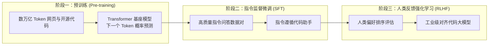

欢迎回到斯坦福大学前沿软件工程课程 **CS146S：现代软件开发者 (The Modern Software Developer)** 第2讲的技术深度解析。

在第1讲中，我们确立了宏观架构视角：现代软件工程师正从纯手工的“代码打字员”向调度多智能体协作的“交响乐指挥家”演进。在**第2讲（第一周）**中，课程直接切入驱动这场变革的核心引擎：**代码大语言模型（Coding LLMs）**与**提示词工程（Prompt Engineering）**。

结合 Andrej Karpathy 的经典讲义《Deep Dive into LLMs》、OpenAI 论文《How OpenAI Uses Codex》以及 Google Cloud 与 DAIR.AI 的最新提示词工程研究，本讲全面揭示大模型理解代码的数理本质，剖析 AI 代码生成中的**“瑞士奶酪模型”**风险，并阐明**“信任但必须验证（Trust but Verify）”**的工业级防御架构。

{/* truncate */}

---

### 1. 代码大模型的底层解构：三阶段训练流水线

---

### 2. 瑞士奶酪模型与“信任但必须验证”架构

代码大模型虽然能生成极为优雅的代码，但其本质是统计学模拟器，常在细微的并发死锁或边界条件中留下致命漏洞（瑞士奶酪的孔洞）。因此，现代工程要求构建包含类型静态分析、单元测试沙箱与模糊测试的多重防御网。

### 课程参考资料
- **官方 YouTube 教学视频列表**: [Stanford CS146S: The Modern Software Development (YouTube Playlist)](https://www.youtube.com/playlist?list=PLxpwjSdVZQ95OWe3QvkVEcU1f1X-6NDj9)
- **核心文献**: Andrej Karpathy, *Deep Dive into LLMs*; OpenAI, *How OpenAI Uses Codex*; Google Cloud & DAIR.AI, *Prompt Engineering Guide*.
- **学术机构**: 斯坦福大学计算机科学系
