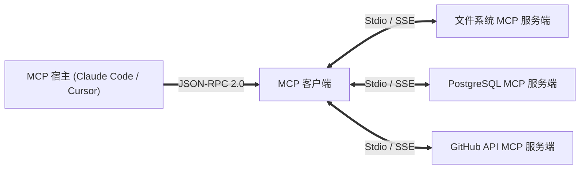

欢迎回到斯坦福大学尖端软件工程课程 **CS146S：现代软件开发者 (The Modern Software Developer)** 第3讲的深度技术解析。

本讲重点破解大模型落地中最核心的工程瓶颈：**“如何让孤立的基础大模型以安全、标准化、可插拔的方式与外部数据库、终端和 API 进行交互？”** 深度解析由 Anthropic 推动并成为斯坦福课程核心的**模型上下文协议 (Model Context Protocol, MCP)**。

{/* truncate */}

---

### 1. 大模型时代的 LSP：MCP 架构解析

正如 Language Server Protocol (LSP) 终结了编辑器与编译器的 N x M 适配困境，MCP 借助 JSON-RPC 2.0 将大模型推理解构与外部物理工具执行完全解耦。

### 课程参考资料
- **官方 YouTube 教学视频列表**: [Stanford CS146S: The Modern Software Development (YouTube Playlist)](https://www.youtube.com/playlist?list=PLxpwjSdVZQ95OWe3QvkVEcU1f1X-6NDj9)
- **核心文献**: Model Context Protocol Specification (modelcontextprotocol.io); Anthropic Claude Tool Use Architecture; Microsoft Language Server Protocol (LSP).
- **学术机构**: 斯坦福大学计算机科学系
