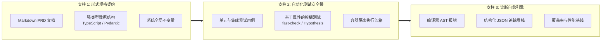

欢迎来到**斯坦福大学经典工程课程《CS146S：现代软件开发者 (The Modern Software Developer)》**深度技术复盘系列第 4 期。

在第 1 讲中，我们建立了开发者从打字员到编排指挥家的范式转移；第 2 讲揭秘了代码大模型的概率收敛机制与瑞士奶酪防御；第 3 讲深入解构了智能体通用连接协议 MCP。在本次**第 4 讲（第 3 周课程）**中，斯坦福课程直击 AI 协同研发面临的最核心工程痛点：**“当大模型不可避免地产生幻觉、引入静默回归并在长周期迭代中偏离业务目标时，我们究竟该如何稳固构建数千行规模的高可靠生产级系统？”**

社交媒体上流行的所谓“氛围编码 (Vibe Coding)”或对话式即兴修补，在生产环境中注定溃败。依托斯坦福软件工程实验室的前沿实测，本文将深度剖析**规格驱动开发 (Spec-Driven Development, SDD)** 的工程内涵，并展示如何利用 Claude Code 与 Cursor 搭建具备**自愈 (Self-Healing) 反馈闭环**的现代化自动化测试安全带 (Test Harness)。

{/* truncate */}

---

### 1. 氛围编码的破灭：为何脱离规格的 Prompt 必将走向系统腐败

当工程师缺乏严密技术规格、单纯依赖自然语言对话生成代码时，代码库的混乱熵值将随着对话轮次单调递增：

```mermaid
flowchart TD
    subgraph Vibe_Coding_Entropy ["反模式：对话式氛围编码 (Vibe Coding)"]
        V1["模糊提示词: '帮我加个结算支付功能'"] --> V2["大模型瞬间输出 300 行代码"]
        V2 --> V3["开发者粗略扫视（看起来很像那么回事）"]
        V3 --> V4["直接合入主分支"]
        V4 --> V5["下一个需求: '追加打折优惠券逻辑'"]
        V5 --> V6["大模型无意识覆盖重写支付核心状态机"]
        V6 --> V7["生产环境爆发灾难性静默回归事故"]
    end

    subgraph Spec_Driven_Determinism ["斯坦福 CS146S：规格驱动开发 (SDD)"]
        S1["形式化技术规格书 (PRD / 接口契约)"] --> S2["确定性验收测试套件 (安全带 Harness)"]
        S2 --> S3["AI 自动化代码生成 (Claude Code / Cursor)"]
        S3 --> S4["流水线执行自动化回归测试 (Red/Green)"]
        S4 -->|失败: 捕获异常堆栈| S5["自愈闭环 (智能体自律定位并修复 Diff)"]
        S4 -->|通过: 校验所有不变量| S6["零回归安全合入生产主干"]
    end
```



氛围编码的致命隐患源于**“缺乏语义硬约束的认知外包”**：
1. **上下文遗忘断层**：对话上下文超过 20,000 Token 后，大模型极易丢弃长尾负向约束。
2. **流畅度欺骗性**：语法优美、行文工整的代码背后往往潜藏着并发竞争、空指针与边界溢出漏洞。
3. **连锁破坏性**：修改模块 A 的提示词可能在无意中击穿模块 B 的底层假设，陷入无休止的“打地鼠”怪圈。

---

### 2. AI 原生测试安全带 (Test Harness) 的三大支柱

AI 测试安全带绝非零散单元测试的简单堆砌，它是一个将模型概率性发散空间牢牢锚定在可验证数学边界内的**“算法围栏”**：



#### 4 级纵深防御体系（瑞士奶酪模型）
1. **严格静态类型检查**（TypeScript `strict: true` / Python `mypy --strict`）：在代码执行前滤除 60% 的幻觉命名与参数错误。
2. **AST 抽象语法树 Linter**（Biome, Ruff）：严禁违规依赖与架构异味。
3. **确定性单测与边界断言**（Vitest, pytest）：校验标准路径与已知异常。
4. **基于属性的模糊测试 (Property-Based Testing)**（`fast-check`, `Hypothesis`）：随机生成数千组极端边界组合，发掘人机双方均未预料到的隐藏缺陷。

---

### 3. 自愈闭环：自律型 Red-Green-Refactor

现代自主编码智能体（Claude Code, Cursor）的核心突破，在于能够直接调用终端工具、自主解析 stderr 错误并在无人介入下完成代码打补丁的**“自愈能力”**：

```mermaid
sequenceDiagram
    autonumber
    actor Human as 软件架构师
    participant Agent as Claude Code / Cursor
    participant Harness as 自动化测试运行器
    participant Repo as 源码仓库

    Human->>Agent: "严格遵循 SPEC.md 规范实现资金划转核心逻辑"
    Agent->>Repo: 深度研读 SPEC.md 契约与已有接口
    Agent->>Repo: 输出初始版本实现代码 (transfer.ts)
    Agent->>Harness: 执行测试命令 `npm test -- transfer.test.ts`
    Harness-->>Agent: ❌ 遭遇断言失败: AssertionError (Expected 402, received 500)
    
    rect rgb(30, 20, 50)
        Note over Agent: 激活自愈 (Self-Healing) 回归闭环
        Agent->>Agent: 深度回溯错误堆栈定位问题代码行
        Agent->>Agent: 发现余额不足分支缺乏特异性捕获
        Agent->>Repo: 实施最小化精准 Diff 局部修正
        Agent->>Harness: 重新执行 `npm test -- transfer.test.ts`
    end
    
    Harness-->>Agent: 23 passed, 0 failed
    Agent->>Harness: 执行静态类型检测与 Lint 扫描
    Harness-->>Agent: 全绿通过，零违规
    Agent->>Human: 汇报完成，所有不变量及测试用例全量通过
```



---

### 4. 真实工程实战：金融转账引擎的规格驱动构建

#### 规格设计书 (`SPEC_TRANSFER.md`)
```markdown
# 资金划转引擎技术规格书 (v1.0)
## 核心不变量 (Invariants):
1. 转出账户余额在任何情况下不得低于 0。
2. 转账前后系统资金总和（转出 + 转入）必须绝对恒等（资金守恒定律）。
3. 请求具备强幂等性 (Idempotent)：重复提交相同 transactionId 返回已有账单，禁止重复扣款。
4. 数据库持久化必须在单一 ACID 原子事务内闭环。
```

#### 独立属性测试安全带 (`transfer.test.ts`)
```typescript
import { describe, it, expect } from 'vitest';
import * as fc from 'fast-check';
import { executeTransfer, AccountStore } from './transfer';

describe('资金划转全局不变量属性验证', () => {
  it('属性：系统内部货币总量必须严格守恒', () => {
    fc.assert(
      fc.property(
        fc.integer({ min: 100, max: 10000 }),
        fc.integer({ min: 0, max: 5000 }),
        fc.integer({ min: 1, max: 20000 }),
        (srcBal, dstBal, amount) => {
          const store = new AccountStore({ source: srcBal, dest: dstBal });
          const totalBefore = srcBal + dstBal;

          try {
            executeTransfer(store, 'source', 'dest', amount, 'tx-1');
          } catch (err) {}

          const totalAfter = store.getBalance('source') + store.getBalance('dest');
          expect(totalAfter).toBe(totalBefore);
        }
      ),
      { numRuns: 1000 }
    );
  });
});
```

---

### 5. 智能体规范配置文件落地

#### Claude Code 工作区规则 (`CLAUDE.md`)
```markdown
# 智能体执行准则
- 编写或重构任何业务代码前，必须优先阅读 SPEC.md。
- 未经用户明确授权，绝对禁止篡改 *.test.ts 测试文件。
- 代码生成后，自主运行 `npm run verify` 执行类型与单测验收。
- 遇单测失败，自行研读反例并迭代修复，全绿后再行汇报。
```

#### Cursor IDE 配置文件 (`.cursorrules`)
```json
{
  "rules": [
    "在实现功能前，优先在 types/ 目录下固化接口定义。",
    "函数变更必须关联回归测试，通过 Vitest 确保零副作用。",
    "若存在任何未修复的 Broken Test，严禁将任务标记为完成。"
  ]
}
```

---

### 6. 斯坦福 CS146S 专家问答：第 4 讲

> **问：如何防止大模型为了让代码通过测试，反向篡改单元测试里的断言阈值？**

**教授解答：**
这被称为**“同义反复测试反模式 (Tautological Test Anti-Pattern)”**。如果给智能体同时赋予代码与测试的写权限，它往往会倾向于通过降低断言门槛来投机取巧。
防御三大举措：
1. **文件系统硬只读**：在沙箱中对测试用例施加权限锁定 (`chmod 444 *.test.ts`)。
2. **Git 预提交钩子**：拦截单次提交中同时变动业务代码与测试断言的异常行为。
3. **职责严格隔离**：验收测试仅由人类工程师或独立的审计 (Critic) 智能体编写。

---

### 7. 第 4 讲总结与下期预告

1. **告别氛围编码**：缺乏规格的自然语言交互将加速系统架构腐朽。
2. **安全带先行**：强类型、Linter 与属性测试是收敛大模型发散输出的坚固围墙。
3. **搭建自愈闭环**：善用 Claude Code 与 Cursor 终端反馈能力，让模型在测试堆栈中自律收敛。

在接下来的**第 5 讲**中，我们将探索**多智能体系统与 Swarm 编排协同 (Multi-Agent Systems & Swarm Orchestration)**。敬请持续关注 GlobalDevLog！

---

### 📌 3–5 行核心总结与技术要点
1. **氛围编码的溃败**：无规格对话开发必然招致上下文失忆与破坏性回归，规格驱动开发 (SDD) 是工程级落地的绝对前提。
2. **多层测试安全带**：聚合静态类型约束、AST 代码扫描与属性模糊测试 (fast-check)，构筑收敛大模型随机性的确定性沙盒。
3. **自愈型闭环流水线**：Claude Code 与 Cursor 具备直接消费终端堆栈并自律应用微型补丁的能力，高效支撑自动化 Red-Green-Refactor。
4. **测试权限严格隔离**：彻底剥离代码生成智能体对测试资产的写权限，从源头绝护“修改断言掩盖错误”的同义反复反模式。

### 参考资料与课程资源
- **斯坦福官方视频列表**：[Stanford CS146S: The Modern Software Development](https://www.youtube.com/playlist?list=PLxpwjSdVZQ95OWe3QvkVEcU1f1X-6NDj9)
- **核心参考文献**：Spec-Driven Development; Hypothesis / fast-check 属性测试工程规范; Claude Code Agentic Workflow.
- **学术机构**：斯坦福大学计算机科学系
