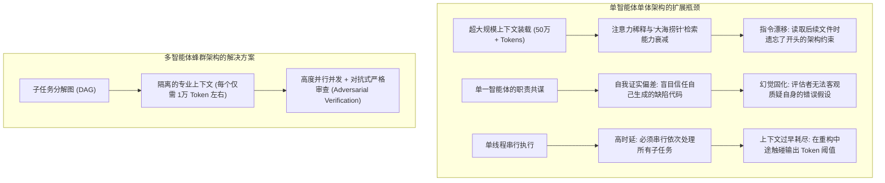
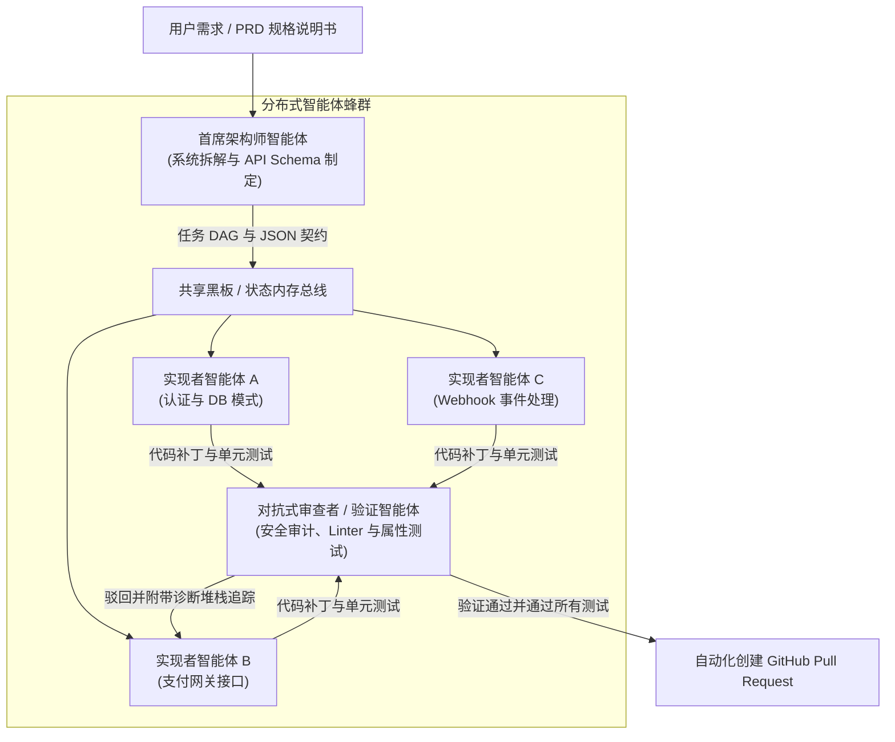

欢迎来到**斯坦福大学 CS146S（现代软件开发者：The Modern Software Developer）**系列课程深度解析第5讲。

在前面的课程中，我们系统探讨了开发者提示词工程、代码大模型的内部注意力机制、利用模型上下文协议（MCP）实现自主工具调用，以及基于规格说明书的自愈测试装配架（Test Harness）。到目前为止，所有探讨的范式都基于一个共同的默认假设：由**单个主要 LLM 会话**在 IDE 或终端工作区中与开发者保持对话交互。

然而，当软件工程规模扩展到数千行代码以上，并涉及分布式微服务和数十万行的庞大企业级代码仓库时，单智能体范式将迅速崩溃。单体智能体必然面临**上下文窗口饱和、注意力稀释（Attention Dilution）和认知抖动（Cognitive Thrashing）**三大致命困境。

在今天的课程中，斯坦福大学教学团队揭示了 AI 原生工程演进的核心方向：**多智能体系统（MAS）与蜂群编排（Swarm Orchestration）**。通过严格分离**架构师（Architect）、实现者（Implementer）与审查者（Critic）**的职能，并在有向无环图（DAG）与结构化消息总线的协同下，实现代码生成精度与软件工程规模的跨越式提升。

{/* truncate */}

---

### 1. 单上下文单体 LLM 的扩展极限

为什么我们不能简单地将一个 50 万行代码的大型企业仓库直接塞进拥有 100 万 Token 上下文的大模型中，然后直接吩咐它“重构支付结算流水线”？

斯坦福研究团队指出了阻碍单智能体扩展的三个根本性架构瓶颈：



1. **注意力稀释与“迷失于中间”（Lost in the Middle）**：当上下文超过 10 万 Token 时，注意力机制的检索精度出现不均匀下降。埋藏在中间文件中的复杂数据库完整性约束或接口规范极易被忽略。
2. **职责共谋与确认偏差**：如果由同一个 LLM 同时扮演系统架构师、编码员和质量验收员，它会产生严重的自我确证偏见，几乎不可能主动构造能够击穿自身逻辑漏洞的极端边界测试。
3. **上下文抖动与污染**：在单个会话中连续修改 15 个文件，终端 diff、编译器报错以及被废弃的假设会彻底污染上下文缓冲区，最终引发模型幻觉或胡言乱语。

---

### 2. 三权分立蜂群架构：架构师、实现者与审查者

为了达到工业级生产环境的鲁棒性，斯坦福 CS146S 正式确立了**三权分立蜂群模式（Tripartite Agent Swarm Pattern）**：



#### 核心角色权责划分：
1. **首席架构师智能体（Lead Architect Agent）**：
   - **输入**：用户需求 PRD、代码仓库依赖拓扑图、业务目标。
   - **输出**：解耦的子任务有向无环图（DAG）、严格的 JSON Schema 接口定义及契约规范。
   - **核心约束**：架构师不编写任何实现代码，其全部推理算力专注于系统拆解与接口稳定。
2. **实现者蜂群（Implementer Swarm Workers）**：
   - **输入**：DAG 分配的单个局部任务切片、接口规范契约、对应模块的文件子树。
   - **输出**：模块化源代码、配套单元测试用例及依赖项。
   - **执行机制**：多个实现者在完全隔离的沙箱分支或临时容器中实现 100% 并发编码。
3. **对抗式审查与验证智能体（Adversarial Critic & Verifier Agent）**：
   - **输入**：候选代码补丁、架构师的原始规格说明、自动化测试套件运行日志。
   - **输出**：静态分析指标、安全性漏洞审计（AST 检查、密钥泄漏检测）及最终通过/驳回判定。
   - **自愈反馈**：审查未通过时，审查者生成附带调用堆栈的精确诊断 diff，直接回传给对应的实现者以驱动闭环自愈修复。

---

### 3. 智能体间通信拓扑：规避无序混乱的确定性控制

放任智能体自由聊天会导致幻觉滚雪球效应并陷入无休止的消息死循环。CS146S 强调了两种主导的确定性编排拓扑：

#### A. 集中式黑板（Blackboard）模式
智能体之间禁止直接进行私聊，而是统一读写经过 Schema 校验的中央状态存储介质：

```json
{
  "task_id": "TASK-402-AUTH",
  "status": "in_review",
  "dependencies": ["TASK-401-DB-SCHEMA"],
  "assigned_agent": "worker-claude-code-01",
  "contract_schema_hash": "sha256:7f8a92...",
  "artifacts": {
    "patch_path": "/workspace/patches/auth_service.patch",
    "test_coverage": 94.2
  },
  "critic_feedback": null
}
```

#### B. 有向无环图（DAG）执行工作流
将任务组织为 DAG 拓扑图，边代表严格的数据与状态依赖关系。若模块 B 依赖于模块 A 的数据契约，在实现者 A 的代码彻底通过审查者（Critic）的严苛测试之前，实现者 B 绝不会被唤醒。

---

### 4. 工程实战：使用 Python 构建异步蜂群编排器

以下是利用 Pydantic 结构化数据验证实现架构师-实现者-审查者闭环的生产级异步蜂群调度引擎：

```python
# swarm_orchestrator.py - 生产级多智能体蜂群编排引擎
import asyncio
from typing import List, Dict, Optional
from pydantic import BaseModel, Field

class SubTaskContract(BaseModel):
    task_id: str
    description: str
    file_targets: List[str]
    interface_schema: Dict[str, str]

class ArchitectPlan(BaseModel):
    plan_title: str
    subtasks: List[SubTaskContract]

class PatchResult(BaseModel):
    task_id: str
    code_diff: str
    unit_tests: str

class CriticAudit(BaseModel):
    passed: bool
    score: float = Field(ge=0.0, le=100.0)
    diagnostic_trace: Optional[str] = None

class SwarmOrchestrator:
    def __init__(self, architect_llm, coder_llm, critic_llm):
        self.architect = architect_llm
        self.coder = coder_llm
        self.critic = critic_llm

    async def execute_task(self, user_prd: str):
        print("[ORCHESTRATOR] 阶段 1: 正在生成架构方案并分解子任务...")
        plan: ArchitectPlan = await self.architect.generate_plan(user_prd)
        
        print(f"[ORCHESTRATOR] 架构师已将 PRD 拆解为 {len(plan.subtasks)} 个 DAG 子任务。")
        
        # 将子任务并发分派给并行实现者工作智能体
        tasks = [self._worker_critic_loop(task) for task in plan.subtasks]
        results = await asyncio.gather(*tasks)
        
        print("[ORCHESTRATOR] 蜂群全部子任务均已通过独立验证并成功集成！")
        return results

    async def _worker_critic_loop(self, task: SubTaskContract, max_retries: int = 3) -> PatchResult:
        attempt = 0
        error_context = None

        while attempt < max_retries:
            attempt += 1
            print(f"[{task.task_id}] 实现者正在编码实现 (尝试 {attempt}/{max_retries})...")
            
            patch: PatchResult = await self.coder.implement_task(task, feedback=error_context)
            
            print(f"[{task.task_id}] 审查者正在对补丁进行严苛审计与测试...")
            audit: CriticAudit = await self.critic.verify(task, patch)
            
            if audit.passed:
                print(f"[{task.task_id}] 审查通过！(质量得分: {audit.score}/100)")
                return patch
            
            print(f"[{task.task_id}] 审查者驳回补丁: {audit.diagnostic_trace}")
            error_context = audit.diagnostic_trace

        raise RuntimeError(f"子任务 {task.task_id} 在重试 {max_retries} 次后仍未能通过审查者验收。")
```

---

### 5. 第5讲核心精要与后续课程

1. **超越单体智能体**：面对大型代码库，必须利用多智能体蜂群消除注意力稀释与确认偏见。
2. **三权分立专业化**：架构师（顶层设计与接口契约）、实现者（沙箱并发编码）、审查者（对抗审计与安全验证）各司其职。
3. **确定性通信管控**：淘汰非结构化的聊天流，使用 Pydantic JSON 契约、中央黑板与 DAG 拓扑实现精准编排。

在**第6讲**中，我们将全面探讨 **AI 辅助调试与性能分析：深度结合 eBPF、动态追踪与运行时故障排查大模型**！

---

### 📌 执行摘要（3–5 行总结）
1. **多智能体演进必然性**：通过将开发任务拆解为分布式智能体蜂群，彻底攻克单会话 LLM 的注意力稀释、指令漂移和自我确证偏见。
2. **三权分立专业分工**：确立架构师（规划与 API 契约）、实现者（沙箱隔离并发编码）与审查者（对抗式审计与回归测试）三位一体的工程架构。
3. **确定性通信协议**：依托 Pydantic JSON 结构化契约、中央黑板内存与 DAG 工作流，有效阻断智能体间的幻觉蔓延与无限死循环。
4. **异步自愈反馈闭环**：审查者将具象化的错误堆栈精确回传给实现者，驱动自主补丁迭代直到完全通过回归测试。

### 参考文献与斯坦福 CS146S 课程信息
- **课程全称**：Stanford CS146S (The Modern Software Developer), 2026.
- **教学单位**：斯坦福大学计算机科学系 (Dept. of Computer Science, Stanford University).
- **关联框架**：LangGraph, AutoGen, CrewAI, Anthropic Multi-Agent Orchestration Protocols.
