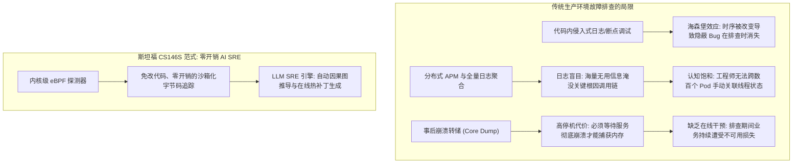
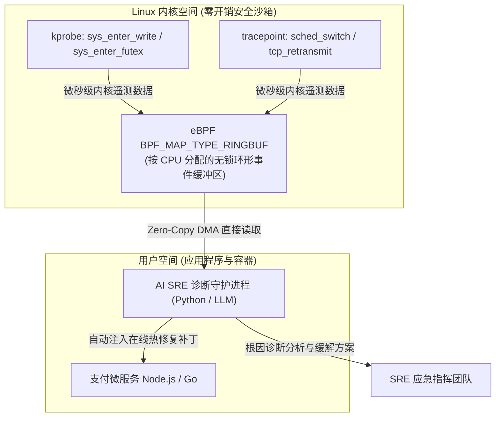

欢迎来到**斯坦福大学 CS146S（现代软件开发者：The Modern Software Developer）**系列深度解析第6讲。

在上一节课中，我们探讨了多智能体蜂群编排——通过结构化的有向无环图（DAG）协调架构师、实现者与审查者大模型协同构建庞大的代码仓库。然而，即使经过最严苛的自动化测试，软件工程终究要在真实生产环境的极端负载下接受检验。

凌晨 3 点，当分布式支付集群中突然爆发隐蔽的并发死锁导致线程挂起，或是未建索引的数据库查询导致长尾延迟飙升至 12 秒时，传统的开发排查手段将全面失灵。静态分析无法预测动态的竞态条件（Race Condition），在代码中强行插桩打印日志（`printf`）会引发**海森堡效应（Heisenbug）**（因改变时序而导致 Bug 诡异消失），而传统的分布式 APM 工具则往往让网站可靠性工程师（SRE）淹没在每秒数百万行的无意义日志噪声之中。

在今天的课程中，斯坦福大学教学团队揭示了自主软件韧性（Autonomous Resilience）的核心突破：**AI 辅助调试与运行时性能分析**。通过将**扩展伯克利数据包过滤器（eBPF）**的零开销、非侵入式内核追踪能力与**专职 LLM 诊断 SRE 智能体**相结合，现代工程团队能够在微秒级捕获内核级真实执行状态，并在数分钟内定位根因、自主合成在线热补丁。

{/* truncate */}

---

### 1. 生产环境故障危机：传统调试手段为何屡屡失效

当高吞吐微服务在高负载下发生故障时，软件工程师通常会陷入三大可观测性悖论：



1. **海森堡（Heisenbug）困境**：一旦在代码中插入追踪日志或挂接交互式调试器（`gdb`），线程被暂停、锁竞争顺序被打乱、CPU 缓存被刷新，导致难以复现的时序性并发 Bug 瞬间消失。
2. **数据泛滥与语义盲目**：现代监控系统每秒收集数以吉字节的指标与追踪数据。然而，当单点故障级联触发 45 个警报时，工程师往往耗费数小时才能理清哪个是主因，哪些是次生症状。
3. **内核层与应用层之间的语义断层**：高层的“HTTP 504 网关超时”无法揭示底层究竟是线程池耗尽、TCP 套接字缓冲区暴涨，还是 Linux VFS 层的脏页回写阻塞。

---

### 2. eBPF 技术革命：操作系统内核级的非侵入式观测

为了彻底消除海森堡效应，斯坦福 CS146S 引入了 **eBPF（extended Berkeley Packet Filter）**。eBPF 是一项革命性的 Linux 内核技术，它允许开发者在不修改内核源码、不加载高风险内核模块的前提下，直接在操作系统内核内部运行经过安全验证的沙箱化字节码。



#### eBPF 在 AI 调试中的关键优势：
- **微乎其微的系统开销**：eBPF 字节码通过内核安全验证器并由 JIT 编译为原生机器码，在全量网络吞吐下引入的 CPU 损耗通常低于 1.5%。
- **全方位全栈透视**：挂载在 `kprobes`（内核函数入口）、`kretprobes`（内核函数返回）、`uprobes`（用户空间符号）及套接字上，无需修改任何一行业务代码即可观测所有系统调用与互斥锁竞争。
- **无锁环形缓冲区（Lockless Ring Buffer）**：以极高频率产生的内核事件通过 `BPF_MAP_TYPE_RINGBUF` 无锁流水线直接推送到用户空间，避免观测动作本身成为服务性能瓶颈。

---

### 3. 跨越语义鸿沟：将内核遥测喂给 LLM 诊断智能体

直接将未经处理的原始 eBPF 追踪流（数百万十六进制指针与纳秒时间戳）输入大语言模型，将迅速耗尽上下文并引发严重幻觉。

斯坦福 CS146S 确立了**两阶段遥测数据蒸馏引擎（Two-Stage Distillation Engine）**：

1. **确定性聚合与火焰图折叠（Flame-Graph Folding）**：
   - 用户空间守护进程将海量调用栈聚合为带权重的折叠格式（如 `process;thread;function_A;function_B;futex_wait 450ms`）。
   - 通过差分对比健康基线追踪与故障窗口追踪，精准剥离统计异常点。
2. **因果图推导与假设生成**：
   - 大模型仅接收提纯后的异常增量、相关微服务源码片段以及当前 Kubernetes Pod 拓扑状态。
   - 依托**思维链（Chain-of-Thought, CoT）诊断 Prompt**，大模型将底层内核阻塞精准映射回高层业务逻辑（例如定位到未关闭的数据库连接池引发了互斥锁饥饿）。

---

### 4. 工程实战：使用 Python 与 C 构建 eBPF 延迟追踪与 LLM 修复流水线

以下基于 BCC 框架构建的微秒级慢系统调用捕获与异步 AI SRE 响应引擎代码：

```python
# ebpf_ai_debugger.py - eBPF 可观测性与 AI SRE 智能诊断流水线
import asyncio
import json
from bcc import BPF
from pydantic import BaseModel, Field
from typing import List, Optional

# 1. C 语言编写的内核级 eBPF 探测程序
EBPF_PROGRAM = """
#include <uapi/linux/ptrace.h>
#include <linux/sched.h>

struct event_t {
    u32 pid;
    u64 latency_ns;
    char comm[TASK_COMM_LEN];
};

BPF_HASH(start_time, u32, u64);
BPF_PERF_OUTPUT(latency_events);

int trace_sys_enter_write(struct pt_regs *ctx) {
    u32 pid = bpf_get_current_pid_tgid() >> 32;
    u64 ts = bpf_ktime_get_ns();
    start_time.update(&pid, &ts);
    return 0;
}

int trace_sys_exit_write(struct pt_regs *ctx) {
    u32 pid = bpf_get_current_pid_tgid() >> 32;
    u64 *tsp = start_time.lookup(&pid);
    if (tsp == 0) return 0;

    u64 delta = bpf_ktime_get_ns() - *tsp;
    start_time.delete(&pid);

    // 仅过滤并上报延迟超过 50ms 的严重系统调用阻塞
    if (delta > 50000000) {
        struct event_t evt = {};
        evt.pid = pid;
        evt.latency_ns = delta;
        bpf_get_current_comm(&evt.comm, sizeof(evt.comm));
        latency_events.perf_submit(ctx, &evt, sizeof(evt));
    }
    return 0;
}
"""

class IncidentRemediationPlan(BaseModel):
    root_cause: str
    culprit_function: str
    confidence_score: float = Field(ge=0.0, le=1.0)
    remediation_script: str
    mitigation_strategy: str

class AIDiagnosticEngine:
    def __init__(self, llm_client):
        self.llm = llm_client

    async def diagnose_and_mitigate(self, event_data: dict, source_context: str) -> IncidentRemediationPlan:
        prompt = f"""
        [紧急故障诊断告警]
        内核级遥测事件: 进程 '{event_data['comm']}' (PID: {event_data['pid']}) 
        发生严重系统调用停顿，延迟高达 {event_data['latency_ms']:.2f} ms。
        
        应用程序源码上下文:
        {source_context}
        
        请深入分析根本原因，并输出包含受影响函数及在线热修复补丁的结构化 JSON 方案。
        """
        response = await self.llm.generate_structured(prompt, schema=IncidentRemediationPlan)
        return response

class eBPFTelemetryMonitor:
    def __init__(self, ai_engine: AIDiagnosticEngine):
        self.bpf = BPF(text=EBPF_PROGRAM)
        self.bpf.attach_kprobe(event="__x64_sys_write", fn_name="trace_sys_enter_write")
        self.bpf.attach_kretprobe(event="__x64_sys_write", fn_name="trace_sys_exit_write")
        self.ai = ai_engine

    def handle_event(self, cpu, data, size):
        event = self.bpf["latency_events"].event(data)
        latency_ms = event.latency_ns / 1_000_000.0
        print(f"[告警] 捕获进程 {event.comm} (PID: {event.pid}) write() 阻塞 {latency_ms:.2f}ms!")
        
        # 异步调度大模型 SRE 诊断
        asyncio.create_task(self.ai.diagnose_and_mitigate(
            event_data={"comm": event.comm, "pid": event.pid, "latency_ms": latency_ms},
            source_context="// 相关业务控制器源码..."
        ))

    def start_polling(self):
        self.bpf["latency_events"].open_perf_buffer(self.handle_event)
        print("[eBPF 监控器] 内核探测器已就绪，正在实时监听系统调用延迟...")
        while True:
            self.bpf.perf_buffer_poll()
```

---

### 5. 第6讲核心精要与后续课程

1. **非侵入式可观测性原则**：生产调试严禁使用侵入式插桩或高开销探针，Linux eBPF 零开销技术是构建自治系统的基石。
2. **结构化数据蒸馏先于大模型推理**：必须将高频原始遥测流归一化为火焰图与统计异常，方能保障大模型诊断的严谨与无幻觉。
3. **闭环主动治理**：结合 AI 智能体，将传统的被动复盘转变为实时拦截、秒级溯源与在线热修复。

在**第7讲**中，我们将全面探讨 **大规模代码审查自动化：AST 语法树感知、安全污点分析（Taint Analysis）与自主大模型 PR 审查员**！

---

### 📌 执行摘要（3–5 行总结）
1. **破解生产调试困境**：采用非侵入式 Linux 内核 eBPF 动态追踪，彻底避免传统插桩引发的海森堡效应及海量日志噪声困扰。
2. **零开销内核级观测**：将安全字节码挂载至 `kprobes` 并配合无锁环形缓冲区，以不足 1.5% 的 CPU 损耗捕获微秒级系统阻塞。
3. **遥测数据智能蒸馏**：将系统调用流转化为火焰图异常与因果关系图，有效填补操作系统底层与高层业务逻辑间的语义断层。
4. **自主在线故障缓解**：建立 AI SRE 闭环，在捕获延迟突增的瞬间完成根因溯源并生成在线热补丁，实现自动化生产级韧性。

### 参考文献与斯坦福 CS146S 课程信息
- **课程全称**：Stanford CS146S (The Modern Software Developer), Fall 2026.
- **教学单位**：斯坦福大学计算机科学系.
- **关联框架与技术**：Linux eBPF/BCC, bpftrace, Cilium, Pixie, OpenTelemetry, LangChain SRE.
