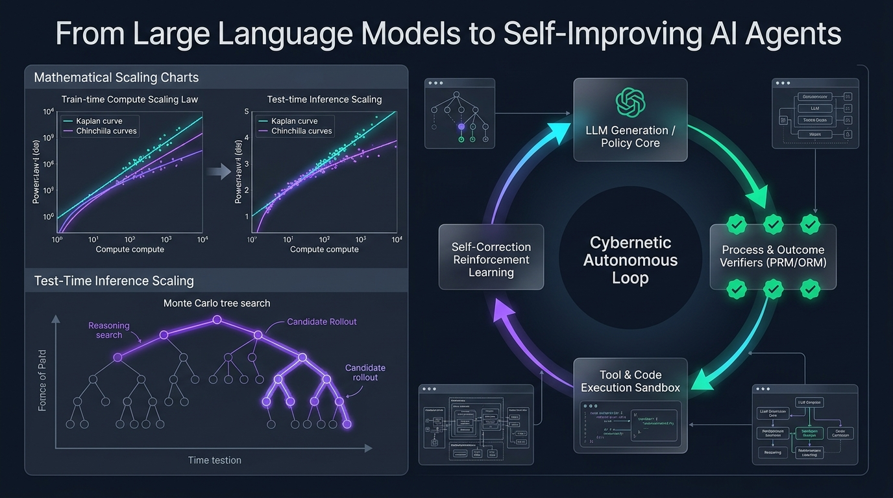
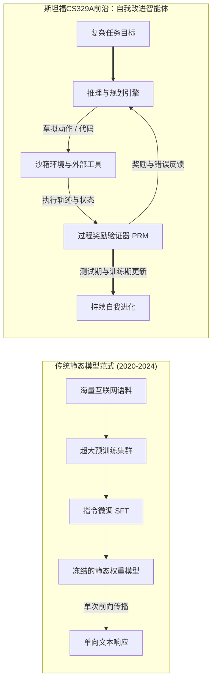
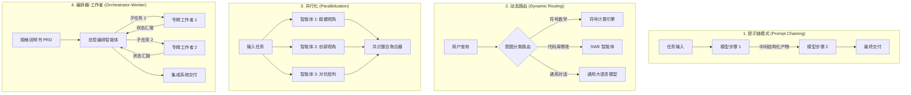

欢迎阅读**斯坦福大学（Stanford University）CS329A：Self-Improving AI Agents（自我改进AI智能体，2025秋季学期）**的核心技术精读。

在过去的四年里，人工智能领域一直被一条强大而单一的教条所主导：*在海量文本语料库上预训练更大规模的模型，能够以可预测的规律持续提升认知能力*。尽管这一范式催生了现代生成式AI革命，孕育出GPT-4、Claude 3.5和Gemini等突破性模型，但机器学习的研究前沿已经迎来了决定性的拐点。

静态基座模型（Static Foundation Model）无论参数规模多么庞大，都存在着根本性的结构局限：它们是在预训练完成、权重冻结（Frozen）之后，在开环（Open-loop）体系下运行的被动、自回归（Autoregressive）下一标记预测器。面对棘手难题时，它们无法动态分配更多的算力，无法自主验证自身推导的真实正确性，也无法借助环境反馈自发纠错。



斯坦福CS329A致力于解答未来十年AI的核心命题：**“我们该如何构建不仅能生成文本，更能在动态环境中持续自我检查、自我验证、自我规划并完善自身推理与代码的软件智能体？”**

在本次开篇总览课中，我们将解构从基座模型迈向智能体系统的进化轨迹，形式化拆解扩展定律与推理期算力分配的数学机制，分析四大标准智能体工作流架构，并剖析制约自主智能演进的核心瓶颈——**生成器-验证器差距（Generator-Verifier Gap）**。

{/* truncate */}

---

### 1. 演进轨迹：我们是如何走到这里的

要理解自我改进智能体未来的发展脉络，必须首先梳理现代基座模型工程经历的三个历史阶段：

```
  第1阶段：无监督预训练（自监督下一Token预测）
  [抓取海量互联网文本 / 数万亿Token] ───> 基础LLM（自回归文本补全器）
                                                      │
  第2阶段：事后对齐与指令微调                        ▼
  [精选Prompt-Response演示对]       ───> SFT（遵循指令的对话助手）
  [人类偏好数据（RLHF/DPO）]        ───> 对齐的安全对话模型
                                                      │
  第3阶段：CS329A学术前沿                           ▼
  [工具执行反馈 + PRM形式化验证]     ───> 自主自我改进智能体
```

#### 第1阶段：无监督预训练（Unsupervised Pre-Training）
基础语言模型在数万亿Token上通过最大似然估计（MLE）目标进行训练：
$$\mathcal{L}_{\text{MLE}}(\theta) = - \sum_{i=1}^{T} \log P_\theta(x_i \mid x_{1:i-1})$$
尽管该目标驱动模型将语法、世界常识和语义关联压缩进数千亿参数中，但基础模型本质上只是一个未受约束的概率模拟器。若输入“法国的首都是哪里？”，它很可能不会作答，而是顺应网络文档的常见排版，接着输出“德国的首都是柏林”。

#### 第2阶段：指令微调与RLHF（“ChatGPT配方”）
为了将无序的补全器改造为得力的交互助手，工业界确立了两阶段后训练管线：
1. **监督微调（SFT）：** 在高质量示范问答对上进行微调，为模型注入得体、合规的对话角色。
2. **基于人类反馈的强化学习（RLHF）/ DPO：** 借助反映人类偏好的奖励模型 $r_\psi(x, y)$ 优化策略：
$$\max_\theta \mathbb{E}_{(x, y) \sim \mathcal{D}} \left[ r_\psi(x, y) \right] - \beta \, \mathbb{D}_{\text{KL}}\left(\pi_\theta(y \mid x) \,||\, \pi_{\text{ref}}(y \mid x)\right)$$
RLHF解决了模型的遵从性和安全性，但并未赋予其真正的解题自主性。即便是高度对齐的聊天机器人，本质上仍然受困于单次前向传播，无法进行外部工具交互、严密验证或多步回溯。

#### 第3阶段：CS329A前沿 —— 自主智能体闭环
自我改进智能体彻底打破了单次前向计算的枷锁。通过深度融合编译器、Web检索器、Python REPL等外部工具、分层记忆系统和自动化验证闭环，系统演变为一个主动的实体：感知环境、执行具体动作、评估中间状态，并根据确定性反馈持续演化内部认知，直至目标在形式上被严格满足。

---

### 2. 扩展定律的数学：训练期算力 vs. 推理期算力

现代深度学习的奠基石是**扩展假说（Scaling Hypothesis）**。2020年Kaplan等人（OpenAI）与2022年Hoffmann等人（DeepMind Chinchilla）证实，自回归语言模型的测试交叉熵损失 $L$ 与算力预算 $C$、参数量 $N$ 以及训练数据量 $D$ 之间呈现严格的幂律（Power Law）关系：

$$L(N, D) = E + \frac{A}{N^\alpha} + \frac{B}{D^\beta}$$

其中 $E$ 代表自然语言不可约简的内在熵，$A, B$ 为尺度系数，$\alpha \approx 0.34, \beta \approx 0.28$ 为实证经验指数。

```
交叉熵损失 L
 ▲
 │ ╲  10^21 FLOPs (GPT-2时代)
 │  ╲
 │   ╲  10^23 FLOPs (GPT-3时代)
 │    ╲
 │     ╲  10^25 FLOPs (GPT-4时代)
 │      └─── 预训练物理墙（公开数据耗尽与电网功率极限）
 └─────────────────────────────────────────────────────────────►
                       计算预算 C (FLOPs)
```

然而，纯粹依靠扩大预训练规模正撞上一面严峻的物理与经济高墙：
- **数据枯竭之墙：** 公开互联网上由人类编写的高质量文本预计将在本年代内彻底耗尽。
- **能源与资本门槛：** 构建超过 $10^{26}$ FLOPs 的超算集群需要吉瓦级（GW）专用变电站和数以亿美元计的庞大基建开销。

#### 第二前沿：推理期（Inference-Time）算力扩展
与其斥巨资在训练阶段微调静态权重，**我们能否在模型给出最终答案的推理时刻（Test-Time），通过倾注更多计算量来激发更深层的智能？**

人类专家在解答复杂的高等数学证明或编写分布式系统架构时，绝不会一笔呵成。人们会构想假说、草拟引理、发现矛盾并主动回溯（Backtracking）。

在**推理期算力扩展**中，测试阶段的FLOPs主要沿三大维度进行动态分配：
1. **重复采样（Best-of-$N$ / 大语言猴子假说）：** 从策略 $\pi_\theta$ 中并行生成 $N$ 条候选轨迹，并由验证器挑选最优解。至少产生一个正确解的概率遵循 $\text{Pass@}k$ 指标：
$$\text{Pass@}k = \mathbb{E}\left[ 1 - \frac{\binom{n - c}{k}}{\binom{n}{k}} \right]$$
其中 $n$ 为总采样数，$c$ 为正解轨迹数。
2. **步骤级过程验证（PRM vs. ORM）：** 结果奖励模型（ORM）仅评估最终输出 $r(x, y)$，无法在冗长的多步推导中精准归因局部错误。过程监督奖励模型（PRM）则为每一个推导步骤赋予标量奖励 $r_t = R(x, y_{1:t})$，实现精细化的信用分配（Credit Assignment）。
3. **树搜索算法（MCTS，Beam Search）：** 利用蒙特卡洛树搜索在庞大的离散推导图谱中展开搜索，平衡高收益中间状态的利用（Exploitation）与未知路径的探索（Exploration）。

正如OpenAI o1与DeepSeek-R1等前沿模型所证明的那样，将推理阶段算力放大100至1,000倍，可以在国际数学奥林匹克（IMO）竞赛题和SWE-bench代码基准上取得远超单纯扩展模型尺寸的颠覆性突破。

---

### 3. 智能体工作流的四大经典架构

构建自主智能体系统时，仅凭单条Prompt往往会因随机漂移而崩塌。斯坦福CS329A将智能体拓扑提炼为四大可组合的设计模式：



#### 1. 提示链模式（Prompt Chaining：顺序分解）
将单体复杂任务切分为若干确定性子步骤，步骤 $k$ 的输出作为步骤 $k+1$ 的上下文输入。在各阶段之间设置验证网关（例如：生成大纲 $\to$ 校验覆盖率 $\to$ 撰写初稿 $\to$ 润色校对），从根源上截断误差扩散。

#### 2. 动态路由（Dynamic Routing：专业分派）
对输入的请求意图进行分类，分发至最合适的高效专用模型或外部工具。例如，代数运算路由至Python计算沙箱，大型软件重构路由至专有SWE智能体，大幅优化整体系统延迟与开销。

#### 3. 并行化（Parallelization：并发切片与投票）
- **任务切片（Sectioning）：** 将彼此正交、无上下文依赖的子任务分派给多个智能体实例并发处理。
- **投票集成（Voting）：** 采用不同Prompt设定或随机种子并行生成多个候选方案，借助多数投票或批判模块过滤随机异常。

#### 4. 编排器-工作者（Orchestrator-Worker：分层指派）
中央编排器将高阶任务分解为有向无环图（DAG），向专精工作者智能体分发子任务，实时监控运行异常，最终汇聚各方产物形成完整系统交付。

---

### 4. 核心瓶颈：生成器-验证器差距（Generator-Verifier Gap）

构建自我改进智能体之所以充满挑战，根源在于**生成与验证的内在不对称性**：

$$\text{复杂度}(\text{验证}) \ll \text{复杂度}(\text{生成}) \quad \text{封闭形式化领域（数学、代码）}$$
$$\text{复杂度}(\text{验证}) \approx \text{复杂度}(\text{生成}) \quad \text{开放自然语言领域（文章、战略、谈判）}$$

```
验证能力
 ▲
 │   形式化领域（数学定理、Python代码、Lean 4）
 │   ┌────────────────────────────────────────────────────────┐
 │   │ 验证器（编译器 / 单元测试套件 / Z3 SMT证明器）         │
 │   │ 具备确定性、计算成本低廉且100%可靠                     │
 │   └────────────────────────────────────────────────────────┘
 │
 │   开放自然语言领域（创意写作、商业分析、法律建议）
 │   ┌────────────────────────────────────────────────────────┐
 │   │ 验证器（LLM 裁判）                                     │
 │   │ 噪声巨大、容易受到长度偏见与附和倾向的影响             │
 │   └────────────────────────────────────────────────────────┘
 └─────────────────────────────────────────────────────────────►
                     生成复杂度
```

在编程与形式定理证明等形式化领域，验证是绝对确定性的：代码要么顺利编译，要么抛出异常；单元测试要么全数通过，要么触发断言报错。在此类场景中，自我进化是闭环成立的：生成候选方案、调用测试套件、淘汰错误项、仅吸收成功代码进行权重或Prompt进化。

但在开放的自然语言领域中，**评估一段文本是否尽善尽美，其认知难度几乎与从头创作该文本旗鼓相当**。当使用大模型担任另一大模型的裁判（LLM-as-a-judge）时，评判者往往表现出对冗长回复的偏好（Verbosity Bias），并继承了生成者的幻觉盲区。

如何借助神经-符号编译将自然语言意图编译为确定性约束，建立真实世界的客观锚点（Ground-truth Anchor），是贯穿CS329A的核心研究主线。

---

### 5. 斯坦福CS329A 四阶段课程路线图

斯坦福CS329A的课程大纲由浅入深，覆盖四大工程与学术梯队：

```
┌─────────────────────────────────────────────────────────────────────────────┐
│                    斯坦福CS329A 完整技术能力栈                              │
├─────────────────────────────────────────────────────────────────────────────┤
│  第4部分 · 前沿攻坚 (L13 - L17)                                             │
│  - 形式化数学证明与 AlphaProof、Lean 4                                       │
│  - 自主系统高可靠三层体系与 AI Control 信任边界                             │
│  - 多模态与具身机器人智能体 (VLA, RT-2, π0)                                 │
│  - 总结篇：未来开放难题与自我进化的对齐侵蚀                                 │
├─────────────────────────────────────────────────────────────────────────────┤
│  第3部分 · 智能体系统工程 (L10 - L12)                                       │
│  - 软件工程智能体 (SWE-bench 与 ASI 接口设计)                               │
│  - 操作系统级分层记忆体系 (MemGPT, CacheBlend)                              │
│  - 长程任务评测与真实经济价值评估 (METR Time Horizons)                      │
├─────────────────────────────────────────────────────────────────────────────┤
│  第2部分 · 训练与进化 (L6 - L9)                                             │
│  - 训练期算力扩展与强化学习 (DeepSeekMath 与 GRPO)                           │
│  - 开放式自我进化与架构搜索 (ADAS, AlphaEvolve)                             │
│  - 自主深度研究工作流 (AlphaCode, Search-o1)                                │
│  - 后训练范式演进：SFT -> RLHF -> RLVR -> Agent RL                          │
├─────────────────────────────────────────────────────────────────────────────┤
│  第1部分 · 基础与探索 (L1 - L5)                                             │
│  - 推理期计算扩展与算力最优配置法则                                         │
│  - 过程奖励模型与严密答案验证 (PRM800K)                                     │
│  - 工具调用与代码执行闭环反馈 (ReAct, RLEF)                                 │
│  - 多步规划与蒙特卡洛树搜索 (LATS MCTS)                                     │
└─────────────────────────────────────────────────────────────────────────────┘
```

---

### 6. 核心要点总结与学术Q&A

#### 核心要点总结
1. **范式跃迁：** 人工智能的演进核心已从单次、静态的文本预测，升级为“感知-行动-验证-反思”闭环循环的自主系统。
2. **双重扩展前沿：** 传统的预训练参数扩展，正与推理期算力扩展（Best-of-$N$、过程验证、树搜索）形成双轮驱动，使小型模型也能凭借深思熟虑攻克高阶难题。
3. **统一核心主线：** 所有卓越的智能体系统都在底层践行着统一的骨架：**《生成 $\to$ 验证 $\to$ 循环》**。
4. **验证瓶颈：** 智能体自我进化的速度，最终取决于其验证机制的客观度、严密性与确定性。

---

#### 学术深度Q&A

**问：推理期算力扩展与常规的Prompt技巧或单链思维链（CoT）有何本质区别？**
**答：** 常规思维链仅引导模型在单次无回溯的线性序列中吐出思考步骤。如果模型在第二步发生算术或概念偏离，该错误会随后续Token如雪崩般级联放大。而推理期算力扩展引入了外置搜索树和验证哨卡：每个中间步骤均由过程奖励模型（PRM）或沙箱编译器打分，从而实现深入探索优质路径、及时剪枝回溯错误分支的能动算力调度。

**问：难道我们不能直接训练一个超大的LLM作为通晓万物的终极验证裁判吗？**
**答：** 概率神经网络在缺乏物理和确定性环境锚点（Ground-truth Anchor）的情况下，无法彻底自我消除概率错觉。在开放文本中，LLM裁判普遍具有附和倾向和长度偏见。真正的可靠性验证，必须将自然语言主张锚定在可执行的代码单元测试、数据库事务、Lean 4形式化数学定理或真实机器人传感器反馈之中。

---

### 下节预告

在**第2讲（Lecture 2）**中，我们将全面切入**推理期算力扩展（Test-Time Compute Scaling）**的硬核数学机理：
- Snell等人揭示的算力最优扩展前沿（Compute-Optimal Scaling Frontiers）
- 广度并发采样覆盖率与深度顺序搜索之间的权衡曲线
- *Archon*与*Large Language Monkeys*如何科学平衡生成与验证的算力配比

让我们一起步入自我进化智能体的技术腹地！