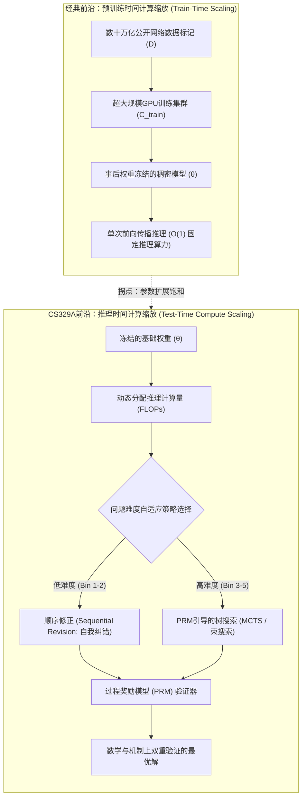
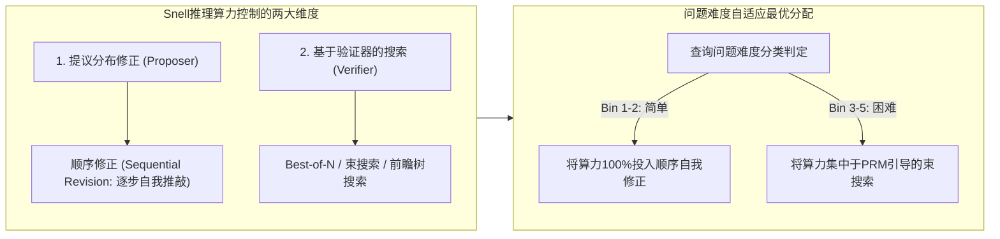

欢迎阅读斯坦福大学2025年秋季最新前沿研究生课程**CS329A: Self-Improving AI Agents（自我演进AI智能体）**的第二篇专业工程解析。

在第一讲中，我们概括了从静态自回归次词预测器向具备环境反馈闭环的自主智能体转变的宏观范式跃迁。今天第二讲所探讨的，正是支撑这一自主演进能力的最核心计算支柱：**推理时间计算缩放（Test-Time Compute Scaling / Inference-Time Scaling）**。

过去五年中，整个AI工业界信奉的唯一教条是预训练阶段的缩放定律（Kaplan等人，Chinchilla定律）：*建设超大规模GPU集群，将模型参数量N推至数千亿级，并灌注数十万亿标记（Tokens）的互联网数据*。然而，在模型权重θ预训练完成后，如果我们拒绝让模型在50毫秒内草率给出贪心预测（Greedy decoding），而是让智能体**花费10秒、1分钟甚至10分钟深入思考、检验中间步骤、并自主推敲修正假设**，会发生什么？

依托*Large Language Monkeys*（Brown等人，2024）、斯坦福-伯克利Charlie Snell研究团队的*Compute-Optimal Scaling*（Snell等人，2024）以及*Archon*模块化架构搜索框架，我们将从数学理论与系统工程双重视角，彻底解析**“如何通过投入推理算力（FLOPs）打破参数规模垄断，实现智能飞跃”**。



{/* truncate */}

---

### 1. 经典缩放定律 vs 推理算力：范式的重大转移

现代深度学习的基础建立在一个经验性发现之上：验证损失（Validation Loss）随训练计算量的增加呈幂律（Power-law）衰减：

```text
L(N, D) = E + A / N^α + B / D^β
```

其中N为非嵌入参数量，D为训练数据集标记量。然而，这一定律将推理计算视为极简的静态常数：在自回归解码中，每生成一个标记恰好消耗2 FLOPs × 参数量。

#### 预训练缩放遭遇的物理硬约束
随着工业界将预训练算力推进至10^26 FLOPs（GPT-4量级），预训练遭遇了三重难以逾越的瓶颈：
1. **公开语料枯竭边界：** 互联网上高质量人类原生文本存在上限（约10^14 Tokens）。缺乏可靠外部验证器而单纯递归引入合成数据，会导致模型退化（Model Collapse）与信息熵衰减。
2. **指数级上升的资本成本：** 在幂律曲线平缓的尾部，将基准准确率提升1%需要额外投入10倍的预训练算力，换算为数亿美元计的巨额资本开支（CAPEX）。
3. **静态前向传播的本质缺陷：** 无论模型是7B还是1T参数，标准解码过程仅通过固定次数的矩阵乘法输出下一个标记t_i：

```text
t_i ~ Softmax( W_u · LayerNorm( h_L(t_{1:i-1}) ) )
```

对于NP完全数学定理证明、跨多源码文件的软件缺陷排查等复杂任务，缺乏回溯（Backtracking）、假设探索和分步检验机制的单向前向传播无法从根本上求解。

---

### 2. 无限猴子定理的现代回归：Large Language Monkeys

古典概率论中有一个著名的思想实验——埃米尔·博雷尔的“无限猴子定理”：如果让无数只猴子在打字机前随机乱按，历经无限时间，它们终将打出莎士比亚的《哈姆雷特》全集。

2024年底，加州大学伯克利分校与谷歌研究院的研究人员针对前沿LLM实证测试了这一假设：**《Large Language Monkeys: Scaling Inference Compute with Repeated Sampling》**（Brown等人，2024）。

```
覆盖率 (Pass@k %)
 ▲
100│                                     ┌────────────── Pass@k 覆盖率理论上限
 90│                                ┌────┘ (在MATH与CodeContests中达到99%)
 80│                           ┌────┘
 70│                      ┌────┘
 60│                 ┌────┘ ◄── SWE-bench Lite: DeepSeek-Coder-V2 (k=250 -> 56.0%)
 50│            ┌────┘
 40│       ┌────┘   ◄── Claude 3.5 Sonnet 单次运行 (43.0%)
 30│  ┌────┘
 20│ ┌┘
 10│┌┘  ◄── Gemma-2B Pass@1 (0.02%)
  0└┴──────┬──────────┬──────────┬──────────┬──────────►
    k=1    k=10       k=100      k=1,000    k=10,000   (采样候选次数 k)
```

#### pass@k 无偏估计量的数学表述
当从模型中独立采样N个候选答案，且其中恰有C个答案完全通过自动化验证工具（如单元测试）时，随机抽取k个样本中至少包含一个正确答案的最小方差无偏估计量（MVUE）定义为：

```text
Pass@k = (1 / P) · ∑_{i=1}^P [ 1 - C(N - C_i, k) / C(N, k) ]
```

其中P为评估测试集总题数，C_i为第i题的正确样本数，C(n, r)为二项式组合数。为防止在扩展到N = 10,000时阶乘运算发生浮点溢出，生产环境采用以下数值稳定的连乘循环进行计算：

```text
Pass@k = 1 - ∏_{j=0}^{k-1} ( 1 - C_i / (N - j) )
```

#### 实证突破：小型模型实现对前沿巨无霸的越级碾压
通过重复采样扩展推理算力带来了震撼的实证发现：
* **SWE-bench Lite（真实GitHub软件缺陷修复评测）：**
  * 开源模型`DeepSeek-Coder-V2-Instruct`单次运行（k=1）成功率仅为**15.9%**。
  * 当采样次数扩展至k=250时，pass@250飙升至**56.0%**。
  * 这一成绩不仅大幅领先GPT-4o与Claude 3.5 Sonnet的单次运行集成（43.0%），领先幅度高达**13个百分点**。
* **CodeContests（超高难度算法竞赛基准）：**
  * 超轻量级模型`Gemma-2B`单次求解率（pass@1）仅为**0.02%**（趋近于0）。
  * 但当扩展至k=10,000时，其通过率跃升至**7.1%**，性能暴增**355倍**。
* **经济效益反转：**
  * 在SWE-bench上，DeepSeek-Coder-V2采样5次达成29.62%成功率的API成本为**$10.80**。
  * 相比之下，单次运行GPT-4o（24.0%）花费**$39.00（贵3.6倍）**，Claude 3.5 Sonnet（26.7%）花费**$51.00（贵4.7倍）**。

```text
┌───────────────────────────────┬──────────┬────────────┬─────────────┐
│ 模型与推理策略                │ SWE-bench│ 调用成本   │ 成本倍数    │
├───────────────────────────────┼──────────┼────────────┼─────────────┤
│ DeepSeek-Coder-V2 (k=5)       │ 29.62%   │ $10.80     │ 1.0x (基准) │
│ GPT-4o (k=1 贪婪单次运行)     │ 24.00%   │ $39.00     │ 3.6倍 高成本│
│ Claude 3.5 Sonnet (k=1)       │ 26.70%   │ $51.00     │ 4.7倍 高成本│
│ DeepSeek-Coder-V2 (k=250)     │ 56.00%   │ $540.00    │ 顶尖性能    │
└───────────────────────────────┴──────────┴────────────┴─────────────┘
```

#### 覆盖度-精确度差距 (Coverage-Precision Gap)：验证器的高墙
然而，无节制地增加采样数量必然面临**覆盖度-精确度差距**这一结构性瓶颈。

在配备确定性判定机制（编译器或单元测试）的封闭形式化领域，**覆盖度等同于最终成功率**：250个样本中只要有1个通过全量测试，就能被精准提取。

但在缺乏外部确定性验证工具的开放领域或主观题中：
* 在MATH数学竞赛数据集上，`Llama-3-8B-Instruct`在k=10,000时的覆盖率高达**98.44%**（意味着答案池中98%含有正确解答）。
* 然而，若采用**多数投票法（Majority Voting）**，准确率仅从40.5%微升至**41.41%**（微幅提升0.9%）。
* 利用结果奖励模型（ORM）进行**Best-of-N优选**在k=100附近即达到停滞平台，由于误报率和奖励作弊（Reward Hacking）无法挑出剩余57%的正确答案。

> **工程铁律：** 在缺乏高精确度验证器的情况下盲目扩充采样，仅仅是把草垛堆得更大。即使一根绣花针（正确答案）掉在草垛里的概率无限接近100%，没有高精度的磁铁（验证器），你依然无法将其找出。

---

### 3. Snell的计算最优缩放定律 (Compute-Optimal Scaling)

在给定的固定推理预算（FLOPs）下，如何用最聪明的数学策略消耗算力？

2024年秋，斯坦福大学与加州大学伯克利分校的Charlie Snell、Jaehoon Seo、Hao Liu等人发表了里程碑式的论文：**《Scaling LLM Test-Time Compute Optimally can be More Effective than Scaling Model Parameters》**。



#### 调控推理算力的两大核心旋钮
Snell等人将所有的测试时推理技术抽象为**提议者（Proposer）**与**验证者（Verifier）**两个正交维度：
1. **修正提议分布（修改Proposer）：** 提示模型反思先前的草稿，产生质量更高的解题路径：
   ```text
   y_{t+1} ~ P_θ( y | x, y_1, ..., y_t, Critique_t )
   ```
2. **基于验证器的状态搜索（依赖Verifier）：** 利用过程奖励模型（PRM）对中间思考节点进行价值评估与剪枝：
   ```text
   Score(Node_t) = PRM_ψ( x, y_{1:t} )
   ```

#### 难易度驱动的最优分配逆转原理
Snell研究团队最核心的洞见是：**最优策略会随着问题的难易度发生根本性的彻底逆转**：

```text
难度 Bin 1-2 (简单问题)   ───>  顺序自我修正 (Sequential Revision) 占据绝对优势
难度 Bin 3-5 (困难问题)   ───>  PRM引导束搜索 (Beam Search) 占据绝对优势
```

1. **简单问题（Bins 1–2）：** 
   * 简单问题的基座模型初次尝试已经非常接近正解。
   * 此时强行施加复杂的树搜索反而会引入验证器的微小噪声，导致模型把算力越花越差（Over-optimization）。
   * **最优解：** 顺序修正（让模型自主检查并修正上一轮的简单运算错误）以极低算力达成极高收益。
2. **困难问题（Bins 3–5）：**
   * 在奥数级别的高难题目中，一旦逻辑开端走入歧途，线性的自我修正完全无法挽救。
   * **最优解：** 基于PRM步级奖励的束搜索能够及早修剪无前途的思维分支，相较于盲目Best-of-N呈现出碾压级的优势。
3. **计算最优分配的红利：**
   * 简单题分配Revision，难题分配PRM束搜索的动态自适应策略，在达成同等准确率的前提下，相较于纯粹Best-of-N**节省了整整4倍（4x）的计算量**。

#### 14倍参数等价性 (The 14x Parameter Equivalence)
论文最具冲击力的实验，是将**“预训练模型参数扩增14倍”与“给小模型赋予14倍推理算力”进行正面对决**：

```text
14倍参数大模型 (贪婪单次解码)   vs   1倍基准小模型 + 14倍推理算力
```

* 在MATH与GSM8K的简单及中等题目中，配备最优推理算力的小模型在准确率上完全追平甚至反超了14倍体量的大模型。
* 但在终极难题（Bin 5）上，预训练大模型的参数内生能力仍无可替代：如果基座模型对问题缺乏基础的语义表征，推理阶段的任何搜索都将退化为毫无依据的幻觉空转。

---

### 4. 系统工程实现：Archon模块化复合智能体架构

如何将理论上的推理缩放定律落地为工业级软件？避免在应用代码中充斥硬编码的Prompt？

**Archon**框架（arxiv:2409.15254）通过将LLM功能单元抽象为**分层式软件流水线**彻底解决了这一工程难题：

```mermaid
flowchart TD
    Q[用户需求 / 规范说明书] --> G[Layer 1: 生成器集成 (Generator)]
    G -->|候选解空间| C[Layer 2: 多视角批判器 (Critic)]
    C -->|批判与缺陷定位| R[Layer 3: 循环淘汰排序器 (Ranker)]
    R -->|高潜力候选解| F[Layer 4: 融合重构器 (Fuser)]
    F -->|共识优化解| V[Layer 5: 自动化验证器与单元测试沙箱]
    V -->|执行反馈| Dec{通过全量测试?}
    Dec -- 是 --> Final[验证通过的生产交付物]
    Dec -- 否 (回溯重构) --> G
```

#### Archon的五层系统架构
1. **生成器层 (Generator)：** 通过调整温度采样参数（T=0.2 ~ 0.8）或调度异构模型（Claude 3.5 Sonnet + DeepSeek-V2），并行生成多样化候选解。
2. **批判器层 (Critic)：** 逐条剖析各个候选解在边界条件、数学逻辑或工程规范上的潜在瑕疵。
3. **排序器层 (Ranker)：** 依据批判反馈对候选方案进行1对1淘汰制比较，建立稳健排名。
4. **融合层 (Fuser)：** 提取高位排名候选解的核心思维闪光点，二次融合成单一完美答卷（+8.9% 基准提升）。
5. **验证层 (Verifier)：** 在代码场景下利用LLM自生成5至10个边界单元测试用例，并在隔离沙箱（Docker / gVisor）中实际执行（+56% 性能提升）。

Archon构建了包含**9,576种潜在拓扑组合**的架构设计空间，并通过**贝叶斯优化（Bayesian Optimization）**在限定的延迟与调用成本预算内，自动寻得帕累托最优（Pareto-optimal）的智能体架构。

---

### 5. 架构案例剖析：透视 OpenAI o1 推理模型的内幕

斯坦福CS329A第二讲的理论，为我们彻底揭开了以OpenAI o1与DeepSeek-R1为代表的推理大模型的底层设计：

```
┌────────────────────────────────────────────────────────────────────────┐
│                   o1 内部“思考（Thinking）”轨迹的本质                  │
├────────────────────────────────────────────────────────────────────────┤
│ 1. 隐蔽推敲阶段 (Test-Time Tokens):                                    │
│    在向用户输出第一个可见文字前，模型自主生成数千个思维链Token，       │
│    在推理端预先消耗海量算力。                                          │
│                                                                        │
│ 2. 内嵌的过程奖励评估 (PRM):                                           │
│    经由强化学习（RL）步级对齐，模型在遇到推导瓶颈时具备自动回溯        │
│    （Backtracking）至先前分叉点的内生能力。                            │
│                                                                        │
│ 3. 顺序纠错循环 (Snell Revision):                                      │
│    诸如“等等，这里似乎算错了，让我换个角度”这类提示，实质上是由        │
│    内在一致性检验所激发的顺序修正策略。                                │
└────────────────────────────────────────────────────────────────────────┘
```

o1展现出的长链思考绝非不可捉摸的黑盒魔法，而是**推理时间计算缩放、顺序修正与过程检验在单一神经网络中实现内嵌式集成的工业典范**。

---

### 6. 核心总结与技术启示

1. **智能扩增的双轮驱动：** AI能力的提升不再完全被预训练所卡脖子。推理时间计算缩放开辟了平行的扩展维度，让紧凑型模型拥有逆袭工业巨无霸的可能。
2. **覆盖度-精确度原则：** 重复采样（pass@k）能够指数级扩大覆盖面（DeepSeek-Coder-V2 15.9% -> 56.0%），但唯有配合高精度的过程验证器（PRM）才能真正将潜力转化为确定性的产出。
3. **Snell最优配比定律：** 自适应算力分配比盲目暴力采样效率高4倍：简单问题走顺序自我修正，复杂问题走PRM树搜索。
4. **模块化智能体系统：** 正如Archon所证实的，组合生成、批判、重构与沙箱验证的软件架构，对最终系统精度的贡献不亚于模型底层权重本身。

---

### 斯坦福CS329A 下讲预告:
在接下来的**第三讲**中，我们将深入智能体系统的“心脏”：**《Robust Verification: 过程奖励模型 (PRM)、模型集成与可扩展监督 (Scalable Oversight)》**。我们将系统探讨如何构建能够抵御奖励作弊（Reward Hacking）、在无需人工介入下确立真实正解的高可靠验证器。敬请关注！
