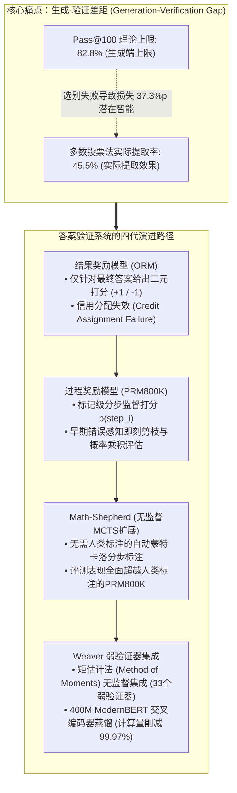
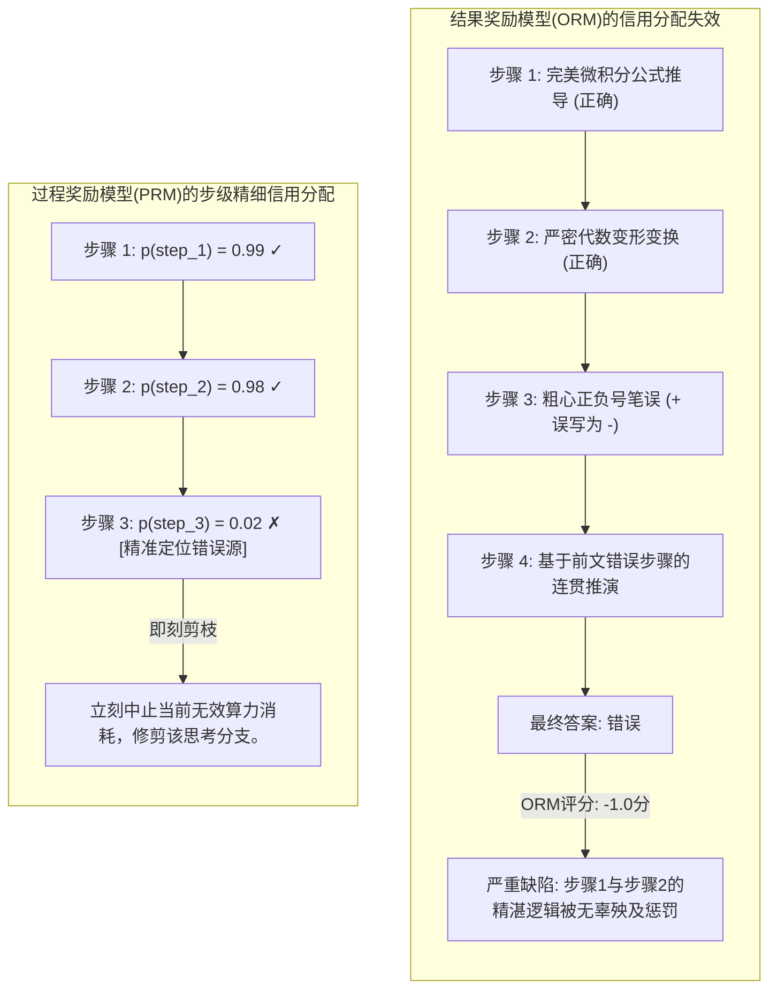
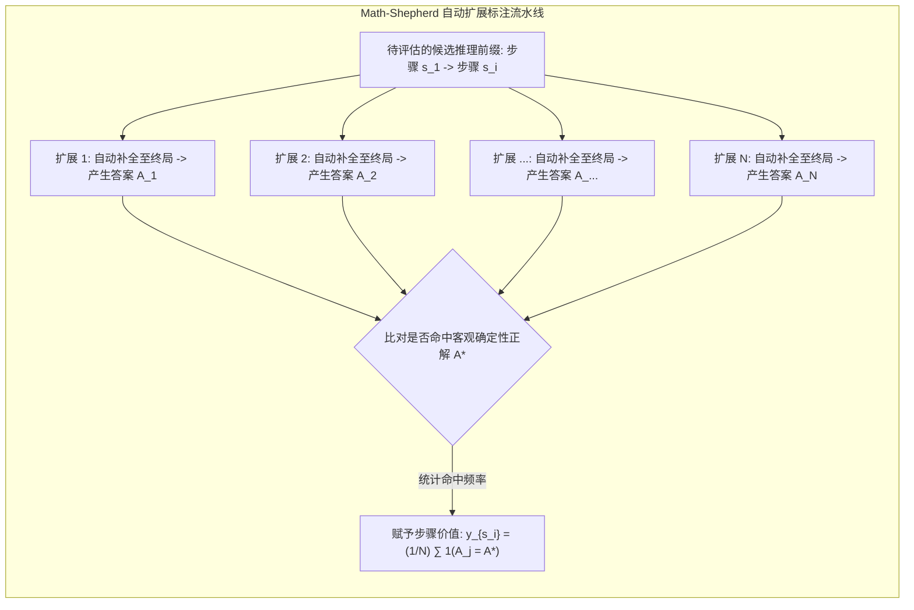
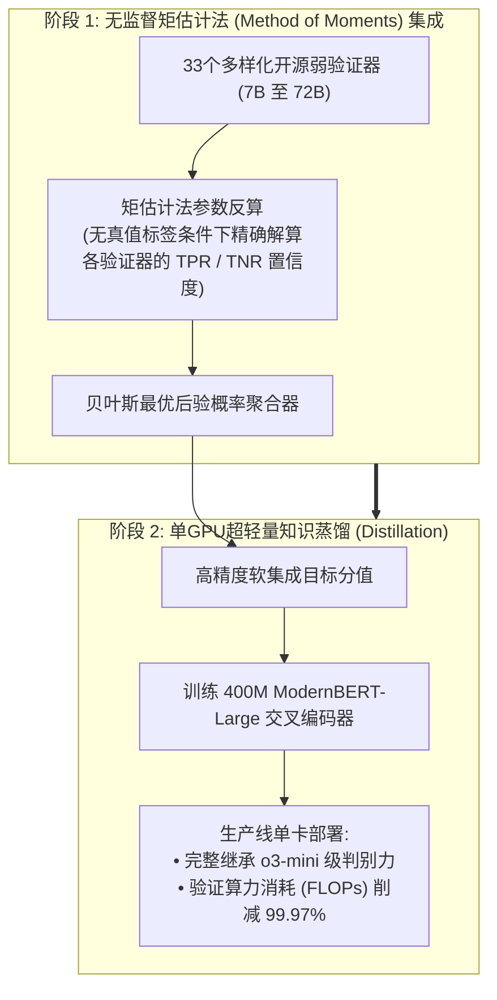

欢迎阅读斯坦福大学2025年秋季前沿研究生课程**CS329A: Self-Improving AI Agents（自我演进AI智能体）**的第三篇专业工程深度解析。

在上一讲（第二讲）中，我们系统剖析了推理时间计算缩放（Test-time Compute Scaling），并得出了一个深刻的结论：单纯让模型产生数千个候选答案（$pass@k$）能够将理论上的覆盖率推向99%以上，但**“如果没有高精度的验证器（Verifier）从浩瀚的错误草垛中挑出唯一正确的绣花针，无论是多数投票还是盲目重抽样，模型性能都会迅速撞墙停滞”**。

今天第三讲所探讨的，正是解决这一致命瓶颈的核心系统级工程：**稳健答案验证（Robust Verification）**。

人类数学家或软件工程师在解决复杂课题时，绝不会凭空一笔画出完美推导；他们写下一行演算，复核代数合理性，捕捉正负号的笔误，并在误入歧途前及时回溯（Backtracking）。相反，标准的自回归语言模型只能向未来单向输出标记。一旦初始推理发生轻微偏差，模型为了自我圆谎，便会在此基础上炮制出越来越荒谬的幻觉（Hallucination）。

那么，**“我们能否训练独立的验证模型，对生成模型每一步的中间推理进行逐行严格质检，提前修剪死胡同？”**

从OpenAI的奠基之作Cobbe GSM8K验证器，到Lightman的分步过程监督（PRM800K），再到无需人类标注、基于蒙特卡洛自动扩展打分的Math-Shepherd，以及最新通过统计物理矩估计法集成33个弱验证器达到o3-mini水准的Weaver（NeurIPS 2025），我们将系统拆解并掌握**验证器工程（Verifier Engineering）的最前沿技术**。



{/* truncate */}

---

### 1. 生成-验证差距 (Generation-Verification Gap)：瓶颈的数学定义

在深入具体验证器拓扑之前，必须将模型潜在生成能力与实际可抽取表现之间的鸿沟进行形式化定义：

```text
Gap(K) = Pass@K - Actual_Success_Rate
```

在前沿高难度评测GPQA Diamond中，开源顶尖模型`Llama-3.3-70B-Instruct`的$Pass@100$高达**82.8%**。这意味着在10道难题中，有超过8道题的100个候选集合内已蕴含了至少一条完全正确的解法。

然而，若对这100个候选应用工业界最普遍的**多数投票法（Majority Voting）**，最终测得的实际准确率暴跌至**45.5%**。

```
准确率 (%)
 ▲
100│                                     ┌────────────── Pass@100 理论上限 (82.8%)
 90│                                ┌────┘
 80│                           ┌────┘
 70│                      ┌────┘
 60│                 ┌────┘
 50│            ┌────┘ ◄── 遴选失效蒸发的 37.3%p 智能
 40│  ──────────┴──────────────────────── 多数投票法停滞平台 (45.5%)
 30│
 20│
 10│
  0└┴────────────────────────────────────────────────► 采样预算 K
```

高达**37.3个百分点的潜在智能**仅仅因为“无法正确挑选正解”而化为乌有。当多条逻辑混乱的解题路径偶然汇聚到同一个看似合理的干扰项（Plausible Distractor）时，单纯依赖频次的统计策略必然会把假阳性（False Positive）选为最终答案。

#### 独立验证器的起源：Cobbe et al. (GSM8K, 2021)
为弥合这一鸿沟，OpenAI的Karl Cobbe团队发布了经典数学基准**GSM8K**，并首次提出了与生成器权重解耦的**独立验证器（Verifier）**架构：

1. **权重解耦 (Decoupled Architecture)：** 生成器与验证器在推理时不共享前向权重。生成器仅微调2轮（Epoch）以保留采样多样性，验证器则针对生成器产生的解法集进行针对性训练。
2. **标记级价值头 (Token-Level Value Heads)：** 验证器不只在序列末尾输出单一标量，而是在Transformer每一个标记位置接入线性头，预估该标记处的正解概率：
   ```text
   V(t_i) = W_v · h_L(t_i) + b_v
   ```
   网络通过联合损失函数进行优化，融合了语言建模交叉熵与验证均方误差（MSE）：
   ```text
   L_total = L_LM(θ) + λ · || V(t_end) - y_true ||^2
   ```
3. **30倍参数红利：**
   * 实验表明，为生成器挂载一个仅**6B参数的轻量验证器**，从100个候选中选拔出的答案精度，足以匹敌单次运行的**175B超大稠密模型**。
   * 单纯将生成与验证解耦，就换来了**约30倍的参数利用效率提升**。

---

### 2. 结果监督 vs 过程监督：Lightman团队的PRM800K

尽管Cobbe的验证器取得了突破，但其本质仍局限于**结果监督（Outcome Reward Models, ORMs）**。

2023年5月，Hunter Lightman带领的OpenAI研究团队发表了里程碑论文：**《Let's Verify Step by Step》**（Lightman等人，2023）。



#### 推理中的信用分配难题 (Credit Assignment Problem)
思考一道包含10个步骤的复杂证明题：
* **假阴性困境：** 模型在步骤1到6展现了惊人的数学严密性。但在步骤7因粗心算错符号，导致最终数值错误。
  * *ORM的裁决：* 扣除全部分数（-1分）。步骤1至6的高价值逻辑推理被全盘否定，污染了训练梯度。
* **假阳性困境（侥幸正解，Lucky Error）：** 模型在步骤3犯下了荒谬的逻辑错误，但巧合的是在步骤8又犯了一个抵消性的计算错误，竟然歪打正着得出了正确答案。
  * *ORM的裁决：* 给出满分（+1分）。模型的不良逻辑得到正向强化，加剧了奖励作弊（Reward Hacking）。

这种时序信用分配的错配，构成了基于结果的验证器进一步扩展的根本障碍。

#### 过程奖励模型 (PRM) 的数学设计
Lightman团队动员人类专家，对MATH数据集中75,000个解答的80万个中间推理步骤（以双换行符分隔）进行了正向/负向/中立的三分类标注，构建了**PRM800K**。

他们引入的降本核心法宝是**“首次错误中止规则（First-Error Termination Rule）”**：由于无效推演后续产生的分支没有认知价值，标注员在发现第一个逻辑漏洞时便即刻停止标注。

PRM在每个推理步骤末尾的换行标记处，预测该步骤逻辑成立的概率：

```text
p(s_i) = σ( W_p · h_L( Token_{\text{newline}, i} ) )
```

整条候选路径$S = (s_1, s_2, ..., s_M)$的综合质量评分由**概率乘积法则（Product Rule）**得出：

```text
Score_PRM(S) = ∏_{i=1}^M p(s_i \text{ is correct})
```

#### PRM的碾压级实证表现
在MATH基准上开展高达$N = 1,860$的Best-of-N搜索时：

```text
┌───────────────────────────────┬──────────────┬──────────────┬─────────────┐
│ 方案选择策略                  │ Best-of-1    │ Best-of-100  │ Best-of-1860│
├───────────────────────────────┼──────────────┼──────────────┼─────────────┤
│ 多数投票法 (Majority Vote)    │ 52.4%        │ 68.3%        │ 69.6%       │
│ 结果奖励模型 (ORM)            │ 52.4%        │ 70.1%        │ 72.4%       │
│ 过程奖励模型 (PRM)            │ 52.4%        │ 74.8%        │ 78.2%       │
└───────────────────────────────┴──────────────┴──────────────┴─────────────┘
```

1. **持续扩展曲线：** 多数投票法与ORM在$N = 100$附近便陷入早熟停滞，而PRM的准确率曲线在扩展至数千个样本时依然保持单调上扬。
2. **负对齐税 (Negative Alignment Tax)：** 传统安全对齐（RLHF）往往以牺牲原始数学推导能力为代价（所谓的“对齐税”），但过程监督在大幅提升推导可解释性与安全性的同时，反而推动推理准确度同步爆发。

---

### 3. 无人化自动过程监督：Math-Shepherd蒙特卡洛扩展

虽然PRM性能卓越，但阻碍其规模化工业落地的唯一痛点在于：**“80万步的人类专家级标注成本过于昂贵”**。

2023年底，Yu、Shen、Zhou等人发表了**Math-Shepherd**框架，从蒙特卡洛树搜索（MCTS）中汲取灵感，攻克了这一难题。



#### 算法直觉：以机验机
正如AlphaGo评估局部棋步的胜率：
> “若要验证某一步推理$s_i$是否成立，只需让语言模型从该步骤出发，将推导随机补全$N$次（Rollout）。如果生成的大量终局答案频繁命中客观真理$A^*$，便足以倒推证明该中间步骤是坚实的逻辑基石！”

#### 硬估计 vs 软估计
Math-Shepherd定义了两种步级价值标签：

1. **硬估计 (Hard Estimation, HE)：** $N$次扩展中只要有至少一次成功击中正解，该步即打为$+1$，否则为$0$：
   ```text
   y^{HE}_{s_i} = 1( ∃ j \in {1, ..., N} : A_j = A^* )
   ```
2. **软估计 (Soft Estimation, SE)：** 计算$N$次扩展中击中正解的实际频率，赋予连续型的概率分数：
   ```text
   y^{SE}_{s_i} = (1 / N) · ∑_{j=1}^N 1( A_j = A^* )
   ```

#### 颠覆性实验发现：机器标注超越人类专家
研究团队在未标注的问题库上执行全自动扩展，以零人工成本合成了**170万步带标注的高质量数据集**（规模达PRM800K的两倍以上）。

* **人类标签 vs 机器标签：** 在开源LLaMA架构上评测，由Math-Shepherd合成数据训练出的PRM，在MATH基准上**击败了完全由人类标注的PRM800K**。
* **超越的原因剖析：** PRM800K的人工标注员审核的是GPT-4生成的解答，无法适配开源模型的独特盲区。而Math-Shepherd直接从目标模型自身的原生分布中采样，免费获得了高度量身定制的判别能力。
* **步级强化学习 (PPO)：** 利用Math-Shepherd的过程奖励实施强化学习微调后，`Mistral-7B`在MATH上的得分从28.6%**飞跃至43.5%**。

---

### 4. 集成理论突破：Weaver框架 (NeurIPS 2025)

即使拥有Math-Shepherd，单一的7B或13B轻量验证器仍存在偶发性误判；而在生产线上堆叠多个70B大模型作为验证器，延迟与调用成本又不可承受。

斯坦福大学与威斯康星大学麦迪逊分校的研究团队在NeurIPS 2025上发表了优雅的数理破局方案：**《Weaver: Shrinking the Generation-Verification Gap with Weak Verifiers》**（Zhang等人，2025）。



#### 无需真值标签反算验证器实力的“矩估计法 (Method of Moments)”
Weaver汇聚了从7B到72B的33个异构开源弱验证器（Weak Verifier）。在没有任何正解标签的线上测试场景中，**我们究竟该信任谁的话？**

Weaver将该挑战建模为**隐变量朴素贝叶斯模型（Latent Variable Naive Bayes）**：
* 候选解答的客观真实正误`Y in {0, 1}`属于未知的隐变量。
* 每个验证器`k`具备未知的真阳性率（灵敏度，``w_{k,1}``）与真阴性率（特异度，``w_{k,0}``）：
  ```text
  `w_{k,1}` = P(S_k = 1 | Y = 1), \quad `w_{k,0}` = P(S_k = 0 | Y = 0)
  ```
* 在给定$Y$的条件独立假设下，两两验证器同时判定为正确的联合概率可以展开为显式代数方程。

Weaver利用统计学中的**矩估计法（Method of Moments）**，解析反演观测量间的二阶与三阶协方差张量，**在不需要任何人工真值标签的前提下，精确解算出了全部33个验证器各自的精度权重``(`w_{k,1}`, `w_{k,0}`)``**。

据此推导出的贝叶斯最优后验共识概率为：

```text
P( Y=1 | S_1, ..., S_K ) = 1 / ( 1 + exp( - ( l_0 + ∑_{k=1}^K l_k(S_k) ) ) )
```

#### Weaver的实证成就
1. **全面超越 OpenAI o3-mini：**
   * 将普通的文本生成器`Llama-3.3-70B-Instruct`与Weaver弱验证器集成结合，在顶尖STEM竞赛基准上取得了**87.7%**的高分。
   * 这一表现彻底超越了当时的单一推理巅峰**OpenAI o3-mini (86.7%)与GPT-4o (69.0%)**。
2. **400M超轻量交叉编码器蒸馏：**
   * 线上实时并行运行33个大模型极其昂贵。研究团队将Weaver算出的集成置信度作为软目标，蒸馏到了仅**400M参数的`ModernBERT-Large`交叉编码器**中。
   * 该小模型不仅**保留了完整集成模型98.7%的精准度，还将验证推理开销（FLOPs）降低了惊人的99.97%**，使单张消费级GPU实现毫秒级o3-mini水准的筛选成为可能。

---

### 5. 架构实践指南：企业级生产验证器设计清单

基于斯坦福CS329A第三讲的理论体系，以下是构建工业级金融、法律、代码AI智能体验证管线的核心指引：

```text
┌────────────────────────────────────────────────────────────────────────┐
│             企业级生产验证器系统架构核心审查清单                       │
├────────────────────────────────────────────────────────────────────────┤
│ 1. 结构化封闭形式化领域 (代码工程、形式数学证明):                      │
│    • 部署编译器、类型检查器与单元测试沙箱作为绝对确定性判据。          │
│    • 依托 Docker / gVisor 沙箱构建执行反馈型 ORM。                     │
│                                                                        │
│ 2. 半形式化 / 多步逻辑推演领域 (金融尽调、合同审计、架构设计):         │
│    • 采用机器自动扩展 (Math-Shepherd) 方式训练专用过程奖励模型 (PRM)。  │
│    • 依照概率乘积法则 (Product Rule) 对多步思考路径精细打分。          │
│    • 对分步概率 p < 0.2 的思考枝叶实施早期剪枝淘汰。                   │
│                                                                        │
│ 3. 生产线延迟与算力预算优化:                                           │
│    • 离线环境下运用矩估计法 (Weaver) 构建多源弱验证器无监督集成。      │
│    • 将集成判别知识蒸馏到 1B 以下的微型交叉编码器中。                  │
│    • 在边缘单卡 GPU 上实现低于 10ms 的极速置信度过滤。                 │
└────────────────────────────────────────────────────────────────────────┘
```

---

### 6. 核心总结与架构启示

1. **验证决定上限的法则：** AI演进的瓶颈正由“生成”转变为“遴选”。弥合30%以上的生成-验证差距，必须依赖权重解耦的独立验证器。
2. **信用分配的代差优势：** 结果奖励模型（ORM）在长链条推理中必然遭遇严重的信用分配失效。唯有分步评估的过程奖励模型（PRM）才能支撑数千样本级别的Best-of-N有效扩展。
3. **机器自监督的胜利：** 人类手工标注是昂贵的过去式。蒙特卡洛随机扩展（Math-Shepherd）能够零成本、无限量地提炼出最适配模型原生分布的过程标签。
4. **集成与蒸馏的闭环：** 无监督矩估计集成（Weaver）可击败垄断巨无霸模型，而蒸馏至400M参数后更可节省99.97%的算力开销。

---

### 斯坦福CS329A 下讲预告:
在接下来的**第四讲**中，我们将从纯文本概率跨入物理世界与数字环境的真实反馈：**《Tool Use & Code Feedback: 编译器、执行沙箱与自主纠错闭环》**。我们将深入探究智能体如何与Python终端、Bash命令行及单元测试实时交互，在试错中自我修复代码。敬请期待！