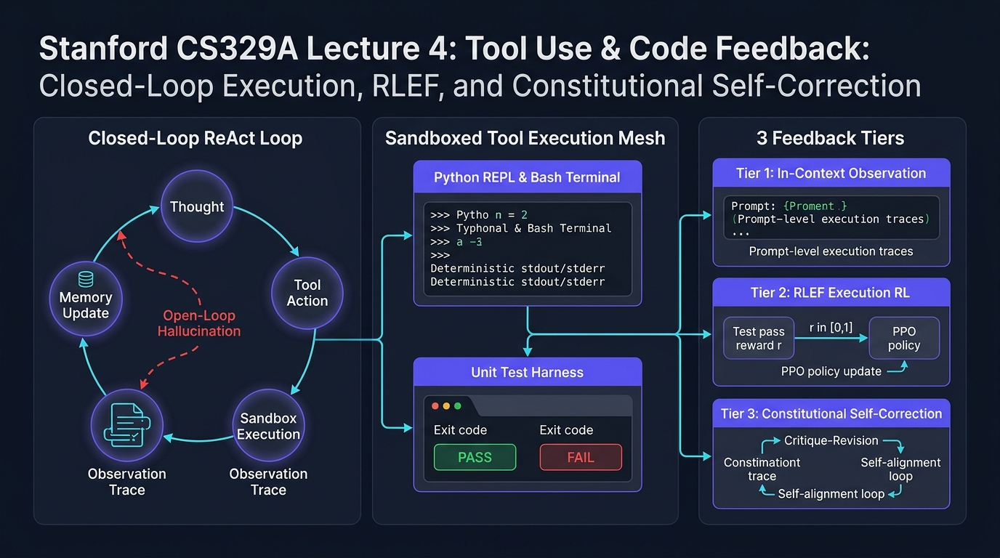
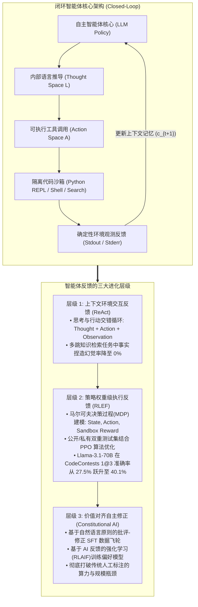
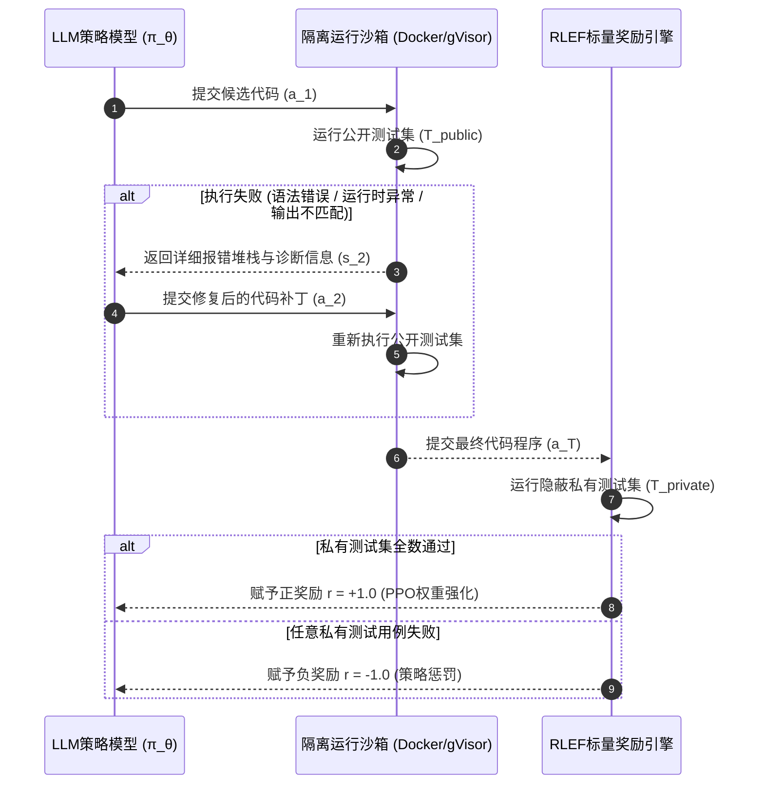
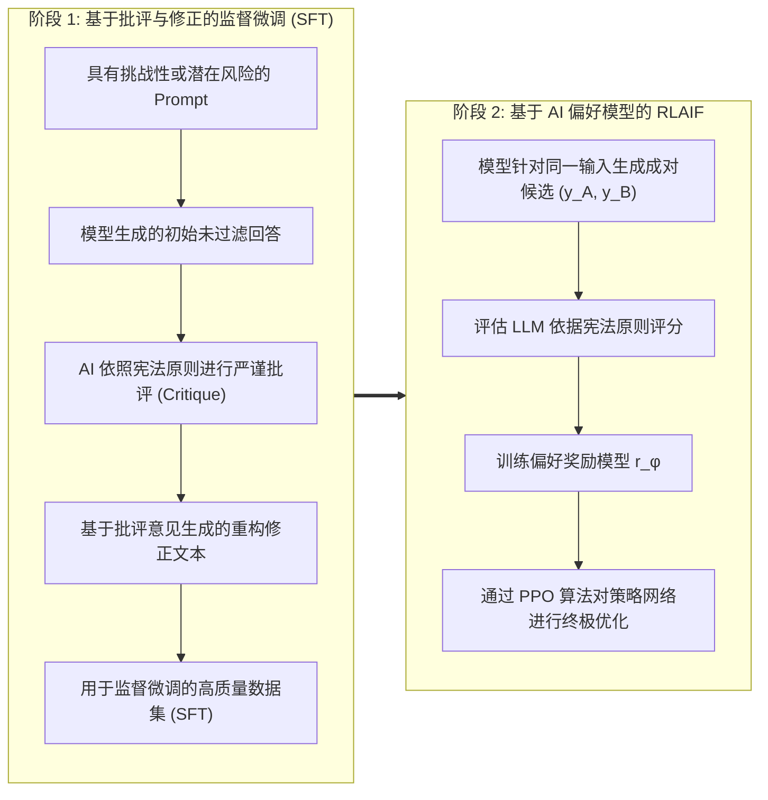

欢迎来到斯坦福大学2025秋季最新研究生课程——**CS329A: Self-Improving AI Agents（自主进化AI智能体）**的第四篇深度工程解析。

在第2讲与第3讲中，我们系统剖析了测试时计算扩展（Test-time Compute Scaling）与过程奖励模型（PRM），掌握了语言模型如何展开推理搜索树并验证中间数学推导的内在逻辑。然而，无论思维链（CoT）推理多么精妙，仅仅局限于纯文本生成的模型本质上依然是**“被关在封闭考场内答卷的学生”**。它们只能依赖预训练阶段写入神经网络的静态、冻结参数记忆（Parametric Memory）。面对实时演变的世界现实、动态Web API或语法要求严苛的代码执行环境，与外部物理隔离的模型不可避免地会陷入以假乱真的“幻觉（Hallucination）”。

今天的**第4讲**正是带领智能体走出封闭考场的决定性转折点：**工具调用（Tool Use）与代码执行反馈循环（Feedback Loops）**。

现代自主智能体不再将代码或API调用仅仅视作最终的文本输出，而是将其转化为与外部环境进行交互的**感知器（Sensor）与执行器（Actuator）**。本讲中，我们将深入拆解将静态语言模型升级为自主闭环智能体的三大核心反馈层级：
1. **提示词层面的环境交互反馈：** 思维与行动协同并进的 **ReAct**（Yao et al., 2022）
2. **策略网络层面的执行诊断反馈：** 将编译器与测试集报错直接刻入模型权重的 **RLEF**（Reinforcement Learning from Execution Feedback, 2024）
3. **自主监督层面的价值对齐修正：** 以自然语言宪法原则替代高昂人工标注的 **Constitutional AI**（Anthropic, 2022）



{/* truncate */}

---

### 1. 思维与行动的协同：ReAct 架构 (Yao et al., 2022)

在 2022 年 ReAct（普林斯顿大学与 Google Research）发表之前，学术界在智能体构建路线上存在两大截然对立的流派：
1. **纯推理派（Chain-of-Thought / CoT）：** 引导模型“一步一步进行推理”。在封闭数学推导中效果显著，但由于缺乏与外部环境的交互，一旦中间产生虚假假设，模型便会在错误的前提下不断展开推演，导致最终结论彻底失真。
2. **纯行动派（Action-only / WebGPT, Act）：** 直接让模型生成 API 搜索或环境交互指令。但由于缺乏内部工作记忆（Working Memory）来追踪“为什么发起这次检索”以及“下一步子目标是什么”，模型极易迷失方向或陷入死循环。

#### 行动空间的数学扩展

ReAct 的核心洞察在于，将智能体的整体行动空间形式化为**物理环境行动空间 $A$** 与 **自然语言思维空间 $L$** 的并集：

```text
A_hat = A ∪ L
```

其中：
* `A` 表示在外部环境中可实际执行的动作集合（如 `Search[query]`、`ExecuteCode[script]`、`Click[element]`）。
* `L` 表示自由的自然语言思维（Thought）空间。

在数学上极为关键的特性是，思考动作 $a_t \in L$ **不会引起外部物理环境发生任何状态转移**。它仅仅更新智能体自身的内部上下文历史：

```text
c_{t+1} = ( c_t, a_t )   (当 a_t ∈ L 时)
```

而当智能体发出物理执行动作 $a_t \in A$ 时，外部环境执行该动作并返回确定性的观测结果（Observation）：

```text
c_{t+1} = ( c_t, a_t, o_t )   (当 a_t ∈ A, o_t = Env(a_t) 时)
```

#### ReAct 交互循环的实际执行轨迹

在标准 ReAct 范式下，推理、行动与环境观测紧密交织：

```text
Thought 1: 将用户的问题拆解为两个子目标。首先需要检索图灵的出生年份。
Action 1: Search["艾伦·图灵 出生日期"]
Observation 1: 艾伦·麦席森·图灵（1912年6月23日 - 1954年6月7日）是英国数学家...
Thought 2: 图灵出生于1912年。接下来需要检索1912年伦敦的官方统计人口数据。
Action 2: Search["伦敦 1912年 人口数据"]
Observation 2: 1912年伦敦行政郡的官方统计人口约为452万人...
Thought 3: 两个关键数值均已通过外部权威数据核实，最终答案为452万人。
Action 3: Finish["452万人"]
```

#### 实验验证：幻觉的戏剧性归零

Yao 等人的基准评测展现了显著的可靠性提升：
* **多跳问答检索基准（HotpotQA）：**
  * 在对 CoT 模型的错误归因分析中，**56% 的失败案例直接源于事实捏造（凭空创造不存在的人物或年份）**。
  * 引入 ReAct 闭环后，模型的事实捏造率直接**降为 0%**。因为面对未知领域时，模型必须调用检索动作获取客观事实。
* **交互式文本任务（ALFWorld）：**
  * 在多房间漫游与物品交互任务中，纯行动派模型因目标漂移成功率仅为 45%，而 ReAct 跃升至 **71%**。
* **生产工程必须遵守的硬性规则（停止序列 / Stop Sequence）：**
  * 自回归语言模型具有自主预测后续文本的本能。如果不加以限制，它会在输出 `Action:` 后迫不及待地自己伪造虚假的 `Observation:`。
  * **工程规范：** 在推理引擎中必须设置显式停止词（`stop=["\nObservation:"]`）。模型输出行动指令后立即强行挂起，由宿主系统调用真实沙箱，并将真实的物理输出作为字符串拼接后再唤醒模型进入下一轮。

---

### 2. 将执行反馈刻入权重：RLEF (Reinforcement Learning from Execution Feedback)

如果说 ReAct 解决了基于上下文提示的环境交互，那么在代码工程领域，智能体还需要更深层的能力：**根据编译器的堆栈报错与测试用例失败信息，自主修改逻辑缺陷的自愈调试（Self-Debugging）能力**。

#### 上下文自我调试的悖论

当开发者将报错信息（Traceback）粘贴给冻结的预训练大模型（Frozen LLM）并要求其修复代码时，实证研究（Olausson et al., 2024; Kapoor et al., 2024）揭示了一个反直觉的普遍现象：

> **“将报错信息喂给未微调的模型要求其调试代码，其成功率往往显著低于直接丢弃报错、从头独立重新采样（Independent Sampling）全新代码的做法！”**

这是因为预训练大模型从未接受过将行号堆栈信息与代码逻辑漏洞进行因果绑定的专项训练。面对报错，模型往往手足无措，仅做无意义的变量重命名，或在换行微调后再次生成一模一样的 Bug。

2024 年底发表的 **RLEF (arxiv:2410.02089)** 放弃了单薄的提示词工程，改用**强化学习（PPO）**从根本上攻克了这一难题。

#### 多轮代码合成的形式化建模（MDP）

RLEF 将“编写代码 $\to$ 运行获取反馈 $\to$ 生成补丁”的最多 $T$ 轮交互过程形式化为离散时间马尔可夫决策过程（MDP）：
* **状态空间（$S$）：** 包含问题描述、过往尝试代码以及编译器/测试集报错诊断历史：
  ```text
  s_t = ( Problem_Spec, Code_1, Err_1, ..., Code_{t-1}, Err_{t-1} )
  ```
* **行动空间（$A$）：** 模型在当前轮次输出的代码补丁或全新程序 $a_t$。
* **环境转移：** 代码在配备自动化测试脚手架的隔离沙箱中编译并执行。



#### 双重测试集设计：杜绝奖励作弊（Reward Hacking）

RLEF 架构最核心的安全设计在于**公开测试集与私有测试集的严格物理隔离**：
1. **公开测试集（`T_public`）：** 在调试过程中向模型开放，编译器报错、断言失败以及标准错误输出构成环境状态 $s_t$。
2. **私有测试集（`T_private`）：** 对模型的输入上下文彻底隐蔽，仅在交互结束时由环境在后端独立运行，用于计算最终的标量奖励。

如果模型试图通过硬编码查询表（`if input == test_1: return val_1`）作弊蒙混过关，它将在私有测试集上彻底全军覆没，遭受极其严厉的策略惩罚。

#### 目标函数与环境奖励设计

策略模型 $\pi_\theta$ 采用 PPO 算法进行训练，并施加针对参考模型 $\rho$ 的词元级 KL 散度惩罚：

```text
R(s_t, a_t) = r(s_t, a_t) - β * log( π_θ(a_t | s_t) / ρ(a_t | s_t) )
```

环境标量奖励函数 $r(s_t, a_t)$ 设计如下：

```text
r(s_t, a_t) = {
    +1.0,  交互终止时通过 T_private 的全部测试用例
    -1.0,  耗尽最大重试次数 T 依然存在未通过用例
    -0.2,  当 a_t 包含无法编译的严重语法错误时的中间惩罚
}
```

#### 基准评测：在 CodeContests 上超越 AlphaCodium

在包含高难度算法竞赛题目的 **CodeContests** 基准测试中，RLEF 展现了惊人的工程爆发力：
* 在开源模型 `Llama-3.1-70B-Instruct` 上应用 RLEF 后，仅给予 3 次重试机会（$1@3$），解题通过率便从 **27.5% 跃升至 40.1%**。
* 作为对比，基于 GPT-4 并进行 100 次并行大批量采样的 **AlphaCodium（$pass@100$, 29.0%）被 RLEF 仅用 3 轮交互就超越了整整 11.1 个百分点**。

#### 随机报错消融实验（Ablation Study）

为验证模型是否真正理解了报错，研究团队设计了消融实验：
* 故意向智能体喂入与当前问题无关的其他题目报错信息，模型的成功率瞬间暴跌至基准线以下。
* 这从数学上充分证明：经由 RLEF 训练的模型并非盲目乱猜，而是**在神经网络权重中建立了精准的因果映射，能根据报错行号与异常类型直接定位代码缺陷并实施有效重构**。

---

### 3. AI 对齐自主监督：Constitutional AI 与 RLAIF

ReAct 依赖外部检索，RLEF 依赖确定性编译器。但在缺乏自动化编译器的开放式、主观性领域中，我们该如何提供反馈？
* 这篇系统架构方案是否符合微服务解耦与可扩展性原则？
* 这份代码审查意见是否既指出了严重安全漏洞，又保持了专业建设性的沟通风格？
* 这段技术回答是否能够防御对抗性越狱提示词的攻击？

传统的人类反馈强化学习（RLHF）依赖成千上万名人类标注员对比评估成对回复。这种模式面临巨大的局限性：成本极度高昂、标注人员之间存在主观偏差、认知疲劳以及评判标准难以统一。

2022 年，Anthropic 提出了 **Constitutional AI（RLAIF：基于 AI 反馈的强化学习）**，确立了完全依托自然语言原则（即“宪法”，Constitution）实现自主对齐的全新范式。



#### 双阶段宪法级训练流水线

1. **第一阶段：批评与修正（Critique $\to$ Revision $\to$ SFT）**
   * 向基座模型输入高难度或诱导性问题。
   * 模型输出初始回答 $y_0$ 后，系统从宪法清单中抽取原则并下达指令：
     * **批评指令：** *“请根据宪法原则（‘严格防范注入漏洞并强制推行静态类型安全性’）审视上一条回复，逐条指出具体违规之处。”*
     * **修正指令：** *“请根据上述批评重写该回复，消除所有缺陷并保持最高的技术深度。”*
   * 将经过反复自我批评与修正的高质量样本 $`{y*}`$ 收集成库，对模型进行第一轮监督微调（SFT）。

2. **第二阶段：AI 反馈强化学习（RLAIF）**
   * 微调后的模型针对输入 $x$ 生成成对选项 $(y_A, y_B)$。
   * 由独立的 AI 裁判模型根据宪法原则评估两者的优劣分布：
     ```text
     P( y_A > y_B | x, Constitution )
     ```
   * 利用 AI 裁判生成的软标签训练偏好奖励模型 $r_\phi(x, y)$，并结合 PPO 算法对目标智能体策略展开端到端强化学习。

#### 核心意义：可扩展监督（Scalable Oversight）

Constitutional AI 证明，人类成千上万小时的繁重标注劳动可以被高度浓缩为**一纸清晰明确的自然语言原则（宪法）**。人类架构师只需把控顶层规范的制定，AI 评估集群即可将高质量监督无缝扩展至数十亿 Token 的训练规模。

---

### 4. 企业级架构设计：高防代码执行沙箱蓝图

要在企业生产环境中安全承载自主工具调用与代码执行反馈，必须构建完备的纵深防御基础设施。斯坦福 CS329A 推荐的企业级架构蓝图如下：

```text
┌────────────────────────────────────────────────────────────────────────┐
│             企业级智能体工具与代码执行沙箱架构                          │
├────────────────────────────────────────────────────────────────────────┤
│                                                                        │
│  [ 客户端业务需求 / PRD 文档 ]                                          │
│          │                                                             │
│          ▼                                                             │
│  ┌──────────────────────────────────────────────────────────────────┐  │
│  │                    编排智能体核心引擎                            │  │
│  │  • 严格绑定停止序列（Stop Sequence）的 ReAct 提示词引擎          │  │
│  │  • 上下文管理器（滑动工作记忆 + AST 代码索引库）                 │  │
│  │  • 基于 JSON-RPC 规范的工具调度验证器                           │  │
│  └───────────────────┬──────────────────────────────▲───────────────┘  │
│                      │ 结构化工具调用指令           │ 净化后的遥测反馈  │
│                      ▼                              │ (Stdout/Stderr)  │
│  ┌──────────────────────────────────────────────────┴───────────────┐  │
│  │                     安全沙箱接入网关                             │  │
│  │  • MicroVM / gVisor 容器隔离（彻底切断宿主机文件系统访问）       │  │
│  │  • 出站网络防火墙拦截（仅放行白名单安全域名）                    │  │
│  │  • 严格资源定额：2.0 CPU 核、2GB 内存、5 秒超时强制熔断          │  │
│  ├──────────────────────────────────────────────────────────────────┤  │
│  │                     隔离执行运行时环境                           │  │
│  │  ┌─────────────────────────┐     ┌────────────────────────────┐  │  │
│  │  │ 临时 Python REPL 实例   │     │ 受限 Bash 交互终端         │  │  │
│  │  │ • Pytest 公开测试套件   │     │ • AST 静态语法检查器       │  │  │
│  │  │ • 报错堆栈脱敏净化器    │     │ • Semgrep 代码安全扫描器   │  │  │
│  │  └─────────────────────────┘     └────────────────────────────┘  │  │
│  └──────────────────────────────────────────────────────────────────┘  │
│                                                                        │
└────────────────────────────────────────────────────────────────────────┘
```

#### 生产落地的三大核心安全原则
1. **纯临时沙箱（Ephemeral Sandboxing）：** 所有的代码执行必须在 gVisor 容器或 Firecracker 驱动的 MicroVM 中即用即启，任务结束立即彻底销毁。
2. **出站流量硬隔离（Egress Isolation）：** 严防提示词注入攻击将宿主机的环境变量或数据库凭据通过外部网络外泄，默认切断所有未授权的出站网络流量。
3. **报错堆栈脱敏（Traceback Sanitization）：** 在将终端的报错信息回传给模型前，必须对服务器绝对物理路径、敏感环境变量等信息进行脱敏过滤。

---

### 5. 资深工程师核心 Q&A

**Q: 如何从根本上防止 ReAct 智能体不等工具返回，就自己编造虚假的 Observation？**
**A:** 这是构建智能体系统时最常见的深坑。自回归模型具有预测对话下文的惯性，输出完 `Action: Search[...]` 后往往会自说自话地接着写 `Observation: 搜索成功...`。唯一的根治方法是在模型推理配置中显式注册停止序列：`stop=["\nObservation:"]`。一旦大模型输出完 `Action:` 行，推理引擎会立即强行刹车。后端系统接管控制权，在沙箱中真正运行工具，获取真实环境输出后再将其拼接到输入提示词中，唤醒模型进入下一个思考步。

**Q: 为什么 RLEF 强化学习的泛化能力显著优于直接用静态报错日志进行监督微调（SFT）？**
**A:** 静态 SFT 数据集存在致命的**分布偏移（Distributional Shift）**。在真实运行环境中，一旦智能体写出了一个过去训练集里从未出现过的冷门语法错误，它就会陷入未见过的状态空间从而彻底崩溃。而 RLEF 是在 MDP 环境中让智能体亲身探索自己独有的代码编写缺陷，在真实碰撞中感受失败惩罚，并通过 PPO 自行探索出修复路径，因而具备极强的鲁棒性与自愈力。

---

### 6. 核心总结与技术要点

1. **环境交互构建智能基石：** 仅依赖静态参数记忆的模型必然产生幻觉。ReAct 将思考与行动空间深度融合（$\hat = A \cup L$），在多跳检索任务中将事实捏造率清零。
2. **执行反馈写入神经权重：** 停留在冻结模型上的提示词技巧已达天花板。RLEF 将编译器与测试集抽象为 MDP，使 70B 开源模型在算法竞赛基准上全面超越百次采样的 GPT-4 框架。
3. **自主宪法对齐：** Constitutional AI 用自然语言原则替代了劳动密集型的人工标注，打通了自发批评-修正与大规模 AI 偏好对齐（RLAIF）的演进通路。
4. **纵深防御沙箱：** 工业级智能体落地离不开严格的工程保障：停止词截断、临时微虚拟机隔离以及公开/私有测试套件分离是系统可靠运行的支柱。

---

### 斯坦福 CS329A 下期预告：
在接下来的**第5讲**中，我们将由单步工具调用正式迈向跨越多个维度的宏观战略规划：**《多步规划与树搜索：ADaPT、LATS、SPRINT 以及面向语言智能体的蒙特卡洛树搜索（MCTS）》**。我们将剖析智能体如何像国际象棋特级大师一样洞察未来数十步变化、自主构建探索树并进行回溯。敬请期待！