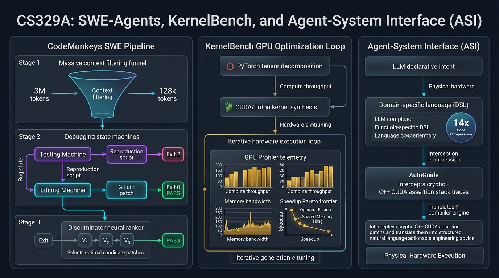
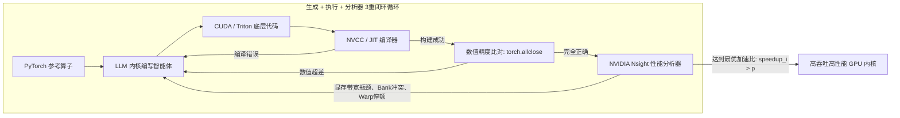

# 斯坦福 CS329A (第10讲): SWE-Agents — 软件工程智能体、CodeMonkeys、KernelBench 与智能体系统接口 (ASI)

工业级真实世界的软件工程现场，与孤立编写单一函数的算法测验或玩具基准有着天壤之别。GitHub 上报告的真实软件缺陷绝不仅局限于单个文件，而是深度盘根错节于数百个模块、复杂的历史依赖以及数百万行跨进程的分布式代码库中。更为苛刻的是，生产环境中的软件系统不仅要求在功能逻辑上“正确（Correct）”，更要求在计算效率上“足够快（Fast）”，并且与底层的物理并行硬件架构“高度对齐（Aligned）”。

从今天开始，我们将正式迈入**斯坦福 CS329A: Self-Improving AI Agents（自我提升型 AI 智能体）**的第三大板块——**Part 3 · Agent Engineering (第10讲至第12讲)**。我们将走出纯理论的模型训练，全方位直面工业级实战软件工程的最前线：
> **“智能体如何深入数百万词元的超大型代码仓库，自动定位隐蔽的回归缺陷，自主编写可复现的验证测试脚本，甚至写出在物理执行速度上超越人类专家标准库的高性能 GPU 定制内核？”**

本文将聚焦 **SWE-Agent Autonomous Coding（软件工程智能体自主编程）** 的技术前沿，全面拆解三大关键突破：在 **SWE-bench Benchmark GitHub** 斩获顶尖战绩的 **CodeMonkeys Automated Refactoring（CodeMonkeys 自动化重构）**、结合硬件性能分析器闭环优化的 **KernelBench GPU Performance Tuning（KernelBench GPU 性能调优）**，以及由斯坦福大学提出的 **Agent-Computer Interface ACI（智能体-计算机接口 / Agent-System Interface ASI）** 架构。

{/* truncate */}



---

## 1. 工业级软件工程智能体的核心现实挑战

要实现自主修复 GitHub 真实开源代码库的 Bug，必须突破三道巨大的系统工程壁垒：
1. **上下文爆炸危机 (Context Explosion):** 工业级代码仓库规模动辄突破 300 万词元。将整个代码库盲目灌入大模型，不仅 API 成本极度高昂，更会导致严重的注意力涣散（大海捞针失效）。
2. **测试验证的自我欺骗 (Self-Deceptive Verification):** 若让智能体先动手修改代码，智能体往往会根据自己修坏的代码反向编写“放水测试”，造成伪通过（False Positive）。
3. **硬件级性能优化壁垒:** 跨出高级语言胶水代码、进入底层 CUDA/Triton 并行计算时，内存对其、线程束分化等物理细节使得单次直接生成（One-shot）的失败率接近 100%。

```
┌─────────────────────────────────────────────────────────────────────────┐
│              工业级软件工程智能体 (SWE-Agents) 的三大支柱               │
└────────────────────────────────────┬────────────────────────────────────┘
                                     │
       ┌─────────────────────────────┼─────────────────────────────┐
       ▼                             ▼                             ▼
┌──────────────────────────┐  ┌──────────────────────────┐  ┌──────────────────────────┐
│  CodeMonkeys SWE-bench   │  │   KernelBench 性能分析   │  │    斯坦福 ASI 系统接口   │
├──────────────────────────┤  ├──────────────────────────┤  ├──────────────────────────┤
│ • 50.5倍上下文深度压缩   │  │ • fast_p 物理墙钟加速比  │  │ • 14倍 DSL 代码复杂性压缩│
│ • 双向互相调试状态机     │  │ • 编译+分析器性能反馈环  │  │ • AutoGuide 底层错误转译 │
│ • 判别式差分测试选择器   │  │ • 算子融合与共享内存优化 │  │ • 高级意图与物理实现对齐 │
│ • SWE-bench Verif. 57.4% │  │ • 最高实现 13倍 GPU 加速 │  │ • 性能超越调优工具 3.8倍│
└──────────────────────────┘  └──────────────────────────┘  └──────────────────────────┘
```

---

## 2. 攻克 GitHub 真实缺陷的完整架构: CodeMonkeys (2025)

在汇聚了 Django、SymPy、scikit-learn 等顶级开源库真实 Bug 的 **SWE-bench Verified** 评测中，2025年初面世的 **CodeMonkeys** 创下了 **57.4%** 的行业顶尖解决率纪录。

CodeMonkeys 的破局核心在于将混乱的软件修复拆解为高度自律的三阶段流水线：

```
                  [真实 GitHub Issue 报告与 300万词元代码库]
                                     │
                                     ▼
           1. 上下文筛选流水线 (Context Pipeline, 50.5倍大幅压缩)
              (本地运行轻量 Qwen2.5-Coder 全局检索 -> 摘要 -> 排序 -> 128k)
                                     │
                                     ▼
           2. 生成阶段双向状态机 (Two-Sided Debugging State Machines)
              ┌────────────────────────────────────────────────────────┐
              │ 测试状态机 (Testing Machine): 编写复现脚本 (Exit 2 报错)│
              │                       │                                │
              │                       ▼                                │
              │ 编辑状态机 (Editing Machine): 编写代码补丁 -> (Exit 0) │
              └────────────────────────────────────────────────────────┘
                                     │
                                     ▼
           3. 判别选择状态机 (Selection State Machine, 差分测试)
              (自主合成专门区分不同候选补丁输出的判别式测试用例)
                                     │
                                     ▼
                        [提交最终验证的 Pull Request]
                     (在 SWE-bench Verified 达成 57.4% 解决率)
```

### 第一阶段：上下文流水线（50.5倍压缩）
- 直接使用 Claude 3.5 Sonnet 等昂贵的商业模型全盘通读数百万词元代码库不仅成本极高，而且响应极慢。
- CodeMonkeys 采用可在本地高效运行的开源 `Qwen2.5-Coder-32B`，对项目所有文件进行静态扫描与语法提取。
- 仅保留核心的类声明与函数签名进行摘要和优先级排序，**将原本 300 万词元的庞大工程精准压缩为 128,000 词元（50.5倍压缩）**。
- 这份上下文元数据由后续 10 条并行代码生成轨迹平摊（Amortized），使搜索阶段成本被严格控制在**总预算的 15% 以内**。

### 第二阶段：生成阶段 — 双向互相调试机制（Two-Sided Debugging）
修复代码时最忌讳的是“以为修复了，实则毫无作用”。CodeMonkeys 采用了两个紧密咬合的状态机：
1. **测试状态机 (Testing State Machine):** 研读 Issue，编写独立的**问题复现测试脚本（`reproduce_issue.py`）**。这一测试脚本在未经修改的代码库上运行必须明确报错，返回 **Exit Code 2 (确认复现失败)**。如果直接通过，则判定测试无效并重写。
2. **编辑状态机 (Editing State Machine):** 依托确凿报错的复现脚本，模型开始修改源码，并在沙箱中反复运行测试，直到测试顺利翻转为 **Exit Code 0 (成功通过)** 为止，期间最多进行 8 轮错误日志驱动的迭代修复。

### 第三阶段：选择阶段 — 走向真实正解（Selection State Machine）
并行采样 10 条修复轨迹后，包含至少一个正确补丁的覆盖率达到 **69.8%**。然而如果只是随机选取一个补丁提交，准确率会骤降至 **45.8%**。

CodeMonkeys 的精髓在于**判别式测试选择器 (Discriminator Selection)**：
- 它不直接让大模型主观猜测哪个补丁写得好。
- 而是要求模型**“专门针对候选补丁 A 与 B 的逻辑差异，编写一段能让两者产生不同输出的全新边缘测试用例”**。
- 藉由运行这些判别测试，逐一剔除存在潜在回归缺陷的错误补丁，将最终的实际解决率拉升至 **57.4%**。

---

## 3. 从功能正确迈向极致性能: KernelBench (2025)

在现代 AI 计算基建中，GPU 内核的效率直接决定了万卡集群的吞吐量与成本。五年前 Transformer 论文提出后，业界专家花费了数年才手工打磨出 FlashAttention 这样极致优化的 CUDA 实现。AI 能否自主编写出性能超越 PyTorch 原生标准实现的定制内核？

2025年2月发布的 **KernelBench** 构建了包含 250 个 PyTorch 算子的严苛评测集，对代码的数学精度和实际硬件执行耗时进行联合考核。

```text
结合准确率与物理加速比的 fast_p 评价指标:
========================================================================================
fast_p = (1 / N) * Σ_{i=1}^N  1[ correct_i  AND  speedup_i > p ]

核心维度含义:
  • fast_0 : 功能数学正确率 (输出张量数值与 PyTorch 完全一致: torch.allclose)
  • fast_1 : 正确且执行耗时实际优于原生 PyTorch 的比例 (Speedup > 1.0x)
  • fast_2 : 正确且耗时领先 PyTorch 2倍以上的比例 (Speedup > 2.0x)
========================================================================================
```



### 硬件分析器（Profiler）反馈环的质变飞跃
在单次无反馈生成（One-shot）中，哪怕如 o1 或 DeepSeek-R1 这样的顶级模型，**能够写出快于 PyTorch 代码的比例（$fast_1$）也低于 20%**，经常因线程索引越界导致段错误（Segfault）或因显存访问冲突导致性能暴跌。

而当将**代码生成（Generation） + 编译运行（Execution） + Nsight 分析器遥测（Profiler）**三者结为闭环时：
- DeepSeek-R1 在复合算子优化（Level 2）上的成功率从 36% **翻倍跃升至 72%**。
- 模型根据分析器反馈的显存带宽瓶颈，自主引入算子融合（Operator Fusion）、块级平铺（Tiling）与共享内存（Shared Memory）规约，合成了**相较原生 PyTorch 速度提升高达 13 倍**的高性能内核。

---

## 4. 意图与实现的精准对齐: 智能体系统接口 (ASI, Stanford 2025)

如果强行要求大模型直接编写数千行充斥着指针操作与模板展开的底层 C++ 并行代码，必然会引发严重的认知失调。斯坦福大学 Alex Aiken 教授团队（ICML 2025）提出的 **Agent-System Interface (ASI)** 从根本上化解了这一阻抗：
> **“让大模型直接处理裸 C++ 指针与底层硬件断言，就像让高级算法架构师去手动调试机器微码一样低效。必须在模型与硬件之间建立一座专用接口：通过领域特定语言（DSL）约束搜索空间，并由 AutoGuide 将硬件报错自动翻译为自然语言操作指令！”**

```text
┌─────────────────────────────────────────────────────────────────────────┐
│                           LLM 深度推理智能体                            │
│                 (确立高级声明式计算意图与顶层算法优化策略)              │
└────────────────────────────────────▲────────────────────────────────────┘
                                     │
          ┌──────────────────────────┴──────────────────────────┐
          │ 高级声明式 DSL           ▲ 操作性自然语言           │
          │ 并行优化指令             │ 诊断指导 (AutoGuide)     │
          ▼                          │                          │
┌────────────────────────────────────┴────────────────────────────────────┐
│                    Agent-System Interface (ASI 抽象层)                  │
│  • 领域特定语言 (DSL): 代码复杂度大幅压缩 14倍 (声明式表达)             │
│  • AutoGuide 诊断转译器: 将晦涩的底层硬件断言转化为具体操作建议         │
└────────────────────────────────────▲────────────────────────────────────┘
                                     │
          │ 底层 C++ 系统代码        ▲ 物理硬件报错日志及       │
          │ 与底层内存分配指令       │ 编译器底层断言           │
          ▼                          │                          │
┌────────────────────────────────────┴────────────────────────────────────┐
│                       物理级并行硬件执行系统                            │
│                  (分布式显存、GPU流处理器、共享缓存)                    │
└─────────────────────────────────────────────────────────────────────────┘
```

### ASI 的两大核心构件
1. **领域特定语言 (DSL):** 摒弃繁琐的底层模板代码，仅将数据切分与内存映射决策抽象为十余行高级声明式 DSL，**将代码复杂度压缩 14 倍**，完全根除了低级语法错误。
2. **AutoGuide 自动转译器:** 当硬件底层抛出诸如 `"Assertion failed: stride mismatch at dim 1"` 等机器断言时，AutoGuide 拦截并重组为具备指导意义的行动建议：
   > *“硬件诊断提示：张量第1维未按32字节对齐，造成显存跨步冲突。请调整 Row-major 排布指令，为其添加32字节的内存 Padding。”*

### 实测成效：10次迭代超越1000次调优
搭载 ASI 接口的智能体仅历经 **10 次迭代优化**，所合成出的并行计算调度方案便比工业界顶尖调优工具 OpenTuner 经过 **1000 次搜索的结果还要快 3.8 倍**。原本需要人类专家耗费数天调优的复杂计算仿真，智能体在 **10 分钟内** 便圆满完成。

---

## 5. 软件工程技术范式全面横向对比

```text
=========================================================================================================
对比维度              基础代码辅助工具 (Copilot)     CodeMonkeys (SWE-bench)   KernelBench + ASI
---------------------------------------------------------------------------------------------------------
处理代码尺度          单个函数及局部补全代码块       涉及跨文件数百万词元工程  极致优化的高性能定制内核
上下文管理            活动编辑窗口 (4k~8k 词元)      50.5倍无损压缩至 128k     声明式高级 DSL (14倍压缩)
验证闭环              单次简单语法编译测试           双向互相调试状态机        Nsight 物理性能分析 (fast_p)
反馈信号形态          基础堆栈异常追踪文本           Exit 2 至 Exit 0 状态跃迁 AutoGuide 硬件行动建议
最终追求目标          词元级语法补全正确             生产级回归缺陷彻底修复    真实物理硬件墙钟时间加速
=========================================================================================================
```

---

## 6. 核心技术深度问答

### Q1: CodeMonkeys 为何必须强制在修改代码前先生成“复现测试脚本”？
如果允许智能体先改源码再写测试，模型必然会陷入“自我欺骗”：它会依据自己刚写出的缺陷代码逻辑，反向编写一段顺应这一错误的“放水测试”，自吹自擂地判定测试通过。

只有先在未修改的真实代码库上跑通一段确凿报错、返回 **Exit Code 2 (复现失败)** 的独立测试脚本，才等于确立了不可动摇的客观裁决准绳。后续修改源码只有将这一错误状态彻底翻转为 **Exit Code 0 (测试通过)**，才能从数学上确凿证明 Bug 已被根除。

### Q2: 大模型直接写 CUDA 内核为何极易溃败？分析器闭环是如何破局的？
语言模型能准确推导张量公式，但对数千线程并发访问显存的底层时空开销缺乏直观体感：
- **越界访存 (Out-of-Bounds):** 线程块坐标公式中只要漏掉边缘判定，就会引发不可挽回的段错误崩溃。
- **共享内存 Bank 冲突:** 多个线程并发读取同一显存 Bank 导致计算直接退化为串行排队。

普通的编译器报错无法揭示运行时的性能瓶颈。**硬件分析器反馈环（E+P）**直接把硬件利用率、显存停顿周期与 Warp 分化数据灌入上下文，使智能体能够精准施展共享内存填充与寄存器复用等专家级硬件优化技巧。

---

## 总结与下期预告

软件工程智能体已彻底跨越了代码自动补全的初级阶段。**CodeMonkeys** 凭借 50.5 倍上下文精炼与双向互相调试状态机，成功破解了 SWE-bench 工业级软件缺陷修复；**KernelBench** 与 **ASI** 则通过硬件分析器与领域抽象接口，打开了 AI 优化算力基础设施的大门。

下一讲 **第11讲**，我们将正面迎击长期多日复杂工程研发中的终极障碍：**Agent Memory — 智能体记忆系统、Cartridges、CacheBlend 与终生学习智能体 (MemGPT)**！

---

### 本讲核心提炼
- **平摊式上下文探索法：** 用低成本模型进行全库扫描与 50.5 倍压缩，让全工程级代码理解在经济上切实可行。
- **双向互相调试消除伪修复：** 唯有从未改时的 Exit 2 翻转为修复后的 Exit 0，才是软件修复的唯一真理。
- **极致性能是闭环迭代的产物：** 高性能代码无法单次直接生成，必须接入运行与硬件性能分析器（fast_p）的闭环反馈。