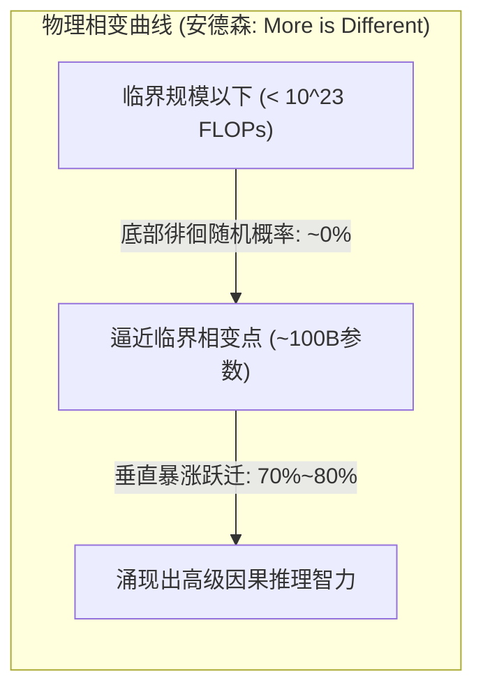

# Stanford CS329A (第13讲): LLM Reasoning — 大模型推理的本质与思维链 (CoT, Self-Consistency, 涌现能力)

数十年来，人工智能学术界一直笼罩在对联结主义神经网络的深层怀疑之中：
> *“自回归大型语言模型本质上不过是一个在统计上顺理成章拼凑下一个词的‘随机鹦鹉（Stochastic Parrot）’。面对需要多步运算、形式逻辑和因果推理的复杂问题时，它只能吐出似是而非的幻觉，根本不具备真正的演绎推理能力。”*

早期前沿大模型在面对小学应用题时的糟糕表现似乎印证了这一点：缺乏中间思维草稿纸的模型往往跳过步骤直接给出一个离谱的错误数字。

从本讲开始，**Stanford CS329A: Self-Improving AI Agents**正式进入万众瞩目的压轴终章——**Part 4: 最前沿（Frontiers, Lectures 13 through 17）**。我们将直面机器智能最深奥的精神高地：**LLM Reasoning Foundations**（大模型推理的底层基石）。以Google DeepMind推理研究总负责人、思维链（Chain-of-Thought）开创者**周登勇（Denny Zhou）博士**的经典研究为核心，深入剖析大语言模型内部“推理的火花”究竟是如何被点燃的：
- **思维链提示法 (Chain of Thought CoT Prompting, NeurIPS 2022):** 仅通过引入自然语言中间推理步骤，在不更新任何模型权重的前提下，让PaLM 540B的数学解题准确率从18%暴增至57%的底层奥秘。
- **自洽性解码 (Self-Consistency Decoding LLM, ICLR 2023):** 基于“通向真理的道路殊途同归，通向谬误的歧途各不相同”的托尔斯泰收敛法则，通过多重推理路径采样与多数投票，过滤随机幻觉噪声。
- **涌现式认知能力 (Emergent Cognitive Abilities AI, 2022):** 复杂系统物理学中的相变规律（“More is Different”）与斯坦福大学Arora教授“涌现是否为非线性指标造成的蜃景（Mirage）”之世纪大论战。

{/* truncate */}


---

## 1. “随机鹦鹉”神话的终结

早期研究者在为大模型编写Few-Shot示例时，通常将问题与最终答案直接强行绑定：

```text
[标准直接提示法 (失败模式)]
-----------------------------------------------------------------------------------------
Q: 罗杰有5个网球。他又买了2罐网球。每罐有3个网球。请问罗杰现在一共有多少个网球？
A: 答案是11。
-----------------------------------------------------------------------------------------
```

这种直接映射迫使模型将整个复杂的多步计算图压缩至“单次下一个Token的预测”之中。由于没有任何中间计算缓存（Scratchpad），注意力机制无法承载高阶因果依赖，导致模型只能凭空捏造错误答案。

周登勇博士与Jason Wei的研究团队仅改变了示例中的一行表达，便彻底逆转了AI演进的轨迹：

```text
[思维链提示法 (Chain-of-Thought)]
-----------------------------------------------------------------------------------------
Q: 罗杰有5个网球。他又买了2罐网球。每罐有3个网球。请问罗杰现在一共有多少个网球？
A: 罗杰最初拥有5个网球。
   买入2罐网球，每罐3个，即 2 * 3 = 6 个网球。
   5 + 6 = 11。
   因此，答案是11。
-----------------------------------------------------------------------------------------
```

```
┌─────────────────────────────────────────────────────────────────────────┐
│                 支撑机器认知推理的三大核心支柱                          │
└────────────────────────────────────┬────────────────────────────────────┘
                                     │
       ┌─────────────────────────────┼─────────────────────────────┐
       ▼                             ▼                             ▼
┌──────────────────────────┐  ┌──────────────────────────┐  ┌──────────────────────────┐
│     思维链 (CoT)         │  │     自洽性 (Self-Cons.)   │  │   涌现能力 (Emergent)    │
├──────────────────────────┤  ├──────────────────────────┤  ├──────────────────────────┤
│ • <问题, 推理步骤, 答案> │  │ • Sample-and-Marginalize │  │ • 安德森“More is Differ” │
│ • 模型权重更新: 0次      │  │ • 托尔斯泰真理收敛法则   │  │ • 临界算力规模 > 10^23 FL│
│ • GSM8K: 18% -> 57% 跃迁 │  │ • 多路径多数投票 (T=0.7) │  │ • 蜃景假说 (Mirage, p^L) │
│ • 自然语言逐步因果演绎   │  │ • 准确率提升: 56%->74.4% │  │ • 宏观智能相变跃迁       │
│ • 消融实验排除单纯数式/点│  │ • 模型内在置信度无监督度量│  │ • 非线性智能爆发的物理实像│
└──────────────────────────┘  └──────────────────────────┘  └──────────────────────────┘
```

---

## 2. 思维链提示法 (Wei, Zhou et al., NeurIPS 2022)

发表于2022年末的经典论文**《Chain-of-Thought Prompting Elicits Reasoning in Large Language Models》**彻底重塑了推理算力的配置范式。

在此之前，学术界普遍认为让模型掌握复杂多步推理，必须在数万条人工标注的数据集上进行全面微调（Fine-tuning）或训练外置验证器（Verifier）：
- 在小学数学应用题基准**GSM8K**上，当时全球顶尖的超大模型`PaLM 540B`采用标准提示的准确率仅为惨淡的**18%**。
- 然而，仅仅在提示词中加入**8个包含自然语言中间推演步骤的CoT示例**，模型的准确率便瞬间**暴涨至57%**！
- 这一跃升不仅将准确率拔高了39个百分点，甚至直接超越了OpenAI此前通过数万条数据微调配合奖励模型验证器才达到的33%纪录——**而且整个过程没有更新模型的一个参数权重**！


### 严谨的消融实验：到底是什么赋予了大模型推理能力？
面对学界对CoT“是否只是塞入了算式”或“单纯增加Token延长时间”的质疑，周登勇团队进行了无懈可击的消融对比实验：
1. **纯算式消融 (Equation Only):** 不写自然语言推导，仅列出算式（如 `5 + (2 * 3) = 11`），模型准确率瞬间跌回 **18%**。
2. **纯算力延长消融 (Dots Only):** 用省略号点（`......`）替代推理步骤给模型“拖延思考时间”，性能提升为零。
3. **答案后置推演 (Reasoning after Answer):** 让模型先输出最终答案，再补写推导过程，模型表现同样崩溃。
- **结论:** 赋予大模型真正推理火种的，既非纯数学符号，亦非盲目的Token填充，而是**“模拟人类思维、使用自然语言逐步铺展因果前提的顺序演绎能力（Natural Language Reasoning Steps）”**。

---

## 3. 多元思维的民主制：Self-Consistency (Wang, Zhou et al., ICLR 2023)

CoT虽然带来了革命性突破，但受限于传统的**贪婪解码（Greedy Decoding）**机制，存在着极其脆弱的致命伤：
> *“贪婪解码在每一步都只选取局部概率最高的那一个Token，沿着单一路线狂奔。在长达10步的推导链条中，一旦模型在第3步出现微小的符号疏忽，即便后续第4至第10步的逻辑再严丝合缝，也只能不可逆地坠入错误的深渊。”*

2023年，周登勇与王雪智团队提出了**Self-Consistency Decoding LLM**，通过优雅的统计边缘化方法取代了脆弱的单路径贪婪解码。

### 托尔斯泰收敛法则：“真理的路径殊途同归，谬误的借口各不相同”
列夫·托尔斯泰在《安娜·卡列尼娜》开篇写道：
> *“幸福的家庭都是相似的，不幸的家庭各有各的不幸。”*

周登勇博士敏锐地洞察到，这种拓扑结构在数学推理空间中完全适用：
- 面对一道复杂的综合推理题，无论采用代数代换、建立几何坐标系，还是利用反向推导，**所有推演逻辑正确的思考路径，最终都必然在唯一的真理终点强力收敛（Converge，如答案均为42）**。
- 反观那些出现推演逻辑漏洞或计算疏忽的错误路径，有的算得 $-14$，有的算得 $108$，有的算得 $3.14$——它们在**无限广袤的谬误解空间中杂乱无章地发散（Diverge）**！

```text
                                [数学推理问题 Prompt]
                                         │
        ┌────────────────┬───────────────┼───────────────┬────────────────┐
        ▼                ▼               ▼               ▼                ▼
   [路径1: 代数推导] [路径2: 几何分析] [路径3: 符号笔误] [路径4: 归纳还原] [路径5: 公式误用]
    ... 逐步推导 ... ... 逐步推导 ... ... 逐步推导 ... ... 逐步推导 ... ... 逐步推导 ...
        │                │               │               │                │
        ▼                ▼               ▼               ▼                ▼
     得数: 42         得数: 42        得数: -14       得数: 42         得数: 108
     (记一票!)        (记一票!)                       (记一票!)
        │                │                               │
        └────────────────┴───────────────┬───────────────┘
                                         ▼
                         [多数投票聚合选出众数: 42]
                        (排除了单次随机错误的最终答案)
```

### 采样与边缘化建模 (Sample-and-Marginalize)
Self-Consistency通过设定适度采样温度（$T = 0.7$），独立抽取 $m$ 条不同的CoT推理轨迹，并在最终离散答案空间进行多数投票（Majority Vote）：

```text
========================================================================================
自洽性 (Self-Consistency) 多数投票数学公式:
========================================================================================
Final Answer = argmax_a  Σ_{i=1}^m  1[ a_i = a ]

其中:
  • m   : 采样的独立推理轨迹数量 (通常取 5 至 40)
  • a_i : 从第 i 条推理轨迹末尾提取出的最终离散答案
  • 1[·]: 指示函数，当轨迹答案与候选答案 a 相符时返回 1，否则返回 0
========================================================================================
```

### 实验收益与无监督置信度自知
- 在`PaLM 540B`上，将CoT（56.5%）与Self-Consistency结合，基准准确率进一步**飙升至74.4%（净增17.9个百分点）**。
- **内在不确定性自我觉察:** 获得最高票数答案的得票率（例如40票中斩获38票 vs 40票中仅得12票）与真实答案的正确概率呈现出绝佳的正相关。这为智能体提供了一种完全无需外挂评判模型的**内在元认知（Metacognition）置信度标尺**。

---

## 4. “More is Different”: 涌现能力与世纪大论战

为什么CoT与Self-Consistency等强大的推理技巧在1B或7B这样的小模型上完全不起作用？

1977年诺贝尔物理学奖得主菲利普·安德森（Philip Anderson）曾写下名篇《More is Different》（多者异也）。孤立研究一个水分子永远无法窥见水的表面张力，解析单颗沙粒也无法预测雪崩。

周登勇与Jason Wei在重磅论文**《Emergent Abilities of Large Language Models》**中明确指出，大神经网络内部同样发生着严密的物理学**相变（Phase Transition）**：
> **“所谓涌现能力（Emergent Ability），是指在小规模模型中完全不存在（性能近乎于随机猜测），但只要算力或参数量突破特定临界规模（通常为 $10^{23}$ FLOPs 或约100B参数），便毫无预兆地发生垂直暴涨的非线性智力飞跃。”**



### 世纪学术大论战：涌现能力是一场数学指标的蜃景吗？
2024年，斯坦福大学Sanjeev Arora教授团队发表了引发全球AI界震动的挑战论文：**《Are Emergent Abilities of Large Language Models a Mirage? (大模型的涌现能力是蜃景吗？)》**

#### 挑战方的论证：非线性阶梯指标的扭曲假象
Arora团队将批判矛头直指常用的评测指标——**完全匹配准确率 (Exact Match)**：
- 假设一个需要 $L$ 步因果链条的推导任务，每一步Token的预测准确率为 $p$。
- 随着模型参数规模的扩大，底层对单个Token的预测概率 $p$ 其实呈现出**完全平滑且均匀的线性增长**（例如从 $0.6 \to 0.7 \to 0.8 \to 0.9$）。
- 然而，如果评测者坚持采用“只有整条链条 $L=5$ 个Token全部猜对才给分”的非线性严苛指标，对外公布的准确率将被扭曲为 $p^L$：
  $$0.6^5 = 0.07 \; (7\%) \quad \longrightarrow \quad 0.9^5 = 0.59 \; (59\%)$$
- **蜃景假说的结论:** 模型的底层神经元能力其实一直在均匀平滑地进化，只是因为评测者戴了一副**非线性的阶梯放大镜，才在外部表象上误以为智能发生了断崖式的跳跃**！

```text
========================================================================================
非线性指标蜃景假说数学模型:
========================================================================================
Accuracy_ExactMatch = ( p_token )^L

其中:
  • p_token : 底层单Token预测成功率 (随规模平滑线性增长)
  • L       : 强因果关联的推导链条长度
  • 当 L 较长时，底层的平滑线性增长在宏观指标上被放大为阶梯状跳跃！
========================================================================================
```

#### 周登勇团队的坚决反驳与辩证统一
周登勇团队对此给出了扎实的实证回应：
1. 即使直接追踪完全平滑且连续的**交叉熵损失函数（Cross-Entropy Loss）**，在诸多高难度任务上，损失值在达到临界规模之前依然纹丝不动，直到跨越阈值才骤然下降，展现出无可辩驳的真性物理相变。
2. 即使改用多项选择或连续的语义相似度指标（BLEU、ROUGE），诸多复杂推理任务的突变跳跃依然鲜明存在。

**我们应当掌握的辩证洞察:**
> *“不可否认，非连续指标确实在视觉上放大了涌现的陡峭程度；但同样必须清醒地认识到，人类逻辑推演本身就具有‘前提出错则全盘皆输’的严密因果性。在复杂的认知链条中，微观突触概率的微小提升一旦越过临界点，诱发系统宏观演绎能力的非线性质变，依然是复杂的物理客观现实。”*

---

## 5. 推理范式核心维度对比矩阵

```text
=============================================================================================================
维度                  标准直接Few-Shot提示          思维链提示 (CoT)              自洽性解码 (Self-Cons.)
-------------------------------------------------------------------------------------------------------------
推理过程展现          无 (直接映射 Q -> A)          自然语言逐步展开因果推演      多路径发散探索加多数投票
解码机制              局部贪婪最大化 (Greedy)       局部贪婪最大化 (Greedy)       采样加边缘化求众数 (Mode)
推演计算成本          1x 基准 FLOPs                 每个请求约耗费 3x Token       基准算力的 15x 至 30x
GSM8K 准确率          18% (PaLM 540B)               57% (+39%p 暴涨)              74.4% (再提 +17.4%p)
核心失效模式          直接陷入随机幻觉              单步细微失误导致雪崩式错误    多条错误路径巧合性共谋
不确定性自知          无 (过度自信的Softmax)        无                            通过胜出答案得票率完美刻画
模型规模适用门槛      各尺度模型均可运行            在 >100B / 10^23 FLOPs涌现    在具备CoT涌现能力的模型起效
=============================================================================================================
```

---

## 6. 技术深度问答 (Q&A)

### Q1: 在今天，7B或8B这样的小型开源模型能够进行CoT推理吗？
在2022年，未经特殊处理的百亿以下Base模型确实无法自发运行CoT。

然而，算法级后训练技术的飞跃改写了这一格局：
- **知识蒸馏 (Distillation):** 将顶尖超大模型生成的数百万条高纯度CoT轨迹直接作为蒸馏目标注入小模型。
- **强化学习 (RLVR):** 配合可验证奖励函数，当今如`DeepSeek-R1-Distill-Qwen-7B`或`Llama-3.1-8B-Instruct`等小型端侧模型在GSM8K上已能达到85%以上的高分，完胜当年的原始PaLM 540B。
- 涌现的物理临界线并非永恒不变，数据纯度与训练算法的精进正将其持续推向更轻量化的模型。

### Q2: 在工业落地中部署Self-Consistency，采样的最佳路径数（m）是多少？
实测数据显示，准确率随着采样路径数 $m$ 呈对数线性增长，并很快迎来边际效应递减：
- **5至10条路径区间:** 便已收割了整个集成收益的 **80%以上**。
- 将路径从10条盲目扩增至40条，虽然API算力账单翻了4倍，带来的准确率提升却仅在1%到2%之间徘徊。
- **实战准则:** 在生产环境中，将采样温度设为 **$T = 0.7$ 并抽取 5 至 8 条独立推理路径进行多数投票**，是兼顾经济成本与推演精度的最佳帕累托甜点（Sweet Spot）。

---

## 总结与下期预告

机器推理并非虚无缥缈的神迹。**Chain-of-Thought (CoT)**揭示了自然语言正是机器逻辑沉淀的物理载体；**Self-Consistency**用统计民主制化解了确定性解码的单点崩溃；而**涌现能力大论战**则向我们展示了智能在微观概率积累与宏观因果跃迁中的辩证演进。

然而，纯粹依靠自然语言的CoT推导，其本质依然建立在概率采样之上，始终无法彻底排除极其微妙的隐蔽幻觉。

面对像**国际数学奥林匹克竞赛（IMO）金牌压轴大题**那样不允许哪怕一丝一毫逻辑瑕疵的终极严密性挑战，纯语言模型该如何突破自我？

在下一讲**第14讲**中，我们将共同见证DeepMind将神经网络的直觉想象与严格的形式化符号逻辑（Lean 4、Z3 SMT）融为一体、斩获IMO金牌水平的历史性传奇：**《AlphaProof & Mathematical Reasoning: 数学推理与形式化验证 (AlphaGeometry, AlphaProof, Lean 4)》**。

---

### 核心要点总结
- **语言是思想的容器:** 仅仅将推导分解为自然语言中间步骤（CoT），便在零参数修改下令PaLM 540B准确率暴增39个百分点。
- **真理汇聚，谬误离散:** Self-Consistency多数投票利用推理拓扑结构过滤噪声，将准确率推向74.4%新高。
- **相变确凿存在:** 当算力跨越临界规模（$10^{23}$ FLOPs），底层概率的微观进化必然激发出系统宏观认知能力的根本跃迁。