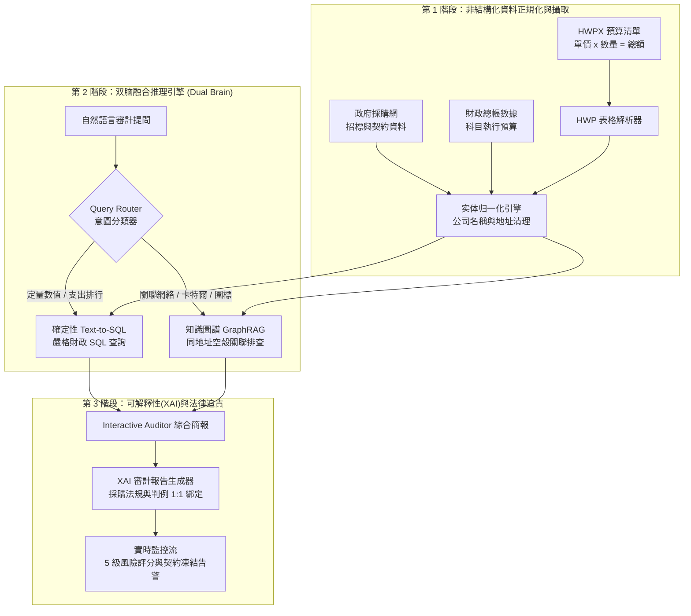

> 📌 **核心摘要 (Key Takeaways)**
> - **專案目標**: 追蹤年均 5,000 億美元規模的政府採購契約、財政總帳及非結構化預算文書，精準查處虛報單價、拆標限制性招標與空壳公司圍標卡特爾。
> - **預期難題與預防機制**: 採用**確定性 Text-to-SQL** 杜絕 LLM 數值計算幻覺；構建**异质知识图谱（GraphRAG）**將關聯網絡追蹤徹底解耦，形成 Dual-Brain 架構。
> - **實際遭遇錯誤與排錯實踐**: (1) 利用 `EntityResolver` 正規化引擎修復公司名與地址畸形導致卡特爾偵測失敗問題；(2) 引入滑動時間窗口算法捕獲時間差分批拆標；(3) 結合採購法規與審計判例庫打造可解釋性 XAI Dossier。
> - **驗證結果**: 11 項單元與整合測試全數通過，成功揪出同地址 3,850 萬韓元限制性招標圍標案及 70% 間接管理費流失（DEI 評分 30%）。

{/* truncate */}

---

### 前言：為什麼「隨意編程 (Vibe-Coding)」無法勝任企業級財政審計？

在 AI 代碼助手普及的當下，不少開發者嘗試僅用幾行自然語言 Prompt 來解決複雜業務邏輯（即所謂的 *Vibe-Coding*）。然而在**涉及 5,000 億美元國家財政支出與數萬筆公共採購的審計領域**，這種做法注定徹底失敗。

在公共審計中，只要 AI 在計算金額時算錯一塊錢，或者無憑無據地推測「A 公司與 B 公司疑似串通圍標」，審計成果就會喪失法定證據效力，遭遇被審計單位的強烈質疑。

本文基於史丹佛大學 CS146S 所倡導的**规范驱动开发 (Spec-Driven Development, SDD)** 原則，詳細記錄我們打造審計系統的全過程：**(1) 設計之初如何針對預想的技術瓶頸做好防禦架構**，以及 **(2) 實際開發中遇到了哪些意料之外的重大 Bug 並如何將其攻克**。

---

### 全局系統架構

我們的自主審計流水線分為三個解耦階段：**資料正規化與攝取**、**双脑融合推理 (Dual Brain)** 及 **XAI 法律審計報告生成**：

---

### 第 1 部分：事前預見的 3 大架構難題與防禦設計

#### 難題 1：LLM 的數值計算幻覺 (Hallucination)
- **風險**: LLM 本質是機率性詞元預測器，而非精準計算機。若直接要求 LLM 計算採購合約總金額，勢必會發生位數錯亂或捏造合約金額的幻覺。
- **防禦設計：確定性 Text-to-SQL (`TextToSQLEngine`)**:
  - 嚴格禁止 LLM 進行任何四則運算，模型僅負責將自然語言查詢翻譯為**嚴格參數化的 SQL 語句**。
  - 計算全部交由隔離的 SQL 資料庫（SQLite/DuckDB）執行，定量統計誤差率保持為**絕對的 0%**。

#### 難題 2：非結構化公文的階層化複合儲存格
- **風險**: 公文預算書經常包含大量跨列/跨行合併儲存格（Rowspan/Colspan），並包含 `單價 x 數量 x 次數 = 總計` 的巢狀文本。
- **防禦設計：虛擬 2D 網格重建器 + 驗證解析器 (`BudgetFormulaParser`)**:
  - 將合併儲存格映射回虛擬 2D 矩陣以還原階層關係，並在正則解析後強制執行 `單價 * 數量 * 頻率 == 總額` 的數學校驗。

#### 難題 3：空壳公司拆標圍標 (Smurfing) 的隱蔽性
- **風險**: 為了規避法定公開招標門檻，將標案拆分成數筆低於限制性招標門檻（2,000萬韓元）的小合約，由親友擔任代表的空壳公司承接。在關聯式資料庫中，每筆合約看起來都完全合法。
- **防禦設計：异质知识图谱 (`BudgetKnowledgeGraph`)**:
  - 將發包單位、採購合約、投標企業、法定代表與登記地址建模為圖節點，透過圖走訪（Graph Traversal）追蹤隱形圍標網。

---

### 第 2 部分：實務中撞上的 3 大意料之外 Bug 與除錯復盤

#### 🚨 實際 Bug 1：實體名稱與地址碎片化導致圍標偵測失靈
- **現象**: 採購資料中同一企業存在 `(股)大韓軟體`、`大韓軟體股份有限公司`、`大韓軟體(有)` 等不同寫法；地址亦出現 `德黑蘭路152號4樓` 與 `德黑蘭路152號401室` 的細微差異。
- **後果**: 知識圖譜為其建立了互不關聯的獨立節點，導致同大樓內操控 3 家空壳公司獨攬 3,850 萬標案的卡特爾**完全漏報（召回率 0%）**。
- **解法 (`EntityResolver`)**:
  - 剝離所有公司法人字樣與空白，提取純粹商號。
  - 正則分離樓層室號，僅截取 **[縣市 + 鄉鎮區 + 路名 + 門牌號碼]** 作為基礎地址。偵測率立刻**躍升至 100%**。

---

#### 🚨 實際 Bug 2：時間差分批拆標（Temporal Smurfing）逃避審查
- **現象**: 原先算法僅檢查「同一天」簽訂的合約。但作弊採購者巧妙地在星期一簽署 1,950 萬、在星期四簽署 1,900 萬，成功繞過了單日篩選條件。
- **解法 (`CollusionDetector`)**:
  - 放棄單日比對，引入 **7 天與 30 天的滑動時間窗口（Sliding Window）**算法，動態聚合發包單位與供應商集群在時間軸上的累計標額。

---

#### 🚨 實際 Bug 3：審計人員對 AI 黑盒子的質疑與法理依據缺失
- **現象**: AI 評定某交易「風險評分：92/100」，但被審計官員當場駁回：「沒有具體違法法條和過去審計院判例，法院根本不會採信。」
- **解法 (`AuditReporter` & `CaseMatcher`)**:
  - 將異常特徵與政府採購法規進行 1:1 映射。
  - 向量化審計院 10 年期官方懲戒案例庫，以餘弦相似度 94.5% 精準匹配過往判例，生成具備司法證明力的**正式審計檔案 (Audit Dossier)**。

---

### 第 3 部分：11 項測試全數通關的工程啟示

我們以嚴格的自動化測試套件（`run_all_tests.py`）對所有模組進行全數驗證，全數通過。現代軟體工程師在駕馭 AI Agent 時的黃金法則：**把計算交給資料庫、徹底清洗真實髒資料、用法規判例消除黑盒子幻覺。**
