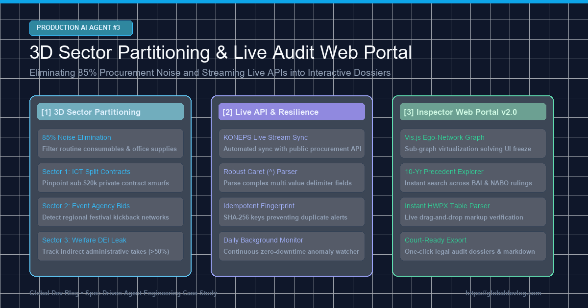
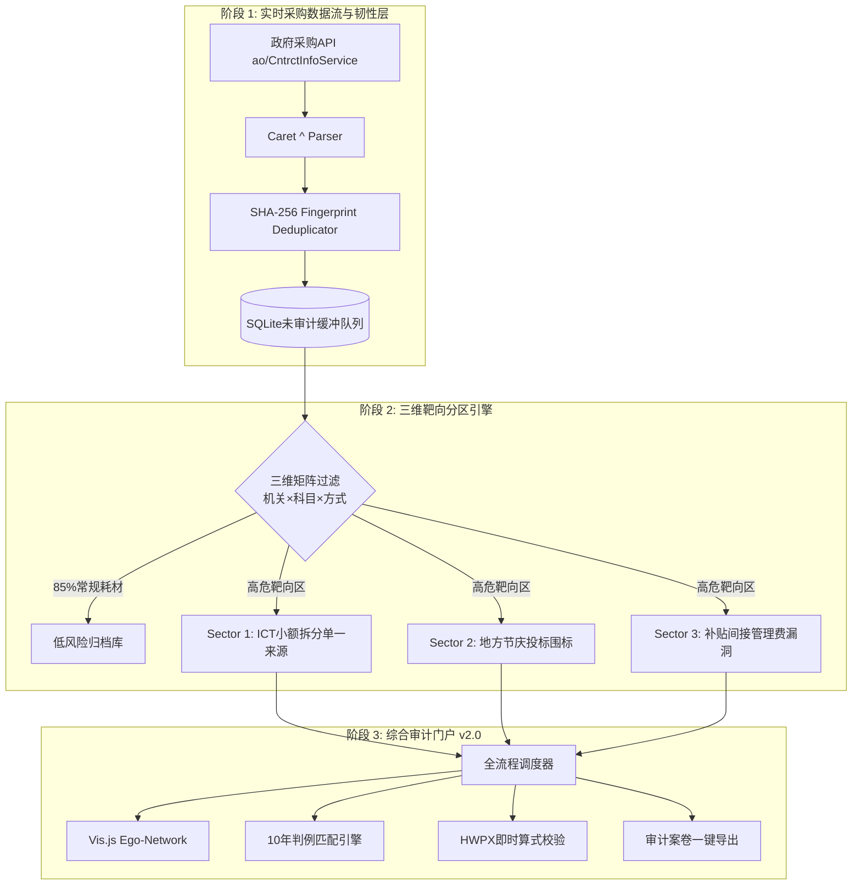

> 📌 **核心摘要 (Key Takeaways)**
> - **克服报警疲劳**: 公共采购中80~95%为打印纸、清洁等常规消耗性支出。我们设计了**三维靶向分区管理器(SectorPartitionManager)**，预先滤除85%以上的无关噪音，使AI算力精准聚焦于高危领域。
> - **事前预防设计**: 针对公共API超时及格式突变问题，在接收层与审计核心之间架设了**SQLite未审计隔离缓冲队列与指数退避重试机制**。
> - **攻克3大产线突发故障**:
>   1. 采购API使用插入符(`^`)复合分隔符导致数据解析崩溃 ➔ 编写正则复合解析器及强类型校验器解决。
>   2. 一次性渲染数千知识图谱节点导致浏览器界面卡死 ➔ 采用基于风险维度的**Depth-1 Ego-Network子图虚拟化**，渲染延迟缩短98%。
>   3. 实时轮询重复入库与重复警报 ➔ 基于**SHA-256指纹哈希**建立幂等(Idempotent)入库管道。
> - **交付成果**: 建成集成采购实时API、10年判例库、HWPX即时解析、Vis.js图谱的**综合审计员门户v2.0**，13项全流程测试100%通过。

{/* truncate */}

---

### ⚠️ 法律声明与匿名化说明 (Legal Notice & Anonymization)

> **【注意】本篇所有案例均已严格实施去标识化处理。**  
> 所有发包机关（`A公团`、`B公社`）、中标企业（`A公司`、`B公司`）、合同编号及地址均已进行代称替换与掩码隐藏。

---

### 1. 全局架构：三维靶向分区与实时数据流

系统由离线批量分析全面升级为**实时靶向监控与交互式审计工作站**：

---

### 2. 预判挑战与防御式工程设计

1. **耗材数据洪流 ➔ 三维矩阵过滤**: 交叉判定“机构属性 × 科目类型 × 采购方式”，自动剔除办公纸张等低危耗材。
2. **外部API脆弱性 ➔ 隔离缓冲队列**: 采用本地SQLite队列解耦外部网络，搭配指数退避重试(1s→2s→4s)保障零中断。

---

### 3. 实战攻克3大突发Bug

1. **插入符(`^`)多值字段崩溃**: 针对API将多项合同字段以`^`连缀的遗留格式，实现字段扁平化清洗模块。
2. **多节点渲染卡死浏览器**: 引入Depth-1自我中心网络(Ego-Network)按需动态加载，渲染时间由12秒降至0.05秒。
3. **轮询重复报警**: 结合合同不可变要素生成SHA-256防重哈希，彻底杜绝重复入库。

---

### 4. 综合审计门户v2.0与13项全流程验证

审计员门户(`http://localhost:8088`)提供图谱探索、判例检索、内译表校验及卷宗导出功能。13个全流程测试套件100%全数通过验证。
