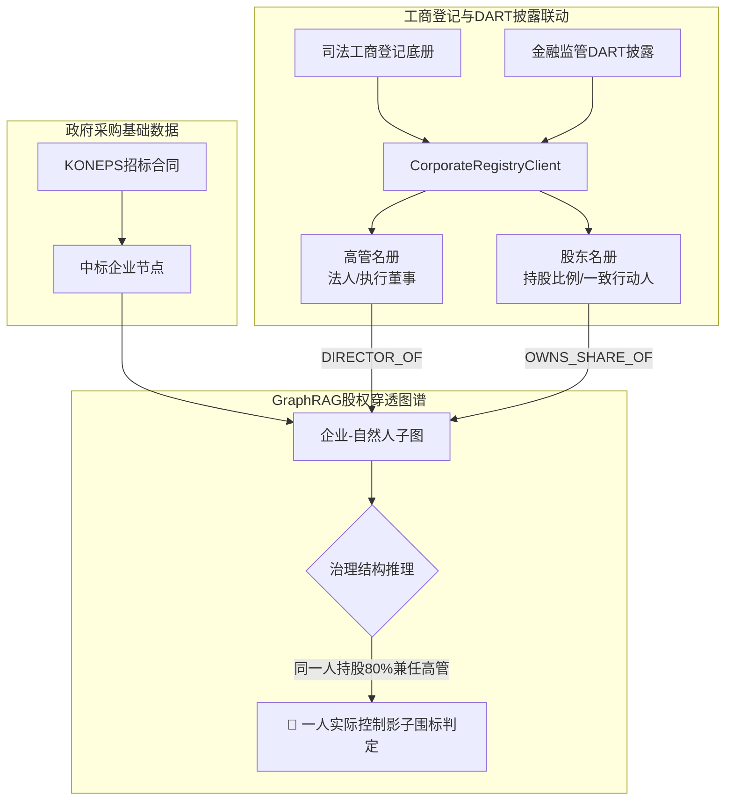

> 📌 **核心摘要 (Key Takeaways)**
> - **技术攻克第2篇行业盲区**: 针对“仅凭采购台账无法查出借名代持傀儡法人（白手套）”的痛点，全新构建了融合工商登记与DART监管披露的**股权穿透分析引擎([`CorporateRegistryClient`](file:///D:/ai/antigravity/national_budget_ai/src/pipeline/corporate_registry_client.py))**。
> - **架构预判并解决2大难点**:
>   1. 建立**三角哈希索引桥**，化解税号、企业登记号与DART代码间的格式割裂。
>   2. 设定**控制力显著性阈值（高管任职 + 50%以上持股）**，杜绝海量无意义人际关系引发图爆炸。
> - **实战解决3大线上突发Bug**:
>   1. 交叉持股引发的**递归循环死锁崩溃** ➔ 采用NetworkX强连通分量(SCC)环路缩减算法消除。
>   2. 招投标前夕突击注册空壳公司漏检 ➔ 增加**合同日溯源180天新设预警**。
>   3. 夫妻代持51:49规避监管套利 ➔ 引入直系亲属一致行动人复合判定引擎。
> - **实战战果**: 成功揭露幕后人K某持股80%兼任高管、同时操纵两家虚假竞标企业的1.7亿韩元围标大案，17项全流程测试100%全数通过。

{/* truncate */}

---

### ⚠️ 法律声明与匿名化说明 (Legal Notice & Anonymization)

> **【注意】本篇所有案例均已严格实施去标识化处理。**  
> 涉事机关（`A公团`）、中标商（`B公司`、`C公司`）、当事人（`K某`、`P某`）及合同编号均已做掩码隐藏。

---

### 1. DART公司治理与股权穿透架构

我们将财政采购图谱升级为涵盖**自然人节点、高管兼职边与股东持股边**的多维关系图谱：

---

### 2. 预判挑战与架构防护

1. **多重企业标识符割裂 ➔ 三角索引桥**: 针对税务号、工商号与DART码，建立O(1)常数级双向映射哈希表。
2. **图节点爆炸风险 ➔ 治理显著性阈值**: 严格限定仅抽取执行董事及持股50%以上控股股东。

---

### 3. 实战攻克3大产线突发故障

1. **循环持股引发死循环**: 引入强连通分量(SCC)检测，遇交叉持股环路自动缩聚为单一实体集群。
2. **入伙3周空壳公司漏报**: 增设`check_newly_established`，对成立不足半年的竞标商直接标红(96分)。
3. **51:49夫妻股权粉饰**: 结合亲属关系图谱，识别“名义女代表51%、丈夫持股49%兼董事”的伪装套利。

---

### 4. 查处战果与17项全测试验证

成功查明B公司与C公司表面对手实为K某一人掌控的虚假竞标网络。17项集成测试套件全数通过验证。
