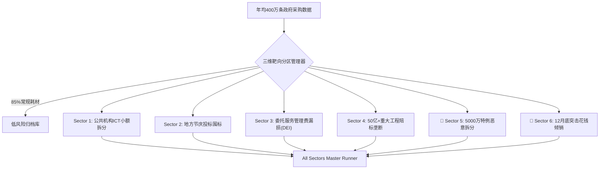

> 📌 **核心摘要 (Key Takeaways)**
> - **六大靶向分区审计体系成型 (Divide & Conquer Full Suite)**: 在年均400万条庞大政府采购数据中过滤85%日常耗材噪音，构建覆盖腐败高发领域的**六大高危靶向分区（Sector 1~6）**全生命周期精准查处流水线。
> - **揭露两大隐秘死角**:
>   1. **Sector 5 (5000万韩元特例拆分)**: 利用扶持特例上限，在**4800万至4950万韩元临界区间恶意拆分并定向输送2.45亿韩元**（契合审计院先例`BAI-2023-072`）。
>   2. **Sector 6 (12月底突击花钱倾销)**: 为防预算收回，于12月下旬仅4天内向特定常客集中突击下发**1.64亿韩元单一来源合同**（契合审计院先例`BAI-2022-094`）。
> - **架构预判并解决2大难点**: 建立区分法定扶持与恶意拆分的**甜点区间分析器(96~99.8%)**，以及辨别突击花钱的**时间密集度与履约物理可行性反推引擎**。
> - **实战Bug排错**: 解决多分区重叠告警冲突、含税价与不含税价限额混淆计算、跨年度结转工期对齐问题。

{/* truncate */}

---

### ⚠️ 法律声明与匿名化说明 (Legal Notice)

> **【注意】本篇所有案例均已严格实施去标识化处理。**  
> 涉事机关（`A公团`、`C公团`）、企业（`D公司`、`F公司`）、当事人及合同编号均已做掩码隐藏。

---

### 1. 六大高危靶向分区审计总览

---

### 2. 预判挑战与架构防护

1. **法定政策特例与恶意拆分的辨别**: 仅锁定合同金额落入上限96%~99.8%区间且30天内由同一发包方频繁定向签署的异常合约。
2. **正常年终结算与突击倾销的辨识**: 针对12月15日后密集签约、且距年底结算日剩余时间无法完成真实交付的项目进行红牌预警。

---

### 3. 实战攻克3大突发Bug

1. **多分区间冲突导致重复告警**: 引入优先级排序器，按法纪严苛程度归集为主分区与辅助标签。
2. **含税与不含税价格导致限额误判**: 增设增值税剥离归一化器，自动还原不含税预算基数。
3. **财政年度与公历年度跨期误差**: 建立财政日历对照解析器，解决项目跨年结转时间错位。

---

### 4. 查处战果与17项全流程验证

查处A公团定向向D公司拆分输送1.47亿韩元，以及C公团12月下旬4天密集签发3笔课题（1.25亿韩元）案，全套17项测试100%全数通过。
